<p align="center">
  
</p>

<p align="center">
  <strong>The open-source platform for planning and running events.</strong><br>
  One directory of event specialists, wired into the tools that take a show from first idea to final encore.
</p>

<p align="center">
  <a href="#what-eventiva-is">Vision</a> &nbsp;&middot;&nbsp;
  <a href="#what-were-building">Features</a> &nbsp;&middot;&nbsp;
  <a href="#why-eventiva-exists">Why</a> &nbsp;&middot;&nbsp;
  <a href="#why-open-source">Open source</a> &nbsp;&middot;&nbsp;
  <a href="#rebuild-order">Roadmap</a> &nbsp;&middot;&nbsp;
  <a href="#set-up-the-repository">Get started</a> &nbsp;&middot;&nbsp;
  <a href="#get-involved">Get involved</a>
</p>

<p align="center">
  
  
  
  
  
</p>

> [!IMPORTANT]
> **Eventiva is being rebuilt from the ground up and has no product features yet.** Today the repository holds the technical foundation the product will be built on. Everything described under [What we're building](#what-were-building) is planned, not shipped. See [Rebuild order](#rebuild-order) for where things stand and [What's in the box today](#whats-in-the-box-today) for what exists.


## What Eventiva is

Behind every festival, conference and touring show sits a small army of vendors, venues and crew, and a mountain of spreadsheets holding it all together. Eventiva aims to replace that mountain with one connected platform that brings two things together:

- **A directory** that indexes, markets and connects event specialists: vendors, venues and professionals.
- **Event production planning tools** connected to that directory, covering scheduling, itineraries, task management, contact management, warehousing, ticket sales, interactive site maps, online and in-person sales, accounting, payroll and human resources.

<p align="center">
  
</p>

## What we're building

Every feature below has a written specification, and none of them is built yet. They all hang off one shared event record, so a change in one place, such as a show date, a crew call or a piece of kit, shows up everywhere it matters. Three ideas run through all of them:

- **It works offline.** Crews at a venue with no signal keep scanning kit, ticking off checklists and updating their status. Everything syncs when the connection returns.
- **The assistant can do what you can.** Every button maps to an action that Eventiva's built-in AI assistant can also run, within your permissions. Anything that contacts someone outside your team, spends money or affects safety waits for a person to approve it.
- **Everything exists once.** A person, a piece of equipment or an event is stored once, and every feature links to it instead of keeping its own copy.

### Plan the show

- **Events and production planning.** The event record everything else hangs off: dates, phases from build to load-out, spaces, the team and its departments. Build the run of show, give everyone a personal itinerary, and let each department (lighting, rigging, sound, staging, video) draw its plan, patch fixtures and write cue lists. On the day, call the show live and fire cues to lighting, sound and media systems.
- **Tasks and checklists.** Task lists per event with owners, due dates and "this before that" dependencies. Templates set due dates relative to the event, so moving the show moves the tasks. On-site checklists take photo evidence and a named sign-off.
- **Interactive site maps.** Draw a to-scale map of any site, from a greenfield festival to an arena or a blank plan, and plan every phase on it with the real equipment, vehicles, gates and people. Share it with crew, authorities and attendees, and follow it live on the day.

### People

- **Scheduling and rosters.** Turn each phase into crew requirements, see who is free and qualified, send offers that freelancers can accept from a link, and publish call sheets. Working-time rules, starting with UK law, warn before someone is booked without enough rest. Crew clock in on their phone and their hours become timesheets.
- **Contacts and CRM.** Every client, vendor, venue, artist and crew member exists once, with their organisation, their role on each event and a timeline of calls, emails and bookings. Track enquiries through a sales pipeline and turn a won one into an event. Consent and privacy requests are built in.
- **Human resources.** One record for every employee, freelancer, volunteer and agency crew member, covering onboarding paperwork, right to work, qualifications such as rigging or first aid, and leave. Nobody can be rostered for a job they are not qualified or available for.
- **Payroll.** Pay everyone from the shifts they were rostered for and the hours they actually worked, with each cost landing on the right event.

### Kit and logistics

- **Warehousing and inventory.** Know what equipment and stock you own, where every item is and whether it is free on a given date. A department's plan becomes the pick list, and crews scan kit out and back in, even offline. Track damage, safety inspections for lifting and electrical gear, purchasing, and hiring in from other suppliers.
- **Fleet and live operations.** Keep every owned or hired vehicle legal and serviced, book it onto events without clashes, and record daily walkaround checks. On show day, a control screen logs incidents and dispatches crews and vehicles, who update their status from a phone. It coordinates event staff and never replaces the emergency services.

### Sell and get paid

- **Ticketing.** Ticket types and capacity for any event, day or area, sold online or at the box office. Gate scanning keeps working when the network drops, with no oversell and no double entry.
- **Online and in-person sales.** One catalogue and one order list for merchandise, services, equipment hire and tickets, sold online and at a till. Card payments keep working offline, and refunds and reconciliation happen in the same place.
- **Accounting.** Every sale, purchase, wage and stock movement lands in one double-entry ledger tagged to its event, so you can see the real profit of each show. Invoices, bills, budgets, bank matching and VAT returns are included.

### Marketplace and web

- **The directory.** Find, compare and engage vendors, venues and freelance professionals inside the app you plan in. Search by category, location, date and budget, send one enquiry to several suppliers, compare their quotes and leave verified reviews. Suppliers run their listing from the same app they run their business in.
- **Website builder and customisation.** Publish branded event, venue and vendor websites from your own live data, and reshape Eventiva with custom fields, record types, views and automations, by hand or by asking the assistant.

## Why Eventiva exists

Event teams plan and run productions with tools built for something else. Eventiva's own industry survey, reported in the historical README, found:

| Claim    | What the survey reported                                                                                                   |
| -------- | -------------------------------------------------------------------------------------------------------------------------- |
| **55%+** | of events had no management tool of any kind.                                                                              |
| **~40%** | used tools designed for office work, such as Flock and Excel, which barely cover what managers need during pre-production. |
| **80%**  | of the people surveyed believed schedulers, task lists and other management tools would help their ongoing operations.     |

> [!NOTE]
> **Source:** _Study of management solutions within events_, primary research carried out by Eventiva's founder for a university work-related project in the 2020-21 academic year. It surveyed 50 individuals, covering 48 job titles and 2 to 40 years of experience, and 20 events companies picked from listings with recent or upcoming events. As the study itself notes, a sample this small may not represent every view in the industry, so treat these as historical findings rather than current industry-wide data.

## Why open source

Eventiva's tools are designed and marketed for event planning, but organisations planning any kind of project can use them. Keeping the tools open source lets the project work with a community of developers who contribute in ways a single team cannot foresee.

The code is published under the [Fair Core License, Version 1.0, MIT Future License](LICENSE) (FCL-1.0-MIT). Read the licence for exactly what it permits.

## Eventiva Gaming origins

Eventiva Gaming grew out of the same aim: to build the best tools for the events industry. Gaming is an unusual route, but role-play communities suit it well. Their teams coordinate, manage and plan digital events with the same requirements as physical events, so working with them is a way to test, develop and improve the tools for everyone.

According to the historical README, the Eventiva Gaming team built the first version of a Fleet Management module to manage the distribution, maintenance and deployment of vehicles in emergency-service role play. The same features were then said to be used for vehicles in the events industry. **That module is not in this repository or its archives**, and its current state is not recorded here.


## Rebuild order

<p align="center">
  
</p>

1. **Archive the past** ([#1011](https://github.com/Resnovas/Eventiva/issues/1011), done): the earlier prototypes moved into [`examples`](#historical-reference) and the package tree was cleaned.
2. **House enrolment** ([#1012](https://github.com/Resnovas/Eventiva/issues/1012), done): shared governance, guidance, workflows and repository configuration from the Resnovas house.
3. **Fresh foundation** ([#1013](https://github.com/Resnovas/Eventiva/issues/1013), done): a new Nx, pnpm, Expo, React Native and Effect workspace with its testing setup.
4. **Build the product** (up next): the modular core ([#779](https://github.com/Resnovas/Eventiva/issues/779)) and the split into contracts and runtime ([#790](https://github.com/Resnovas/Eventiva/issues/790)), then the features above.

Read the [planning record](docs/planning/README.md) for the full [timeline and dependency roadmap](docs/planning/timeline.md), decision evidence and outstanding acceptance gates.

<details>
<summary><strong>Documentation checks and the debt ratchet</strong></summary>

<br>

The [source documentation standard](docs/documentation-standard.md) and [exact remediation backlog](docs/planning/documentation-backlog.md) explain the prune-only debt ratchet. `node --run documentation` runs offline mirror, planning and documentation checks; `pnpm nx run @eventiva/eventiva:documentation` runs the same uncached target. Root `check` includes this gate; CI supplies trusted earlier history rather than letting a candidate certify its own changes. Live API freshness is a separate read-only check and requires a securely injected credential.

</details>

## What's in the box today

| Path                                                                                                                     | What it is                                                                                     |
| ------------------------------------------------------------------------------------------------------------------------ | ---------------------------------------------------------------------------------------------- |
| [`apps/server`](apps/server)                                                                                             | Effect backend shell                                                                           |
| [`apps/client`](apps/client)                                                                                             | Expo and React Native client shell, with [`apps/client-e2e`](apps/client-e2e) end-to-end tests |
| [`packages/contracts`](packages/contracts), [`packages/schema`](packages/schema), [`packages/runtime`](packages/runtime) | The `@eventiva/contracts`, `@eventiva/schema` and `@eventiva/runtime` packages                 |
| [`docs`](docs)                                                                                                           | Foundation guide, planning record, architecture notes and ADRs                                 |
| [`externals`](externals/README.md)                                                                                       | Version-pinned upstream source references for coding agents, not installed packages            |
| [`examples`](#historical-reference)                                                                                      | Historical snapshots, kept for reference only                                                  |

The workspace has tests and smoke runs but no product features. Read [the foundation guide](docs/foundation.md) for how it fits together. Release workflows stay inactive until a release configuration exists.

## Set up the repository

Use Node at the version in [`.node-version`](.node-version) and pnpm at the `packageManager` version in [`package.json`](package.json); `corepack enable pnpm` selects it.

```sh
pnpm install --frozen-lockfile
node --run setup
node --run check
pnpm exec playwright install --with-deps chromium
node --run verify
```

| Command  | What it does                                                                                                                                                                                                                |
| -------- | --------------------------------------------------------------------------------------------------------------------------------------------------------------------------------------------------------------------------- |
| `setup`  | Installs the house commit hook and registers available editor actions.                                                                                                                                                      |
| `check`  | The house gate: the toolchain pins agree, generated agent files are current, licence headers are present outside the historical archive and `LLMS.md` is current. Locally it also checks that the commit hook is installed. |
| `verify` | Runs `check`, then the Nx `lint`, `typecheck`, `test`, `build` and `parity` targets, then the `smoke` targets.                                                                                                              |
| `parity` | Runs the action inventory gate alone. Read [the action host guide](docs/actions.md) for invocation services, approval and receipt guarantees.                                                                               |

The `house check` and `application check` CI jobs run the same gates. `scripts/agent-setup` runs the install, setup and check on a machine with the pinned toolchain. No secrets, services or private repository access are required. There is no development server to start.

<details>
<summary><strong>Workspace layout, Amp orbs and troubleshooting</strong></summary>

<br>

`pnpm-workspace.yaml` selects `apps/*`, `packages/*`, `packages/integrations/*`, `tests/*` and `tests/integrations/*`, and explicitly excludes `examples/**` and `externals/**` so recursive commands never discover archived or upstream reference manifests.

Amp orbs use [`.agents/setup`](.agents/setup) to provision the pinned toolchain, dependencies and Chromium, and [`.agents/resume`](.agents/resume) for a fast readiness check. Old `pnpm dev`, `platform:*`, cluster and declaration-doc commands from the archive do not exist here.

If `check` reports stale generated files, run `node tools/dev/surfaces.mjs sync` and `node tools/ai-docs/docgen.mjs`, then repeat the check. To open the graph viewer, first generate it with `sh tools/graphify/graphify update`.

</details>

<details>
<summary><strong>Upstream source references</strong></summary>

<br>

Browse [`externals/README.md`](externals/README.md) for version-pinned dependency implementations, licenses, provenance and the update procedure. These are actual upstream source trees for coding-agent inspection, not installed packages or another application implementation. Effect stable and main are separate; only the stable dependencies in the workspace lockfile execute. `check` verifies source identities and workspace exclusions; `verify` also rejects application and test imports into the references.

</details>

<details>
<summary><strong>House synchronization and delivery</strong></summary>

<br>

The canonical configuration is [`.github/smartcloud.yml`](.github/smartcloud.yml), extending the current Resnovas house preset. House automation checks policies, synchronizes templates and repository settings, and runs security and workflow checks. Read [the enrollment record](docs/smartcloud-enrollment.md) for the dry-run effects, supported CLI commands, credential requirements and outstanding external administration steps. Enrollment is not fully verified until those steps succeed.

The Markdown governance files and `LICENSE` are canonical. Obsolete root AsciiDoc compatibility links have been removed; historical originals remain in the archive. Ownership and funding configuration now live only in `.github/CODEOWNERS` and `.github/FUNDING.yml`.

**Coding agents still commit and push directly to `main` under [the owner's documented exception](AGENTS.md#delivery-exception-ship-straight-to-main).** It takes precedence over the generic house PR delivery path. The preset retains an always-bypass for repository administrators. Standard house sync and Graphify bot PRs do not change that exception.

</details>

## Historical reference

- [`examples/eventiva-before-amp`](examples/eventiva-before-amp/README.md) preserves the manual workspace, packages, tests reference, tooling, documentation and CI configuration from main at `ae54174aa209be4c21f00226eebae8a01ed04df6`.
- [`examples/packages-old`](examples/packages-old) is a separate, older snapshot. It has not been merged with or overwritten by the new archive.

Inspect both for behaviour and lessons, not as code to copy into the new implementation. Neither is an active workspace or production dependency. They hold earlier platform experiments: a core library, database backends, cluster and messaging demos, and a contact extension. They do not implement the directory or the event-planning features described above, and they are not the baseline for the rebuild.

<details>
<summary><strong>Archive details</strong></summary>

<br>

The archived private tests gitlink is preserved at its original revision and disabled for automatic submodule updates; no private test source was fetched or deleted.

[#1038](https://github.com/Resnovas/Eventiva/issues/1038) lowercases the archive parent path only; historical file bytes, AsciiDoc and the private-tests revision stay unchanged. The package-hygiene tests require exactly the lowercase top-level spelling and reject archive imports regardless of case. Quoted old checkout errors retain their original spelling; use lowercase paths for current commands and links.

</details>

## Get involved

Read current [AGENTS.md](AGENTS.md) before working. Historical instructions, commands and configuration inside the archives do not govern the rebuild. The application workspace is the fresh foundation described in [docs/foundation.md](docs/foundation.md).

| Read                                                                                                | For                                      |
| --------------------------------------------------------------------------------------------------- | ---------------------------------------- |
| [CONTRIBUTING.md](CONTRIBUTING.md)                                                                  | How to contribute                        |
| [SUPPORT.md](SUPPORT.md)                                                                            | Where to get help                        |
| [SECURITY.md](SECURITY.md)                                                                          | How to report a vulnerability            |
| [CODE_OF_CONDUCT.md](CODE_OF_CONDUCT.md) and [COOPERATION_COMMITMENT.md](COOPERATION_COMMITMENT.md) | How we work together                     |
| [GOVERNANCE.md](GOVERNANCE.md), [AI_POLICY.md](AI_POLICY.md) and [DCO.md](DCO.md)                   | Decisions, AI-assisted work and sign-off |

<p align="center">
  
</p>
