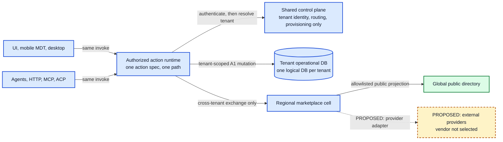
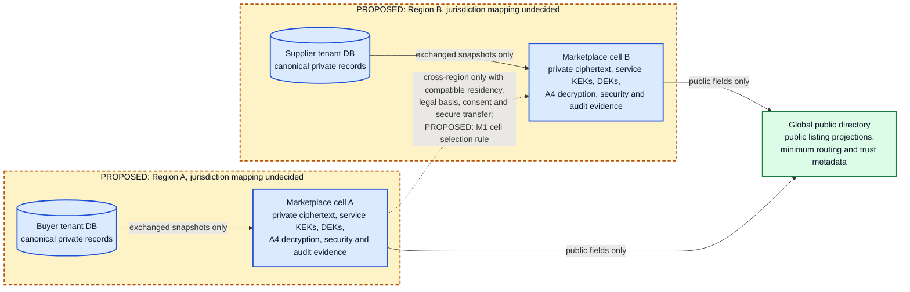
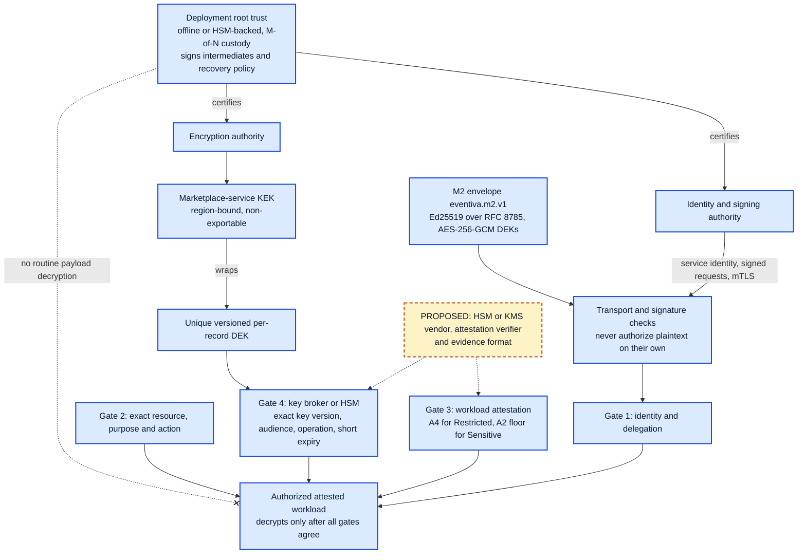
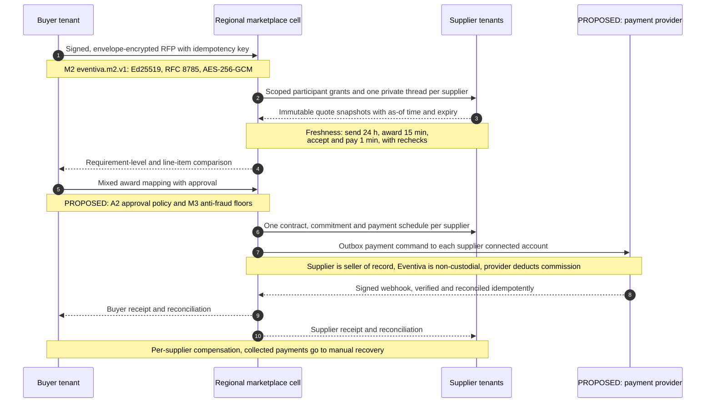

# Eventiva platform and marketplace architecture

This file indexes the Eventiva platform and marketplace architecture decisions and holds the source of four diagrams you can edit. It does not decide anything new and does not specify an implementation. Owner decisions are made on Linear. This file records them, links them, and draws them.

This document authorizes no implementation, dependency, vendor, infrastructure, provisioning, key ceremony or spending. The concrete algorithms and parameters Jonathan approved on 2026-11-18 are listed in the decision register and the [trust profile](../trust-profile.md).

[Back to the README](../../README.md)

## Which source wins

When two sources disagree, use the first source in this list that covers the point:

1. **Owner approvals recorded on Linear.** These are the comments headed `APPROVED` on [EVE-13](https://linear.app/resnovas/issue/EVE-13), [EVE-40](https://linear.app/resnovas/issue/EVE-40), [EVE-42](https://linear.app/resnovas/issue/EVE-42), [EVE-250](https://linear.app/resnovas/issue/EVE-250) and [EVE-251](https://linear.app/resnovas/issue/EVE-251), plus the settled product requirements in the F5 and payment issues listed under [Sources](#sources).
2. **This file: the current repository replacement/index.** Jonathan directed this bounded source reconciliation on 2026-11-17 through the [Puck coordination thread](https://ampcode.com/threads/T-01a1e940-37a3-7691-a5c0-e935b711c99a); the exact owner-instruction time is unavailable. Use this index instead of waiting for the unavailable historical `Eventiva-marketplace-infrastructure-v1.md`. This designates a replacement, not recovery or reconstruction of the original or a new architecture approval. The missing-file source blocker is resolved; implementation acceptance and the concrete composition/policy gates below are not.
3. **Derivative decision sheets and diagrams.** The [Eventiva architecture decisions](https://ampcode.com/artifacts/eventiva-architecture-decisions-3169b540-652d-4795-ae9c-7ad78a534f17) sheet and rendered diagrams are secondary to current Linear decisions and this repository index. Existing Mermaid blocks retain their dated scope; do not infer that every historical proposal label is a current unresolved architecture choice.

### Current source status and preserved history - 2026-11-17

Historical architecture-index/missing-source and archive comments remain unchanged. Their missing-source statements and instructions to await the original are explicitly superseded for current source status by this replacement designation. The original remains unavailable and unread; no original bytes, diagrams or decisions are claimed recovered. If it becomes available, compare it as historical evidence, not as an automatic override of newer Linear decisions.

The 2026-11-15 source reports are [EVE-250 `a58060eb`](https://linear.app/resnovas/issue/EVE-250#comment-a58060eb-3896-456e-b3ac-79eef83c4a75) and [EVE-251 `a62ccfbf`](https://linear.app/resnovas/issue/EVE-251#comment-a62ccfbf-0c3f-4a81-b0ea-5f2414298a13). Their historical check results remain evidence, not current approval. The archive-key-design gap in [EVE-250 `804a4ef1`](https://linear.app/resnovas/issue/EVE-250#comment-804a4ef1-945e-41b6-9343-d4ef9cb58fe1) is likewise superseded by the EVE-13 security decisions and later EVE-251 reconciliation, not by archived implementation notes.

[EVE-250 `91db949b`](https://linear.app/resnovas/issue/EVE-250#comment-91db949b-6e9c-4cc8-8a80-879f2d815be3), created 2026-11-16T18:51:51.499Z, confirms the bounded controlled marketplace architecture. [EVE-251 `15483735`](https://linear.app/resnovas/issue/EVE-251#comment-15483735-fbab-487d-a03e-3c15f27e2682), created 2026-11-16T19:03:34.533Z, permits provider-neutral implementation under the binding EVE-13 security architecture. These owner decisions supersede blanket proposal-only implementation wording, not concrete crypto/provider/verifier/custody/canonicalization/timing review, legal/residency/retention policies, freshness/recovery/reconciliation/moderation parameters or existing dependency/security gates. Both issues remain In Progress / implementation pending. This reconciliation is not completed implementation or production authorization.

### Concrete parameters - 2026-11-18

Jonathan approved choosing well-established standard options for the concrete cryptography, custody, retention, freshness, recovery and compensation parameters on 2026-11-18, relayed through the [Puck coordination thread](https://ampcode.com/threads/T-01a1e940-37a3-7691-a5c0-e935b711c99a). The selected values and their reasons are in the [trust profile](../trust-profile.md) and the [decision index](../planning/decisions.md#concrete-trust-and-marketplace-parameters---2026-11-18). This supersedes the statements above that concrete crypto/custody/canonicalization/timing choices and freshness/recovery/reconciliation/retention parameters remain open. Region placement, lawful bases, staff access, anti-fraud thresholds, vendor selection, provisioning and production activation remain open.

## Legend

Every diagram uses the same Mermaid classes, so the status survives edits:

| Mark                                           | Meaning                                                                                                                                            |
| ---------------------------------------------- | -------------------------------------------------------------------------------------------------------------------------------------------------- |
| Solid blue node (`approved`), solid arrow      | Approved by the owner on Linear. The approval is linked in the decision register.                                                                  |
| Solid green node (`public`)                    | An approved public or verified path, such as an allowlisted listing projection or a signed provider return path.                                   |
| Dashed amber node (`proposed`), dotted arrow   | Proposed or unresolved: exact vendors, regional placement and jurisdiction mapping, anti-fraud thresholds, and every card still marked `Proposed`. |
| `PROPOSED:` prefix on a label or sequence note | The same as a dashed amber node, used in the sequence diagram, which has no node classes.                                                          |

Region names such as `Region A` are placeholders. Which jurisdiction maps to which region has not been decided.

## 1. Platform context

Every surface reaches one authorized action path. Tenant data stays in that tenant's own database. Data crosses tenants only through a regional marketplace cell.

## 2. Regional marketplace cells and tenant databases

Private data stays in its region. Only public projections and the minimum non-sensitive routing and trust metadata are replicated globally.

The requirement on the cross-region arrow is approved: compatible residency, legal basis, recipient consent and permissions, and a secure-transfer policy. The arrow is dotted because the rule that picks a cell (M1) and the region placement are still proposals. Private payloads are never replicated silently.

## 3. Root trust, keys, attestation and decryption

A workload decrypts a private marketplace record only after four independent gates agree. The root trust never decrypts payloads.

No key decrypts everything in the marketplace. If A4 assurance is unavailable for Restricted records, processing fails closed, or falls back only to the degraded behaviour that the sealed core profile explicitly permits. Vault and zero-knowledge records follow a separate client-side workflow and must never silently become decryptable on the server.

## 4. Buyer, marketplace and supplier: RFP, quote, mixed award and payment saga

A mixed award stays as separate supplier contracts. A saga that can recover coordinates them; Eventiva does not claim one global ACID transaction.

The marketplace cell owns the participant grants, the private two-party threads, the immutable quote and contract snapshots, the comparison and mixed-award mappings, and the saga state. Each tenant database stays canonical for its own inventory, purchasing, sales, staff, finance and PII. No payment runs offline. Choosing only part of an indivisible package requires a re-quote that the supplier confirms.

## Decision register

| Decision                                                                                                                             | Status   | Record                                                                                                                                                                                                                 |
| ------------------------------------------------------------------------------------------------------------------------------------ | -------- | ---------------------------------------------------------------------------------------------------------------------------------------------------------------------------------------------------------------------- |
| One action specification and one authorized runtime path for every surface                                                           | Settled  | EVE-13, settled requirements in [EVE-40 `fa3a5b15`](https://linear.app/resnovas/issue/EVE-40#comment-fa3a5b15-87a8-4b1d-a41b-ea89e9beb12a)                                                                             |
| A1: one atomic write of domain state, idempotency evidence, history, outbox and receipt                                              | Approved | [EVE-40 `a412365e`](https://linear.app/resnovas/issue/EVE-40#comment-a412365e-b4df-4172-a316-606b06a7e763)                                                                                                             |
| Three offline execution categories                                                                                                   | Approved | [EVE-40 `aba96798`](https://linear.app/resnovas/issue/EVE-40#comment-aba96798-42e6-4502-b8c0-7f18b6ca6b35), [EVE-42 `1807bbaf`](https://linear.app/resnovas/issue/EVE-42#comment-1807bbaf-0431-4f46-8282-535bfa78aa7b) |
| S1: one logical database per tenant plus a narrow shared control plane                                                               | Approved | [EVE-42 `e7459930`](https://linear.app/resnovas/issue/EVE-42#comment-e7459930-9d89-4f53-b7cb-d6b76d4c8cfc)                                                                                                             |
| Key hierarchy, root trust, M-of-N custody, envelope encryption                                                                       | Approved | [EVE-13 `9e6e287a`](https://linear.app/resnovas/issue/EVE-13#comment-9e6e287a-4a28-4695-801a-23a0889f6a56)                                                                                                             |
| Four independent decryption gates, non-exportable keys                                                                               | Approved | [EVE-13 `ebbcbe62`](https://linear.app/resnovas/issue/EVE-13#comment-ebbcbe62-4eab-4919-9b33-03288c232e73)                                                                                                             |
| Sealed core security profiles (Baseline, Sensitive, Restricted, Vault)                                                               | Approved | [EVE-13 `08f09405`](https://linear.app/resnovas/issue/EVE-13#comment-08f09405-dbfb-4d5f-ac19-920cf95a98df), [`c3a06adc`](https://linear.app/resnovas/issue/EVE-13#comment-c3a06adc-8c33-4a6c-b43c-815bb8479410)        |
| Zero trust on every route and surface                                                                                                | Approved | [EVE-13 `1da54684`](https://linear.app/resnovas/issue/EVE-13#comment-1da54684-89c0-4ce7-895c-aeec61af9c8a)                                                                                                             |
| Assurance levels A1 to A5, A4 for Restricted server-side decryption                                                                  | Approved | [EVE-13 `6770565a`](https://linear.app/resnovas/issue/EVE-13#comment-6770565a-053c-47e6-8980-adab5ed9a109)                                                                                                             |
| Canonical record ownership between the marketplace and tenant databases                                                              | Approved | [EVE-250 `804a4ef1`](https://linear.app/resnovas/issue/EVE-250#comment-804a4ef1-945e-41b6-9343-d4ef9cb58fe1)                                                                                                           |
| Standard marketplace decryption profile                                                                                              | Approved | [EVE-251 `a81300d7`](https://linear.app/resnovas/issue/EVE-251#comment-a81300d7-254f-4ae7-b2f7-2f8f1204ea27)                                                                                                           |
| Application-layer envelope encryption for every private exchange                                                                     | Approved | [EVE-251 `86d01307`](https://linear.app/resnovas/issue/EVE-251#comment-86d01307-78cd-4ec6-9b91-ba2414789321)                                                                                                           |
| Classification defaults: messages Sensitive; quotes, contracts, awards, invoices, payment evidence Restricted                        | Approved | [EVE-251 `a2a18d4b`](https://linear.app/resnovas/issue/EVE-251#comment-a2a18d4b-4965-4ab1-9da6-eab36244b322)                                                                                                           |
| Marketplace KEKs under M-of-N, per-record DEKs, no universal decrypt key                                                             | Approved | [EVE-251 `d42e2263`](https://linear.app/resnovas/issue/EVE-251#comment-d42e2263-a1a3-4db9-bbce-2c69d215ebad)                                                                                                           |
| Revocation, retention and lawful erasure                                                                                             | Approved | [EVE-251 `304faca9`](https://linear.app/resnovas/issue/EVE-251#comment-304faca9-ecbb-4ce6-8255-20c771e2e1b9)                                                                                                           |
| Region-scoped marketplace cells, global replication limited to public projections                                                    | Approved | [EVE-251 `2377819a`](https://linear.app/resnovas/issue/EVE-251#comment-2377819a-8c8c-4ba4-8c78-408ece1e0ca8)                                                                                                           |
| Allowlisted public listing projections                                                                                               | Settled  | [EVE-66](https://linear.app/resnovas/issue/EVE-66), [EVE-75](https://linear.app/resnovas/issue/EVE-75)                                                                                                                 |
| Private two-party enquiry threads                                                                                                    | Settled  | [EVE-119](https://linear.app/resnovas/issue/EVE-119)                                                                                                                                                                   |
| Mixed-supplier awards with a separate contract, commitment and payment schedule per supplier                                         | Settled  | [EVE-124](https://linear.app/resnovas/issue/EVE-124) D5-7                                                                                                                                                              |
| Non-custodial connected-account payments, commission deducted by the provider, provider-neutral records                              | Settled  | [EVE-237](https://linear.app/resnovas/issue/EVE-237), [EVE-246](https://linear.app/resnovas/issue/EVE-246)                                                                                                             |
| A2 approval policy, A3 offline and scheduled execution, A4 audit availability                                                        | Proposed | [EVE-40 `fa3a5b15`](https://linear.app/resnovas/issue/EVE-40#comment-fa3a5b15-87a8-4b1d-a41b-ea89e9beb12a), Amp decision sheet batch 1                                                                                 |
| S2 scarce-resource ledgers, S3 device schema and command envelope, S4 migrations and canonical values                                | Proposed | [EVE-42 `fe5c339d`](https://linear.app/resnovas/issue/EVE-42#comment-fe5c339d-4de7-4a46-a71e-a7ae0967f485)                                                                                                             |
| M1 cell selection for cross-region exchange                                                                                          | Proposed | Amp decision sheet batch 3                                                                                                                                                                                             |
| M3 anti-fraud review floors                                                                                                          | Proposed | Amp decision sheet batch 3                                                                                                                                                                                             |
| M2 canonical signed request envelope `eventiva.m2.v1`: Ed25519, RFC 8785, SHA-256 payload digest, 5 min lifetime, 30 s skew          | Approved | Jonathan, 2026-11-18, relayed through the [Puck thread](https://ampcode.com/threads/T-01a1e940-37a3-7691-a5c0-e935b711c99a); [trust profile](../trust-profile.md)                                                      |
| Algorithms: AES-256-GCM per-record DEKs under KMS-held KEKs, Ed25519 evidence signatures, per-gate evidence ages                     | Approved | Same 2026-11-18 approval; [trust profile](../trust-profile.md)                                                                                                                                                         |
| Custody: 3-of-5 offline root, 90-day signing and KEK rotation, FIPS 140-3 level 3 non-exportable KEKs, two-person KEK administration | Approved | Same 2026-11-18 approval                                                                                                                                                                                               |
| Freshness thresholds, synchronous rechecks, compensation and manual recovery, invoice reconciliation against the contract schedule   | Approved | Same 2026-11-18 approval; [marketplace parameters](../trust-profile.md#marketplace-freshness)                                                                                                                          |
| Default retention schedule by record class (2 or 7 years, legal hold, jurisdictions only lengthen)                                   | Approved | Same 2026-11-18 approval                                                                                                                                                                                               |
| Staff access to private exchange records                                                                                             | Proposed | [EVE-250](https://linear.app/resnovas/issue/EVE-250) open decisions                                                                                                                                                    |
| Exact region placement and jurisdiction mapping, per-jurisdiction lawful bases                                                       | Proposed | EVE-250, EVE-251                                                                                                                                                                                                       |
| Vendors, payment provider, HSM or KMS product, attestation verifier and evidence format, package pins, paid services                 | Proposed | Separate technical and dependency approval when provisioning starts                                                                                                                                                    |

## Discrepancies found while compiling this file

- Historical discrepancy, resolved for current source status on 2026-11-17: the unavailable `Eventiva-marketplace-infrastructure-v1.md` could not be compared. This file is now its explicitly designated repository replacement/index; the historical original is still unavailable, not recovered.
- The Amp decision sheet lists non-custodial connected-account payments and separate supplier contracts as approved in EVE-250 and EVE-251. On Linear they are settled requirements from EVE-237, EVE-246 and EVE-124, which EVE-250 preserves. The register above cites the issues that own them.
- Historical blanket `PROPOSAL` wording is superseded by the 2026-11-16 EVE-250 architecture approval and EVE-251 provider-neutral implementation reconciliation cited above. Current descriptions point directly here and resolve the missing-source blocker. Concrete composition and unresolved policy parameters remain gated; no blanket approval follows.
- The Amp decision sheet cites EVE-40 comment `fa3a5b15` for A1. That comment is the proposal; the approval is EVE-40 comment `a412365e`.
- EVE-251 comment `a81300d7` lists the scope of envelope encryption as still open. Comment `86d01307` resolved it later (every private exchange).

## Revising this document

1. Decide on Linear first. Change a mark from proposed to approved only after the owner's decision is recorded in an `APPROVED` comment on the issue that owns it. Then add that comment link to the decision register.
2. Edit the Mermaid block. Keep the three `classDef` lines identical in every diagram, move a node between the `approved`, `public` and `proposed` class lists, change a dotted arrow (`-.->`) to a solid one (`-->`) when its decision is approved, and remove the `PROPOSED:` prefix from the label.
3. Keep the Amp diagram set in step. Update the matching Mermaid source and rendered visual in the [Amp decision sheet](https://ampcode.com/artifacts/eventiva-architecture-decisions-3169b540-652d-4795-ae9c-7ad78a534f17), or note on the owning Linear issue that this file is now ahead of it.
4. Maintain this file as the current replacement/index without waiting for the historical original. If the original is later supplied, record its provenance/date, compare it with current owner decisions and retain discrepancies for explicit reconciliation. Do not silently restore superseded instructions or present it as newer approval.
5. Name an exact vendor, algorithm, package version or region only after it has its own explicit approval. Until then, label it `PROPOSED:`.
6. Check the change before you commit it:
    - Render every diagram: `pnpm dlx --allow-build puppeteer @mermaid-js/mermaid-cli@11 -i docs/architecture/eventiva-platform-and-marketplace.md -o /tmp/arch/out.md -e png`, then look at each PNG. This runs the Mermaid CLI from pnpm's dlx cache and adds no workspace dependency. Where Chromium is already installed, set `PUPPETEER_SKIP_DOWNLOAD=1` and pass `-p` with a Puppeteer config whose `executablePath` points to that browser.
    - Check formatting: `pnpm exec prettier --check docs/architecture/eventiva-platform-and-marketplace.md`.
    - Run the repository gate: `node --run check`.
    - Use ASCII text only, with no em or en dashes.
7. Record the commit link on EVE-250 and EVE-251.

## Sources

- Linear: [EVE-13](https://linear.app/resnovas/issue/EVE-13), [EVE-40](https://linear.app/resnovas/issue/EVE-40), [EVE-42](https://linear.app/resnovas/issue/EVE-42), [EVE-66](https://linear.app/resnovas/issue/EVE-66), [EVE-75](https://linear.app/resnovas/issue/EVE-75), [EVE-119](https://linear.app/resnovas/issue/EVE-119), [EVE-124](https://linear.app/resnovas/issue/EVE-124), [EVE-237](https://linear.app/resnovas/issue/EVE-237), [EVE-246](https://linear.app/resnovas/issue/EVE-246), [EVE-250](https://linear.app/resnovas/issue/EVE-250), [EVE-251](https://linear.app/resnovas/issue/EVE-251).
- Amp decision sheet: [Eventiva architecture decisions](https://ampcode.com/artifacts/eventiva-architecture-decisions-3169b540-652d-4795-ae9c-7ad78a534f17).
- Amp rendered diagrams: [platform topology](https://ampcode.com/artifacts/visuals/eventiva-platform-topology-642e7f6c-7f4c-4a0a-9b8a-a3238de5488d), [regional marketplace cells](https://ampcode.com/artifacts/visuals/regional-marketplace-cells-53e16fa9-4142-491a-a36a-b190ce591e90), [marketplace decryption gates](https://ampcode.com/artifacts/visuals/marketplace-decryption-gates-ee91fc95-83c9-4a15-8662-80b11dabb75d), [marketplace award sequence](https://ampcode.com/artifacts/visuals/marketplace-award-sequence-e6c99855-c5e6-41d0-8587-00bfb92a289d).
- Historical `Eventiva-marketplace-infrastructure-v1.md`: unavailable, not recovered. Its former missing-source prerequisite is superseded by this current replacement/index, per Jonathan's 2026-11-17 reconciliation direction linked above. Original archive comments remain unchanged historical evidence.

| Date       | Change                                                                                                                                                                                              |
| ---------- | --------------------------------------------------------------------------------------------------------------------------------------------------------------------------------------------------- |
| 2026-11-15 | First version: index, four diagrams, decision register as of EVE-251 comment `2377819a`.                                                                                                            |
| 2026-11-17 | Designate current replacement/index, explicitly supersede historical missing-source instructions, and preserve the separately approved architecture and remaining composition/policy gates.         |
| 2026-11-18 | Record Jonathan's approval of the concrete trust profile and marketplace parameters; mark the M2 envelope, algorithms, custody, freshness, recovery, reconciliation and default retention approved. |
