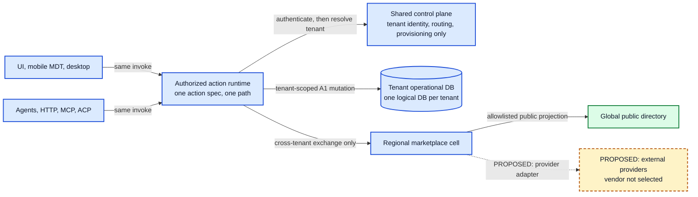
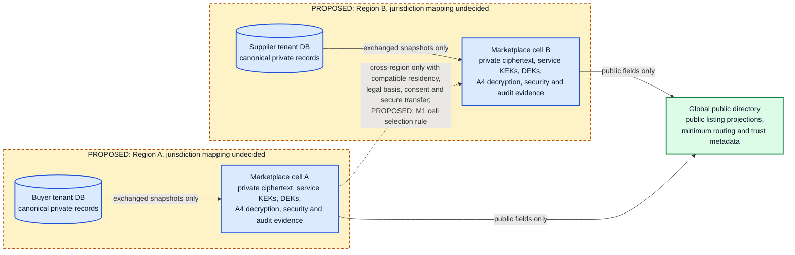
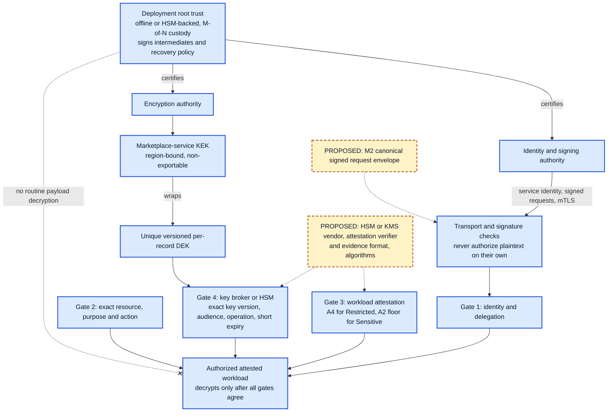
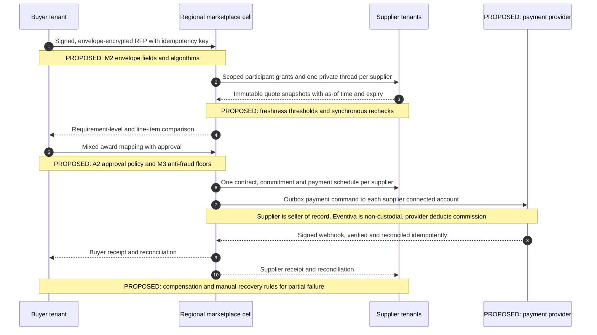

# Eventiva platform and marketplace architecture

This file indexes the Eventiva platform and marketplace architecture decisions and holds the source of four diagrams you can edit. It does not decide anything new and does not specify an implementation. Owner decisions are made on Linear. This file records them, links them, and draws them.

This document authorizes no implementation, dependency, algorithm, vendor, infrastructure, provisioning, key ceremony or spending.

[Back to the README](../../README.md)

## Which source wins

When two sources disagree, use the first source in this list that covers the point:

1. **Owner approvals recorded on Linear.** These are the comments headed `APPROVED` on [EVE-13](https://linear.app/resnovas/issue/EVE-13), [EVE-40](https://linear.app/resnovas/issue/EVE-40), [EVE-42](https://linear.app/resnovas/issue/EVE-42), [EVE-250](https://linear.app/resnovas/issue/EVE-250) and [EVE-251](https://linear.app/resnovas/issue/EVE-251), plus the settled product requirements in the F5 and payment issues listed under [Sources](#sources).
2. **The owner's architecture document, `Eventiva-marketplace-infrastructure-v1.md`.** ChatGPT wrote it for Jonathan, and it contains four Mermaid diagrams you can edit and a decision register. **It was not in this repository or in Linear documents on 2026-11-15**, so this file does not reproduce or replace it. When it is committed, link it here and reconcile the diagrams below with it (see [Revising this document](#revising-this-document)).
3. **This file and the Amp decision sheet.** The [Eventiva architecture decisions](https://ampcode.com/artifacts/eventiva-architecture-decisions-3169b540-652d-4795-ae9c-7ad78a534f17) sheet and its rendered diagrams. The Mermaid blocks below are the repository copies of that sheet's sources. Each node and edge carries the approval state it has on Linear.

## Legend

Every diagram uses the same Mermaid classes, so the status survives edits:

| Mark                                           | Meaning                                                                                                                                                               |
| ---------------------------------------------- | --------------------------------------------------------------------------------------------------------------------------------------------------------------------- |
| Solid blue node (`approved`), solid arrow      | Approved by the owner on Linear. The approval is linked in the decision register.                                                                                     |
| Solid green node (`public`)                    | An approved public or verified path, such as an allowlisted listing projection or a signed provider return path.                                                      |
| Dashed amber node (`proposed`), dotted arrow   | Proposed or unresolved: exact vendors, algorithms, regional placement and jurisdiction mapping, envelope formats, thresholds, and every card still marked `Proposed`. |
| `PROPOSED:` prefix on a label or sequence note | The same as a dashed amber node, used in the sequence diagram, which has no node classes.                                                                             |

Region names such as `Region A` are placeholders. Which jurisdiction maps to which region has not been decided.

## 1. Platform context

Every surface reaches one authorized action path. Tenant data stays in that tenant's own database. Data crosses tenants only through a regional marketplace cell.

## 2. Regional marketplace cells and tenant databases

Private data stays in its region. Only public projections and the minimum non-sensitive routing and trust metadata are replicated globally.

The requirement on the cross-region arrow is approved: compatible residency, legal basis, recipient consent and permissions, and a secure-transfer policy. The arrow is dotted because the rule that picks a cell (M1) and the region placement are still proposals. Private payloads are never replicated silently.

## 3. Root trust, keys, attestation and decryption

A workload decrypts a private marketplace record only after four independent gates agree. The root trust never decrypts payloads.

No key decrypts everything in the marketplace. If A4 assurance is unavailable for Restricted records, processing fails closed, or falls back only to the degraded behaviour that the sealed core profile explicitly permits. Vault and zero-knowledge records follow a separate client-side workflow and must never silently become decryptable on the server.

## 4. Buyer, marketplace and supplier: RFP, quote, mixed award and payment saga

A mixed award stays as separate supplier contracts. A saga that can recover coordinates them; Eventiva does not claim one global ACID transaction.

The marketplace cell owns the participant grants, the private two-party threads, the immutable quote and contract snapshots, the comparison and mixed-award mappings, and the saga state. Each tenant database stays canonical for its own inventory, purchasing, sales, staff, finance and PII. No payment runs offline. Choosing only part of an indivisible package requires a re-quote that the supplier confirms.

## Decision register

| Decision                                                                                                                 | Status   | Record                                                                                                                                                                                                                 |
| ------------------------------------------------------------------------------------------------------------------------ | -------- | ---------------------------------------------------------------------------------------------------------------------------------------------------------------------------------------------------------------------- |
| One action specification and one authorized runtime path for every surface                                               | Settled  | EVE-13, settled requirements in [EVE-40 `fa3a5b15`](https://linear.app/resnovas/issue/EVE-40#comment-fa3a5b15-87a8-4b1d-a41b-ea89e9beb12a)                                                                             |
| A1: one atomic write of domain state, idempotency evidence, history, outbox and receipt                                  | Approved | [EVE-40 `a412365e`](https://linear.app/resnovas/issue/EVE-40#comment-a412365e-b4df-4172-a316-606b06a7e763)                                                                                                             |
| Three offline execution categories                                                                                       | Approved | [EVE-40 `aba96798`](https://linear.app/resnovas/issue/EVE-40#comment-aba96798-42e6-4502-b8c0-7f18b6ca6b35), [EVE-42 `1807bbaf`](https://linear.app/resnovas/issue/EVE-42#comment-1807bbaf-0431-4f46-8282-535bfa78aa7b) |
| S1: one logical database per tenant plus a narrow shared control plane                                                   | Approved | [EVE-42 `e7459930`](https://linear.app/resnovas/issue/EVE-42#comment-e7459930-9d89-4f53-b7cb-d6b76d4c8cfc)                                                                                                             |
| Key hierarchy, root trust, M-of-N custody, envelope encryption                                                           | Approved | [EVE-13 `9e6e287a`](https://linear.app/resnovas/issue/EVE-13#comment-9e6e287a-4a28-4695-801a-23a0889f6a56)                                                                                                             |
| Four independent decryption gates, non-exportable keys                                                                   | Approved | [EVE-13 `ebbcbe62`](https://linear.app/resnovas/issue/EVE-13#comment-ebbcbe62-4eab-4919-9b33-03288c232e73)                                                                                                             |
| Sealed core security profiles (Baseline, Sensitive, Restricted, Vault)                                                   | Approved | [EVE-13 `08f09405`](https://linear.app/resnovas/issue/EVE-13#comment-08f09405-dbfb-4d5f-ac19-920cf95a98df), [`c3a06adc`](https://linear.app/resnovas/issue/EVE-13#comment-c3a06adc-8c33-4a6c-b43c-815bb8479410)        |
| Zero trust on every route and surface                                                                                    | Approved | [EVE-13 `1da54684`](https://linear.app/resnovas/issue/EVE-13#comment-1da54684-89c0-4ce7-895c-aeec61af9c8a)                                                                                                             |
| Assurance levels A1 to A5, A4 for Restricted server-side decryption                                                      | Approved | [EVE-13 `6770565a`](https://linear.app/resnovas/issue/EVE-13#comment-6770565a-053c-47e6-8980-adab5ed9a109)                                                                                                             |
| Canonical record ownership between the marketplace and tenant databases                                                  | Approved | [EVE-250 `804a4ef1`](https://linear.app/resnovas/issue/EVE-250#comment-804a4ef1-945e-41b6-9343-d4ef9cb58fe1)                                                                                                           |
| Standard marketplace decryption profile                                                                                  | Approved | [EVE-251 `a81300d7`](https://linear.app/resnovas/issue/EVE-251#comment-a81300d7-254f-4ae7-b2f7-2f8f1204ea27)                                                                                                           |
| Application-layer envelope encryption for every private exchange                                                         | Approved | [EVE-251 `86d01307`](https://linear.app/resnovas/issue/EVE-251#comment-86d01307-78cd-4ec6-9b91-ba2414789321)                                                                                                           |
| Classification defaults: messages Sensitive; quotes, contracts, awards, invoices, payment evidence Restricted            | Approved | [EVE-251 `a2a18d4b`](https://linear.app/resnovas/issue/EVE-251#comment-a2a18d4b-4965-4ab1-9da6-eab36244b322)                                                                                                           |
| Marketplace KEKs under M-of-N, per-record DEKs, no universal decrypt key                                                 | Approved | [EVE-251 `d42e2263`](https://linear.app/resnovas/issue/EVE-251#comment-d42e2263-a1a3-4db9-bbce-2c69d215ebad)                                                                                                           |
| Revocation, retention and lawful erasure                                                                                 | Approved | [EVE-251 `304faca9`](https://linear.app/resnovas/issue/EVE-251#comment-304faca9-ecbb-4ce6-8255-20c771e2e1b9)                                                                                                           |
| Region-scoped marketplace cells, global replication limited to public projections                                        | Approved | [EVE-251 `2377819a`](https://linear.app/resnovas/issue/EVE-251#comment-2377819a-8c8c-4ba4-8c78-408ece1e0ca8)                                                                                                           |
| Allowlisted public listing projections                                                                                   | Settled  | [EVE-66](https://linear.app/resnovas/issue/EVE-66), [EVE-75](https://linear.app/resnovas/issue/EVE-75)                                                                                                                 |
| Private two-party enquiry threads                                                                                        | Settled  | [EVE-119](https://linear.app/resnovas/issue/EVE-119)                                                                                                                                                                   |
| Mixed-supplier awards with a separate contract, commitment and payment schedule per supplier                             | Settled  | [EVE-124](https://linear.app/resnovas/issue/EVE-124) D5-7                                                                                                                                                              |
| Non-custodial connected-account payments, commission deducted by the provider, provider-neutral records                  | Settled  | [EVE-237](https://linear.app/resnovas/issue/EVE-237), [EVE-246](https://linear.app/resnovas/issue/EVE-246)                                                                                                             |
| A2 approval policy, A3 offline and scheduled execution, A4 audit availability                                            | Proposed | [EVE-40 `fa3a5b15`](https://linear.app/resnovas/issue/EVE-40#comment-fa3a5b15-87a8-4b1d-a41b-ea89e9beb12a), Amp decision sheet batch 1                                                                                 |
| S2 scarce-resource ledgers, S3 device schema and command envelope, S4 migrations and canonical values                    | Proposed | [EVE-42 `fe5c339d`](https://linear.app/resnovas/issue/EVE-42#comment-fe5c339d-4de7-4a46-a71e-a7ae0967f485)                                                                                                             |
| M1 cell selection for cross-region exchange                                                                              | Proposed | Amp decision sheet batch 3                                                                                                                                                                                             |
| M2 canonical signed request envelope                                                                                     | Proposed | Amp decision sheet batch 3, EVE-251 description                                                                                                                                                                        |
| M3 anti-fraud review floors                                                                                              | Proposed | Amp decision sheet batch 3                                                                                                                                                                                             |
| Freshness thresholds, compensation and manual recovery, invoice reconciliation basis, staff access to private records    | Proposed | [EVE-250](https://linear.app/resnovas/issue/EVE-250) open decisions                                                                                                                                                    |
| Exact region placement and jurisdiction mapping, per-jurisdiction lawful bases and retention schedules                   | Proposed | EVE-250, EVE-251                                                                                                                                                                                                       |
| Vendors, payment provider, HSM or KMS, attestation verifier and evidence format, algorithms, package pins, paid services | Proposed | Separate technical and dependency approval when the implementation issue starts                                                                                                                                        |

## Discrepancies found while compiling this file

- The owner document `Eventiva-marketplace-infrastructure-v1.md` is not in the repository, so its four diagrams and decision register could not be compared with these.
- The Amp decision sheet lists non-custodial connected-account payments and separate supplier contracts as approved in EVE-250 and EVE-251. On Linear they are settled requirements from EVE-237, EVE-246 and EVE-124, which EVE-250 preserves. The register above cites the issues that own them.
- The EVE-250 and EVE-251 descriptions still open with `PROPOSAL`. The later `APPROVED` comments govern the points they name. Everything else in those descriptions is still a proposal.
- The Amp decision sheet cites EVE-40 comment `fa3a5b15` for A1. That comment is the proposal; the approval is EVE-40 comment `a412365e`.
- EVE-251 comment `a81300d7` lists the scope of envelope encryption as still open. Comment `86d01307` resolved it later (every private exchange).

## Revising this document

1. Decide on Linear first. Change a mark from proposed to approved only after the owner's decision is recorded in an `APPROVED` comment on the issue that owns it. Then add that comment link to the decision register.
2. Edit the Mermaid block. Keep the three `classDef` lines identical in every diagram, move a node between the `approved`, `public` and `proposed` class lists, change a dotted arrow (`-.->`) to a solid one (`-->`) when its decision is approved, and remove the `PROPOSED:` prefix from the label.
3. Keep the Amp diagram set in step. Update the matching Mermaid source and rendered visual in the [Amp decision sheet](https://ampcode.com/artifacts/eventiva-architecture-decisions-3169b540-652d-4795-ae9c-7ad78a534f17), or note on the owning Linear issue that this file is now ahead of it.
4. When the owner document is committed, link it under [Which source wins](#which-source-wins), compare its four diagrams and decision register with these, and record each difference under [Discrepancies](#discrepancies-found-while-compiling-this-file) until the owner resolves it.
5. Name an exact vendor, algorithm, package version or region only after it has its own explicit approval. Until then, label it `PROPOSED:`.
6. Check the change before you commit it:
    - Render every diagram: `pnpm dlx --allow-build puppeteer @mermaid-js/mermaid-cli@11 -i docs/architecture/eventiva-platform-and-marketplace.md -o /tmp/arch/out.md -e png`, then look at each PNG. This runs the Mermaid CLI from pnpm's dlx cache and adds no workspace dependency. Where Chromium is already installed, set `PUPPETEER_SKIP_DOWNLOAD=1` and pass `-p` with a Puppeteer config whose `executablePath` points to that browser.
    - Check formatting: `pnpm exec prettier --check docs/architecture/eventiva-platform-and-marketplace.md`.
    - Run the repository gate: `node --run check`.
    - Use ASCII text only, with no em or en dashes.
7. Record the commit link on EVE-250 and EVE-251.

## Sources

- Linear: [EVE-13](https://linear.app/resnovas/issue/EVE-13), [EVE-40](https://linear.app/resnovas/issue/EVE-40), [EVE-42](https://linear.app/resnovas/issue/EVE-42), [EVE-66](https://linear.app/resnovas/issue/EVE-66), [EVE-75](https://linear.app/resnovas/issue/EVE-75), [EVE-119](https://linear.app/resnovas/issue/EVE-119), [EVE-124](https://linear.app/resnovas/issue/EVE-124), [EVE-237](https://linear.app/resnovas/issue/EVE-237), [EVE-246](https://linear.app/resnovas/issue/EVE-246), [EVE-250](https://linear.app/resnovas/issue/EVE-250), [EVE-251](https://linear.app/resnovas/issue/EVE-251).
- Amp decision sheet: [Eventiva architecture decisions](https://ampcode.com/artifacts/eventiva-architecture-decisions-3169b540-652d-4795-ae9c-7ad78a534f17).
- Amp rendered diagrams: [platform topology](https://ampcode.com/artifacts/visuals/eventiva-platform-topology-642e7f6c-7f4c-4a0a-9b8a-a3238de5488d), [regional marketplace cells](https://ampcode.com/artifacts/visuals/regional-marketplace-cells-53e16fa9-4142-491a-a36a-b190ce591e90), [marketplace decryption gates](https://ampcode.com/artifacts/visuals/marketplace-decryption-gates-ee91fc95-83c9-4a15-8662-80b11dabb75d), [marketplace award sequence](https://ampcode.com/artifacts/visuals/marketplace-award-sequence-e6c99855-c5e6-41d0-8587-00bfb92a289d).
- Owner document `Eventiva-marketplace-infrastructure-v1.md`: not yet in the repository.

| Date       | Change                                                                                   |
| ---------- | ---------------------------------------------------------------------------------------- |
| 2026-11-15 | First version: index, four diagrams, decision register as of EVE-251 comment `2377819a`. |
