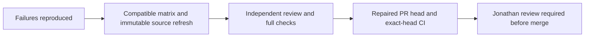

# EVE-308 dependency batch qualification

Retain all 26 requested upgrades and qualify the compatible repair before Jonathan reviews the published head. This is not merge or production authorization.

Owner: [existing implementation thread](https://ampcode.com/threads/T-b8c343d3-1f24-49c7-86ba-54ec116278cf). Verified pair: [EVE-308](https://linear.app/resnovas/issue/EVE-308) / [Eventiva#1128](https://github.com/Resnovas/Eventiva/issues/1128), repairing [PR1125](https://github.com/Resnovas/Eventiva/pull/1125). Jonathan selected option C at 2026-11-27T23:15:37.187Z in the [source thread](https://ampcode.com/threads/T-01a21f3b-7821-7194-b956-625d41f89870), authorizing full compatible remediation and provenance-preserving source refresh. Scope approval does not accept an unverified matrix or waive compatibility, security or tests.

The later [EVE-327 / #1147 direction](https://github.com/Resnovas/Eventiva/issues/1147) requires full green checks followed by Jonathan's approval of #1125. No merge before his review. Under its EVE-326 instruction, this task-local record replaces this branch's unpublished timeline insertion; shared timeline and roadmap SVGs are not changed. Broader EVE-265/EVE-299 acceptance stays open.

## Matrix and source ownership

Retained targets: `@formatjs/cli` 6.20.0, `@formatjs/intl` 6.2.0, `@formatjs/intl-getcanonicallocales` 3.4.0, `@formatjs/intl-locale` 5.5.0, `@formatjs/intl-pluralrules` 7.1.0, `react-intl` 12.2.0, `eslint-plugin-formatjs` 8.1.4; `nx` and `@nx/{devkit,eslint,eslint-plugin,expo,js,playwright,vitest}` 24.0.6; `@playwright/test` 1.65.1; `eslint` 10.15.0; `prettier` 3.10.1; `typescript-eslint` 8.73.0; `vite` 8.3.8; `posthog-react-native` 4.87.1; `oauth4webapi` 3.8.9; `eslint-plugin-jsdoc` 65.5.0; `@effect/platform` 0.97.4; `@effect/experimental` 0.61.3; `@opentelemetry/api` 1.10.0.

Additional compatible pin: shared `effect` 3.22.5 satisfies Platform/Experimental's `^3.22.5` peers. Replace the fixed `OtlpSerialization.layerJson` with the identical `HttpBody.unsafeJson` helper it called. Remove only the redundant `@effect/opentelemetry` bridge and its unused mandatory SDK peer closure, without migrating SDK generations or overriding peers. API 1.10.0 remains declared with no current direct source consumer. Existing OTLP wire payload, release, cancellation and lifecycle contracts remain unchanged.

Fifteen release-source entries change; all 45 entries retain their scopes, licenses and notices. Signed aggregate bundle `96b53d12f946d53b5af5372bdbe83efe48f27757` retains the preceding bundle as parent. [The source inventory](../../externals/README.md#eve-308-full-batch-qualification) distinguishes release-tag provenance from npm publication metadata. No unrelated pin, supply-chain policy or remote-export permission changes.

## Qualification timeline

| State | Executed evidence and remaining acceptance |
| --- | --- |
| Completed diagnosis, 2026-11-27T23:06:03Z | Frozen setup on PR head `fa407c2f7b406fcad90804a3ffe8b4ae90dd76ce` fails root checking with `Reference version drift: @formatjs/cli@6.20.0`, matching hosted CI. Enumerated 28 manifest mismatches across 23 packages, plus the Effect minimum and OpenTelemetry API ceiling conflicts. Declared incompatibility is not a demonstrated runtime crash. |
| Completed local source and peer proof | Strict-peer install succeeds; `pnpm peers check` reports no peer issues. Reference checking passes 45 trees, 32,764 files, 290,071,642 bytes under the unchanged 350 MiB cap. `pnpm audit --json` reports zero vulnerabilities at every severity; static checks and Nx reference synchronization pass. These are pre-publication results, not hosted acceptance. |
| Completed independent source review | Separate Standards and Spec reviewers report zero findings above the confidence threshold across the complete 635-file remediation snapshot. Both inspect the unchanged OTLP tests and delegate equivalence; neither claims to have executed full verification or supplied human approval. |
| Recovered fixture failures | The first full run fails PostgreSQL consumers with `ECONNREFUSED 127.0.0.1:5432`. A focused probe confirms Docker's internal network has no published loopback port while its private address connects. The second run reaches the database but correctly fails fixture safety checks because destructive tests require loopback. A supervised loopback-only relay preserves both the internal network and that safety rule. No repository test, timeout, fixture image or credential policy changes. |
| Completed fixture control | `node tests/storage/fixtures/resource-process.mjs migration-proof postgres` passes through the relay: precommit rollback, lost acknowledgement, repeat-history idempotence, changed-prefix rejection, stale-writer rejection and current-writer acceptance all report true; two records and five revisions survive. This is local process-loss proof, not power-loss or distributed-fencing acceptance. |
| Completed normal admission, 2026-11-28 | Signed source-subtree repair `6fd35634c3b8110f6c4909283375ad5580287663` and accepted-main integration `168ae2b8` pass the unchanged static-plus-affected hook, including 325 tooling tests. Generated agent documentation is synchronized. No hook bypass or published-history rewrite. |
| Recovered interrupted verification | The earlier combined-tree run passed test/build/parity and smoke, then terminated before final feature evidence. It has no successful full-gate exit marker and is not counted as full acceptance. |
| Retained failure evidence | The first full run on accepted main `90c1cad4` fails the unchanged telemetry import-graph test at its 15-second deadline: 689 runtime assertions pass and one times out. The exact assertion passes in isolation in 2.15 seconds; contention is plausible, not an established cause. No test, deadline, concurrency setting or gate changes. |
| Completed combined qualification, 2026-11-28 | Accepted main `90c1cad4`, including the verified cluster harness repair, integrates without conflicts. Repeated unchanged `node --run verify` exits 0: static/root gates, benchmark, all 32 test/build/parity projects and prerequisites, three smoke projects, then uncached backend-surfaces, backend-fixture-isolation and funnel-policy evidence. Explicit feature proof against original published head `fa407c2f7b406fcad90804a3ffe8b4ae90dd76ce` separately exits 0 for those three surfaces plus telemetry. Both failures and successful controls remain recorded; no earlier failure is relabeled as success. |
| Delivery gates | Normal merge-commit admission precedes publication on the existing draft PR branch. Exact-head hosted reference/security/application results and Jonathan's review remain separate acceptance gates. Keep auto-merge disabled and the issue open while acceptance or his review remains pending; no queue action or PR merge is authorized here. |

