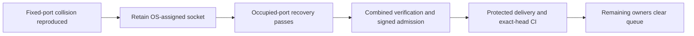

# EVE-327 queue recovery

Owner: [implementation thread](https://ampcode.com/threads/T-81f50337-2b3e-4b6c-8e89-0c0c0d6d3db6).
Verified task pair: [EVE-327](https://linear.app/resnovas/issue/EVE-327) /
[Eventiva#1147](https://github.com/Resnovas/Eventiva/issues/1147).
This bounded receipt does not refresh the historical planning snapshot.

## Scoped owner decision - 2026-11-28

Jonathan directly requested the cluster-harness repair and approved the scoped
[PR1118](https://github.com/Resnovas/Eventiva/pull/1118) timeline exception in the
implementation thread; the exact message timestamp is unavailable. PR1118 may
move its unpublished receipt to an issue-scoped planning document, preserving
the historical timeline and leaving generated timeline/roadmap SVGs unchanged.
This overrides only that receipt's shared-timeline placement requirement, not
repository-wide planning policy, review, checks or protection. Its existing
recovery owner retains implementation and delivery. EVE-326 remains separate.

## Scoped AI-03 and AI-12 authorization - 2026-11-28

At 13:26:04.453 UTC Jonathan directly approved the ordered merge pass in
[the owner thread](https://ampcode.com/threads/T-be4cf9f0-bfd7-4fcd-9296-83a499f936dc),
human message `M-0355RbS200f5lej6yVN2VX`. The implementation owner read that
human message independently; the earlier
[Linear relay](https://linear.app/resnovas/issue/EVE-327#comment-e519b32e-cb2d-4eb3-93e5-56bcf273087a)
was not used as authorization.

The AI-03 exception applies only to PR1111, PR1112, PR1113 and PR1114:
accept verified original author signatures together with verified unchanged
GitHub `web-flow` restacks. It is not a standing signer rule or fresh human
DCO certification. Preserve the original signed source and compare each
restacked patch before admission; stop for changes outside this scope.

AI-12 approval covers PR1125's exact dependency changes at
[7dee6c94](https://github.com/Resnovas/Eventiva/commit/7dee6c945ef1a202b343737d3e737f215ee70c5c),
including Effect 3.22.4 to 3.22.5 and removal of `@effect/opentelemetry`.
Merge PR1111 through PR1114 in order, then PR1125. All required checks and
branch protection remain mandatory; no force-push, bypass, self-approval,
production action or unrelated dependency approval follows.

At resumption, PR1111 already targets main at
[c5bf2b9c](https://github.com/Resnovas/Eventiva/commit/c5bf2b9c69a6122d94d89448c86a33bbca505ece),
with successful [application CI](https://github.com/Resnovas/Eventiva/actions/runs/46092638731)
and [policy](https://github.com/Resnovas/Eventiva/actions/runs/46092760847).
PR1112 conflicts, PR1113 is behind with failed old verification, and PR1114
still targets PR1113's branch. Those layers require sequential reconciliation
and fresh qualification. PR1125 remains draft at the approved head; its
[application CI](https://github.com/Resnovas/Eventiva/actions/runs/46099928065)
and [policy](https://github.com/Resnovas/Eventiva/actions/runs/46099928033) pass.
Approval and these historical head checks do not establish merge-group or
new-head acceptance. Existing specialist owners retain delivery; EVE-327
remains open until the queue acceptance criteria are satisfied.

## Bounded conflict-resolution amendment - 2026-11-28

Jonathan subsequently approved the following directly in the implementation
thread, observed by 15:01:45 UTC; the exact message timestamp is unavailable.
For PR1112, PR1113 and PR1114, keep both timeline histories and recompute
the existing ratchet reduction against current main. PR1112 reduces 2108
to 2106; equivalent recounts are permitted for the next two layers. Reverify
each resolved head before its protected merge, in order. Changes beyond
rebasing, preserving timeline history and recounting the ratchet remain
outside this amendment.

After the stack, merge PR1152 only when its required checks pass, then
PR1125 at approved head7dee6c94 last. Publish this branch's decision and
receipt documents through the normal path. All checks and protection still
apply; no force-push, bypass, self-approval or inferred human certification.
This supersedes the conflict-resolution hold below, not its failure evidence.

## PR1111 delivered; historical PR1112 conflict-resolution hold

PR1111 merged through protection at 13:52:28 UTC as
[9897c2be](https://github.com/Resnovas/Eventiva/commit/9897c2be69bc775fcca16dddaea4b85c61bf1cb3).
The stack owner reports all five merge-group workflows passed; this thread
independently verified successful
[group CI](https://github.com/Resnovas/Eventiva/actions/runs/46149856471) and
[group policy](https://github.com/Resnovas/Eventiva/actions/runs/46149856363).
Separate [main CI](https://github.com/Resnovas/Eventiva/actions/runs/46151773366)
subsequently passed, independently verified after the 14:44 follow-up.

GitHub retargeted PR1112 onto main without restacking its original signed
head413bdc1768f95af65aeb4be6c460958696700f1b. It is conflicting. The stack
owner's merge-tree and isolated-index probes identify timeline and comment
ratchet conflicts. The original ratchet patch changes 2109 to 2107; current
main has total2108 and still includes the two client-smoke comments.
Applying the same two-comment reduction requires 2108 to 2106, which is
not the approved unchanged patch. No branch edit, push or queue admission
was attempted. Jonathan must approve the bounded conflict resolution and
fresh qualification before the existing owner resumes.

PR1113 and PR1114 remain on their dependent branches. PR1125 remains draft
at its approved unchanged head and cannot pass them in the ordered merge
sequence. A new automated [PR1152](https://github.com/Resnovas/Eventiva/pull/1152)
updates only the shared navigation snapshot; it is separate from the five
PRs in the scoped authorization and has not been admitted by this thread.

## Historical harness evidence and delivery timeline

| State | Evidence and remaining work |
| --- | --- |
| Completed diagnosis | Main run [46087494585](https://github.com/Resnovas/Eventiva/actions/runs/46087494585) failed `backend-surfaces` with `EADDRINUSE 127.0.0.1:34562`. The competing hosted process is unknown. Unchanged harness on main72b556a79f1394f987176ff466d1ebd2f33cc540 reproduced exit1 while a separate listener held that port. |
| Completed local correction | Initial children retain OS-assigned sockets through the existing backend seam. Readiness reports actual ports; the parent checks distinct initial ports and exact replacement identity. No production schema, timeout, recovery assertion or dependency changes. |
| Completed adversarial proof at 00:51:06 UTC | Running `node apps/server/tests/two-runners.mjs` against disposable PostgreSQL while both34561/34562 remained occupied ended with `sql-cluster-conformance-passed`, exit0 and `listenersHeld:true`. SIGKILL/SIGTERM takeover, output reconstruction, security/replay and community total restart assertions passed. Initial `node --run verify:static` passed with zero boundary violations. |
| Completed combined verification, observed 01:07:29 UTC | On main3c77a89abe9c2661fa65a4677f61d0763a8561a8 plus this patch, disposable-fixture `node --run verify` exited0: static/root gates, benchmark, 32 test/build/parity projects with three prerequisites, three smoke projects and uncached `backend-surfaces: passed`. Both cluster and module-run process conformance passed. Normal signed admission and protected delivery remain pending. |
| Upcoming queue acceptance | Existing owners retain PR1110-1114, PR1094/1118/1148, PR1119 and PR1125. Require exact-head checks and normal protected delivery; PR1125 remains reserved for Jonathan's review. No whole-queue completion or production release is claimed. |

Graphify Cloud was unavailable. Local Graphify refreshed with the existing
partial-extraction warning; generated graph output remains ignored.
