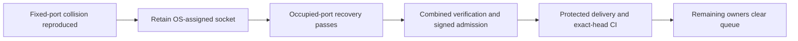

# EVE-327 queue recovery

Owner: [implementation thread](https://ampcode.com/threads/T-81f50337-2b3e-4b6c-8e89-0c0c0d6d3db6).
Verified task pair: [EVE-327](https://linear.app/resnovas/issue/EVE-327) /
[Eventiva#1147](https://github.com/Resnovas/Eventiva/issues/1147).
This bounded receipt does not refresh the historical planning snapshot.

## Scoped owner decision - 2026-11-28

Jonathan directly requested the cluster-harness repair and approved the scoped
[PR1118](https://github.com/Resnovas/Eventiva/pull/1118) timeline exception in the
implementation thread; the exact message timestamp is unavailable. PR1118 may
move its unpublished receipt to an issue-scoped planning document, preserving
the historical timeline and leaving generated timeline/roadmap SVGs unchanged.
This overrides only that receipt's shared-timeline placement requirement, not
repository-wide planning policy, review, checks or protection. Its existing
recovery owner retains implementation and delivery. EVE-326 remains separate.

## Harness evidence and delivery timeline

| State | Evidence and remaining work |
| --- | --- |
| Completed diagnosis | Main run [46087494585](https://github.com/Resnovas/Eventiva/actions/runs/46087494585) failed `backend-surfaces` with `EADDRINUSE 127.0.0.1:34562`. The competing hosted process is unknown. Unchanged harness on main72b556a79f1394f987176ff466d1ebd2f33cc540 reproduced exit1 while a separate listener held that port. |
| Completed local correction | Initial children retain OS-assigned sockets through the existing backend seam. Readiness reports actual ports; the parent checks distinct initial ports and exact replacement identity. No production schema, timeout, recovery assertion or dependency changes. |
| Completed adversarial proof at 00:51:06 UTC | Running `node apps/server/tests/two-runners.mjs` against disposable PostgreSQL while both34561/34562 remained occupied ended with `sql-cluster-conformance-passed`, exit0 and `listenersHeld:true`. SIGKILL/SIGTERM takeover, output reconstruction, security/replay and community total restart assertions passed. Initial `node --run verify:static` passed with zero boundary violations. |
| Completed combined verification, observed 01:07:29 UTC | On main3c77a89abe9c2661fa65a4677f61d0763a8561a8 plus this patch, disposable-fixture `node --run verify` exited0: static/root gates, benchmark, 32 test/build/parity projects with three prerequisites, three smoke projects and uncached `backend-surfaces: passed`. Both cluster and module-run process conformance passed. Normal signed admission and protected delivery remain pending. |
| Upcoming queue acceptance | Existing owners retain PR1110-1114, PR1094/1118/1148, PR1119 and PR1125. Require exact-head checks and normal protected delivery; PR1125 remains reserved for Jonathan's review. No whole-queue completion or production release is claimed. |

Graphify Cloud was unavailable. Local Graphify refreshed with the existing
partial-extraction warning; generated graph output remains ignored.
