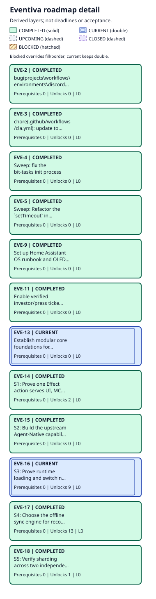

<!-- planning:generated:start -->
# Layer 0, group 1

[All layers](README.md) | [Full Mermaid](graph.mmd) | [Full SVG](../roadmap.svg)

Each row links to the complete mirrored specification/discussion. BLOCKED is an additional planning signal, not a replacement Linear status. Closed duplicates are not completed implementation. Related/duplicate relations remain in the issue page. Parent membership is not a dependency.

| Issue / source specification | Planning / Linear state | Recorded phase / project | All prerequisites | Open prerequisite blockers | Unlocks / precedes | Parent |
| --- | --- | --- | --- | --- | --- | --- | --- |
| [EVE-2](../issues/EVE-2.md)  bug(projects\workflows\environments\discord\bot):  &apos;module&apos; must be set to &apos;NodeNext&apos; | **COMPLETED**; captured Linear: Done | No numbered phase recorded; No project | None recorded | None recorded | None recorded | None recorded |
| [EVE-3](../issues/EVE-3.md) chore(.github/workflows/cla.yml): update to add the restyled-io&#91;bot&#93; to allowed list | **COMPLETED**; captured Linear: Done | No numbered phase recorded; No project | None recorded | None recorded | None recorded | None recorded |
| [EVE-4](../issues/EVE-4.md) Sweep: fix the bit-tasks init process | **COMPLETED**; captured Linear: Done | No numbered phase recorded; No project | None recorded | None recorded | None recorded | None recorded |
| [EVE-5](../issues/EVE-5.md) Sweep: Refactor the `setTimeout` in `initialize`  | **COMPLETED**; captured Linear: Done | No numbered phase recorded; No project | None recorded | None recorded | None recorded | None recorded |
| [EVE-9](../issues/EVE-9.md) Set up Home Assistant OS runbook and OLED Status app | **COMPLETED**; captured Linear: Done | No numbered phase recorded; No project | None recorded | None recorded | None recorded | None recorded |
| [EVE-11](../issues/EVE-11.md) Enable verified investor/press tickets without checkout | **COMPLETED**; captured Linear: Done | No numbered phase recorded; No project | None recorded | None recorded | None recorded | None recorded |
| [EVE-13](../issues/EVE-13.md) Establish modular core foundations for database adapters, Expo and observability | **CURRENT**; captured Linear: In Progress | No numbered phase recorded; Eventiva platform foundations | None recorded | None recorded | None recorded | None recorded |
| [EVE-14](../issues/EVE-14.md) S1: Prove one Effect action serves UI, MCP and AI SDK from one inventory entry | **COMPLETED**; captured Linear: Done | No numbered phase recorded; Eventiva platform foundations | None recorded | None recorded | [EVE-40](../issues/EVE-40.md), [EVE-47](../issues/EVE-47.md) | [EVE-13](../issues/EVE-13.md) |
| [EVE-15](../issues/EVE-15.md) S2: Build the upstream Agent-Native capability map and protocol conformance matrix | **COMPLETED**; captured Linear: Done | No numbered phase recorded; Eventiva platform foundations | None recorded | None recorded | None recorded | [EVE-13](../issues/EVE-13.md) |
| [EVE-16](../issues/EVE-16.md) S3: Prove runtime loading and switching of a remote module on Expo web and Android | **CURRENT**; captured Linear: In Progress | No numbered phase recorded; Eventiva platform foundations | None recorded | None recorded | [EVE-50](../issues/EVE-50.md), [EVE-77](../issues/EVE-77.md), [EVE-86](../issues/EVE-86.md), [EVE-120](../issues/EVE-120.md), [EVE-134](../issues/EVE-134.md), [EVE-149](../issues/EVE-149.md), [EVE-182](../issues/EVE-182.md), [EVE-204](../issues/EVE-204.md), [EVE-213](../issues/EVE-213.md) | [EVE-13](../issues/EVE-13.md) |
| [EVE-17](../issues/EVE-17.md) S4: Choose the offline sync engine for record edits and live text and canvas editing | **COMPLETED**; captured Linear: Done | No numbered phase recorded; Eventiva platform foundations | None recorded | None recorded | [EVE-51](../issues/EVE-51.md), [EVE-64](../issues/EVE-64.md), [EVE-106](../issues/EVE-106.md), [EVE-120](../issues/EVE-120.md), [EVE-128](../issues/EVE-128.md), [EVE-138](../issues/EVE-138.md), [EVE-145](../issues/EVE-145.md), [EVE-148](../issues/EVE-148.md), [EVE-154](../issues/EVE-154.md), [EVE-172](../issues/EVE-172.md), [EVE-176](../issues/EVE-176.md), [EVE-179](../issues/EVE-179.md), [EVE-192](../issues/EVE-192.md) | [EVE-13](../issues/EVE-13.md) |
| [EVE-18](../issues/EVE-18.md) S5: Verify sharding across two independent runners with drain and runner-loss recovery | **COMPLETED**; captured Linear: Done | No numbered phase recorded; Eventiva platform foundations | None recorded | None recorded | [EVE-54](../issues/EVE-54.md) | [EVE-13](../issues/EVE-13.md) |
<!-- planning:generated:end -->
