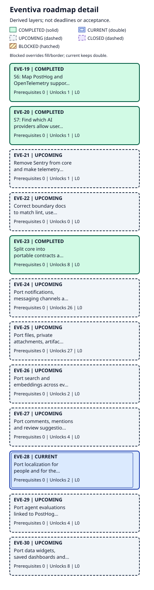

<!-- planning:generated:start -->
# Layer 0, group 2

[All layers](README.md) | [Full Mermaid](graph.mmd) | [Full SVG](../roadmap.svg)

Each row links to the complete mirrored specification/discussion. BLOCKED is an additional planning signal, not a replacement Linear status. Closed duplicates are not completed implementation. Related/duplicate relations remain in the issue page. Parent membership is not a dependency.

| Issue / source specification | Planning / Linear state | Recorded phase / project | All prerequisites | Open prerequisite blockers | Unlocks / precedes | Parent |
| --- | --- | --- | --- | --- | --- | --- | --- |
| [EVE-19](../issues/EVE-19.md) S6: Map PostHog and OpenTelemetry support across web, native and backend | **COMPLETED**; captured Linear: Done; later-status 2026-11-17T15:28:29.172Z: Live capability-study issue retains historical Done, not EVE-60 implementation acceptance. The later decision records the owner&apos;s hourly rotation with automatic trusted-issuer renewal, no user-visible failure or action replay/drop, and UTC boundary/multi-epoch tests. Only pseudonyms may leave the process with per-request opt-in and current consent/release; raw SDK headers remain forbidden. Dedicated server-only tenant/destination/purpose keys are design-authorized, not provisioned; production remains denied. The source capture stays historical and the later cited annotation supersedes only the lifetime-pending proposal. [evidence](https://linear.app/resnovas/issue/EVE-19#comment-f9740a5b-d126-4a55-8000-12bf9971a349), [evidence](https://ampcode.com/threads/T-01a1e940-37a3-7691-a5c0-e935b711c99a#M-034zDqigs0qoRlB2tOAQYo) | No numbered phase recorded; Eventiva platform foundations | None recorded | None recorded | [EVE-44](../issues/EVE-44.md) | [EVE-13](../issues/EVE-13.md) |
| [EVE-20](../issues/EVE-20.md) S7: Find which AI providers allow users to bring their own subscription to Eventiva | **COMPLETED**; captured Linear: Done | No numbered phase recorded; Eventiva platform foundations | None recorded | None recorded | [EVE-53](../issues/EVE-53.md) | [EVE-13](../issues/EVE-13.md) |
| [EVE-21](../issues/EVE-21.md) Remove Sentry from core and make telemetry export vendor-neutral | **UPCOMING**; captured Linear: Backlog; later-status 2026-11-17T11:53:50.319Z: Live MCP recheck retains Backlog, not accepted. Jonathan&apos;s authenticated selection at 2026-11-17T11:40:29.023Z approved adding @effect/opentelemetry and configurable OTLP endpoint/headers. Redaction, compatible 0.64.2/API1.9.0 pins, default-off/local behavior and one-shot no-backlog transport are scoped implementation constraints, not verbatim human wording or production-ingestion approval. Lane reports43 fixture tests; combined delivery remains separately verified. Later evidence is cited without changing the captured description/comments. [evidence](https://ampcode.com/threads/T-01a1e940-37a3-7691-a5c0-e935b711c99a), [evidence](https://linear.app/resnovas/issue/EVE-21/remove-sentry-from-core-and-make-telemetry-export-vendor-neutral#comment-bbcf9d9f) | No numbered phase recorded; Eventiva platform foundations | None recorded | None recorded | [EVE-44](../issues/EVE-44.md) | [EVE-13](../issues/EVE-13.md) |
| [EVE-22](../issues/EVE-22.md) Correct boundary docs to match lint, use colon tags, and fix the house reference | **CURRENT**; captured Linear: Backlog; later-status 2026-11-17T12:15:01.148Z: Live MCP recheck retains In Progress. Human TGTGamer merged house PR 47 at 12:14:25Z as squash commit 983ce5595b75f1d485446b320fdc85b322c80dd4; GitHub state was independently checked. The tested downstream architecture references and house summary now align with Eventiva&apos;s 16 intersecting ESLint rows, without changing lint/runtime behavior. Eventiva combined verification/delivery and exact-head CI remain separate evidence; the historical mirror is not silently refreshed and whole-issue acceptance is not inferred from the house merge. [evidence](https://github.com/Resnovas/.github/pull/47), [evidence](https://github.com/Resnovas/.github/commit/983ce5595b75f1d485446b320fdc85b322c80dd4), [evidence](https://linear.app/resnovas/issue/EVE-22#comment-9b58885c-134f-49a6-aed2-59bfb9a1ef60) | No numbered phase recorded; Eventiva platform foundations | None recorded | None recorded | None recorded | [EVE-13](../issues/EVE-13.md) |
| [EVE-23](../issues/EVE-23.md) Split core into portable contracts and backend runtime, with a shared schema package | **COMPLETED**; captured Linear: Done | No numbered phase recorded; Eventiva platform foundations | None recorded | None recorded | [EVE-40](../issues/EVE-40.md), [EVE-42](../issues/EVE-42.md), [EVE-64](../issues/EVE-64.md), [EVE-68](../issues/EVE-68.md), [EVE-82](../issues/EVE-82.md), [EVE-98](../issues/EVE-98.md), [EVE-257](../issues/EVE-257.md), [EVE-258](../issues/EVE-258.md) | [EVE-13](../issues/EVE-13.md) |
| [EVE-24](../issues/EVE-24.md) Port notifications, messaging channels and transactional email | **UPCOMING**; captured Linear: Backlog | No numbered phase recorded; Eventiva platform foundations | None recorded | None recorded | [EVE-78](../issues/EVE-78.md), [EVE-89](../issues/EVE-89.md), [EVE-92](../issues/EVE-92.md), [EVE-105](../issues/EVE-105.md), [EVE-109](../issues/EVE-109.md), [EVE-117](../issues/EVE-117.md), [EVE-119](../issues/EVE-119.md), [EVE-121](../issues/EVE-121.md), [EVE-126](../issues/EVE-126.md), [EVE-131](../issues/EVE-131.md), [EVE-135](../issues/EVE-135.md), [EVE-136](../issues/EVE-136.md), [EVE-153](../issues/EVE-153.md), [EVE-169](../issues/EVE-169.md), [EVE-171](../issues/EVE-171.md), [EVE-175](../issues/EVE-175.md), [EVE-177](../issues/EVE-177.md), [EVE-179](../issues/EVE-179.md), [EVE-187](../issues/EVE-187.md), [EVE-194](../issues/EVE-194.md), [EVE-200](../issues/EVE-200.md), [EVE-214](../issues/EVE-214.md), [EVE-222](../issues/EVE-222.md), [EVE-225](../issues/EVE-225.md), [EVE-236](../issues/EVE-236.md), [EVE-239](../issues/EVE-239.md) | [EVE-13](../issues/EVE-13.md) |
| [EVE-25](../issues/EVE-25.md) Port files, private attachments, artifacts and document import | **UPCOMING**; captured Linear: Backlog | No numbered phase recorded; Eventiva platform foundations | None recorded | None recorded | [EVE-70](../issues/EVE-70.md), [EVE-75](../issues/EVE-75.md), [EVE-88](../issues/EVE-88.md), [EVE-92](../issues/EVE-92.md), [EVE-99](../issues/EVE-99.md), [EVE-116](../issues/EVE-116.md), [EVE-117](../issues/EVE-117.md), [EVE-118](../issues/EVE-118.md), [EVE-121](../issues/EVE-121.md), [EVE-126](../issues/EVE-126.md), [EVE-127](../issues/EVE-127.md), [EVE-135](../issues/EVE-135.md), [EVE-146](../issues/EVE-146.md), [EVE-150](../issues/EVE-150.md), [EVE-151](../issues/EVE-151.md), [EVE-154](../issues/EVE-154.md), [EVE-156](../issues/EVE-156.md), [EVE-159](../issues/EVE-159.md), [EVE-167](../issues/EVE-167.md), [EVE-173](../issues/EVE-173.md), [EVE-193](../issues/EVE-193.md), [EVE-195](../issues/EVE-195.md), [EVE-199](../issues/EVE-199.md), [EVE-201](../issues/EVE-201.md), [EVE-203](../issues/EVE-203.md), [EVE-210](../issues/EVE-210.md), [EVE-214](../issues/EVE-214.md) | [EVE-13](../issues/EVE-13.md) |
| [EVE-26](../issues/EVE-26.md) Port search and embeddings across every resource | **UPCOMING**; captured Linear: Backlog | No numbered phase recorded; Eventiva platform foundations | None recorded | None recorded | [EVE-79](../issues/EVE-79.md), [EVE-202](../issues/EVE-202.md) | [EVE-13](../issues/EVE-13.md) |
| [EVE-27](../issues/EVE-27.md) Port comments, mentions and review suggestions on any resource | **UPCOMING**; captured Linear: Backlog | No numbered phase recorded; Eventiva platform foundations | None recorded | None recorded | [EVE-86](../issues/EVE-86.md), [EVE-150](../issues/EVE-150.md), [EVE-167](../issues/EVE-167.md), [EVE-200](../issues/EVE-200.md) | [EVE-13](../issues/EVE-13.md) |
| [EVE-28](../issues/EVE-28.md) Port localization for people and for the agent | **CURRENT**; captured Linear: In Progress | No numbered phase recorded; Eventiva platform foundations | None recorded | None recorded | [EVE-175](../issues/EVE-175.md), [EVE-228](../issues/EVE-228.md) | [EVE-13](../issues/EVE-13.md) |
| [EVE-29](../issues/EVE-29.md) Port agent evaluations linked to PostHog datasets | **UPCOMING**; captured Linear: Backlog | No numbered phase recorded; Eventiva platform foundations | None recorded | None recorded | [EVE-104](../issues/EVE-104.md), [EVE-165](../issues/EVE-165.md), [EVE-196](../issues/EVE-196.md), [EVE-224](../issues/EVE-224.md) | [EVE-13](../issues/EVE-13.md) |
| [EVE-30](../issues/EVE-30.md) Port data widgets, saved dashboards and brand kits | **UPCOMING**; captured Linear: Backlog | No numbered phase recorded; Eventiva platform foundations | None recorded | None recorded | [EVE-101](../issues/EVE-101.md), [EVE-159](../issues/EVE-159.md), [EVE-164](../issues/EVE-164.md), [EVE-195](../issues/EVE-195.md), [EVE-196](../issues/EVE-196.md), [EVE-222](../issues/EVE-222.md), [EVE-227](../issues/EVE-227.md), [EVE-234](../issues/EVE-234.md) | [EVE-13](../issues/EVE-13.md) |
<!-- planning:generated:end -->
