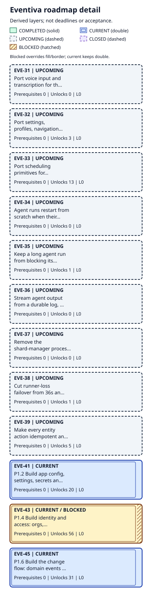

<!-- planning:generated:start -->
# Layer 0, group 3

[All layers](README.md) | [Full Mermaid](graph.mmd) | [Full SVG](../roadmap.svg)

Each row links to the complete mirrored specification/discussion. BLOCKED is an additional planning signal, not a replacement Linear status. Closed duplicates are not completed implementation. Related/duplicate relations remain in the issue page. Parent membership is not a dependency.

| Issue / source specification | Planning / Linear state | Recorded phase / project | All prerequisites | Open prerequisite blockers | Unlocks / precedes | Parent |
| --- | --- | --- | --- | --- | --- | --- | --- |
| [EVE-31](../issues/EVE-31.md) Port voice input and transcription for the agent | **UPCOMING**; captured Linear: Backlog | No numbered phase recorded; Eventiva platform foundations | None recorded | None recorded | None recorded | [EVE-13](../issues/EVE-13.md) |
| [EVE-32](../issues/EVE-32.md) Port settings, profiles, navigation, command menu and onboarding | **UPCOMING**; captured Linear: Backlog | No numbered phase recorded; Eventiva platform foundations | None recorded | None recorded | [EVE-148](../issues/EVE-148.md), [EVE-168](../issues/EVE-168.md), [EVE-182](../issues/EVE-182.md) | [EVE-13](../issues/EVE-13.md) |
| [EVE-33](../issues/EVE-33.md) Port scheduling primitives for availability, bookings and rosters | **UPCOMING**; captured Linear: Backlog | No numbered phase recorded; Eventiva platform foundations | None recorded | None recorded | [EVE-93](../issues/EVE-93.md), [EVE-100](../issues/EVE-100.md), [EVE-123](../issues/EVE-123.md), [EVE-124](../issues/EVE-124.md), [EVE-128](../issues/EVE-128.md), [EVE-129](../issues/EVE-129.md), [EVE-130](../issues/EVE-130.md), [EVE-138](../issues/EVE-138.md), [EVE-154](../issues/EVE-154.md), [EVE-161](../issues/EVE-161.md), [EVE-171](../issues/EVE-171.md), [EVE-179](../issues/EVE-179.md), [EVE-218](../issues/EVE-218.md) | [EVE-13](../issues/EVE-13.md) |
| [EVE-34](../issues/EVE-34.md) Agent runs restart from scratch when their shard moves | **UPCOMING**; captured Linear: Backlog; later-status 2026-11-17T12:03:57.576Z: Bounded EVE-34 refresh retains Backlog and includes the checkpoint plus source-lane evidence. Central immutable-d771b366 verification on 2026-11-17 passed completed-Activity SIGKILL/drain/restart controls, all 85 aggregate Nx tasks and smoke with disposable PostgreSQL. Both new modules remain in normal coverage: AgentRun branches 42/44 and combined server branches 84/86, above the unchanged 90% gate after public-contract tests closed the initial gap. Exact-head CI remains separate. EVE-35/36 consume the run model; EVE-52 and EVE-54 module pin/fence/full lifecycle acceptance remain separate. No production activation or whole-issue completion. [evidence](https://linear.app/resnovas/issue/EVE-34#comment-01bffbbf-3f7b-433e-9397-e964b555037c), [evidence](https://ampcode.com/threads/T-5a85c8b5-cf76-429d-b85e-30bc35c680a4), [evidence](https://ampcode.com/threads/T-66e90dd6-0f21-4bf7-809b-fb3bb8b9eb9c) | No numbered phase recorded; Eventiva platform foundations | None recorded | None recorded | None recorded | [EVE-13](../issues/EVE-13.md) |
| [EVE-35](../issues/EVE-35.md) Keep a long agent run from blocking its entity&apos;s other messages | **UPCOMING**; captured Linear: Backlog | No numbered phase recorded; Eventiva platform foundations | None recorded | None recorded | [EVE-142](../issues/EVE-142.md) | [EVE-13](../issues/EVE-13.md) |
| [EVE-36](../issues/EVE-36.md) Stream agent output from a durable log, not volatile RPCs | **UPCOMING**; captured Linear: Backlog | No numbered phase recorded; Eventiva platform foundations | None recorded | None recorded | None recorded | [EVE-13](../issues/EVE-13.md) |
| [EVE-37](../issues/EVE-37.md) Remove the shard-manager process that owns shards with no entities | **UPCOMING**; captured Linear: Backlog | No numbered phase recorded; Eventiva platform foundations | None recorded | None recorded | None recorded | [EVE-13](../issues/EVE-13.md) |
| [EVE-38](../issues/EVE-38.md) Cut runner-loss failover from 36s and expose the cluster settings in config | **UPCOMING**; captured Linear: Backlog | No numbered phase recorded; Eventiva platform foundations | None recorded | None recorded | [EVE-114](../issues/EVE-114.md) | [EVE-13](../issues/EVE-13.md) |
| [EVE-39](../issues/EVE-39.md) Make every entity action idempotent and persisted by default | **UPCOMING**; captured Linear: Backlog | No numbered phase recorded; Eventiva platform foundations | None recorded | None recorded | [EVE-103](../issues/EVE-103.md), [EVE-114](../issues/EVE-114.md), [EVE-145](../issues/EVE-145.md), [EVE-170](../issues/EVE-170.md), [EVE-172](../issues/EVE-172.md) | [EVE-13](../issues/EVE-13.md) |
| [EVE-41](../issues/EVE-41.md) P1.2 Build app config, settings, secrets and credentials | **CURRENT**; captured Linear: In Progress | P1.2; Eventiva platform foundations | None recorded | None recorded | [EVE-53](../issues/EVE-53.md), [EVE-74](../issues/EVE-74.md), [EVE-88](../issues/EVE-88.md), [EVE-116](../issues/EVE-116.md), [EVE-117](../issues/EVE-117.md), [EVE-130](../issues/EVE-130.md), [EVE-139](../issues/EVE-139.md), [EVE-151](../issues/EVE-151.md), [EVE-157](../issues/EVE-157.md), [EVE-158](../issues/EVE-158.md), [EVE-174](../issues/EVE-174.md), [EVE-183](../issues/EVE-183.md), [EVE-184](../issues/EVE-184.md), [EVE-192](../issues/EVE-192.md), [EVE-209](../issues/EVE-209.md), [EVE-213](../issues/EVE-213.md), [EVE-226](../issues/EVE-226.md), [EVE-231](../issues/EVE-231.md), [EVE-259](../issues/EVE-259.md), [EVE-261](../issues/EVE-261.md) | [EVE-13](../issues/EVE-13.md) |
| [EVE-43](../issues/EVE-43.md) P1.4 Build identity and access: orgs, authorization, user profiles and audit | **CURRENT / BLOCKED**; captured Linear: In Progress; blocker 2026-11-17T07:22:23.589Z: Exact-component adoption remains technically blocked: unresolved security, producer-provenance and inventory/licence evidence must close. Candidate readiness is denied; no risk acceptance or architecture change is established. [evidence](https://linear.app/resnovas/issue/EVE-43#comment-f95261be-6166-4781-8e5d-f8cbe2a9ec96) | P1.4; Eventiva platform foundations | None recorded | None recorded; Curated adoption blocker: see cited state evidence | [EVE-52](../issues/EVE-52.md), [EVE-64](../issues/EVE-64.md), [EVE-68](../issues/EVE-68.md), [EVE-70](../issues/EVE-70.md), [EVE-74](../issues/EVE-74.md), [EVE-75](../issues/EVE-75.md), [EVE-78](../issues/EVE-78.md), [EVE-81](../issues/EVE-81.md), [EVE-82](../issues/EVE-82.md), [EVE-87](../issues/EVE-87.md), [EVE-91](../issues/EVE-91.md), [EVE-92](../issues/EVE-92.md), [EVE-94](../issues/EVE-94.md), [EVE-96](../issues/EVE-96.md), [EVE-97](../issues/EVE-97.md), [EVE-98](../issues/EVE-98.md), [EVE-105](../issues/EVE-105.md), [EVE-109](../issues/EVE-109.md), [EVE-112](../issues/EVE-112.md), [EVE-116](../issues/EVE-116.md), [EVE-119](../issues/EVE-119.md), [EVE-121](../issues/EVE-121.md), [EVE-122](../issues/EVE-122.md), [EVE-127](../issues/EVE-127.md), [EVE-128](../issues/EVE-128.md), [EVE-131](../issues/EVE-131.md), [EVE-132](../issues/EVE-132.md), [EVE-133](../issues/EVE-133.md), [EVE-138](../issues/EVE-138.md), [EVE-140](../issues/EVE-140.md), [EVE-141](../issues/EVE-141.md), [EVE-146](../issues/EVE-146.md), [EVE-147](../issues/EVE-147.md), [EVE-152](../issues/EVE-152.md), [EVE-153](../issues/EVE-153.md), [EVE-155](../issues/EVE-155.md), [EVE-158](../issues/EVE-158.md), [EVE-162](../issues/EVE-162.md), [EVE-166](../issues/EVE-166.md), [EVE-167](../issues/EVE-167.md), [EVE-170](../issues/EVE-170.md), [EVE-171](../issues/EVE-171.md), [EVE-174](../issues/EVE-174.md), [EVE-176](../issues/EVE-176.md), [EVE-179](../issues/EVE-179.md), [EVE-181](../issues/EVE-181.md), [EVE-185](../issues/EVE-185.md), [EVE-191](../issues/EVE-191.md), [EVE-200](../issues/EVE-200.md), [EVE-204](../issues/EVE-204.md), [EVE-206](../issues/EVE-206.md), [EVE-215](../issues/EVE-215.md), [EVE-223](../issues/EVE-223.md), [EVE-231](../issues/EVE-231.md), [EVE-235](../issues/EVE-235.md), [EVE-261](../issues/EVE-261.md) | [EVE-13](../issues/EVE-13.md) |
| [EVE-45](../issues/EVE-45.md) P1.6 Build the change flow: domain events and a durable resource change feed | **CURRENT**; captured Linear: In Progress; later-status 2026-11-17T11:41:17.706Z: Live MCP recheck retains In Progress. Jonathan&apos;s authenticated option-A selection at 2026-11-17T11:38:55.329Z in the cited Puck thread requires mandatory finalizers despite failed durable admission, visible recovery-required and no fabricated fact. The Amp relay was recorded separately at 11:41:17.721Z on EVE-45. Ordinary mutations fail closed before callbacks with no replay. Kernel implementation and focused SQL acceptance are a bounded checkpoint, not full EVE-45/EVE-261 acceptance or production authorization. Historical capture is unchanged. [evidence](https://ampcode.com/threads/T-01a1e940-37a3-7691-a5c0-e935b711c99a), [evidence](https://linear.app/resnovas/issue/EVE-45/p16-build-the-change-flow-domain-events-and-a-durable-resource-change#comment-2ef327d5) | P1.6; Eventiva platform foundations | None recorded | None recorded | [EVE-55](../issues/EVE-55.md), [EVE-64](../issues/EVE-64.md), [EVE-79](../issues/EVE-79.md), [EVE-89](../issues/EVE-89.md), [EVE-90](../issues/EVE-90.md), [EVE-95](../issues/EVE-95.md), [EVE-96](../issues/EVE-96.md), [EVE-100](../issues/EVE-100.md), [EVE-103](../issues/EVE-103.md), [EVE-114](../issues/EVE-114.md), [EVE-117](../issues/EVE-117.md), [EVE-119](../issues/EVE-119.md), [EVE-129](../issues/EVE-129.md), [EVE-131](../issues/EVE-131.md), [EVE-138](../issues/EVE-138.md), [EVE-145](../issues/EVE-145.md), [EVE-147](../issues/EVE-147.md), [EVE-152](../issues/EVE-152.md), [EVE-154](../issues/EVE-154.md), [EVE-155](../issues/EVE-155.md), [EVE-166](../issues/EVE-166.md), [EVE-169](../issues/EVE-169.md), [EVE-172](../issues/EVE-172.md), [EVE-174](../issues/EVE-174.md), [EVE-191](../issues/EVE-191.md), [EVE-198](../issues/EVE-198.md), [EVE-222](../issues/EVE-222.md), [EVE-229](../issues/EVE-229.md), [EVE-235](../issues/EVE-235.md), [EVE-260](../issues/EVE-260.md), [EVE-261](../issues/EVE-261.md) | [EVE-13](../issues/EVE-13.md) |
<!-- planning:generated:end -->
