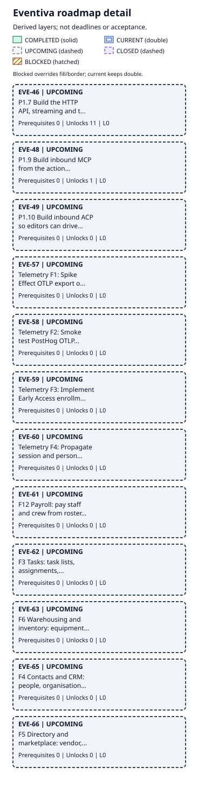

<!-- planning:generated:start -->
# Layer 0, group 4

[All layers](README.md) | [Full Mermaid](graph.mmd) | [Full SVG](../roadmap.svg)

Each row links to the complete mirrored specification/discussion. BLOCKED is an additional planning signal, not a replacement Linear status. Closed duplicates are not completed implementation. Related/duplicate relations remain in the issue page. Parent membership is not a dependency.

| Issue / source specification | Planning / Linear state | Recorded phase / project | All prerequisites | Open prerequisite blockers | Unlocks / precedes | Parent |
| --- | --- | --- | --- | --- | --- | --- | --- |
| [EVE-46](../issues/EVE-46.md) P1.7 Build the HTTP API, streaming and the typed client from the action inventory | **UPCOMING**; captured Linear: Backlog | P1.7; Eventiva platform foundations | None recorded | None recorded | [EVE-113](../issues/EVE-113.md), [EVE-126](../issues/EVE-126.md), [EVE-132](../issues/EVE-132.md), [EVE-140](../issues/EVE-140.md), [EVE-162](../issues/EVE-162.md), [EVE-174](../issues/EVE-174.md), [EVE-175](../issues/EVE-175.md), [EVE-205](../issues/EVE-205.md), [EVE-219](../issues/EVE-219.md), [EVE-221](../issues/EVE-221.md), [EVE-230](../issues/EVE-230.md) | [EVE-13](../issues/EVE-13.md) |
| [EVE-48](../issues/EVE-48.md) P1.9 Build inbound MCP from the action inventory | **UPCOMING**; captured Linear: Backlog | P1.9; Eventiva platform foundations | None recorded | None recorded | [EVE-165](../issues/EVE-165.md) | [EVE-13](../issues/EVE-13.md) |
| [EVE-49](../issues/EVE-49.md) P1.10 Build inbound ACP so editors can drive Eventiva&apos;s agent | **UPCOMING**; captured Linear: Backlog | P1.10; Eventiva platform foundations | None recorded | None recorded | None recorded | [EVE-13](../issues/EVE-13.md) |
| [EVE-57](../issues/EVE-57.md) Telemetry F1: Spike Effect OTLP export of traces and metrics from Expo on Hermes | **UPCOMING**; captured Linear: Backlog | No numbered phase recorded; Eventiva platform foundations | None recorded | None recorded | None recorded | [EVE-13](../issues/EVE-13.md) |
| [EVE-58](../issues/EVE-58.md) Telemetry F2: Smoke test PostHog OTLP endpoints and auth for logs, traces, metrics and AI spans | **UPCOMING**; captured Linear: Backlog; later-status 2026-11-18T08:47:33.830Z: Live MCP retains Backlog. Owner-relayed dev/staging activation selects existing EU project 344329. Server-only flag aliases target only development/staging; private root HKDF custody and persistent exact-scope SQL consent are implemented locally, not yet delivered. Private project secrets and independently delivered OIDC seam remain prerequisites to exact event/trace arrival proof. No production, full endpoint/auth matrix or whole-issue acceptance. Historical snapshot is unchanged. [evidence](https://linear.app/resnovas/issue/EVE-58#comment-1ab3f885-5de7-49bc-841d-21126d64fef0), [evidence](https://ampcode.com/threads/T-01a1edbf-66b8-7570-b2b1-31c82b6132c5) | No numbered phase recorded; Eventiva platform foundations | None recorded | None recorded | None recorded | [EVE-13](../issues/EVE-13.md) |
| [EVE-59](../issues/EVE-59.md) Telemetry F3: Implement Early Access enrollment on native and server through the Flags service | **UPCOMING**; captured Linear: Backlog | No numbered phase recorded; Eventiva platform foundations | None recorded | None recorded | None recorded | [EVE-13](../issues/EVE-13.md) |
| [EVE-60](../issues/EVE-60.md) Telemetry F4: Propagate session and person context from clients into server spans, logs, errors and AI spans | **UPCOMING**; captured Linear: Backlog; later-status 2026-11-18T08:47:34.756Z: Live MCP retains Backlog. Later owner relay authorizes non-production real identity/consent/root custody composition: HKDF-SHA256 derives exact environment/tenant/destination/purpose/UTC-hour keys from one private root. Existing pseudonym-only, live consent, profile, per-request opt-in and production denials remain. Focused persistent SQL/crypto/composition proof is not real PostHog arrival, native/replay or full issue acceptance; private secrets and delivered EVE-43 integration are pending. [evidence](https://linear.app/resnovas/issue/EVE-60#comment-0e6caaaf-6444-4066-8c8a-c06f2a69cb06), [evidence](https://ampcode.com/threads/T-01a1edbf-66b8-7570-b2b1-31c82b6132c5) | No numbered phase recorded; Eventiva platform foundations | None recorded | None recorded | None recorded | [EVE-13](../issues/EVE-13.md) |
| [EVE-61](../issues/EVE-61.md) F12 Payroll: pay staff and crew from rosters and approved timesheets | **UPCOMING**; captured Linear: Backlog | F12; Eventiva product features | None recorded | None recorded | None recorded | None recorded |
| [EVE-62](../issues/EVE-62.md) F3 Tasks: task lists, assignments, dependencies and checklists per event | **UPCOMING**; captured Linear: Backlog | F3; Eventiva product features | None recorded | None recorded | None recorded | None recorded |
| [EVE-63](../issues/EVE-63.md) F6 Warehousing and inventory: equipment, stock, availability, purchasing and maintenance | **UPCOMING**; captured Linear: Backlog | F6; Eventiva product features | None recorded | None recorded | None recorded | None recorded |
| [EVE-65](../issues/EVE-65.md) F4 Contacts and CRM: people, organisations, relationships and history | **UPCOMING**; captured Linear: Backlog | F4; Eventiva product features | None recorded | None recorded | None recorded | None recorded |
| [EVE-66](../issues/EVE-66.md) F5 Directory and marketplace: vendor, venue and professional listings, search, enquiries, quotes and reviews | **UPCOMING**; captured Linear: Backlog | F5; Eventiva product features | None recorded | None recorded | None recorded | None recorded |
<!-- planning:generated:end -->
