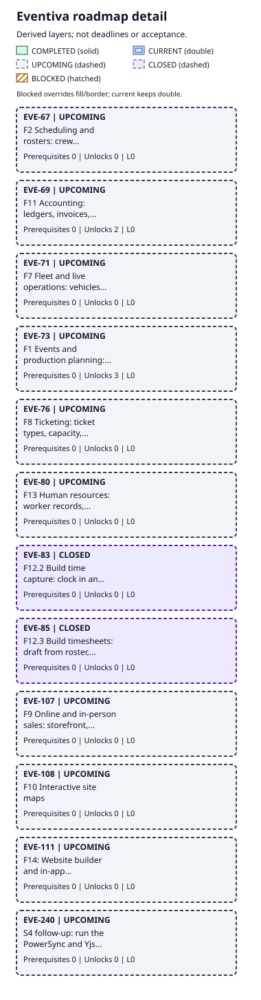

<!-- planning:generated:start -->
# Layer 0, group 5

[All layers](README.md) | [Full Mermaid](graph.mmd) | [Full SVG](../roadmap.svg)

Each row links to the complete mirrored specification/discussion. BLOCKED is an additional planning signal, not a replacement Linear status. Closed duplicates are not completed implementation. Related/duplicate relations remain in the issue page. Parent membership is not a dependency.

| Issue / source specification | Planning / Linear state | Recorded phase / project | All prerequisites | Open prerequisite blockers | Unlocks / precedes | Parent |
| --- | --- | --- | --- | --- | --- | --- | --- |
| [EVE-67](../issues/EVE-67.md) F2 Scheduling and rosters: crew availability, shifts, offers, call sheets and timesheets | **UPCOMING**; captured Linear: Backlog | F2; Eventiva product features | None recorded | None recorded | None recorded | None recorded |
| [EVE-69](../issues/EVE-69.md) F11 Accounting: ledgers, invoices, bills, event budgets and tax | **UPCOMING**; captured Linear: Backlog | F11; Eventiva product features | None recorded | None recorded | [EVE-187](../issues/EVE-187.md), [EVE-190](../issues/EVE-190.md) | None recorded |
| [EVE-71](../issues/EVE-71.md) F7 Fleet and live operations: vehicles, maintenance, units, dispatch and crew MDT | **UPCOMING**; captured Linear: Backlog | F7; Eventiva product features | None recorded | None recorded | None recorded | None recorded |
| [EVE-73](../issues/EVE-73.md) F1 Events and production planning: the event record, run of show, departments, cues and show control | **UPCOMING**; captured Linear: Backlog | F1; Eventiva product features | None recorded | None recorded | [EVE-123](../issues/EVE-123.md), [EVE-129](../issues/EVE-129.md), [EVE-135](../issues/EVE-135.md) | None recorded |
| [EVE-76](../issues/EVE-76.md) F8 Ticketing: ticket types, capacity, issuance, admissions and scanning | **UPCOMING**; captured Linear: Backlog | F8; Eventiva product features | None recorded | None recorded | None recorded | None recorded |
| [EVE-80](../issues/EVE-80.md) F13 Human resources: worker records, onboarding, qualifications and leave | **UPCOMING**; captured Linear: Backlog | F13; Eventiva product features | None recorded | None recorded | None recorded | None recorded |
| [EVE-83](../issues/EVE-83.md) F12.2 Build time capture: clock in and out and time entries, offline | **CLOSED**; captured Linear: Duplicate | F12.2; Eventiva product features | None recorded | None recorded | None recorded | [EVE-61](../issues/EVE-61.md) |
| [EVE-85](../issues/EVE-85.md) F12.3 Build timesheets: draft from roster, submit and approve | **CLOSED**; captured Linear: Duplicate | F12.3; Eventiva product features | None recorded | None recorded | None recorded | [EVE-61](../issues/EVE-61.md) |
| [EVE-107](../issues/EVE-107.md) F9 Online and in-person sales: storefront, point of sale, orders, payments, fulfilment and refunds | **UPCOMING**; captured Linear: Backlog | F9; Eventiva product features | None recorded | None recorded | None recorded | None recorded |
| [EVE-108](../issues/EVE-108.md) F10 Interactive site maps | **UPCOMING**; captured Linear: Backlog | F10; Eventiva product features | None recorded | None recorded | None recorded | None recorded |
| [EVE-111](../issues/EVE-111.md) F14: Website builder and in-app customisation | **UPCOMING**; captured Linear: Backlog | F14; Eventiva product features | None recorded | None recorded | None recorded | None recorded |
| [EVE-240](../issues/EVE-240.md) S4 follow-up: run the PowerSync and Yjs device test on iOS | **UPCOMING**; captured Linear: Backlog | No numbered phase recorded; Eventiva platform foundations | None recorded | None recorded | None recorded | [EVE-13](../issues/EVE-13.md) |
<!-- planning:generated:end -->
