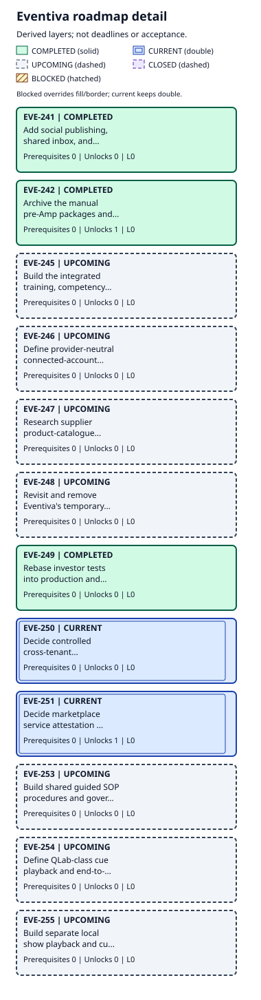

<!-- planning:generated:start -->
# Layer 0, group 6

[All layers](README.md) | [Full Mermaid](graph.mmd) | [Full SVG](../roadmap.svg)

Each row links to the complete mirrored specification/discussion. BLOCKED is an additional planning signal, not a replacement Linear status. Closed duplicates are not completed implementation. Related/duplicate relations remain in the issue page. Parent membership is not a dependency.

| Issue / source specification | Planning / Linear state | Recorded phase / project | All prerequisites | Open prerequisite blockers | Unlocks / precedes | Parent |
| --- | --- | --- | --- | --- | --- | --- | --- |
| [EVE-241](../issues/EVE-241.md) Add social publishing, shared inbox, and analytics suite | **COMPLETED**; captured Linear: Done | No numbered phase recorded; Eventiva platform foundations | None recorded | None recorded | None recorded | None recorded |
| [EVE-242](../issues/EVE-242.md) Archive the manual pre-Amp packages and create a clean package tree | **COMPLETED**; captured Linear: Done | No numbered phase recorded; Eventiva platform foundations | None recorded | None recorded | [EVE-243](../issues/EVE-243.md) | [EVE-13](../issues/EVE-13.md) |
| [EVE-245](../issues/EVE-245.md) Build the integrated training, competency and certification platform | **UPCOMING**; captured Linear: Backlog | No numbered phase recorded; No project | None recorded | None recorded | None recorded | None recorded |
| [EVE-246](../issues/EVE-246.md) Define provider-neutral connected-account invoicing and settlement orchestration | **UPCOMING**; captured Linear: Backlog; later-status 2026-11-18: Jonathan resumed the named issues on 2026-11-18. First bounded slice adds a schema-validated advisory per-obligation fulfilment assessment with fake-clock 14/7/3-day boundaries, no-response reminders and dispute/unsupported-hold refusal. Focused tests and TypeScript compilation pass; full gates and signed delivery are recorded separately. No provider command, payment, dependency, production integration or whole-issue acceptance. The historical issue capture is unchanged. [evidence](https://ampcode.com/threads/T-01a1e940-37a3-7691-a5c0-e935b711c99a#M-034zciY2mZuppwjcEvwc6g), [evidence](https://linear.app/resnovas/issue/EVE-246#comment-1301864e) | No numbered phase recorded; Eventiva product features | None recorded | None recorded | None recorded | [EVE-107](../issues/EVE-107.md) |
| [EVE-247](../issues/EVE-247.md) Research supplier product-catalogue coverage and bulk inventory onboarding | **UPCOMING**; captured Linear: Backlog; later-status 2026-11-18: Owner resumed the named issue. First bounded library slice previews mapped bulk stock against separate public model identities. Exact case-insensitive matching retains punctuation/variants; invalid rows, all colliding valid SKUs and ambiguous references remain explicit. Conservative 1000-row/10000-reference limits are implementation choices, not researched coverage. Eight focused tests across the payment/catalogue modules and TypeScript compilation pass; full gates and signed delivery follow separately. The catalogue guide separately cites two official manufacturer samples and two inventory-tool format guides; source rights, connector compatibility and supplier discovery remain open. No scraping, source-rights claim, stock persistence, dependency or broader acceptance. Frozen source remains historical. [evidence](https://ampcode.com/threads/T-01a1e940-37a3-7691-a5c0-e935b711c99a#M-034zciY2mZuppwjcEvwc6g), [evidence](https://linear.app/resnovas/issue/EVE-247#comment-719b971b) | No numbered phase recorded; Eventiva product features | None recorded | None recorded | None recorded | [EVE-81](../issues/EVE-81.md) |
| [EVE-248](../issues/EVE-248.md) Revisit and remove Eventiva&apos;s temporary house AI-gate override | **UPCOMING / BLOCKED**; captured Linear: Backlog; blocker 2026-11-18: Jonathan&apos;s superseding 2026-11-18 decision: Leave off for now, revisit in January only. Recorded on EVE-248 with due date 2027-01-04. Keep the AI-gate override and all budgets unchanged; do not reopen before January 2027. No further EVE-248 work or read-only investigation by this lane. Supersedes the earlier same-day readiness checkpoint; EVE-246/247 continue independently. Frozen issue capture remains historical. [evidence](https://ampcode.com/threads/T-01a1e940-37a3-7691-a5c0-e935b711c99a#M-034zciY2mZuppwjcEvwc6g), [evidence](https://linear.app/resnovas/issue/EVE-248#comment-887d205b) | No numbered phase recorded; Eventiva platform foundations | None recorded | None recorded; Curated adoption blocker: see cited state evidence | None recorded | [EVE-13](../issues/EVE-13.md) |
| [EVE-249](../issues/EVE-249.md) Rebase investor tests into production and merge changes | **COMPLETED**; captured Linear: Done | No numbered phase recorded; Eventiva platform foundations | None recorded | None recorded | None recorded | None recorded |
| [EVE-250](../issues/EVE-250.md) Decide controlled cross-tenant marketplace gateway architecture | **CURRENT**; captured Linear: In Progress | No numbered phase recorded; Eventiva product features | None recorded | None recorded | None recorded | [EVE-66](../issues/EVE-66.md) |
| [EVE-251](../issues/EVE-251.md) Decide marketplace service attestation and cryptographic trust architecture | **CURRENT**; captured Linear: In Progress; later-status 2026-11-17T15:44:16.936Z: The 14:28:01.568Z slice 4 checkpoint adds independent-process consume-once evidence to the existing default trust fixture: identical and case-equivalent UUID races, one retained matching winner, sanitized fail-closed losers, deterministic replay after all racing clients close, and a distinct-nonce positive control. Both standalone dialect proofs passed; an isolated lowercasing-removal mutation was rejected. The 15:44:16.936Z next-batch slice 2 checkpoint independently read the live description and terminal 16-comment page; EVE-251 remains In Progress. Its A5-policy/A4-evidence adapter-mutation regression reproduced metadata success and nonce consumption before the fix; detached immutable admitted request/policy snapshots passed the initial 170-case checkpoint. The maintained timeline records the final separate suspension barriers, checks and delivery. Aggregate verification and signed delivery are separately recorded on the issue, not inferred from either checkpoint. The captured issue prose remains historical; this is not a full live mirror refresh. No concrete crypto/provider/custody/timing/retention choice, key/plaintext release, production activation or whole-issue completion is established. [evidence](https://linear.app/resnovas/issue/EVE-251#comment-eaf4d8a6-1612-4ae7-9bde-97244b878250), [evidence](https://ampcode.com/threads/T-01a1e9e1-bcd6-7217-97ea-fd5de5a09a96), [evidence](https://linear.app/resnovas/issue/EVE-251#comment-b5a4e484-a21b-4b81-8292-566b8b76ba9d), [evidence](https://ampcode.com/threads/T-01a1ea29-5659-70f4-acdb-3856f1dc28ae) | No numbered phase recorded; Eventiva product features | None recorded | None recorded | [EVE-261](../issues/EVE-261.md) | [EVE-250](../issues/EVE-250.md) |
| [EVE-253](../issues/EVE-253.md) Build shared guided SOP procedures and governed step execution | **UPCOMING**; captured Linear: Backlog | No numbered phase recorded; Eventiva platform foundations | None recorded | None recorded | None recorded | None recorded |
| [EVE-254](../issues/EVE-254.md) Define QLab-class cue playback and end-to-end production control | **UPCOMING**; captured Linear: Backlog | No numbered phase recorded; Eventiva product features | None recorded | None recorded | None recorded | [EVE-73](../issues/EVE-73.md) |
| [EVE-255](../issues/EVE-255.md) Build separate local show playback and cue execution engine | **UPCOMING**; captured Linear: Backlog | No numbered phase recorded; Eventiva product features | None recorded | None recorded | None recorded | [EVE-73](../issues/EVE-73.md) |
<!-- planning:generated:end -->
