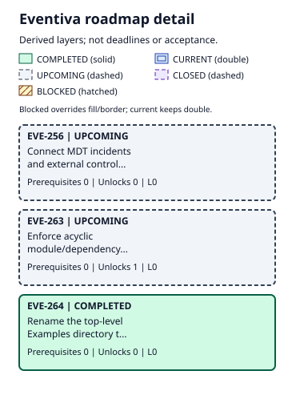

<!-- planning:generated:start -->
# Layer 0, group 7

[All layers](README.md) | [Full Mermaid](graph.mmd) | [Full SVG](../roadmap.svg)

Each row links to the complete mirrored specification/discussion. BLOCKED is an additional planning signal, not a replacement Linear status. Closed duplicates are not completed implementation. Related/duplicate relations remain in the issue page. Parent membership is not a dependency.

| Issue / source specification | Planning / Linear state | Recorded phase / project | All prerequisites | Open prerequisite blockers | Unlocks / precedes | Parent |
| --- | --- | --- | --- | --- | --- | --- | --- |
| [EVE-256](../issues/EVE-256.md) Connect MDT incidents and external controls to live show cues and emergency response presets | **UPCOMING**; captured Linear: Backlog | No numbered phase recorded; No project | None recorded | None recorded | None recorded | None recorded |
| [EVE-263](../issues/EVE-263.md) Enforce acyclic module/dependency graphs and exact Effect-TS types across the extension platform | **UPCOMING**; captured Linear: Backlog | No numbered phase recorded; Eventiva platform foundations | None recorded | None recorded | [EVE-261](../issues/EVE-261.md) | None recorded |
| [EVE-264](../issues/EVE-264.md) Rename the top-level Examples directory to lowercase examples | **COMPLETED**; captured Linear: In Progress; later-status 2026-11-17: Central independently rechecked the live issue via MCP: Done/completed, source updatedAt 2026-11-17T08:24:52.805Z. Acceptance comment and delivered rename commit are cited. Captured Linear remains In Progress; this verified newer state is not full live reacquisition or an acceptance-test rerun. [evidence](https://linear.app/resnovas/issue/EVE-264), [evidence](https://linear.app/resnovas/issue/EVE-264/rename-the-top-level-examples-directory-to-lowercase-examples#comment-9e3bcf9c), [evidence](https://github.com/Resnovas/Eventiva/commit/980cac6f682336e97da5d72dea72650570dab6c7) | No numbered phase recorded; Eventiva platform foundations | None recorded | None recorded | None recorded | None recorded |
<!-- planning:generated:end -->
