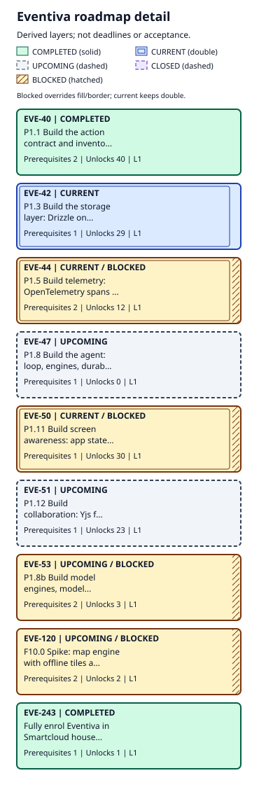

<!-- planning:generated:start -->
# Layer 1, group 1

[All layers](README.md) | [Full Mermaid](graph.mmd) | [Full SVG](../roadmap.svg)

Each row links to the complete mirrored specification/discussion. BLOCKED is an additional planning signal, not a replacement Linear status. Closed duplicates are not completed implementation. Related/duplicate relations remain in the issue page. Parent membership is not a dependency.

| Issue / source specification | Planning / Linear state | Recorded phase / project | All prerequisites | Open prerequisite blockers | Unlocks / precedes | Parent |
| --- | --- | --- | --- | --- | --- | --- | --- |
| [EVE-40](../issues/EVE-40.md) P1.1 Build the action contract and inventory in Effect Schema | **COMPLETED**; captured Linear: Done | P1.1; Eventiva platform foundations | [EVE-14](../issues/EVE-14.md), [EVE-23](../issues/EVE-23.md) | None recorded | [EVE-52](../issues/EVE-52.md), [EVE-56](../issues/EVE-56.md), [EVE-64](../issues/EVE-64.md), [EVE-68](../issues/EVE-68.md), [EVE-74](../issues/EVE-74.md), [EVE-75](../issues/EVE-75.md), [EVE-81](../issues/EVE-81.md), [EVE-82](../issues/EVE-82.md), [EVE-88](../issues/EVE-88.md), [EVE-94](../issues/EVE-94.md), [EVE-96](../issues/EVE-96.md), [EVE-97](../issues/EVE-97.md), [EVE-98](../issues/EVE-98.md), [EVE-100](../issues/EVE-100.md), [EVE-101](../issues/EVE-101.md), [EVE-106](../issues/EVE-106.md), [EVE-112](../issues/EVE-112.md), [EVE-114](../issues/EVE-114.md), [EVE-128](../issues/EVE-128.md), [EVE-129](../issues/EVE-129.md), [EVE-130](../issues/EVE-130.md), [EVE-133](../issues/EVE-133.md), [EVE-138](../issues/EVE-138.md), [EVE-143](../issues/EVE-143.md), [EVE-145](../issues/EVE-145.md), [EVE-146](../issues/EVE-146.md), [EVE-147](../issues/EVE-147.md), [EVE-166](../issues/EVE-166.md), [EVE-170](../issues/EVE-170.md), [EVE-172](../issues/EVE-172.md), [EVE-173](../issues/EVE-173.md), [EVE-177](../issues/EVE-177.md), [EVE-181](../issues/EVE-181.md), [EVE-184](../issues/EVE-184.md), [EVE-204](../issues/EVE-204.md), [EVE-235](../issues/EVE-235.md), [EVE-252](../issues/EVE-252.md), [EVE-257](../issues/EVE-257.md), [EVE-258](../issues/EVE-258.md), [EVE-259](../issues/EVE-259.md) | [EVE-13](../issues/EVE-13.md) |
| [EVE-42](../issues/EVE-42.md) P1.3 Build the storage layer: Drizzle on Postgres and SQLite, state machines and tenant guards | **CURRENT**; captured Linear: In Progress; later-status 2026-11-17: The EVE-258 migration process-loss slice executes on both SQL dialects through the existing public migrator with fixture-only barriers and three distinct SIGKILL workers. Two asymmetric records, exact declaration bytes/checksums and five original revisions survive rollback/retry and acknowledgement loss; repeat history applies nothing and stale writers fail closed. No adapter policy, dependency, secret or production change. Deferred Drizzle/device/provider least-privilege and complete storage acceptance remain open. This dated checkpoint does not silently refresh the captured issue discussion or infer completion. [evidence](https://linear.app/resnovas/issue/EVE-42/p13-build-the-storage-layer-drizzle-on-postgres-and-sqlite-state#comment-b23c70d9), [evidence](https://ampcode.com/threads/T-a0a1608d-284c-46c6-8bd0-372ce1a02efb) | P1.3; Eventiva platform foundations | [EVE-23](../issues/EVE-23.md) | None recorded | [EVE-54](../issues/EVE-54.md), [EVE-55](../issues/EVE-55.md), [EVE-64](../issues/EVE-64.md), [EVE-68](../issues/EVE-68.md), [EVE-74](../issues/EVE-74.md), [EVE-75](../issues/EVE-75.md), [EVE-81](../issues/EVE-81.md), [EVE-82](../issues/EVE-82.md), [EVE-87](../issues/EVE-87.md), [EVE-94](../issues/EVE-94.md), [EVE-98](../issues/EVE-98.md), [EVE-100](../issues/EVE-100.md), [EVE-103](../issues/EVE-103.md), [EVE-106](../issues/EVE-106.md), [EVE-112](../issues/EVE-112.md), [EVE-128](../issues/EVE-128.md), [EVE-129](../issues/EVE-129.md), [EVE-131](../issues/EVE-131.md), [EVE-133](../issues/EVE-133.md), [EVE-136](../issues/EVE-136.md), [EVE-138](../issues/EVE-138.md), [EVE-143](../issues/EVE-143.md), [EVE-145](../issues/EVE-145.md), [EVE-146](../issues/EVE-146.md), [EVE-166](../issues/EVE-166.md), [EVE-170](../issues/EVE-170.md), [EVE-172](../issues/EVE-172.md), [EVE-204](../issues/EVE-204.md), [EVE-252](../issues/EVE-252.md) | [EVE-13](../issues/EVE-13.md) |
| [EVE-44](../issues/EVE-44.md) P1.5 Build telemetry: OpenTelemetry spans on every call and a vendor-neutral tracking port | **CURRENT / BLOCKED**; captured Linear: In Progress | P1.5; Eventiva platform foundations | [EVE-19](../issues/EVE-19.md), [EVE-21](../issues/EVE-21.md) | [EVE-21](../issues/EVE-21.md) | [EVE-74](../issues/EVE-74.md), [EVE-87](../issues/EVE-87.md), [EVE-116](../issues/EVE-116.md), [EVE-164](../issues/EVE-164.md), [EVE-181](../issues/EVE-181.md), [EVE-205](../issues/EVE-205.md), [EVE-221](../issues/EVE-221.md), [EVE-228](../issues/EVE-228.md), [EVE-230](../issues/EVE-230.md), [EVE-231](../issues/EVE-231.md), [EVE-260](../issues/EVE-260.md), [EVE-261](../issues/EVE-261.md) | [EVE-13](../issues/EVE-13.md) |
| [EVE-47](../issues/EVE-47.md) P1.8 Build the agent: loop, engines, durable runs, threads and harness | **UPCOMING**; captured Linear: Backlog | P1.8; Eventiva platform foundations | [EVE-14](../issues/EVE-14.md) | None recorded | None recorded | [EVE-13](../issues/EVE-13.md) |
| [EVE-50](../issues/EVE-50.md) P1.11 Build screen awareness: app state, navigation and the screen registry on React Native | **CURRENT / BLOCKED**; captured Linear: In Progress | P1.11; Eventiva platform foundations | [EVE-16](../issues/EVE-16.md) | [EVE-16](../issues/EVE-16.md) | [EVE-77](../issues/EVE-77.md), [EVE-81](../issues/EVE-81.md), [EVE-86](../issues/EVE-86.md), [EVE-94](../issues/EVE-94.md), [EVE-101](../issues/EVE-101.md), [EVE-104](../issues/EVE-104.md), [EVE-106](../issues/EVE-106.md), [EVE-112](../issues/EVE-112.md), [EVE-115](../issues/EVE-115.md), [EVE-116](../issues/EVE-116.md), [EVE-122](../issues/EVE-122.md), [EVE-125](../issues/EVE-125.md), [EVE-134](../issues/EVE-134.md), [EVE-138](../issues/EVE-138.md), [EVE-147](../issues/EVE-147.md), [EVE-148](../issues/EVE-148.md), [EVE-162](../issues/EVE-162.md), [EVE-166](../issues/EVE-166.md), [EVE-168](../issues/EVE-168.md), [EVE-169](../issues/EVE-169.md), [EVE-175](../issues/EVE-175.md), [EVE-176](../issues/EVE-176.md), [EVE-178](../issues/EVE-178.md), [EVE-182](../issues/EVE-182.md), [EVE-186](../issues/EVE-186.md), [EVE-201](../issues/EVE-201.md), [EVE-211](../issues/EVE-211.md), [EVE-217](../issues/EVE-217.md), [EVE-224](../issues/EVE-224.md), [EVE-260](../issues/EVE-260.md) | [EVE-13](../issues/EVE-13.md) |
| [EVE-51](../issues/EVE-51.md) P1.12 Build collaboration: Yjs for text and canvas with record sync and authorization at sync | **UPCOMING**; captured Linear: Backlog | P1.12; Eventiva platform foundations | [EVE-17](../issues/EVE-17.md) | None recorded | [EVE-64](../issues/EVE-64.md), [EVE-95](../issues/EVE-95.md), [EVE-103](../issues/EVE-103.md), [EVE-109](../issues/EVE-109.md), [EVE-121](../issues/EVE-121.md), [EVE-122](../issues/EVE-122.md), [EVE-125](../issues/EVE-125.md), [EVE-133](../issues/EVE-133.md), [EVE-134](../issues/EVE-134.md), [EVE-135](../issues/EVE-135.md), [EVE-138](../issues/EVE-138.md), [EVE-147](../issues/EVE-147.md), [EVE-152](../issues/EVE-152.md), [EVE-166](../issues/EVE-166.md), [EVE-167](../issues/EVE-167.md), [EVE-169](../issues/EVE-169.md), [EVE-173](../issues/EVE-173.md), [EVE-176](../issues/EVE-176.md), [EVE-192](../issues/EVE-192.md), [EVE-201](../issues/EVE-201.md), [EVE-204](../issues/EVE-204.md), [EVE-211](../issues/EVE-211.md), [EVE-239](../issues/EVE-239.md) | [EVE-13](../issues/EVE-13.md) |
| [EVE-53](../issues/EVE-53.md) P1.8b Build model engines, model selection and user-owned subscriptions | **UPCOMING / BLOCKED**; captured Linear: Backlog | P1.8; Eventiva platform foundations | [EVE-20](../issues/EVE-20.md), [EVE-41](../issues/EVE-41.md) | [EVE-41](../issues/EVE-41.md) | [EVE-127](../issues/EVE-127.md), [EVE-197](../issues/EVE-197.md), [EVE-227](../issues/EVE-227.md) | [EVE-47](../issues/EVE-47.md) |
| [EVE-120](../issues/EVE-120.md) F10.0 Spike: map engine with offline tiles and Yjs-bound editing on Expo web and Android | **UPCOMING / BLOCKED**; captured Linear: Backlog | F10.0; Eventiva product features | [EVE-16](../issues/EVE-16.md), [EVE-17](../issues/EVE-17.md) | [EVE-16](../issues/EVE-16.md) | [EVE-146](../issues/EVE-146.md), [EVE-211](../issues/EVE-211.md) | [EVE-108](../issues/EVE-108.md) |
| [EVE-243](../issues/EVE-243.md) Fully enrol Eventiva in Smartcloud house synchronization | **COMPLETED**; captured Linear: Done | No numbered phase recorded; Eventiva platform foundations | [EVE-242](../issues/EVE-242.md) | None recorded | [EVE-244](../issues/EVE-244.md) | [EVE-13](../issues/EVE-13.md) |
<!-- planning:generated:end -->
