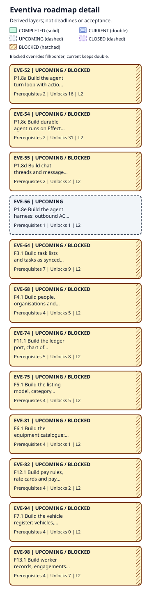

<!-- planning:generated:start -->
# Layer 2, group 1

[All layers](README.md) | [Full Mermaid](graph.mmd) | [Full SVG](../roadmap.svg)

Each row links to the complete mirrored specification/discussion. BLOCKED is an additional planning signal, not a replacement Linear status. Closed duplicates are not completed implementation. Related/duplicate relations remain in the issue page. Parent membership is not a dependency.

| Issue / source specification | Planning / Linear state | Recorded phase / project | All prerequisites | Open prerequisite blockers | Unlocks / precedes | Parent |
| --- | --- | --- | --- | --- | --- | --- | --- |
| [EVE-52](../issues/EVE-52.md) P1.8a Build the agent turn loop with actions as tools | **UPCOMING / BLOCKED**; captured Linear: Backlog | P1.8; Eventiva platform foundations | [EVE-40](../issues/EVE-40.md), [EVE-43](../issues/EVE-43.md) | [EVE-43](../issues/EVE-43.md) | [EVE-104](../issues/EVE-104.md), [EVE-110](../issues/EVE-110.md), [EVE-127](../issues/EVE-127.md), [EVE-142](../issues/EVE-142.md), [EVE-144](../issues/EVE-144.md), [EVE-165](../issues/EVE-165.md), [EVE-186](../issues/EVE-186.md), [EVE-196](../issues/EVE-196.md), [EVE-197](../issues/EVE-197.md), [EVE-198](../issues/EVE-198.md), [EVE-212](../issues/EVE-212.md), [EVE-215](../issues/EVE-215.md), [EVE-220](../issues/EVE-220.md), [EVE-224](../issues/EVE-224.md), [EVE-227](../issues/EVE-227.md), [EVE-230](../issues/EVE-230.md) | [EVE-47](../issues/EVE-47.md) |
| [EVE-54](../issues/EVE-54.md) P1.8c Build durable agent runs on Effect Cluster and Workflow | **UPCOMING / BLOCKED**; captured Linear: Backlog | P1.8; Eventiva platform foundations | [EVE-18](../issues/EVE-18.md), [EVE-42](../issues/EVE-42.md) | [EVE-42](../issues/EVE-42.md) | [EVE-87](../issues/EVE-87.md), [EVE-89](../issues/EVE-89.md), [EVE-90](../issues/EVE-90.md), [EVE-99](../issues/EVE-99.md), [EVE-104](../issues/EVE-104.md), [EVE-105](../issues/EVE-105.md), [EVE-110](../issues/EVE-110.md), [EVE-114](../issues/EVE-114.md), [EVE-124](../issues/EVE-124.md), [EVE-139](../issues/EVE-139.md), [EVE-142](../issues/EVE-142.md), [EVE-143](../issues/EVE-143.md), [EVE-145](../issues/EVE-145.md), [EVE-147](../issues/EVE-147.md), [EVE-153](../issues/EVE-153.md), [EVE-156](../issues/EVE-156.md), [EVE-165](../issues/EVE-165.md), [EVE-177](../issues/EVE-177.md), [EVE-181](../issues/EVE-181.md), [EVE-186](../issues/EVE-186.md), [EVE-191](../issues/EVE-191.md), [EVE-196](../issues/EVE-196.md), [EVE-198](../issues/EVE-198.md), [EVE-199](../issues/EVE-199.md), [EVE-212](../issues/EVE-212.md), [EVE-220](../issues/EVE-220.md), [EVE-224](../issues/EVE-224.md), [EVE-233](../issues/EVE-233.md), [EVE-235](../issues/EVE-235.md), [EVE-239](../issues/EVE-239.md), [EVE-261](../issues/EVE-261.md) | [EVE-47](../issues/EVE-47.md) |
| [EVE-55](../issues/EVE-55.md) P1.8d Build chat threads and message projections | **UPCOMING / BLOCKED**; captured Linear: Backlog | P1.8; Eventiva platform foundations | [EVE-42](../issues/EVE-42.md), [EVE-45](../issues/EVE-45.md) | [EVE-42](../issues/EVE-42.md), [EVE-45](../issues/EVE-45.md) | [EVE-186](../issues/EVE-186.md), [EVE-212](../issues/EVE-212.md) | [EVE-47](../issues/EVE-47.md) |
| [EVE-56](../issues/EVE-56.md) P1.8e Build the agent harness: outbound ACP, agent memory and context inspection | **UPCOMING**; captured Linear: Backlog | P1.8; Eventiva platform foundations | [EVE-40](../issues/EVE-40.md) | None recorded | [EVE-116](../issues/EVE-116.md) | [EVE-47](../issues/EVE-47.md) |
| [EVE-64](../issues/EVE-64.md) F3.1 Build task lists and tasks as synced records with actions | **UPCOMING / BLOCKED**; captured Linear: Backlog | F3.1; Eventiva product features | [EVE-17](../issues/EVE-17.md), [EVE-23](../issues/EVE-23.md), [EVE-40](../issues/EVE-40.md), [EVE-42](../issues/EVE-42.md), [EVE-43](../issues/EVE-43.md), [EVE-45](../issues/EVE-45.md), [EVE-51](../issues/EVE-51.md) | [EVE-42](../issues/EVE-42.md), [EVE-43](../issues/EVE-43.md), [EVE-45](../issues/EVE-45.md), [EVE-51](../issues/EVE-51.md) | [EVE-70](../issues/EVE-70.md), [EVE-72](../issues/EVE-72.md), [EVE-84](../issues/EVE-84.md), [EVE-86](../issues/EVE-86.md), [EVE-89](../issues/EVE-89.md), [EVE-93](../issues/EVE-93.md), [EVE-109](../issues/EVE-109.md), [EVE-110](../issues/EVE-110.md), [EVE-235](../issues/EVE-235.md) | [EVE-62](../issues/EVE-62.md) |
| [EVE-68](../issues/EVE-68.md) F4.1 Build people, organisations and contact points as CRM actions | **CURRENT / BLOCKED**; captured Linear: Backlog; later-status 2026-11-18: Owner-relayed revision-10 rank-1 continuation adds six sensitive online-only organisation work email/phone actions to the delivered tenant-private organisation backend. Existing lowercase grammar requires crm.contact-point.* and set-primary, without shared naming changes or aliases. Stable UUIDv7 identity, immutable parent/kind/work label, exact unverified values, duplicate distinction and revisioned tombstones retain default-off crm.enabled and live crm.read/write/target/resource authority. Persisted per-organisation/kind guards serialize complete-page primary changes without parent-pair revision writes. Seventeen focused tests pass, including fourteen actual-host PostgreSQL/SQLite scenarios: reopen, original-key/lost-reply replay, post-write rollback/interruption, revision/primary races, whole tombstone-page traversal, tenant isolation, live revocation and actual span/logger/error canaries. Full check/verify repeats preserve kit, catalogue-import, task-traceability, location dcfca0df and authenticated HTTP c88b5cb0 main: 104 aggregate and 17 smoke/dependency tasks; strict scanner 270 files/0 findings, ratchet 0 violations, source/emitted boundaries and cycles zero. Strict reviewed planning and Nx sync pass. Generated outputs, signed SHAs and independent hosted CI are recorded separately in the maintained timeline and verified EVE-68/GitHub835 pair. Unmirrored task comments were explicitly synchronized to GitHub without claiming automatic synchronization. Archive blocks fresh contact operations but is not replay authorization revocation. Intact-schema provider discovery remains incomplete; UUID normalization does not fix bounds/composed/union restrictions. Person/personal kinds, affiliations, private/team sharing, masking/undo, UI/offline/native, transport/provider parity and broad EVE-68 remain open. Frozen capture is unchanged; EVE-248 stays January 2027-deferred, without paid work or production activation. [evidence](https://linear.app/resnovas/issue/EVE-68), [evidence](https://linear.app/resnovas/issue/EVE-68#comment-6ee19fe8-b30c-474b-a1d3-f024ed5812df), [evidence](https://github.com/Resnovas/Eventiva/issues/835#issuecomment-6986135835), [evidence](https://linear.app/resnovas/issue/EVE-68#comment-95d4b0f3-124a-492d-8283-0ba30092ce5e), [evidence](https://linear.app/resnovas/issue/EVE-68#comment-395f9a4b-16a5-4d3c-b52c-2bc39300593d), [evidence](https://linear.app/resnovas/issue/EVE-68#comment-cd5e2833-38a7-4ca8-9ff4-f5972d5f1489), [evidence](https://linear.app/resnovas/issue/EVE-68#comment-0486f3bc-e25d-4585-9056-a9ead4035b31), [evidence](https://github.com/Resnovas/Eventiva/issues/835#issuecomment-6984409366), [evidence](https://linear.app/resnovas/issue/EVE-68#comment-207dc958-d085-4886-95ea-97d66d2b50c3), [evidence](https://linear.app/resnovas/issue/EVE-68#comment-2ab7c5ec-9d28-4283-964d-bb422021dba5), [evidence](https://linear.app/resnovas/issue/EVE-68#comment-1fb5f620-046e-4144-8f24-64e20c3ca4a3), [evidence](https://linear.app/resnovas/issue/EVE-68#comment-3601c5f9-a453-4a11-be9a-d3447fbe8ef3), [evidence](https://linear.app/resnovas/issue/EVE-68#comment-ca2f3188-82eb-49a1-92c8-cd4105fdb0ba), [evidence](https://linear.app/resnovas/issue/EVE-68#comment-51e7e3a9-f92f-4bc7-95ac-5a1057a3c941), [evidence](https://ampcode.com/threads/T-01a1e940-37a3-7691-a5c0-e935b711c99a) | F4.1; Eventiva product features | [EVE-23](../issues/EVE-23.md), [EVE-40](../issues/EVE-40.md), [EVE-42](../issues/EVE-42.md), [EVE-43](../issues/EVE-43.md) | [EVE-42](../issues/EVE-42.md), [EVE-43](../issues/EVE-43.md) | [EVE-91](../issues/EVE-91.md), [EVE-95](../issues/EVE-95.md), [EVE-99](../issues/EVE-99.md), [EVE-102](../issues/EVE-102.md), [EVE-105](../issues/EVE-105.md) | [EVE-65](../issues/EVE-65.md) |
| [EVE-74](../issues/EVE-74.md) F11.1 Build the ledger port, chart of accounts, journals and periods | **UPCOMING / BLOCKED**; captured Linear: Backlog | F11.1; Eventiva product features | [EVE-40](../issues/EVE-40.md), [EVE-41](../issues/EVE-41.md), [EVE-42](../issues/EVE-42.md), [EVE-43](../issues/EVE-43.md), [EVE-44](../issues/EVE-44.md) | [EVE-41](../issues/EVE-41.md), [EVE-42](../issues/EVE-42.md), [EVE-43](../issues/EVE-43.md), [EVE-44](../issues/EVE-44.md) | [EVE-90](../issues/EVE-90.md), [EVE-125](../issues/EVE-125.md), [EVE-126](../issues/EVE-126.md), [EVE-127](../issues/EVE-127.md), [EVE-157](../issues/EVE-157.md), [EVE-158](../issues/EVE-158.md), [EVE-159](../issues/EVE-159.md), [EVE-160](../issues/EVE-160.md) | [EVE-69](../issues/EVE-69.md) |
| [EVE-75](../issues/EVE-75.md) F5.1 Build the listing model, category taxonomy and listing actions | **UPCOMING / BLOCKED**; captured Linear: Backlog | F5.1; Eventiva product features | [EVE-25](../issues/EVE-25.md), [EVE-40](../issues/EVE-40.md), [EVE-42](../issues/EVE-42.md), [EVE-43](../issues/EVE-43.md) | [EVE-25](../issues/EVE-25.md), [EVE-42](../issues/EVE-42.md), [EVE-43](../issues/EVE-43.md) | [EVE-77](../issues/EVE-77.md), [EVE-78](../issues/EVE-78.md), [EVE-79](../issues/EVE-79.md), [EVE-119](../issues/EVE-119.md), [EVE-161](../issues/EVE-161.md) | [EVE-66](../issues/EVE-66.md) |
| [EVE-81](../issues/EVE-81.md) F6.1 Build the equipment catalogue: products, tracking modes and kits | **UPCOMING / BLOCKED**; captured Linear: Backlog; later-status 2026-11-18: Live description and terminal five-comment page retain Backlog. Rank-2 revision-7 dispatch adds private online-only kit define/get alongside existing products, using default-off inventory and catalogue permissions. Kit-owned tenant CAS guard serializes complete bounded graph validation and full composition replacement on the existing Resources/Integrity owner; no Product/product-guard or stock write. Focused real PostgreSQL/SQLite kit/product/import tests pass, including opposite-edge initialization contention, nested exact values, replay/history, rollback, cycle/limit, retained-target/corrupt-codec and live policy controls. Check and fixture-backed full verify pass after both HTTP batch main 21438ec0 and CRM main dd2e9796 rebases: 34 aggregate projects, source/declaration boundaries and three smoke projects. Both CRM and kit exports are preserved. Final strict scanner reports 264 editable files with zero findings; Nx sync and strict reviewed planning pass. Engineering ceilings are 100 components, integer quantities up to 1000000, 1000 total tenant kit definitions and 1000 distinct reachable Products including leaves; exact each units only. These reversible memory/IO safeguards are not owner-selected business parameters. Exact signed SHAs and remote CI are recorded separately on the issue. Discovery/provider parity, UI/sync, rich product fields, stock/fulfilment and broad EVE-81 acceptance remain open. Compiler/product/import/SQL/protected execution sources are unchanged. EVE-248 stays deferred until January 2027; no paid work or production activation. Frozen historical issue capture is unchanged. [evidence](https://linear.app/resnovas/issue/EVE-81#comment-990d77fb-141a-4ce0-8195-f10727cfcf25), [evidence](https://linear.app/resnovas/issue/EVE-81#comment-200caff5-26f0-4c7c-94d9-9cc9c3925dc7), [evidence](https://ampcode.com/threads/T-01a1ee61-3b8d-76e1-acd9-cd77319ec06c), [evidence](https://ampcode.com/artifacts/next-implementation-packets-cd16f2fd-d187-4163-9463-9270422c87b0) | F6.1; Eventiva product features | [EVE-40](../issues/EVE-40.md), [EVE-42](../issues/EVE-42.md), [EVE-43](../issues/EVE-43.md), [EVE-50](../issues/EVE-50.md) | [EVE-42](../issues/EVE-42.md), [EVE-43](../issues/EVE-43.md), [EVE-50](../issues/EVE-50.md) | [EVE-103](../issues/EVE-103.md) | [EVE-63](../issues/EVE-63.md) |
| [EVE-82](../issues/EVE-82.md) F12.1 Build pay rules, rate cards and pay profiles | **UPCOMING / BLOCKED**; captured Linear: Backlog | F12.1; Eventiva product features | [EVE-23](../issues/EVE-23.md), [EVE-40](../issues/EVE-40.md), [EVE-42](../issues/EVE-42.md), [EVE-43](../issues/EVE-43.md) | [EVE-42](../issues/EVE-42.md), [EVE-43](../issues/EVE-43.md) | [EVE-87](../issues/EVE-87.md), [EVE-138](../issues/EVE-138.md) | [EVE-61](../issues/EVE-61.md) |
| [EVE-94](../issues/EVE-94.md) F7.1 Build the vehicle register: vehicles, types and documents | **UPCOMING / BLOCKED**; captured Linear: Backlog | F7.1; Eventiva product features | [EVE-40](../issues/EVE-40.md), [EVE-42](../issues/EVE-42.md), [EVE-43](../issues/EVE-43.md), [EVE-50](../issues/EVE-50.md) | [EVE-42](../issues/EVE-42.md), [EVE-43](../issues/EVE-43.md), [EVE-50](../issues/EVE-50.md) | None recorded | [EVE-71](../issues/EVE-71.md) |
| [EVE-98](../issues/EVE-98.md) F13.1 Build worker records, engagements and organisation structure | **UPCOMING / BLOCKED**; captured Linear: Backlog | F13.1; Eventiva product features | [EVE-23](../issues/EVE-23.md), [EVE-40](../issues/EVE-40.md), [EVE-42](../issues/EVE-42.md), [EVE-43](../issues/EVE-43.md) | [EVE-42](../issues/EVE-42.md), [EVE-43](../issues/EVE-43.md) | [EVE-116](../issues/EVE-116.md), [EVE-121](../issues/EVE-121.md), [EVE-153](../issues/EVE-153.md), [EVE-154](../issues/EVE-154.md), [EVE-156](../issues/EVE-156.md), [EVE-179](../issues/EVE-179.md), [EVE-239](../issues/EVE-239.md) | [EVE-80](../issues/EVE-80.md) |
<!-- planning:generated:end -->
