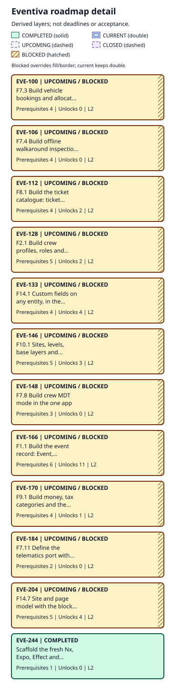

<!-- planning:generated:start -->
# Layer 2, group 2

[All layers](README.md) | [Full Mermaid](graph.mmd) | [Full SVG](../roadmap.svg)

Each row links to the complete mirrored specification/discussion. BLOCKED is an additional planning signal, not a replacement Linear status. Closed duplicates are not completed implementation. Related/duplicate relations remain in the issue page. Parent membership is not a dependency.

| Issue / source specification | Planning / Linear state | Recorded phase / project | All prerequisites | Open prerequisite blockers | Unlocks / precedes | Parent |
| --- | --- | --- | --- | --- | --- | --- | --- |
| [EVE-100](../issues/EVE-100.md) F7.3 Build vehicle bookings and allocation to events without clashes | **UPCOMING / BLOCKED**; captured Linear: Backlog | F7.3; Eventiva product features | [EVE-33](../issues/EVE-33.md), [EVE-40](../issues/EVE-40.md), [EVE-42](../issues/EVE-42.md), [EVE-45](../issues/EVE-45.md) | [EVE-33](../issues/EVE-33.md), [EVE-42](../issues/EVE-42.md), [EVE-45](../issues/EVE-45.md) | None recorded | [EVE-71](../issues/EVE-71.md) |
| [EVE-106](../issues/EVE-106.md) F7.4 Build offline walkaround inspections and defect reporting | **UPCOMING / BLOCKED**; captured Linear: Backlog | F7.4; Eventiva product features | [EVE-17](../issues/EVE-17.md), [EVE-40](../issues/EVE-40.md), [EVE-42](../issues/EVE-42.md), [EVE-50](../issues/EVE-50.md) | [EVE-42](../issues/EVE-42.md), [EVE-50](../issues/EVE-50.md) | None recorded | [EVE-71](../issues/EVE-71.md) |
| [EVE-112](../issues/EVE-112.md) F8.1 Build the ticket catalogue: ticket types, capacity pools, sales windows and access codes | **UPCOMING / BLOCKED**; captured Linear: Backlog | F8.1; Eventiva product features | [EVE-40](../issues/EVE-40.md), [EVE-42](../issues/EVE-42.md), [EVE-43](../issues/EVE-43.md), [EVE-50](../issues/EVE-50.md) | [EVE-42](../issues/EVE-42.md), [EVE-43](../issues/EVE-43.md), [EVE-50](../issues/EVE-50.md) | [EVE-114](../issues/EVE-114.md), [EVE-211](../issues/EVE-211.md) | [EVE-76](../issues/EVE-76.md) |
| [EVE-128](../issues/EVE-128.md) F2.1 Build crew profiles, roles and availability | **UPCOMING / BLOCKED**; captured Linear: Backlog | F2.1; Eventiva product features | [EVE-17](../issues/EVE-17.md), [EVE-33](../issues/EVE-33.md), [EVE-40](../issues/EVE-40.md), [EVE-42](../issues/EVE-42.md), [EVE-43](../issues/EVE-43.md) | [EVE-33](../issues/EVE-33.md), [EVE-42](../issues/EVE-42.md), [EVE-43](../issues/EVE-43.md) | [EVE-129](../issues/EVE-129.md), [EVE-130](../issues/EVE-130.md) | [EVE-67](../issues/EVE-67.md) |
| [EVE-133](../issues/EVE-133.md) F14.1 Custom fields on any entity, in the action inventory | **UPCOMING / BLOCKED**; captured Linear: Backlog | F14.1; Eventiva product features | [EVE-40](../issues/EVE-40.md), [EVE-42](../issues/EVE-42.md), [EVE-43](../issues/EVE-43.md), [EVE-51](../issues/EVE-51.md) | [EVE-42](../issues/EVE-42.md), [EVE-43](../issues/EVE-43.md), [EVE-51](../issues/EVE-51.md) | [EVE-155](../issues/EVE-155.md), [EVE-168](../issues/EVE-168.md), [EVE-185](../issues/EVE-185.md), [EVE-219](../issues/EVE-219.md) | [EVE-111](../issues/EVE-111.md) |
| [EVE-146](../issues/EVE-146.md) F10.1 Sites, levels, base layers and calibration | **UPCOMING / BLOCKED**; captured Linear: Backlog | F10.1; Eventiva product features | [EVE-25](../issues/EVE-25.md), [EVE-40](../issues/EVE-40.md), [EVE-42](../issues/EVE-42.md), [EVE-43](../issues/EVE-43.md), [EVE-120](../issues/EVE-120.md) | [EVE-25](../issues/EVE-25.md), [EVE-42](../issues/EVE-42.md), [EVE-43](../issues/EVE-43.md), [EVE-120](../issues/EVE-120.md) | [EVE-152](../issues/EVE-152.md), [EVE-201](../issues/EVE-201.md), [EVE-238](../issues/EVE-238.md) | [EVE-108](../issues/EVE-108.md) |
| [EVE-148](../issues/EVE-148.md) F7.8 Build crew MDT mode in the one app | **UPCOMING / BLOCKED**; captured Linear: Backlog | F7.8; Eventiva product features | [EVE-17](../issues/EVE-17.md), [EVE-32](../issues/EVE-32.md), [EVE-50](../issues/EVE-50.md) | [EVE-32](../issues/EVE-32.md), [EVE-50](../issues/EVE-50.md) | None recorded | [EVE-71](../issues/EVE-71.md) |
| [EVE-166](../issues/EVE-166.md) F1.1 Build the event record: Event, EventSeries, Phase, Space, team and departments | **UPCOMING / BLOCKED**; captured Linear: Backlog | F1.1; Eventiva product features | [EVE-40](../issues/EVE-40.md), [EVE-42](../issues/EVE-42.md), [EVE-43](../issues/EVE-43.md), [EVE-45](../issues/EVE-45.md), [EVE-50](../issues/EVE-50.md), [EVE-51](../issues/EVE-51.md) | [EVE-42](../issues/EVE-42.md), [EVE-43](../issues/EVE-43.md), [EVE-45](../issues/EVE-45.md), [EVE-50](../issues/EVE-50.md), [EVE-51](../issues/EVE-51.md) | [EVE-167](../issues/EVE-167.md), [EVE-169](../issues/EVE-169.md), [EVE-171](../issues/EVE-171.md), [EVE-173](../issues/EVE-173.md), [EVE-201](../issues/EVE-201.md), [EVE-203](../issues/EVE-203.md), [EVE-206](../issues/EVE-206.md), [EVE-208](../issues/EVE-208.md), [EVE-210](../issues/EVE-210.md), [EVE-229](../issues/EVE-229.md), [EVE-233](../issues/EVE-233.md) | [EVE-73](../issues/EVE-73.md) |
| [EVE-170](../issues/EVE-170.md) F9.1 Build money, tax categories and the sales catalogue | **UPCOMING / BLOCKED**; captured Linear: Backlog | F9.1; Eventiva product features | [EVE-39](../issues/EVE-39.md), [EVE-40](../issues/EVE-40.md), [EVE-42](../issues/EVE-42.md), [EVE-43](../issues/EVE-43.md) | [EVE-39](../issues/EVE-39.md), [EVE-42](../issues/EVE-42.md), [EVE-43](../issues/EVE-43.md) | [EVE-172](../issues/EVE-172.md) | [EVE-107](../issues/EVE-107.md) |
| [EVE-184](../issues/EVE-184.md) F7.11 Define the telematics port with a test adapter | **UPCOMING / BLOCKED**; captured Linear: Backlog | F7.11; Eventiva product features | [EVE-40](../issues/EVE-40.md), [EVE-41](../issues/EVE-41.md) | [EVE-41](../issues/EVE-41.md) | None recorded | [EVE-71](../issues/EVE-71.md) |
| [EVE-204](../issues/EVE-204.md) F14.7 Site and page model with the block registry | **UPCOMING / BLOCKED**; captured Linear: Backlog | F14.7; Eventiva product features | [EVE-16](../issues/EVE-16.md), [EVE-40](../issues/EVE-40.md), [EVE-42](../issues/EVE-42.md), [EVE-43](../issues/EVE-43.md), [EVE-51](../issues/EVE-51.md) | [EVE-16](../issues/EVE-16.md), [EVE-42](../issues/EVE-42.md), [EVE-43](../issues/EVE-43.md), [EVE-51](../issues/EVE-51.md) | [EVE-217](../issues/EVE-217.md), [EVE-219](../issues/EVE-219.md), [EVE-221](../issues/EVE-221.md), [EVE-234](../issues/EVE-234.md) | [EVE-111](../issues/EVE-111.md) |
| [EVE-244](../issues/EVE-244.md) Scaffold the fresh Nx, Expo, Effect and testing foundation | **COMPLETED**; captured Linear: Done | No numbered phase recorded; Eventiva platform foundations | [EVE-243](../issues/EVE-243.md) | None recorded | None recorded | [EVE-13](../issues/EVE-13.md) |
<!-- planning:generated:end -->
