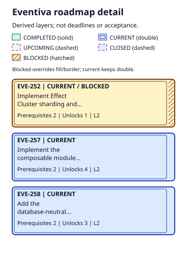

<!-- planning:generated:start -->
# Layer 2, group 3

[All layers](README.md) | [Full Mermaid](graph.mmd) | [Full SVG](../roadmap.svg)

Each row links to the complete mirrored specification/discussion. BLOCKED is an additional planning signal, not a replacement Linear status. Closed duplicates are not completed implementation. Related/duplicate relations remain in the issue page. Parent membership is not a dependency.

| Issue / source specification | Planning / Linear state | Recorded phase / project | All prerequisites | Open prerequisite blockers | Unlocks / precedes | Parent |
| --- | --- | --- | --- | --- | --- | --- | --- |
| [EVE-252](../issues/EVE-252.md) Implement Effect Cluster sharding and multi-runner recovery in the fresh Eventiva backend | **CURRENT / BLOCKED**; captured Linear: In Progress | No numbered phase recorded; No project | [EVE-40](../issues/EVE-40.md), [EVE-42](../issues/EVE-42.md) | [EVE-42](../issues/EVE-42.md) | [EVE-261](../issues/EVE-261.md) | None recorded |
| [EVE-257](../issues/EVE-257.md) Implement the composable module kernel and safe lifecycle/provider contracts | **CURRENT**; captured Linear: In Progress | No numbered phase recorded; Eventiva platform foundations | [EVE-23](../issues/EVE-23.md), [EVE-40](../issues/EVE-40.md) | None recorded | [EVE-259](../issues/EVE-259.md), [EVE-260](../issues/EVE-260.md), [EVE-261](../issues/EVE-261.md), [EVE-262](../issues/EVE-262.md) | [EVE-13](../issues/EVE-13.md) |
| [EVE-258](../issues/EVE-258.md) Add the database-neutral Resources API and privileged tenant migration adapter | **CURRENT**; captured Linear: In Progress; later-status 2026-11-17: Slice 1 adds a separate self-asserting declaration migration process-loss target to storage test, preserving the held parent spec and its migrationCrashProof:false default report. SQLite and disposable PostgreSQL pass precommit SIGKILL rollback, postcommit acknowledgement loss, empty repeat history, valid changed-prefix refusal and stale-writer rejection with a current-writer control. This is bounded local G04 evidence, not power loss, distributed fencing, native execution, production least privilege or whole-issue acceptance. Source capture remains historical; later execution and delivery evidence is cited separately. [evidence](https://linear.app/resnovas/issue/EVE-258/add-the-database-neutral-resources-api-and-privileged-tenant-migration#comment-79bf922f), [evidence](https://ampcode.com/threads/T-a0a1608d-284c-46c6-8bd0-372ce1a02efb) | No numbered phase recorded; Eventiva platform foundations | [EVE-23](../issues/EVE-23.md), [EVE-40](../issues/EVE-40.md) | None recorded | [EVE-260](../issues/EVE-260.md), [EVE-261](../issues/EVE-261.md), [EVE-262](../issues/EVE-262.md) | [EVE-42](../issues/EVE-42.md) |
<!-- planning:generated:end -->
