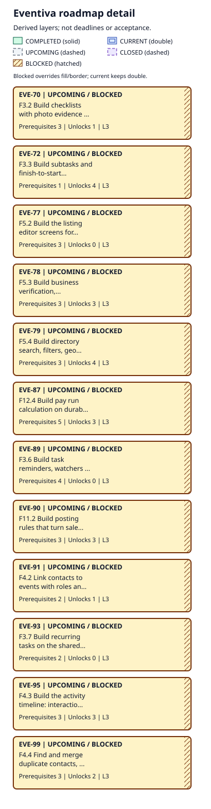

<!-- planning:generated:start -->
# Layer 3, group 1

[All layers](README.md) | [Full Mermaid](graph.mmd) | [Full SVG](../roadmap.svg)

Each row links to the complete mirrored specification/discussion. BLOCKED is an additional planning signal, not a replacement Linear status. Closed duplicates are not completed implementation. Related/duplicate relations remain in the issue page. Parent membership is not a dependency.

| Issue / source specification | Planning / Linear state | Recorded phase / project | All prerequisites | Open prerequisite blockers | Unlocks / precedes | Parent |
| --- | --- | --- | --- | --- | --- | --- | --- |
| [EVE-70](../issues/EVE-70.md) F3.2 Build checklists with photo evidence and sign-off that work offline on site | **UPCOMING / BLOCKED**; captured Linear: Backlog | F3.2; Eventiva product features | [EVE-25](../issues/EVE-25.md), [EVE-43](../issues/EVE-43.md), [EVE-64](../issues/EVE-64.md) | [EVE-25](../issues/EVE-25.md), [EVE-43](../issues/EVE-43.md), [EVE-64](../issues/EVE-64.md) | [EVE-86](../issues/EVE-86.md) | [EVE-62](../issues/EVE-62.md) |
| [EVE-72](../issues/EVE-72.md) F3.3 Build subtasks and finish-to-start dependencies with blocker queries | **UPCOMING / BLOCKED**; captured Linear: Backlog | F3.3; Eventiva product features | [EVE-64](../issues/EVE-64.md) | [EVE-64](../issues/EVE-64.md) | [EVE-84](../issues/EVE-84.md), [EVE-86](../issues/EVE-86.md), [EVE-110](../issues/EVE-110.md), [EVE-235](../issues/EVE-235.md) | [EVE-62](../issues/EVE-62.md) |
| [EVE-77](../issues/EVE-77.md) F5.2 Build the listing editor screens for vendors, venues and professionals | **UPCOMING / BLOCKED**; captured Linear: Backlog | F5.2; Eventiva product features | [EVE-16](../issues/EVE-16.md), [EVE-50](../issues/EVE-50.md), [EVE-75](../issues/EVE-75.md) | [EVE-16](../issues/EVE-16.md), [EVE-50](../issues/EVE-50.md), [EVE-75](../issues/EVE-75.md) | None recorded | [EVE-66](../issues/EVE-66.md) |
| [EVE-78](../issues/EVE-78.md) F5.3 Build business verification, publishing and content moderation | **UPCOMING / BLOCKED**; captured Linear: Backlog | F5.3; Eventiva product features | [EVE-24](../issues/EVE-24.md), [EVE-43](../issues/EVE-43.md), [EVE-75](../issues/EVE-75.md) | [EVE-24](../issues/EVE-24.md), [EVE-43](../issues/EVE-43.md), [EVE-75](../issues/EVE-75.md) | [EVE-113](../issues/EVE-113.md), [EVE-163](../issues/EVE-163.md), [EVE-236](../issues/EVE-236.md) | [EVE-66](../issues/EVE-66.md) |
| [EVE-79](../issues/EVE-79.md) F5.4 Build directory search, filters, geo radius and transparent ranking | **UPCOMING / BLOCKED**; captured Linear: Backlog | F5.4; Eventiva product features | [EVE-26](../issues/EVE-26.md), [EVE-45](../issues/EVE-45.md), [EVE-75](../issues/EVE-75.md) | [EVE-26](../issues/EVE-26.md), [EVE-45](../issues/EVE-45.md), [EVE-75](../issues/EVE-75.md) | [EVE-113](../issues/EVE-113.md), [EVE-115](../issues/EVE-115.md), [EVE-164](../issues/EVE-164.md), [EVE-165](../issues/EVE-165.md) | [EVE-66](../issues/EVE-66.md) |
| [EVE-87](../issues/EVE-87.md) F12.4 Build pay run calculation on durable runs | **UPCOMING / BLOCKED**; captured Linear: Backlog | F12.4; Eventiva product features | [EVE-42](../issues/EVE-42.md), [EVE-43](../issues/EVE-43.md), [EVE-44](../issues/EVE-44.md), [EVE-54](../issues/EVE-54.md), [EVE-82](../issues/EVE-82.md) | [EVE-42](../issues/EVE-42.md), [EVE-43](../issues/EVE-43.md), [EVE-44](../issues/EVE-44.md), [EVE-54](../issues/EVE-54.md), [EVE-82](../issues/EVE-82.md) | [EVE-88](../issues/EVE-88.md), [EVE-92](../issues/EVE-92.md), [EVE-101](../issues/EVE-101.md) | [EVE-61](../issues/EVE-61.md) |
| [EVE-89](../issues/EVE-89.md) F3.6 Build task reminders, watchers and notifications | **UPCOMING / BLOCKED**; captured Linear: Backlog | F3.6; Eventiva product features | [EVE-24](../issues/EVE-24.md), [EVE-45](../issues/EVE-45.md), [EVE-54](../issues/EVE-54.md), [EVE-64](../issues/EVE-64.md) | [EVE-24](../issues/EVE-24.md), [EVE-45](../issues/EVE-45.md), [EVE-54](../issues/EVE-54.md), [EVE-64](../issues/EVE-64.md) | None recorded | [EVE-62](../issues/EVE-62.md) |
| [EVE-90](../issues/EVE-90.md) F11.2 Build posting rules that turn sales, stock and payroll events into journals | **UPCOMING / BLOCKED**; captured Linear: Backlog | F11.2; Eventiva product features | [EVE-45](../issues/EVE-45.md), [EVE-54](../issues/EVE-54.md), [EVE-74](../issues/EVE-74.md) | [EVE-45](../issues/EVE-45.md), [EVE-54](../issues/EVE-54.md), [EVE-74](../issues/EVE-74.md) | [EVE-126](../issues/EVE-126.md), [EVE-127](../issues/EVE-127.md), [EVE-160](../issues/EVE-160.md) | [EVE-69](../issues/EVE-69.md) |
| [EVE-91](../issues/EVE-91.md) F4.2 Link contacts to events with roles and to each other with relationships | **UPCOMING / BLOCKED**; captured Linear: Backlog | F4.2; Eventiva product features | [EVE-43](../issues/EVE-43.md), [EVE-68](../issues/EVE-68.md) | [EVE-43](../issues/EVE-43.md), [EVE-68](../issues/EVE-68.md) | [EVE-137](../issues/EVE-137.md) | [EVE-65](../issues/EVE-65.md) |
| [EVE-93](../issues/EVE-93.md) F3.7 Build recurring tasks on the shared scheduling rules | **UPCOMING / BLOCKED**; captured Linear: Backlog | F3.7; Eventiva product features | [EVE-33](../issues/EVE-33.md), [EVE-64](../issues/EVE-64.md) | [EVE-33](../issues/EVE-33.md), [EVE-64](../issues/EVE-64.md) | None recorded | [EVE-62](../issues/EVE-62.md) |
| [EVE-95](../issues/EVE-95.md) F4.3 Build the activity timeline: interactions, notes and history from other sets | **UPCOMING / BLOCKED**; captured Linear: Backlog | F4.3; Eventiva product features | [EVE-45](../issues/EVE-45.md), [EVE-51](../issues/EVE-51.md), [EVE-68](../issues/EVE-68.md) | [EVE-45](../issues/EVE-45.md), [EVE-51](../issues/EVE-51.md), [EVE-68](../issues/EVE-68.md) | [EVE-137](../issues/EVE-137.md), [EVE-139](../issues/EVE-139.md), [EVE-144](../issues/EVE-144.md) | [EVE-65](../issues/EVE-65.md) |
| [EVE-99](../issues/EVE-99.md) F4.4 Find and merge duplicate contacts, and import and export them | **UPCOMING / BLOCKED**; captured Linear: Backlog | F4.4; Eventiva product features | [EVE-25](../issues/EVE-25.md), [EVE-54](../issues/EVE-54.md), [EVE-68](../issues/EVE-68.md) | [EVE-25](../issues/EVE-25.md), [EVE-54](../issues/EVE-54.md), [EVE-68](../issues/EVE-68.md) | [EVE-105](../issues/EVE-105.md), [EVE-144](../issues/EVE-144.md) | [EVE-65](../issues/EVE-65.md) |
<!-- planning:generated:end -->
