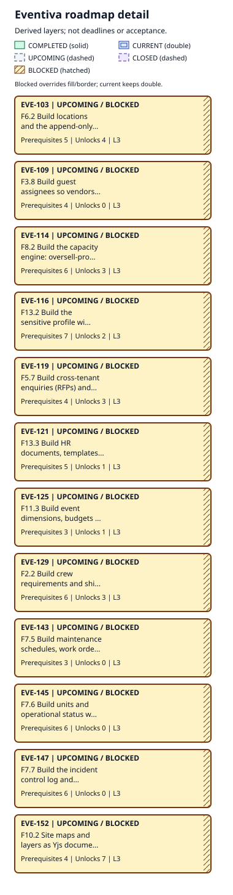

<!-- planning:generated:start -->
# Layer 3, group 2

[All layers](README.md) | [Full Mermaid](graph.mmd) | [Full SVG](../roadmap.svg)

Each row links to the complete mirrored specification/discussion. BLOCKED is an additional planning signal, not a replacement Linear status. Closed duplicates are not completed implementation. Related/duplicate relations remain in the issue page. Parent membership is not a dependency.

| Issue / source specification | Planning / Linear state | Recorded phase / project | All prerequisites | Open prerequisite blockers | Unlocks / precedes | Parent |
| --- | --- | --- | --- | --- | --- | --- | --- |
| [EVE-103](../issues/EVE-103.md) F6.2 Build locations and the append-only stock movement ledger | **UPCOMING / BLOCKED**; captured Linear: Backlog; later-status 2026-11-18: Owner-relayed revision-10 physical location metadata slice: four sensitive online-only actions, existing default-off inventory flag, immutable kinds and revisioned parent/name under tenant graph guard. Focused actual PostgreSQL/SQLite host proof passes 13 tests including reopen, paging/root filters, history/replay, bounded complete ancestry, rollback/interruption/recovery and live policy. Independent PostgreSQL client races isolate the graph lock from unrelated identity serialization; reverse/disjoint cycles have one winner, and deliberately bypassing guard CAS yields two winners. Latest-main full gates and signed delivery are recorded separately on the live issue/timeline. No stock/ledger/archive authority, Resources/SQL/compiler API, dependency or production activation. Broader EVE-103 remains Backlog/open; frozen capture is unchanged. EVE-248 stays January 2027 only. [evidence](https://linear.app/resnovas/issue/EVE-103#comment-ddd54a8f-bada-472f-a508-6c5cce1998e5), [evidence](https://ampcode.com/threads/T-01a1e940-37a3-7691-a5c0-e935b711c99a) | F6.2; Eventiva product features | [EVE-39](../issues/EVE-39.md), [EVE-42](../issues/EVE-42.md), [EVE-45](../issues/EVE-45.md), [EVE-51](../issues/EVE-51.md), [EVE-81](../issues/EVE-81.md) | [EVE-39](../issues/EVE-39.md), [EVE-42](../issues/EVE-42.md), [EVE-45](../issues/EVE-45.md), [EVE-51](../issues/EVE-51.md), [EVE-81](../issues/EVE-81.md) | [EVE-118](../issues/EVE-118.md), [EVE-123](../issues/EVE-123.md), [EVE-150](../issues/EVE-150.md), [EVE-187](../issues/EVE-187.md) | [EVE-63](../issues/EVE-63.md) |
| [EVE-109](../issues/EVE-109.md) F3.8 Build guest assignees so vendors and freelancers see only their tasks | **UPCOMING / BLOCKED**; captured Linear: Backlog | F3.8; Eventiva product features | [EVE-24](../issues/EVE-24.md), [EVE-43](../issues/EVE-43.md), [EVE-51](../issues/EVE-51.md), [EVE-64](../issues/EVE-64.md) | [EVE-24](../issues/EVE-24.md), [EVE-43](../issues/EVE-43.md), [EVE-51](../issues/EVE-51.md), [EVE-64](../issues/EVE-64.md) | None recorded | [EVE-62](../issues/EVE-62.md) |
| [EVE-114](../issues/EVE-114.md) F8.2 Build the capacity engine: oversell-proof holds on a cluster entity per pool | **UPCOMING / BLOCKED**; captured Linear: Backlog | F8.2; Eventiva product features | [EVE-38](../issues/EVE-38.md), [EVE-39](../issues/EVE-39.md), [EVE-40](../issues/EVE-40.md), [EVE-45](../issues/EVE-45.md), [EVE-54](../issues/EVE-54.md), [EVE-112](../issues/EVE-112.md) | [EVE-38](../issues/EVE-38.md), [EVE-39](../issues/EVE-39.md), [EVE-45](../issues/EVE-45.md), [EVE-54](../issues/EVE-54.md), [EVE-112](../issues/EVE-112.md) | [EVE-117](../issues/EVE-117.md), [EVE-194](../issues/EVE-194.md), [EVE-211](../issues/EVE-211.md) | [EVE-76](../issues/EVE-76.md) |
| [EVE-116](../issues/EVE-116.md) F13.2 Build the sensitive profile with field masking, reveal audit and retention | **UPCOMING / BLOCKED**; captured Linear: Backlog | F13.2; Eventiva product features | [EVE-25](../issues/EVE-25.md), [EVE-41](../issues/EVE-41.md), [EVE-43](../issues/EVE-43.md), [EVE-44](../issues/EVE-44.md), [EVE-50](../issues/EVE-50.md), [EVE-56](../issues/EVE-56.md), [EVE-98](../issues/EVE-98.md) | [EVE-25](../issues/EVE-25.md), [EVE-41](../issues/EVE-41.md), [EVE-43](../issues/EVE-43.md), [EVE-44](../issues/EVE-44.md), [EVE-50](../issues/EVE-50.md), [EVE-56](../issues/EVE-56.md), [EVE-98](../issues/EVE-98.md) | [EVE-156](../issues/EVE-156.md), [EVE-239](../issues/EVE-239.md) | [EVE-80](../issues/EVE-80.md) |
| [EVE-119](../issues/EVE-119.md) F5.7 Build cross-tenant enquiries (RFPs) and private message threads | **UPCOMING / BLOCKED**; captured Linear: Backlog | F5.7; Eventiva product features | [EVE-24](../issues/EVE-24.md), [EVE-43](../issues/EVE-43.md), [EVE-45](../issues/EVE-45.md), [EVE-75](../issues/EVE-75.md) | [EVE-24](../issues/EVE-24.md), [EVE-43](../issues/EVE-43.md), [EVE-45](../issues/EVE-45.md), [EVE-75](../issues/EVE-75.md) | [EVE-124](../issues/EVE-124.md), [EVE-164](../issues/EVE-164.md), [EVE-165](../issues/EVE-165.md) | [EVE-66](../issues/EVE-66.md) |
| [EVE-121](../issues/EVE-121.md) F13.3 Build HR documents, templates and built-in e-signature | **UPCOMING / BLOCKED**; captured Linear: Backlog | F13.3; Eventiva product features | [EVE-24](../issues/EVE-24.md), [EVE-25](../issues/EVE-25.md), [EVE-43](../issues/EVE-43.md), [EVE-51](../issues/EVE-51.md), [EVE-98](../issues/EVE-98.md) | [EVE-24](../issues/EVE-24.md), [EVE-25](../issues/EVE-25.md), [EVE-43](../issues/EVE-43.md), [EVE-51](../issues/EVE-51.md), [EVE-98](../issues/EVE-98.md) | [EVE-153](../issues/EVE-153.md) | [EVE-80](../issues/EVE-80.md) |
| [EVE-125](../issues/EVE-125.md) F11.3 Build event dimensions, budgets and budget vs actual | **UPCOMING / BLOCKED**; captured Linear: Backlog | F11.3; Eventiva product features | [EVE-50](../issues/EVE-50.md), [EVE-51](../issues/EVE-51.md), [EVE-74](../issues/EVE-74.md) | [EVE-50](../issues/EVE-50.md), [EVE-51](../issues/EVE-51.md), [EVE-74](../issues/EVE-74.md) | [EVE-159](../issues/EVE-159.md) | [EVE-69](../issues/EVE-69.md) |
| [EVE-129](../issues/EVE-129.md) F2.2 Build crew requirements and shifts on events | **UPCOMING / BLOCKED**; captured Linear: Backlog | F2.2; Eventiva product features | [EVE-33](../issues/EVE-33.md), [EVE-40](../issues/EVE-40.md), [EVE-42](../issues/EVE-42.md), [EVE-45](../issues/EVE-45.md), [EVE-73](../issues/EVE-73.md), [EVE-128](../issues/EVE-128.md) | [EVE-33](../issues/EVE-33.md), [EVE-42](../issues/EVE-42.md), [EVE-45](../issues/EVE-45.md), [EVE-73](../issues/EVE-73.md), [EVE-128](../issues/EVE-128.md) | [EVE-130](../issues/EVE-130.md), [EVE-131](../issues/EVE-131.md), [EVE-171](../issues/EVE-171.md) | [EVE-67](../issues/EVE-67.md) |
| [EVE-143](../issues/EVE-143.md) F7.5 Build maintenance schedules, work orders, fuel, mileage and cost export | **UPCOMING / BLOCKED**; captured Linear: Backlog | F7.5; Eventiva product features | [EVE-40](../issues/EVE-40.md), [EVE-42](../issues/EVE-42.md), [EVE-54](../issues/EVE-54.md) | [EVE-42](../issues/EVE-42.md), [EVE-54](../issues/EVE-54.md) | None recorded | [EVE-71](../issues/EVE-71.md) |
| [EVE-145](../issues/EVE-145.md) F7.6 Build units and operational status with an ordered offline queue | **UPCOMING / BLOCKED**; captured Linear: Backlog | F7.6; Eventiva product features | [EVE-17](../issues/EVE-17.md), [EVE-39](../issues/EVE-39.md), [EVE-40](../issues/EVE-40.md), [EVE-42](../issues/EVE-42.md), [EVE-45](../issues/EVE-45.md), [EVE-54](../issues/EVE-54.md) | [EVE-39](../issues/EVE-39.md), [EVE-42](../issues/EVE-42.md), [EVE-45](../issues/EVE-45.md), [EVE-54](../issues/EVE-54.md) | None recorded | [EVE-71](../issues/EVE-71.md) |
| [EVE-147](../issues/EVE-147.md) F7.7 Build the incident control log and dispatch for live events | **UPCOMING / BLOCKED**; captured Linear: Backlog | F7.7; Eventiva product features | [EVE-40](../issues/EVE-40.md), [EVE-43](../issues/EVE-43.md), [EVE-45](../issues/EVE-45.md), [EVE-50](../issues/EVE-50.md), [EVE-51](../issues/EVE-51.md), [EVE-54](../issues/EVE-54.md) | [EVE-43](../issues/EVE-43.md), [EVE-45](../issues/EVE-45.md), [EVE-50](../issues/EVE-50.md), [EVE-51](../issues/EVE-51.md), [EVE-54](../issues/EVE-54.md) | None recorded | [EVE-71](../issues/EVE-71.md) |
| [EVE-152](../issues/EVE-152.md) F10.2 Site maps and layers as Yjs documents with a feature record mirror | **UPCOMING / BLOCKED**; captured Linear: Backlog | F10.2; Eventiva product features | [EVE-43](../issues/EVE-43.md), [EVE-45](../issues/EVE-45.md), [EVE-51](../issues/EVE-51.md), [EVE-146](../issues/EVE-146.md) | [EVE-43](../issues/EVE-43.md), [EVE-45](../issues/EVE-45.md), [EVE-51](../issues/EVE-51.md), [EVE-146](../issues/EVE-146.md) | [EVE-178](../issues/EVE-178.md), [EVE-180](../issues/EVE-180.md), [EVE-181](../issues/EVE-181.md), [EVE-183](../issues/EVE-183.md), [EVE-200](../issues/EVE-200.md), [EVE-201](../issues/EVE-201.md), [EVE-238](../issues/EVE-238.md) | [EVE-108](../issues/EVE-108.md) |
<!-- planning:generated:end -->
