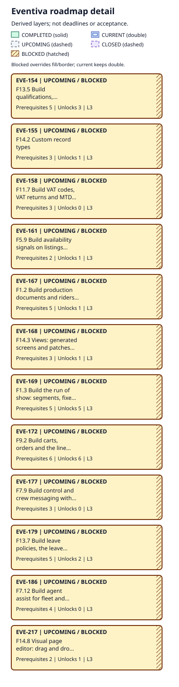

<!-- planning:generated:start -->
# Layer 3, group 3

[All layers](README.md) | [Full Mermaid](graph.mmd) | [Full SVG](../roadmap.svg)

Each row links to the complete mirrored specification/discussion. BLOCKED is an additional planning signal, not a replacement Linear status. Closed duplicates are not completed implementation. Related/duplicate relations remain in the issue page. Parent membership is not a dependency.

| Issue / source specification | Planning / Linear state | Recorded phase / project | All prerequisites | Open prerequisite blockers | Unlocks / precedes | Parent |
| --- | --- | --- | --- | --- | --- | --- | --- |
| [EVE-154](../issues/EVE-154.md) F13.5 Build qualifications, requirements and the eligibility check | **UPCOMING / BLOCKED**; captured Linear: Backlog | F13.5; Eventiva product features | [EVE-17](../issues/EVE-17.md), [EVE-25](../issues/EVE-25.md), [EVE-33](../issues/EVE-33.md), [EVE-45](../issues/EVE-45.md), [EVE-98](../issues/EVE-98.md) | [EVE-25](../issues/EVE-25.md), [EVE-33](../issues/EVE-33.md), [EVE-45](../issues/EVE-45.md), [EVE-98](../issues/EVE-98.md) | [EVE-97](../issues/EVE-97.md), [EVE-182](../issues/EVE-182.md), [EVE-196](../issues/EVE-196.md) | [EVE-80](../issues/EVE-80.md) |
| [EVE-155](../issues/EVE-155.md) F14.2 Custom record types | **UPCOMING / BLOCKED**; captured Linear: Backlog | F14.2; Eventiva product features | [EVE-43](../issues/EVE-43.md), [EVE-45](../issues/EVE-45.md), [EVE-133](../issues/EVE-133.md) | [EVE-43](../issues/EVE-43.md), [EVE-45](../issues/EVE-45.md), [EVE-133](../issues/EVE-133.md) | [EVE-185](../issues/EVE-185.md) | [EVE-111](../issues/EVE-111.md) |
| [EVE-158](../issues/EVE-158.md) F11.7 Build VAT codes, VAT returns and MTD submission | **UPCOMING / BLOCKED**; captured Linear: Backlog | F11.7; Eventiva product features | [EVE-41](../issues/EVE-41.md), [EVE-43](../issues/EVE-43.md), [EVE-74](../issues/EVE-74.md) | [EVE-41](../issues/EVE-41.md), [EVE-43](../issues/EVE-43.md), [EVE-74](../issues/EVE-74.md) | None recorded | [EVE-69](../issues/EVE-69.md) |
| [EVE-161](../issues/EVE-161.md) F5.9 Build availability signals on listings from the vendor&apos;s own calendar | **UPCOMING / BLOCKED**; captured Linear: Backlog | F5.9; Eventiva product features | [EVE-33](../issues/EVE-33.md), [EVE-75](../issues/EVE-75.md) | [EVE-33](../issues/EVE-33.md), [EVE-75](../issues/EVE-75.md) | [EVE-165](../issues/EVE-165.md) | [EVE-66](../issues/EVE-66.md) |
| [EVE-167](../issues/EVE-167.md) F1.2 Build production documents and riders as collaborative documents on the event | **UPCOMING / BLOCKED**; captured Linear: Backlog | F1.2; Eventiva product features | [EVE-25](../issues/EVE-25.md), [EVE-27](../issues/EVE-27.md), [EVE-43](../issues/EVE-43.md), [EVE-51](../issues/EVE-51.md), [EVE-166](../issues/EVE-166.md) | [EVE-25](../issues/EVE-25.md), [EVE-27](../issues/EVE-27.md), [EVE-43](../issues/EVE-43.md), [EVE-51](../issues/EVE-51.md), [EVE-166](../issues/EVE-166.md) | [EVE-208](../issues/EVE-208.md) | [EVE-73](../issues/EVE-73.md) |
| [EVE-168](../issues/EVE-168.md) F14.3 Views: generated screens and patches over base screens | **UPCOMING / BLOCKED**; captured Linear: Backlog | F14.3; Eventiva product features | [EVE-32](../issues/EVE-32.md), [EVE-50](../issues/EVE-50.md), [EVE-133](../issues/EVE-133.md) | [EVE-32](../issues/EVE-32.md), [EVE-50](../issues/EVE-50.md), [EVE-133](../issues/EVE-133.md) | [EVE-185](../issues/EVE-185.md) | [EVE-111](../issues/EVE-111.md) |
| [EVE-169](../issues/EVE-169.md) F1.3 Build the run of show: segments, fixed and relative timing, department columns and publishing | **UPCOMING / BLOCKED**; captured Linear: Backlog | F1.3; Eventiva product features | [EVE-24](../issues/EVE-24.md), [EVE-45](../issues/EVE-45.md), [EVE-50](../issues/EVE-50.md), [EVE-51](../issues/EVE-51.md), [EVE-166](../issues/EVE-166.md) | [EVE-24](../issues/EVE-24.md), [EVE-45](../issues/EVE-45.md), [EVE-50](../issues/EVE-50.md), [EVE-51](../issues/EVE-51.md), [EVE-166](../issues/EVE-166.md) | [EVE-171](../issues/EVE-171.md), [EVE-173](../issues/EVE-173.md), [EVE-210](../issues/EVE-210.md), [EVE-230](../issues/EVE-230.md), [EVE-233](../issues/EVE-233.md) | [EVE-73](../issues/EVE-73.md) |
| [EVE-172](../issues/EVE-172.md) F9.2 Build carts, orders and the line provider contract | **UPCOMING / BLOCKED**; captured Linear: Backlog | F9.2; Eventiva product features | [EVE-17](../issues/EVE-17.md), [EVE-39](../issues/EVE-39.md), [EVE-40](../issues/EVE-40.md), [EVE-42](../issues/EVE-42.md), [EVE-45](../issues/EVE-45.md), [EVE-170](../issues/EVE-170.md) | [EVE-39](../issues/EVE-39.md), [EVE-42](../issues/EVE-42.md), [EVE-45](../issues/EVE-45.md), [EVE-170](../issues/EVE-170.md) | [EVE-174](../issues/EVE-174.md), [EVE-176](../issues/EVE-176.md), [EVE-214](../issues/EVE-214.md), [EVE-216](../issues/EVE-216.md), [EVE-218](../issues/EVE-218.md), [EVE-225](../issues/EVE-225.md) | [EVE-107](../issues/EVE-107.md) |
| [EVE-177](../issues/EVE-177.md) F7.9 Build control and crew messaging with acknowledgement | **UPCOMING / BLOCKED**; captured Linear: Backlog | F7.9; Eventiva product features | [EVE-24](../issues/EVE-24.md), [EVE-40](../issues/EVE-40.md), [EVE-54](../issues/EVE-54.md) | [EVE-24](../issues/EVE-24.md), [EVE-54](../issues/EVE-54.md) | None recorded | [EVE-71](../issues/EVE-71.md) |
| [EVE-179](../issues/EVE-179.md) F13.7 Build leave policies, the leave ledger, requests and absence | **UPCOMING / BLOCKED**; captured Linear: Backlog | F13.7; Eventiva product features | [EVE-17](../issues/EVE-17.md), [EVE-24](../issues/EVE-24.md), [EVE-33](../issues/EVE-33.md), [EVE-43](../issues/EVE-43.md), [EVE-98](../issues/EVE-98.md) | [EVE-24](../issues/EVE-24.md), [EVE-33](../issues/EVE-33.md), [EVE-43](../issues/EVE-43.md), [EVE-98](../issues/EVE-98.md) | [EVE-182](../issues/EVE-182.md), [EVE-196](../issues/EVE-196.md) | [EVE-80](../issues/EVE-80.md) |
| [EVE-186](../issues/EVE-186.md) F7.12 Build agent assist for fleet and dispatch with approvals | **UPCOMING / BLOCKED**; captured Linear: Backlog | F7.12; Eventiva product features | [EVE-50](../issues/EVE-50.md), [EVE-52](../issues/EVE-52.md), [EVE-54](../issues/EVE-54.md), [EVE-55](../issues/EVE-55.md) | [EVE-50](../issues/EVE-50.md), [EVE-52](../issues/EVE-52.md), [EVE-54](../issues/EVE-54.md), [EVE-55](../issues/EVE-55.md) | None recorded | [EVE-71](../issues/EVE-71.md) |
| [EVE-217](../issues/EVE-217.md) F14.8 Visual page editor: drag and drop on wide screens, structured editing on phones | **UPCOMING / BLOCKED**; captured Linear: Backlog | F14.8; Eventiva product features | [EVE-50](../issues/EVE-50.md), [EVE-204](../issues/EVE-204.md) | [EVE-50](../issues/EVE-50.md), [EVE-204](../issues/EVE-204.md) | [EVE-227](../issues/EVE-227.md) | [EVE-111](../issues/EVE-111.md) |
<!-- planning:generated:end -->
