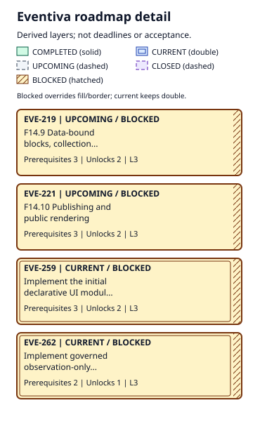

<!-- planning:generated:start -->
# Layer 3, group 4

[All layers](README.md) | [Full Mermaid](graph.mmd) | [Full SVG](../roadmap.svg)

Each row links to the complete mirrored specification/discussion. BLOCKED is an additional planning signal, not a replacement Linear status. Closed duplicates are not completed implementation. Related/duplicate relations remain in the issue page. Parent membership is not a dependency.

| Issue / source specification | Planning / Linear state | Recorded phase / project | All prerequisites | Open prerequisite blockers | Unlocks / precedes | Parent |
| --- | --- | --- | --- | --- | --- | --- | --- |
| [EVE-219](../issues/EVE-219.md) F14.9 Data-bound blocks, collection pages and forms | **UPCOMING / BLOCKED**; captured Linear: Backlog | F14.9; Eventiva product features | [EVE-46](../issues/EVE-46.md), [EVE-133](../issues/EVE-133.md), [EVE-204](../issues/EVE-204.md) | [EVE-46](../issues/EVE-46.md), [EVE-133](../issues/EVE-133.md), [EVE-204](../issues/EVE-204.md) | [EVE-227](../issues/EVE-227.md), [EVE-234](../issues/EVE-234.md) | [EVE-111](../issues/EVE-111.md) |
| [EVE-221](../issues/EVE-221.md) F14.10 Publishing and public rendering | **UPCOMING / BLOCKED**; captured Linear: Backlog | F14.10; Eventiva product features | [EVE-44](../issues/EVE-44.md), [EVE-46](../issues/EVE-46.md), [EVE-204](../issues/EVE-204.md) | [EVE-44](../issues/EVE-44.md), [EVE-46](../issues/EVE-46.md), [EVE-204](../issues/EVE-204.md) | [EVE-226](../issues/EVE-226.md), [EVE-228](../issues/EVE-228.md) | [EVE-111](../issues/EVE-111.md) |
| [EVE-259](../issues/EVE-259.md) Implement the initial declarative UI module registry over approved native components | **CURRENT / BLOCKED**; captured Linear: In Progress | No numbered phase recorded; Eventiva platform foundations | [EVE-40](../issues/EVE-40.md), [EVE-41](../issues/EVE-41.md), [EVE-257](../issues/EVE-257.md) | [EVE-41](../issues/EVE-41.md), [EVE-257](../issues/EVE-257.md) | [EVE-260](../issues/EVE-260.md), [EVE-261](../issues/EVE-261.md) | [EVE-13](../issues/EVE-13.md) |
| [EVE-262](../issues/EVE-262.md) Implement governed observation-only execution and lifecycle hooks with protected event gateway | **UPCOMING / BLOCKED**; captured Linear: Backlog | No numbered phase recorded; Eventiva platform foundations | [EVE-257](../issues/EVE-257.md), [EVE-258](../issues/EVE-258.md) | [EVE-257](../issues/EVE-257.md), [EVE-258](../issues/EVE-258.md) | [EVE-261](../issues/EVE-261.md) | None recorded |
<!-- planning:generated:end -->
