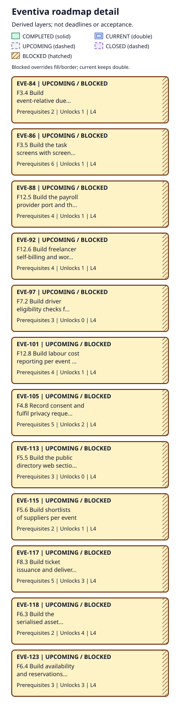

<!-- planning:generated:start -->
# Layer 4, group 1

[All layers](README.md) | [Full Mermaid](graph.mmd) | [Full SVG](../roadmap.svg)

Each row links to the complete mirrored specification/discussion. BLOCKED is an additional planning signal, not a replacement Linear status. Closed duplicates are not completed implementation. Related/duplicate relations remain in the issue page. Parent membership is not a dependency.

| Issue / source specification | Planning / Linear state | Recorded phase / project | All prerequisites | Open prerequisite blockers | Unlocks / precedes | Parent |
| --- | --- | --- | --- | --- | --- | --- | --- |
| [EVE-84](../issues/EVE-84.md) F3.4 Build event-relative due dates, task templates and reschedule cascade | **UPCOMING / BLOCKED**; captured Linear: Backlog; later-status 2026-11-17T12:31:56.867Z: Live description and complete comment list independently reviewed: EVE-84 covers general Event planning, not MDT only. Jonathan&apos;s conditional 2026-11-17 decision therefore selects option B: confirm every Event/Phase anchor-date change, including dependency-delay cascades; non-anchor dates may cascade automatically. Exact owner-selection time is unknown; this date is the Amp Linear relay, not the owner-selection or capture time. Baseline/history, absolute/completed-date exclusions, manual locks, authorization and readiness remain. The prior source ambiguity is resolved, but implementation prerequisites and whole-issue acceptance remain open. Frozen capture is unchanged; this is not a complete live roadmap refresh. [evidence](https://linear.app/resnovas/issue/EVE-84#comment-f9c96ce3-873a-46ba-9702-bf00bcebc44d), [evidence](https://ampcode.com/threads/T-01a1e940-37a3-7691-a5c0-e935b711c99a) | F3.4; Eventiva product features | [EVE-64](../issues/EVE-64.md), [EVE-72](../issues/EVE-72.md) | [EVE-64](../issues/EVE-64.md), [EVE-72](../issues/EVE-72.md) | [EVE-110](../issues/EVE-110.md) | [EVE-62](../issues/EVE-62.md) |
| [EVE-86](../issues/EVE-86.md) F3.5 Build the task screens with screen projections on web and mobile | **UPCOMING / BLOCKED**; captured Linear: Backlog | F3.5; Eventiva product features | [EVE-16](../issues/EVE-16.md), [EVE-27](../issues/EVE-27.md), [EVE-50](../issues/EVE-50.md), [EVE-64](../issues/EVE-64.md), [EVE-70](../issues/EVE-70.md), [EVE-72](../issues/EVE-72.md) | [EVE-16](../issues/EVE-16.md), [EVE-27](../issues/EVE-27.md), [EVE-50](../issues/EVE-50.md), [EVE-64](../issues/EVE-64.md), [EVE-70](../issues/EVE-70.md), [EVE-72](../issues/EVE-72.md) | [EVE-110](../issues/EVE-110.md) | [EVE-62](../issues/EVE-62.md) |
| [EVE-88](../issues/EVE-88.md) F12.5 Build the payroll provider port and the first adapter | **UPCOMING / BLOCKED**; captured Linear: Backlog | F12.5; Eventiva product features | [EVE-25](../issues/EVE-25.md), [EVE-40](../issues/EVE-40.md), [EVE-41](../issues/EVE-41.md), [EVE-87](../issues/EVE-87.md) | [EVE-25](../issues/EVE-25.md), [EVE-41](../issues/EVE-41.md), [EVE-87](../issues/EVE-87.md) | [EVE-96](../issues/EVE-96.md) | [EVE-61](../issues/EVE-61.md) |
| [EVE-92](../issues/EVE-92.md) F12.6 Build freelancer self-billing and worker status records | **UPCOMING / BLOCKED**; captured Linear: Backlog | F12.6; Eventiva product features | [EVE-24](../issues/EVE-24.md), [EVE-25](../issues/EVE-25.md), [EVE-43](../issues/EVE-43.md), [EVE-87](../issues/EVE-87.md) | [EVE-24](../issues/EVE-24.md), [EVE-25](../issues/EVE-25.md), [EVE-43](../issues/EVE-43.md), [EVE-87](../issues/EVE-87.md) | [EVE-96](../issues/EVE-96.md) | [EVE-61](../issues/EVE-61.md) |
| [EVE-97](../issues/EVE-97.md) F7.2 Build driver eligibility checks from staff qualifications | **UPCOMING / BLOCKED**; captured Linear: Backlog | F7.2; Eventiva product features | [EVE-40](../issues/EVE-40.md), [EVE-43](../issues/EVE-43.md), [EVE-154](../issues/EVE-154.md) | [EVE-43](../issues/EVE-43.md), [EVE-154](../issues/EVE-154.md) | None recorded | [EVE-71](../issues/EVE-71.md) |
| [EVE-101](../issues/EVE-101.md) F12.8 Build labour cost reporting per event and phase | **UPCOMING / BLOCKED**; captured Linear: Backlog | F12.8; Eventiva product features | [EVE-30](../issues/EVE-30.md), [EVE-40](../issues/EVE-40.md), [EVE-50](../issues/EVE-50.md), [EVE-87](../issues/EVE-87.md) | [EVE-30](../issues/EVE-30.md), [EVE-50](../issues/EVE-50.md), [EVE-87](../issues/EVE-87.md) | [EVE-104](../issues/EVE-104.md) | [EVE-61](../issues/EVE-61.md) |
| [EVE-105](../issues/EVE-105.md) F4.8 Record consent and fulfil privacy requests for contacts | **UPCOMING / BLOCKED**; captured Linear: Backlog | F4.8; Eventiva product features | [EVE-24](../issues/EVE-24.md), [EVE-43](../issues/EVE-43.md), [EVE-54](../issues/EVE-54.md), [EVE-68](../issues/EVE-68.md), [EVE-99](../issues/EVE-99.md) | [EVE-24](../issues/EVE-24.md), [EVE-43](../issues/EVE-43.md), [EVE-54](../issues/EVE-54.md), [EVE-68](../issues/EVE-68.md), [EVE-99](../issues/EVE-99.md) | [EVE-102](../issues/EVE-102.md), [EVE-141](../issues/EVE-141.md) | [EVE-65](../issues/EVE-65.md) |
| [EVE-113](../issues/EVE-113.md) F5.5 Build the public directory web section for anonymous visitors and search engines | **UPCOMING / BLOCKED**; captured Linear: Backlog | F5.5; Eventiva product features | [EVE-46](../issues/EVE-46.md), [EVE-78](../issues/EVE-78.md), [EVE-79](../issues/EVE-79.md) | [EVE-46](../issues/EVE-46.md), [EVE-78](../issues/EVE-78.md), [EVE-79](../issues/EVE-79.md) | None recorded | [EVE-66](../issues/EVE-66.md) |
| [EVE-115](../issues/EVE-115.md) F5.6 Build shortlists of suppliers per event | **UPCOMING / BLOCKED**; captured Linear: Backlog | F5.6; Eventiva product features | [EVE-50](../issues/EVE-50.md), [EVE-79](../issues/EVE-79.md) | [EVE-50](../issues/EVE-50.md), [EVE-79](../issues/EVE-79.md) | [EVE-165](../issues/EVE-165.md) | [EVE-66](../issues/EVE-66.md) |
| [EVE-117](../issues/EVE-117.md) F8.3 Build ticket issuance and delivery: signed tickets from paid orders, comps, voids and reissue | **UPCOMING / BLOCKED**; captured Linear: Backlog | F8.3; Eventiva product features | [EVE-24](../issues/EVE-24.md), [EVE-25](../issues/EVE-25.md), [EVE-41](../issues/EVE-41.md), [EVE-45](../issues/EVE-45.md), [EVE-114](../issues/EVE-114.md) | [EVE-24](../issues/EVE-24.md), [EVE-25](../issues/EVE-25.md), [EVE-41](../issues/EVE-41.md), [EVE-45](../issues/EVE-45.md), [EVE-114](../issues/EVE-114.md) | [EVE-122](../issues/EVE-122.md), [EVE-162](../issues/EVE-162.md), [EVE-209](../issues/EVE-209.md) | [EVE-76](../issues/EVE-76.md) |
| [EVE-118](../issues/EVE-118.md) F6.3 Build the serialised asset register, containers and labels | **UPCOMING / BLOCKED**; captured Linear: Backlog | F6.3; Eventiva product features | [EVE-25](../issues/EVE-25.md), [EVE-103](../issues/EVE-103.md) | [EVE-25](../issues/EVE-25.md), [EVE-103](../issues/EVE-103.md) | [EVE-149](../issues/EVE-149.md), [EVE-150](../issues/EVE-150.md), [EVE-151](../issues/EVE-151.md), [EVE-187](../issues/EVE-187.md) | [EVE-63](../issues/EVE-63.md) |
| [EVE-123](../issues/EVE-123.md) F6.4 Build availability and reservations against events, carts and production plans | **UPCOMING / BLOCKED**; captured Linear: Backlog | F6.4; Eventiva product features | [EVE-33](../issues/EVE-33.md), [EVE-73](../issues/EVE-73.md), [EVE-103](../issues/EVE-103.md) | [EVE-33](../issues/EVE-33.md), [EVE-73](../issues/EVE-73.md), [EVE-103](../issues/EVE-103.md) | [EVE-149](../issues/EVE-149.md), [EVE-188](../issues/EVE-188.md), [EVE-198](../issues/EVE-198.md) | [EVE-63](../issues/EVE-63.md) |
<!-- planning:generated:end -->
