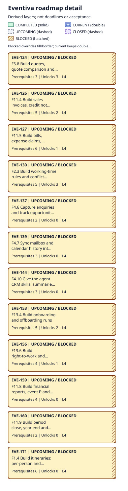

<!-- planning:generated:start -->
# Layer 4, group 2

[All layers](README.md) | [Full Mermaid](graph.mmd) | [Full SVG](../roadmap.svg)

Each row links to the complete mirrored specification/discussion. BLOCKED is an additional planning signal, not a replacement Linear status. Closed duplicates are not completed implementation. Related/duplicate relations remain in the issue page. Parent membership is not a dependency.

| Issue / source specification | Planning / Linear state | Recorded phase / project | All prerequisites | Open prerequisite blockers | Unlocks / precedes | Parent |
| --- | --- | --- | --- | --- | --- | --- | --- |
| [EVE-124](../issues/EVE-124.md) F5.8 Build quotes, quote comparison and the acceptance handoff to the event | **UPCOMING / BLOCKED**; captured Linear: Backlog | F5.8; Eventiva product features | [EVE-33](../issues/EVE-33.md), [EVE-54](../issues/EVE-54.md), [EVE-119](../issues/EVE-119.md) | [EVE-33](../issues/EVE-33.md), [EVE-54](../issues/EVE-54.md), [EVE-119](../issues/EVE-119.md) | [EVE-163](../issues/EVE-163.md), [EVE-164](../issues/EVE-164.md), [EVE-165](../issues/EVE-165.md) | [EVE-66](../issues/EVE-66.md) |
| [EVE-126](../issues/EVE-126.md) F11.4 Build sales invoices, credit notes and receivables | **UPCOMING / BLOCKED**; captured Linear: Backlog | F11.4; Eventiva product features | [EVE-24](../issues/EVE-24.md), [EVE-25](../issues/EVE-25.md), [EVE-46](../issues/EVE-46.md), [EVE-74](../issues/EVE-74.md), [EVE-90](../issues/EVE-90.md) | [EVE-24](../issues/EVE-24.md), [EVE-25](../issues/EVE-25.md), [EVE-46](../issues/EVE-46.md), [EVE-74](../issues/EVE-74.md), [EVE-90](../issues/EVE-90.md) | [EVE-157](../issues/EVE-157.md), [EVE-237](../issues/EVE-237.md) | [EVE-69](../issues/EVE-69.md) |
| [EVE-127](../issues/EVE-127.md) F11.5 Build bills, expense claims, approvals and payables | **UPCOMING / BLOCKED**; captured Linear: Backlog | F11.5; Eventiva product features | [EVE-25](../issues/EVE-25.md), [EVE-43](../issues/EVE-43.md), [EVE-52](../issues/EVE-52.md), [EVE-53](../issues/EVE-53.md), [EVE-74](../issues/EVE-74.md), [EVE-90](../issues/EVE-90.md) | [EVE-25](../issues/EVE-25.md), [EVE-43](../issues/EVE-43.md), [EVE-52](../issues/EVE-52.md), [EVE-53](../issues/EVE-53.md), [EVE-74](../issues/EVE-74.md), [EVE-90](../issues/EVE-90.md) | [EVE-157](../issues/EVE-157.md) | [EVE-69](../issues/EVE-69.md) |
| [EVE-130](../issues/EVE-130.md) F2.3 Build working-time rules and conflict checks | **UPCOMING / BLOCKED**; captured Linear: Backlog | F2.3; Eventiva product features | [EVE-33](../issues/EVE-33.md), [EVE-40](../issues/EVE-40.md), [EVE-41](../issues/EVE-41.md), [EVE-128](../issues/EVE-128.md), [EVE-129](../issues/EVE-129.md) | [EVE-33](../issues/EVE-33.md), [EVE-41](../issues/EVE-41.md), [EVE-128](../issues/EVE-128.md), [EVE-129](../issues/EVE-129.md) | [EVE-131](../issues/EVE-131.md), [EVE-136](../issues/EVE-136.md), [EVE-142](../issues/EVE-142.md) | [EVE-67](../issues/EVE-67.md) |
| [EVE-137](../issues/EVE-137.md) F4.6 Capture enquiries and track opportunities through a pipeline into events | **UPCOMING / BLOCKED**; captured Linear: Backlog | F4.6; Eventiva product features | [EVE-91](../issues/EVE-91.md), [EVE-95](../issues/EVE-95.md) | [EVE-91](../issues/EVE-91.md), [EVE-95](../issues/EVE-95.md) | None recorded | [EVE-65](../issues/EVE-65.md) |
| [EVE-139](../issues/EVE-139.md) F4.7 Sync mailbox and calendar history into the contact timeline | **UPCOMING / BLOCKED**; captured Linear: Backlog | F4.7; Eventiva product features | [EVE-41](../issues/EVE-41.md), [EVE-54](../issues/EVE-54.md), [EVE-95](../issues/EVE-95.md) | [EVE-41](../issues/EVE-41.md), [EVE-54](../issues/EVE-54.md), [EVE-95](../issues/EVE-95.md) | None recorded | [EVE-65](../issues/EVE-65.md) |
| [EVE-144](../issues/EVE-144.md) F4.10 Give the agent CRM skills: summaries, follow-up suggestions and health checks | **UPCOMING / BLOCKED**; captured Linear: Backlog | F4.10; Eventiva product features | [EVE-52](../issues/EVE-52.md), [EVE-95](../issues/EVE-95.md), [EVE-99](../issues/EVE-99.md) | [EVE-52](../issues/EVE-52.md), [EVE-95](../issues/EVE-95.md), [EVE-99](../issues/EVE-99.md) | None recorded | [EVE-65](../issues/EVE-65.md) |
| [EVE-153](../issues/EVE-153.md) F13.4 Build onboarding and offboarding runs | **UPCOMING / BLOCKED**; captured Linear: Backlog | F13.4; Eventiva product features | [EVE-24](../issues/EVE-24.md), [EVE-43](../issues/EVE-43.md), [EVE-54](../issues/EVE-54.md), [EVE-98](../issues/EVE-98.md), [EVE-121](../issues/EVE-121.md) | [EVE-24](../issues/EVE-24.md), [EVE-43](../issues/EVE-43.md), [EVE-54](../issues/EVE-54.md), [EVE-98](../issues/EVE-98.md), [EVE-121](../issues/EVE-121.md) | [EVE-182](../issues/EVE-182.md), [EVE-196](../issues/EVE-196.md) | [EVE-80](../issues/EVE-80.md) |
| [EVE-156](../issues/EVE-156.md) F13.6 Build right-to-work and background check records | **UPCOMING / BLOCKED**; captured Linear: Backlog | F13.6; Eventiva product features | [EVE-25](../issues/EVE-25.md), [EVE-54](../issues/EVE-54.md), [EVE-98](../issues/EVE-98.md), [EVE-116](../issues/EVE-116.md) | [EVE-25](../issues/EVE-25.md), [EVE-54](../issues/EVE-54.md), [EVE-98](../issues/EVE-98.md), [EVE-116](../issues/EVE-116.md) | [EVE-196](../issues/EVE-196.md) | [EVE-80](../issues/EVE-80.md) |
| [EVE-159](../issues/EVE-159.md) F11.8 Build financial reports, event P and L and exports | **UPCOMING / BLOCKED**; captured Linear: Backlog | F11.8; Eventiva product features | [EVE-25](../issues/EVE-25.md), [EVE-30](../issues/EVE-30.md), [EVE-74](../issues/EVE-74.md), [EVE-125](../issues/EVE-125.md) | [EVE-25](../issues/EVE-25.md), [EVE-30](../issues/EVE-30.md), [EVE-74](../issues/EVE-74.md), [EVE-125](../issues/EVE-125.md) | None recorded | [EVE-69](../issues/EVE-69.md) |
| [EVE-160](../issues/EVE-160.md) F11.9 Build period close, year end and ledger migration export | **UPCOMING / BLOCKED**; captured Linear: Backlog | F11.9; Eventiva product features | [EVE-74](../issues/EVE-74.md), [EVE-90](../issues/EVE-90.md) | [EVE-74](../issues/EVE-74.md), [EVE-90](../issues/EVE-90.md) | None recorded | [EVE-69](../issues/EVE-69.md) |
| [EVE-171](../issues/EVE-171.md) F1.4 Build itineraries: per-person and per-group schedules generated from the event and published | **UPCOMING / BLOCKED**; captured Linear: Backlog | F1.4; Eventiva product features | [EVE-24](../issues/EVE-24.md), [EVE-33](../issues/EVE-33.md), [EVE-43](../issues/EVE-43.md), [EVE-129](../issues/EVE-129.md), [EVE-166](../issues/EVE-166.md), [EVE-169](../issues/EVE-169.md) | [EVE-24](../issues/EVE-24.md), [EVE-33](../issues/EVE-33.md), [EVE-43](../issues/EVE-43.md), [EVE-129](../issues/EVE-129.md), [EVE-166](../issues/EVE-166.md), [EVE-169](../issues/EVE-169.md) | None recorded | [EVE-73](../issues/EVE-73.md) |
<!-- planning:generated:end -->
