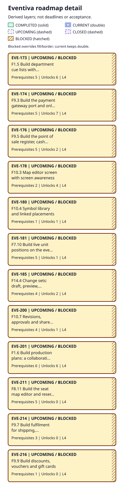

<!-- planning:generated:start -->
# Layer 4, group 3

[All layers](README.md) | [Full Mermaid](graph.mmd) | [Full SVG](../roadmap.svg)

Each row links to the complete mirrored specification/discussion. BLOCKED is an additional planning signal, not a replacement Linear status. Closed duplicates are not completed implementation. Related/duplicate relations remain in the issue page. Parent membership is not a dependency.

| Issue / source specification | Planning / Linear state | Recorded phase / project | All prerequisites | Open prerequisite blockers | Unlocks / precedes | Parent |
| --- | --- | --- | --- | --- | --- | --- | --- |
| [EVE-173](../issues/EVE-173.md) F1.5 Build department cue lists with numbering, segment links and console exports | **UPCOMING / BLOCKED**; captured Linear: Backlog | F1.5; Eventiva product features | [EVE-25](../issues/EVE-25.md), [EVE-40](../issues/EVE-40.md), [EVE-51](../issues/EVE-51.md), [EVE-166](../issues/EVE-166.md), [EVE-169](../issues/EVE-169.md) | [EVE-25](../issues/EVE-25.md), [EVE-51](../issues/EVE-51.md), [EVE-166](../issues/EVE-166.md), [EVE-169](../issues/EVE-169.md) | [EVE-203](../issues/EVE-203.md), [EVE-208](../issues/EVE-208.md), [EVE-210](../issues/EVE-210.md), [EVE-230](../issues/EVE-230.md), [EVE-231](../issues/EVE-231.md), [EVE-233](../issues/EVE-233.md) | [EVE-73](../issues/EVE-73.md) |
| [EVE-174](../issues/EVE-174.md) F9.3 Build the payment gateway port and online card payments | **UPCOMING / BLOCKED**; captured Linear: Backlog | F9.3; Eventiva product features | [EVE-41](../issues/EVE-41.md), [EVE-43](../issues/EVE-43.md), [EVE-45](../issues/EVE-45.md), [EVE-46](../issues/EVE-46.md), [EVE-172](../issues/EVE-172.md) | [EVE-41](../issues/EVE-41.md), [EVE-43](../issues/EVE-43.md), [EVE-45](../issues/EVE-45.md), [EVE-46](../issues/EVE-46.md), [EVE-172](../issues/EVE-172.md) | [EVE-175](../issues/EVE-175.md), [EVE-213](../issues/EVE-213.md), [EVE-215](../issues/EVE-215.md), [EVE-222](../issues/EVE-222.md), [EVE-223](../issues/EVE-223.md), [EVE-225](../issues/EVE-225.md), [EVE-237](../issues/EVE-237.md) | [EVE-107](../issues/EVE-107.md) |
| [EVE-176](../issues/EVE-176.md) F9.5 Build the point of sale register, cash sessions and offline sales | **UPCOMING / BLOCKED**; captured Linear: Backlog | F9.5; Eventiva product features | [EVE-17](../issues/EVE-17.md), [EVE-43](../issues/EVE-43.md), [EVE-50](../issues/EVE-50.md), [EVE-51](../issues/EVE-51.md), [EVE-172](../issues/EVE-172.md) | [EVE-43](../issues/EVE-43.md), [EVE-50](../issues/EVE-50.md), [EVE-51](../issues/EVE-51.md), [EVE-172](../issues/EVE-172.md) | [EVE-213](../issues/EVE-213.md), [EVE-222](../issues/EVE-222.md) | [EVE-107](../issues/EVE-107.md) |
| [EVE-178](../issues/EVE-178.md) F10.3 Map editor screen with screen awareness | **UPCOMING / BLOCKED**; captured Linear: Backlog | F10.3; Eventiva product features | [EVE-50](../issues/EVE-50.md), [EVE-152](../issues/EVE-152.md) | [EVE-50](../issues/EVE-50.md), [EVE-152](../issues/EVE-152.md) | [EVE-202](../issues/EVE-202.md), [EVE-205](../issues/EVE-205.md), [EVE-207](../issues/EVE-207.md), [EVE-238](../issues/EVE-238.md) | [EVE-108](../issues/EVE-108.md) |
| [EVE-180](../issues/EVE-180.md) F10.4 Symbol library and linked placements | **UPCOMING / BLOCKED**; captured Linear: Backlog | F10.4; Eventiva product features | [EVE-152](../issues/EVE-152.md) | [EVE-152](../issues/EVE-152.md) | [EVE-199](../issues/EVE-199.md) | [EVE-108](../issues/EVE-108.md) |
| [EVE-181](../issues/EVE-181.md) F7.10 Build live unit positions on the event map with consent and retention | **UPCOMING / BLOCKED**; captured Linear: Backlog | F7.10; Eventiva product features | [EVE-40](../issues/EVE-40.md), [EVE-43](../issues/EVE-43.md), [EVE-44](../issues/EVE-44.md), [EVE-54](../issues/EVE-54.md), [EVE-152](../issues/EVE-152.md) | [EVE-43](../issues/EVE-43.md), [EVE-44](../issues/EVE-44.md), [EVE-54](../issues/EVE-54.md), [EVE-152](../issues/EVE-152.md) | [EVE-205](../issues/EVE-205.md) | [EVE-71](../issues/EVE-71.md) |
| [EVE-185](../issues/EVE-185.md) F14.4 Change sets: draft, preview, publish, rollback and packages | **UPCOMING / BLOCKED**; captured Linear: Backlog | F14.4; Eventiva product features | [EVE-43](../issues/EVE-43.md), [EVE-133](../issues/EVE-133.md), [EVE-155](../issues/EVE-155.md), [EVE-168](../issues/EVE-168.md) | [EVE-43](../issues/EVE-43.md), [EVE-133](../issues/EVE-133.md), [EVE-155](../issues/EVE-155.md), [EVE-168](../issues/EVE-168.md) | [EVE-191](../issues/EVE-191.md), [EVE-197](../issues/EVE-197.md) | [EVE-111](../issues/EVE-111.md) |
| [EVE-200](../issues/EVE-200.md) F10.7 Revisions, approvals and share links | **UPCOMING / BLOCKED**; captured Linear: Backlog | F10.7; Eventiva product features | [EVE-24](../issues/EVE-24.md), [EVE-27](../issues/EVE-27.md), [EVE-43](../issues/EVE-43.md), [EVE-152](../issues/EVE-152.md) | [EVE-24](../issues/EVE-24.md), [EVE-27](../issues/EVE-27.md), [EVE-43](../issues/EVE-43.md), [EVE-152](../issues/EVE-152.md) | [EVE-207](../issues/EVE-207.md) | [EVE-108](../issues/EVE-108.md) |
| [EVE-201](../issues/EVE-201.md) F1.6 Build production plans: a collaborative canvas per space and department over the site map, with MVR exchange | **UPCOMING / BLOCKED**; captured Linear: Backlog | F1.6; Eventiva product features | [EVE-25](../issues/EVE-25.md), [EVE-50](../issues/EVE-50.md), [EVE-51](../issues/EVE-51.md), [EVE-146](../issues/EVE-146.md), [EVE-152](../issues/EVE-152.md), [EVE-166](../issues/EVE-166.md) | [EVE-25](../issues/EVE-25.md), [EVE-50](../issues/EVE-50.md), [EVE-51](../issues/EVE-51.md), [EVE-146](../issues/EVE-146.md), [EVE-152](../issues/EVE-152.md), [EVE-166](../issues/EVE-166.md) | [EVE-203](../issues/EVE-203.md), [EVE-206](../issues/EVE-206.md), [EVE-208](../issues/EVE-208.md), [EVE-210](../issues/EVE-210.md), [EVE-229](../issues/EVE-229.md), [EVE-233](../issues/EVE-233.md) | [EVE-73](../issues/EVE-73.md) |
| [EVE-211](../issues/EVE-211.md) F8.11 Build the seat map editor and reserved seating in F8 | **UPCOMING / BLOCKED**; captured Linear: Backlog | F8.11; Eventiva product features | [EVE-50](../issues/EVE-50.md), [EVE-51](../issues/EVE-51.md), [EVE-112](../issues/EVE-112.md), [EVE-114](../issues/EVE-114.md), [EVE-120](../issues/EVE-120.md) | [EVE-50](../issues/EVE-50.md), [EVE-51](../issues/EVE-51.md), [EVE-112](../issues/EVE-112.md), [EVE-114](../issues/EVE-114.md), [EVE-120](../issues/EVE-120.md) | None recorded | [EVE-76](../issues/EVE-76.md) |
| [EVE-214](../issues/EVE-214.md) F9.7 Build fulfilment for shipping, collection, on-site hand over and digital items | **UPCOMING / BLOCKED**; captured Linear: Backlog | F9.7; Eventiva product features | [EVE-24](../issues/EVE-24.md), [EVE-25](../issues/EVE-25.md), [EVE-172](../issues/EVE-172.md) | [EVE-24](../issues/EVE-24.md), [EVE-25](../issues/EVE-25.md), [EVE-172](../issues/EVE-172.md) | None recorded | [EVE-107](../issues/EVE-107.md) |
| [EVE-216](../issues/EVE-216.md) F9.9 Build discounts, vouchers and gift cards | **UPCOMING / BLOCKED**; captured Linear: Backlog | F9.9; Eventiva product features | [EVE-172](../issues/EVE-172.md) | [EVE-172](../issues/EVE-172.md) | None recorded | [EVE-107](../issues/EVE-107.md) |
<!-- planning:generated:end -->
