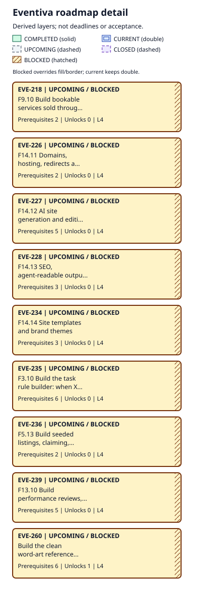

<!-- planning:generated:start -->
# Layer 4, group 4

[All layers](README.md) | [Full Mermaid](graph.mmd) | [Full SVG](../roadmap.svg)

Each row links to the complete mirrored specification/discussion. BLOCKED is an additional planning signal, not a replacement Linear status. Closed duplicates are not completed implementation. Related/duplicate relations remain in the issue page. Parent membership is not a dependency.

| Issue / source specification | Planning / Linear state | Recorded phase / project | All prerequisites | Open prerequisite blockers | Unlocks / precedes | Parent |
| --- | --- | --- | --- | --- | --- | --- | --- |
| [EVE-218](../issues/EVE-218.md) F9.10 Build bookable services sold through checkout | **UPCOMING / BLOCKED**; captured Linear: Backlog | F9.10; Eventiva product features | [EVE-33](../issues/EVE-33.md), [EVE-172](../issues/EVE-172.md) | [EVE-33](../issues/EVE-33.md), [EVE-172](../issues/EVE-172.md) | None recorded | [EVE-107](../issues/EVE-107.md) |
| [EVE-226](../issues/EVE-226.md) F14.11 Domains, hosting, redirects and abuse handling | **UPCOMING / BLOCKED**; captured Linear: Backlog | F14.11; Eventiva product features | [EVE-41](../issues/EVE-41.md), [EVE-221](../issues/EVE-221.md) | [EVE-41](../issues/EVE-41.md), [EVE-221](../issues/EVE-221.md) | None recorded | [EVE-111](../issues/EVE-111.md) |
| [EVE-227](../issues/EVE-227.md) F14.12 AI site generation and editing by instruction | **UPCOMING / BLOCKED**; captured Linear: Backlog | F14.12; Eventiva product features | [EVE-30](../issues/EVE-30.md), [EVE-52](../issues/EVE-52.md), [EVE-53](../issues/EVE-53.md), [EVE-217](../issues/EVE-217.md), [EVE-219](../issues/EVE-219.md) | [EVE-30](../issues/EVE-30.md), [EVE-52](../issues/EVE-52.md), [EVE-53](../issues/EVE-53.md), [EVE-217](../issues/EVE-217.md), [EVE-219](../issues/EVE-219.md) | None recorded | [EVE-111](../issues/EVE-111.md) |
| [EVE-228](../issues/EVE-228.md) F14.13 SEO, agent-readable output, localisation and consent on published sites | **UPCOMING / BLOCKED**; captured Linear: Backlog | F14.13; Eventiva product features | [EVE-28](../issues/EVE-28.md), [EVE-44](../issues/EVE-44.md), [EVE-221](../issues/EVE-221.md) | [EVE-28](../issues/EVE-28.md), [EVE-44](../issues/EVE-44.md), [EVE-221](../issues/EVE-221.md) | None recorded | [EVE-111](../issues/EVE-111.md) |
| [EVE-234](../issues/EVE-234.md) F14.14 Site templates and brand themes | **UPCOMING / BLOCKED**; captured Linear: Backlog | F14.14; Eventiva product features | [EVE-30](../issues/EVE-30.md), [EVE-204](../issues/EVE-204.md), [EVE-219](../issues/EVE-219.md) | [EVE-30](../issues/EVE-30.md), [EVE-204](../issues/EVE-204.md), [EVE-219](../issues/EVE-219.md) | None recorded | [EVE-111](../issues/EVE-111.md) |
| [EVE-235](../issues/EVE-235.md) F3.10 Build the task rule builder: when X then Y, on a generic rule engine | **UPCOMING / BLOCKED**; captured Linear: Backlog | F3.10; Eventiva product features | [EVE-40](../issues/EVE-40.md), [EVE-43](../issues/EVE-43.md), [EVE-45](../issues/EVE-45.md), [EVE-54](../issues/EVE-54.md), [EVE-64](../issues/EVE-64.md), [EVE-72](../issues/EVE-72.md) | [EVE-43](../issues/EVE-43.md), [EVE-45](../issues/EVE-45.md), [EVE-54](../issues/EVE-54.md), [EVE-64](../issues/EVE-64.md), [EVE-72](../issues/EVE-72.md) | None recorded | [EVE-62](../issues/EVE-62.md) |
| [EVE-236](../issues/EVE-236.md) F5.13 Build seeded listings, claiming, claim disputes and removal requests | **UPCOMING / BLOCKED**; captured Linear: Backlog | F5.13; Eventiva product features | [EVE-24](../issues/EVE-24.md), [EVE-78](../issues/EVE-78.md) | [EVE-24](../issues/EVE-24.md), [EVE-78](../issues/EVE-78.md) | None recorded | [EVE-66](../issues/EVE-66.md) |
| [EVE-239](../issues/EVE-239.md) F13.10 Build performance reviews, goals and feedback | **UPCOMING / BLOCKED**; captured Linear: Backlog | F13.10; Eventiva product features | [EVE-24](../issues/EVE-24.md), [EVE-51](../issues/EVE-51.md), [EVE-54](../issues/EVE-54.md), [EVE-98](../issues/EVE-98.md), [EVE-116](../issues/EVE-116.md) | [EVE-24](../issues/EVE-24.md), [EVE-51](../issues/EVE-51.md), [EVE-54](../issues/EVE-54.md), [EVE-98](../issues/EVE-98.md), [EVE-116](../issues/EVE-116.md) | None recorded | [EVE-80](../issues/EVE-80.md) |
| [EVE-260](../issues/EVE-260.md) Build the clean word-art reference extension after verified platform readiness | **UPCOMING / BLOCKED**; captured Linear: Backlog | No numbered phase recorded; Eventiva platform foundations | [EVE-44](../issues/EVE-44.md), [EVE-45](../issues/EVE-45.md), [EVE-50](../issues/EVE-50.md), [EVE-257](../issues/EVE-257.md), [EVE-258](../issues/EVE-258.md), [EVE-259](../issues/EVE-259.md) | [EVE-44](../issues/EVE-44.md), [EVE-45](../issues/EVE-45.md), [EVE-50](../issues/EVE-50.md), [EVE-257](../issues/EVE-257.md), [EVE-258](../issues/EVE-258.md), [EVE-259](../issues/EVE-259.md) | [EVE-261](../issues/EVE-261.md) | [EVE-13](../issues/EVE-13.md) |
<!-- planning:generated:end -->
