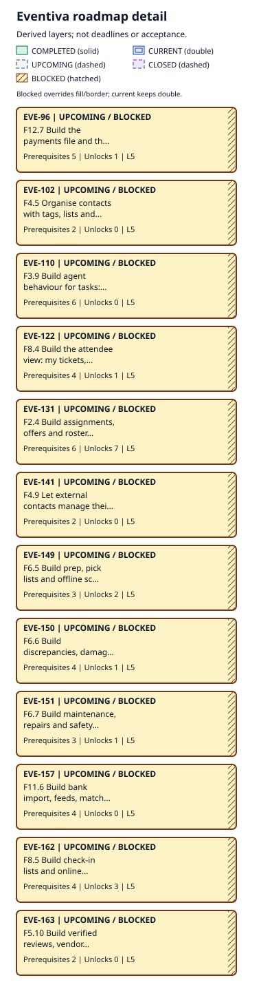

<!-- planning:generated:start -->
# Layer 5, group 1

[All layers](README.md) | [Full Mermaid](graph.mmd) | [Full SVG](../roadmap.svg)

Each row links to the complete mirrored specification/discussion. BLOCKED is an additional planning signal, not a replacement Linear status. Closed duplicates are not completed implementation. Related/duplicate relations remain in the issue page. Parent membership is not a dependency.

| Issue / source specification | Planning / Linear state | Recorded phase / project | All prerequisites | Open prerequisite blockers | Unlocks / precedes | Parent |
| --- | --- | --- | --- | --- | --- | --- | --- |
| [EVE-96](../issues/EVE-96.md) F12.7 Build the payments file and the pay run events for accounting | **UPCOMING / BLOCKED**; captured Linear: Backlog | F12.7; Eventiva product features | [EVE-40](../issues/EVE-40.md), [EVE-43](../issues/EVE-43.md), [EVE-45](../issues/EVE-45.md), [EVE-88](../issues/EVE-88.md), [EVE-92](../issues/EVE-92.md) | [EVE-43](../issues/EVE-43.md), [EVE-45](../issues/EVE-45.md), [EVE-88](../issues/EVE-88.md), [EVE-92](../issues/EVE-92.md) | [EVE-104](../issues/EVE-104.md) | [EVE-61](../issues/EVE-61.md) |
| [EVE-102](../issues/EVE-102.md) F4.5 Organise contacts with tags, lists and smart lists | **UPCOMING / BLOCKED**; captured Linear: Backlog | F4.5; Eventiva product features | [EVE-68](../issues/EVE-68.md), [EVE-105](../issues/EVE-105.md) | [EVE-68](../issues/EVE-68.md), [EVE-105](../issues/EVE-105.md) | None recorded | [EVE-65](../issues/EVE-65.md) |
| [EVE-110](../issues/EVE-110.md) F3.9 Build agent behaviour for tasks: planning, blockers, digests and rescheduling | **UPCOMING / BLOCKED**; captured Linear: Backlog | F3.9; Eventiva product features | [EVE-52](../issues/EVE-52.md), [EVE-54](../issues/EVE-54.md), [EVE-64](../issues/EVE-64.md), [EVE-72](../issues/EVE-72.md), [EVE-84](../issues/EVE-84.md), [EVE-86](../issues/EVE-86.md) | [EVE-52](../issues/EVE-52.md), [EVE-54](../issues/EVE-54.md), [EVE-64](../issues/EVE-64.md), [EVE-72](../issues/EVE-72.md), [EVE-84](../issues/EVE-84.md), [EVE-86](../issues/EVE-86.md) | None recorded | [EVE-62](../issues/EVE-62.md) |
| [EVE-122](../issues/EVE-122.md) F8.4 Build the attendee view: my tickets, holder details and transfers in the one app | **UPCOMING / BLOCKED**; captured Linear: Backlog | F8.4; Eventiva product features | [EVE-43](../issues/EVE-43.md), [EVE-50](../issues/EVE-50.md), [EVE-51](../issues/EVE-51.md), [EVE-117](../issues/EVE-117.md) | [EVE-43](../issues/EVE-43.md), [EVE-50](../issues/EVE-50.md), [EVE-51](../issues/EVE-51.md), [EVE-117](../issues/EVE-117.md) | [EVE-194](../issues/EVE-194.md) | [EVE-76](../issues/EVE-76.md) |
| [EVE-131](../issues/EVE-131.md) F2.4 Build assignments, offers and roster confirmation | **UPCOMING / BLOCKED**; captured Linear: Backlog | F2.4; Eventiva product features | [EVE-24](../issues/EVE-24.md), [EVE-42](../issues/EVE-42.md), [EVE-43](../issues/EVE-43.md), [EVE-45](../issues/EVE-45.md), [EVE-129](../issues/EVE-129.md), [EVE-130](../issues/EVE-130.md) | [EVE-24](../issues/EVE-24.md), [EVE-42](../issues/EVE-42.md), [EVE-43](../issues/EVE-43.md), [EVE-45](../issues/EVE-45.md), [EVE-129](../issues/EVE-129.md), [EVE-130](../issues/EVE-130.md) | [EVE-132](../issues/EVE-132.md), [EVE-134](../issues/EVE-134.md), [EVE-135](../issues/EVE-135.md), [EVE-136](../issues/EVE-136.md), [EVE-138](../issues/EVE-138.md), [EVE-140](../issues/EVE-140.md), [EVE-142](../issues/EVE-142.md) | [EVE-67](../issues/EVE-67.md) |
| [EVE-141](../issues/EVE-141.md) F4.9 Let external contacts manage their own details and consent in a portal | **UPCOMING / BLOCKED**; captured Linear: Backlog | F4.9; Eventiva product features | [EVE-43](../issues/EVE-43.md), [EVE-105](../issues/EVE-105.md) | [EVE-43](../issues/EVE-43.md), [EVE-105](../issues/EVE-105.md) | None recorded | [EVE-65](../issues/EVE-65.md) |
| [EVE-149](../issues/EVE-149.md) F6.5 Build prep, pick lists and offline scan out and scan in | **UPCOMING / BLOCKED**; captured Linear: Backlog | F6.5; Eventiva product features | [EVE-16](../issues/EVE-16.md), [EVE-118](../issues/EVE-118.md), [EVE-123](../issues/EVE-123.md) | [EVE-16](../issues/EVE-16.md), [EVE-118](../issues/EVE-118.md), [EVE-123](../issues/EVE-123.md) | [EVE-188](../issues/EVE-188.md), [EVE-189](../issues/EVE-189.md) | [EVE-63](../issues/EVE-63.md) |
| [EVE-150](../issues/EVE-150.md) F6.6 Build discrepancies, damage reports and asset quarantine | **UPCOMING / BLOCKED**; captured Linear: Backlog | F6.6; Eventiva product features | [EVE-25](../issues/EVE-25.md), [EVE-27](../issues/EVE-27.md), [EVE-103](../issues/EVE-103.md), [EVE-118](../issues/EVE-118.md) | [EVE-25](../issues/EVE-25.md), [EVE-27](../issues/EVE-27.md), [EVE-103](../issues/EVE-103.md), [EVE-118](../issues/EVE-118.md) | [EVE-189](../issues/EVE-189.md) | [EVE-63](../issues/EVE-63.md) |
| [EVE-151](../issues/EVE-151.md) F6.7 Build maintenance, repairs and safety inspections for lifting and electrical equipment | **UPCOMING / BLOCKED**; captured Linear: Backlog | F6.7; Eventiva product features | [EVE-25](../issues/EVE-25.md), [EVE-41](../issues/EVE-41.md), [EVE-118](../issues/EVE-118.md) | [EVE-25](../issues/EVE-25.md), [EVE-41](../issues/EVE-41.md), [EVE-118](../issues/EVE-118.md) | [EVE-198](../issues/EVE-198.md) | [EVE-63](../issues/EVE-63.md) |
| [EVE-157](../issues/EVE-157.md) F11.6 Build bank import, feeds, matching and reconciliation | **UPCOMING / BLOCKED**; captured Linear: Backlog | F11.6; Eventiva product features | [EVE-41](../issues/EVE-41.md), [EVE-74](../issues/EVE-74.md), [EVE-126](../issues/EVE-126.md), [EVE-127](../issues/EVE-127.md) | [EVE-41](../issues/EVE-41.md), [EVE-74](../issues/EVE-74.md), [EVE-126](../issues/EVE-126.md), [EVE-127](../issues/EVE-127.md) | None recorded | [EVE-69](../issues/EVE-69.md) |
| [EVE-162](../issues/EVE-162.md) F8.5 Build check-in lists and online scanning in the app | **UPCOMING / BLOCKED**; captured Linear: Backlog | F8.5; Eventiva product features | [EVE-43](../issues/EVE-43.md), [EVE-46](../issues/EVE-46.md), [EVE-50](../issues/EVE-50.md), [EVE-117](../issues/EVE-117.md) | [EVE-43](../issues/EVE-43.md), [EVE-46](../issues/EVE-46.md), [EVE-50](../issues/EVE-50.md), [EVE-117](../issues/EVE-117.md) | [EVE-192](../issues/EVE-192.md), [EVE-193](../issues/EVE-193.md), [EVE-195](../issues/EVE-195.md) | [EVE-76](../issues/EVE-76.md) |
| [EVE-163](../issues/EVE-163.md) F5.10 Build verified reviews, vendor responses and review moderation | **UPCOMING / BLOCKED**; captured Linear: Backlog | F5.10; Eventiva product features | [EVE-78](../issues/EVE-78.md), [EVE-124](../issues/EVE-124.md) | [EVE-78](../issues/EVE-78.md), [EVE-124](../issues/EVE-124.md) | None recorded | [EVE-66](../issues/EVE-66.md) |
<!-- planning:generated:end -->
