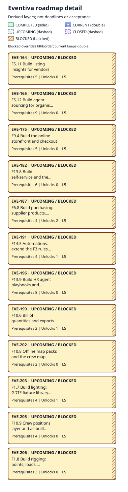

<!-- planning:generated:start -->
# Layer 5, group 2

[All layers](README.md) | [Full Mermaid](graph.mmd) | [Full SVG](../roadmap.svg)

Each row links to the complete mirrored specification/discussion. BLOCKED is an additional planning signal, not a replacement Linear status. Closed duplicates are not completed implementation. Related/duplicate relations remain in the issue page. Parent membership is not a dependency.

| Issue / source specification | Planning / Linear state | Recorded phase / project | All prerequisites | Open prerequisite blockers | Unlocks / precedes | Parent |
| --- | --- | --- | --- | --- | --- | --- | --- |
| [EVE-164](../issues/EVE-164.md) F5.11 Build listing insights for vendors | **UPCOMING / BLOCKED**; captured Linear: Backlog | F5.11; Eventiva product features | [EVE-30](../issues/EVE-30.md), [EVE-44](../issues/EVE-44.md), [EVE-79](../issues/EVE-79.md), [EVE-119](../issues/EVE-119.md), [EVE-124](../issues/EVE-124.md) | [EVE-30](../issues/EVE-30.md), [EVE-44](../issues/EVE-44.md), [EVE-79](../issues/EVE-79.md), [EVE-119](../issues/EVE-119.md), [EVE-124](../issues/EVE-124.md) | None recorded | [EVE-66](../issues/EVE-66.md) |
| [EVE-165](../issues/EVE-165.md) F5.12 Build agent sourcing for organisers and quote drafting for vendors | **UPCOMING / BLOCKED**; captured Linear: Backlog | F5.12; Eventiva product features | [EVE-29](../issues/EVE-29.md), [EVE-48](../issues/EVE-48.md), [EVE-52](../issues/EVE-52.md), [EVE-54](../issues/EVE-54.md), [EVE-79](../issues/EVE-79.md), [EVE-115](../issues/EVE-115.md), [EVE-119](../issues/EVE-119.md), [EVE-124](../issues/EVE-124.md), [EVE-161](../issues/EVE-161.md) | [EVE-29](../issues/EVE-29.md), [EVE-48](../issues/EVE-48.md), [EVE-52](../issues/EVE-52.md), [EVE-54](../issues/EVE-54.md), [EVE-79](../issues/EVE-79.md), [EVE-115](../issues/EVE-115.md), [EVE-119](../issues/EVE-119.md), [EVE-124](../issues/EVE-124.md), [EVE-161](../issues/EVE-161.md) | None recorded | [EVE-66](../issues/EVE-66.md) |
| [EVE-175](../issues/EVE-175.md) F9.4 Build the online storefront and checkout | **UPCOMING / BLOCKED**; captured Linear: Backlog | F9.4; Eventiva product features | [EVE-24](../issues/EVE-24.md), [EVE-28](../issues/EVE-28.md), [EVE-46](../issues/EVE-46.md), [EVE-50](../issues/EVE-50.md), [EVE-174](../issues/EVE-174.md) | [EVE-24](../issues/EVE-24.md), [EVE-28](../issues/EVE-28.md), [EVE-46](../issues/EVE-46.md), [EVE-50](../issues/EVE-50.md), [EVE-174](../issues/EVE-174.md) | None recorded | [EVE-107](../issues/EVE-107.md) |
| [EVE-182](../issues/EVE-182.md) F13.8 Build self-service and the offline site check screens | **UPCOMING / BLOCKED**; captured Linear: Backlog | F13.8; Eventiva product features | [EVE-16](../issues/EVE-16.md), [EVE-32](../issues/EVE-32.md), [EVE-50](../issues/EVE-50.md), [EVE-153](../issues/EVE-153.md), [EVE-154](../issues/EVE-154.md), [EVE-179](../issues/EVE-179.md) | [EVE-16](../issues/EVE-16.md), [EVE-32](../issues/EVE-32.md), [EVE-50](../issues/EVE-50.md), [EVE-153](../issues/EVE-153.md), [EVE-154](../issues/EVE-154.md), [EVE-179](../issues/EVE-179.md) | None recorded | [EVE-80](../issues/EVE-80.md) |
| [EVE-187](../issues/EVE-187.md) F6.8 Build purchasing: supplier products, requests, orders, receiving and reorder points | **UPCOMING / BLOCKED**; captured Linear: Backlog | F6.8; Eventiva product features | [EVE-24](../issues/EVE-24.md), [EVE-69](../issues/EVE-69.md), [EVE-103](../issues/EVE-103.md), [EVE-118](../issues/EVE-118.md) | [EVE-24](../issues/EVE-24.md), [EVE-69](../issues/EVE-69.md), [EVE-103](../issues/EVE-103.md), [EVE-118](../issues/EVE-118.md) | [EVE-190](../issues/EVE-190.md), [EVE-198](../issues/EVE-198.md) | [EVE-63](../issues/EVE-63.md) |
| [EVE-191](../issues/EVE-191.md) F14.5 Automations: extend the F3 rules engine across every feature set | **UPCOMING / BLOCKED**; captured Linear: Backlog | F14.5; Eventiva product features | [EVE-43](../issues/EVE-43.md), [EVE-45](../issues/EVE-45.md), [EVE-54](../issues/EVE-54.md), [EVE-185](../issues/EVE-185.md) | [EVE-43](../issues/EVE-43.md), [EVE-45](../issues/EVE-45.md), [EVE-54](../issues/EVE-54.md), [EVE-185](../issues/EVE-185.md) | [EVE-197](../issues/EVE-197.md) | [EVE-111](../issues/EVE-111.md) |
| [EVE-196](../issues/EVE-196.md) F13.9 Build HR agent playbooks and compliance reports | **UPCOMING / BLOCKED**; captured Linear: Backlog | F13.9; Eventiva product features | [EVE-29](../issues/EVE-29.md), [EVE-30](../issues/EVE-30.md), [EVE-52](../issues/EVE-52.md), [EVE-54](../issues/EVE-54.md), [EVE-153](../issues/EVE-153.md), [EVE-154](../issues/EVE-154.md), [EVE-156](../issues/EVE-156.md), [EVE-179](../issues/EVE-179.md) | [EVE-29](../issues/EVE-29.md), [EVE-30](../issues/EVE-30.md), [EVE-52](../issues/EVE-52.md), [EVE-54](../issues/EVE-54.md), [EVE-153](../issues/EVE-153.md), [EVE-154](../issues/EVE-154.md), [EVE-156](../issues/EVE-156.md), [EVE-179](../issues/EVE-179.md) | None recorded | [EVE-80](../issues/EVE-80.md) |
| [EVE-199](../issues/EVE-199.md) F10.6 Bill of quantities and exports | **UPCOMING / BLOCKED**; captured Linear: Backlog | F10.6; Eventiva product features | [EVE-25](../issues/EVE-25.md), [EVE-54](../issues/EVE-54.md), [EVE-180](../issues/EVE-180.md) | [EVE-25](../issues/EVE-25.md), [EVE-54](../issues/EVE-54.md), [EVE-180](../issues/EVE-180.md) | [EVE-220](../issues/EVE-220.md) | [EVE-108](../issues/EVE-108.md) |
| [EVE-202](../issues/EVE-202.md) F10.8 Offline map packs and the crew map | **UPCOMING / BLOCKED**; captured Linear: Backlog | F10.8; Eventiva product features | [EVE-26](../issues/EVE-26.md), [EVE-178](../issues/EVE-178.md) | [EVE-26](../issues/EVE-26.md), [EVE-178](../issues/EVE-178.md) | None recorded | [EVE-108](../issues/EVE-108.md) |
| [EVE-203](../issues/EVE-203.md) F1.7 Build lighting: GDTF fixture library, fixture modes and DMX patch with conflict checks | **UPCOMING / BLOCKED**; captured Linear: Backlog | F1.7; Eventiva product features | [EVE-25](../issues/EVE-25.md), [EVE-166](../issues/EVE-166.md), [EVE-173](../issues/EVE-173.md), [EVE-201](../issues/EVE-201.md) | [EVE-25](../issues/EVE-25.md), [EVE-166](../issues/EVE-166.md), [EVE-173](../issues/EVE-173.md), [EVE-201](../issues/EVE-201.md) | [EVE-232](../issues/EVE-232.md) | [EVE-73](../issues/EVE-73.md) |
| [EVE-205](../issues/EVE-205.md) F10.9 Crew positions layer and as-built reporting | **UPCOMING / BLOCKED**; captured Linear: Backlog | F10.9; Eventiva product features | [EVE-44](../issues/EVE-44.md), [EVE-46](../issues/EVE-46.md), [EVE-178](../issues/EVE-178.md), [EVE-181](../issues/EVE-181.md) | [EVE-44](../issues/EVE-44.md), [EVE-46](../issues/EVE-46.md), [EVE-178](../issues/EVE-178.md), [EVE-181](../issues/EVE-181.md) | None recorded | [EVE-108](../issues/EVE-108.md) |
| [EVE-206](../issues/EVE-206.md) F1.8 Build rigging: points, loads, indicative load summary and competent-person sign-off | **UPCOMING / BLOCKED**; captured Linear: Backlog | F1.8; Eventiva product features | [EVE-43](../issues/EVE-43.md), [EVE-166](../issues/EVE-166.md), [EVE-201](../issues/EVE-201.md) | [EVE-43](../issues/EVE-43.md), [EVE-166](../issues/EVE-166.md), [EVE-201](../issues/EVE-201.md) | None recorded | [EVE-73](../issues/EVE-73.md) |
<!-- planning:generated:end -->
