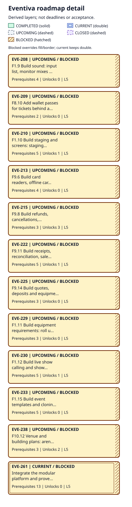

<!-- planning:generated:start -->
# Layer 5, group 3

[All layers](README.md) | [Full Mermaid](graph.mmd) | [Full SVG](../roadmap.svg)

Each row links to the complete mirrored specification/discussion. BLOCKED is an additional planning signal, not a replacement Linear status. Closed duplicates are not completed implementation. Related/duplicate relations remain in the issue page. Parent membership is not a dependency.

| Issue / source specification | Planning / Linear state | Recorded phase / project | All prerequisites | Open prerequisite blockers | Unlocks / precedes | Parent |
| --- | --- | --- | --- | --- | --- | --- | --- |
| [EVE-208](../issues/EVE-208.md) F1.9 Build sound: input list, monitor mixes and stage plot | **UPCOMING / BLOCKED**; captured Linear: Backlog | F1.9; Eventiva product features | [EVE-166](../issues/EVE-166.md), [EVE-167](../issues/EVE-167.md), [EVE-173](../issues/EVE-173.md), [EVE-201](../issues/EVE-201.md) | [EVE-166](../issues/EVE-166.md), [EVE-167](../issues/EVE-167.md), [EVE-173](../issues/EVE-173.md), [EVE-201](../issues/EVE-201.md) | None recorded | [EVE-73](../issues/EVE-73.md) |
| [EVE-209](../issues/EVE-209.md) F8.10 Add wallet passes for tickets behind a neutral port | **UPCOMING / BLOCKED**; captured Linear: Backlog | F8.10; Eventiva product features | [EVE-41](../issues/EVE-41.md), [EVE-117](../issues/EVE-117.md) | [EVE-41](../issues/EVE-41.md), [EVE-117](../issues/EVE-117.md) | None recorded | [EVE-76](../issues/EVE-76.md) |
| [EVE-210](../issues/EVE-210.md) F1.10 Build staging and screens: staging elements, screen surfaces and pre-programmed screen content per segment and cue | **UPCOMING / BLOCKED**; captured Linear: Backlog | F1.10; Eventiva product features | [EVE-25](../issues/EVE-25.md), [EVE-166](../issues/EVE-166.md), [EVE-169](../issues/EVE-169.md), [EVE-173](../issues/EVE-173.md), [EVE-201](../issues/EVE-201.md) | [EVE-25](../issues/EVE-25.md), [EVE-166](../issues/EVE-166.md), [EVE-169](../issues/EVE-169.md), [EVE-173](../issues/EVE-173.md), [EVE-201](../issues/EVE-201.md) | [EVE-231](../issues/EVE-231.md) | [EVE-73](../issues/EVE-73.md) |
| [EVE-213](../issues/EVE-213.md) F9.6 Build card readers, offline card payments and POS peripherals | **UPCOMING / BLOCKED**; captured Linear: Backlog | F9.6; Eventiva product features | [EVE-16](../issues/EVE-16.md), [EVE-41](../issues/EVE-41.md), [EVE-174](../issues/EVE-174.md), [EVE-176](../issues/EVE-176.md) | [EVE-16](../issues/EVE-16.md), [EVE-41](../issues/EVE-41.md), [EVE-174](../issues/EVE-174.md), [EVE-176](../issues/EVE-176.md) | None recorded | [EVE-107](../issues/EVE-107.md) |
| [EVE-215](../issues/EVE-215.md) F9.8 Build refunds, cancellations, exchanges and disputes | **UPCOMING / BLOCKED**; captured Linear: Backlog | F9.8; Eventiva product features | [EVE-43](../issues/EVE-43.md), [EVE-52](../issues/EVE-52.md), [EVE-174](../issues/EVE-174.md) | [EVE-43](../issues/EVE-43.md), [EVE-52](../issues/EVE-52.md), [EVE-174](../issues/EVE-174.md) | [EVE-223](../issues/EVE-223.md), [EVE-224](../issues/EVE-224.md), [EVE-237](../issues/EVE-237.md) | [EVE-107](../issues/EVE-107.md) |
| [EVE-222](../issues/EVE-222.md) F9.11 Build receipts, reconciliation, sales reporting and accounting events | **UPCOMING / BLOCKED**; captured Linear: Backlog | F9.11; Eventiva product features | [EVE-24](../issues/EVE-24.md), [EVE-30](../issues/EVE-30.md), [EVE-45](../issues/EVE-45.md), [EVE-174](../issues/EVE-174.md), [EVE-176](../issues/EVE-176.md) | [EVE-24](../issues/EVE-24.md), [EVE-30](../issues/EVE-30.md), [EVE-45](../issues/EVE-45.md), [EVE-174](../issues/EVE-174.md), [EVE-176](../issues/EVE-176.md) | [EVE-224](../issues/EVE-224.md) | [EVE-107](../issues/EVE-107.md) |
| [EVE-225](../issues/EVE-225.md) F9.14 Build quotes, deposits and equipment hire orders | **UPCOMING / BLOCKED**; captured Linear: Backlog | F9.14; Eventiva product features | [EVE-24](../issues/EVE-24.md), [EVE-172](../issues/EVE-172.md), [EVE-174](../issues/EVE-174.md) | [EVE-24](../issues/EVE-24.md), [EVE-172](../issues/EVE-172.md), [EVE-174](../issues/EVE-174.md) | None recorded | [EVE-107](../issues/EVE-107.md) |
| [EVE-229](../issues/EVE-229.md) F1.11 Build equipment requirements: roll up placed elements and hand them to warehousing | **UPCOMING / BLOCKED**; captured Linear: Backlog | F1.11; Eventiva product features | [EVE-45](../issues/EVE-45.md), [EVE-166](../issues/EVE-166.md), [EVE-201](../issues/EVE-201.md) | [EVE-45](../issues/EVE-45.md), [EVE-166](../issues/EVE-166.md), [EVE-201](../issues/EVE-201.md) | None recorded | [EVE-73](../issues/EVE-73.md) |
| [EVE-230](../issues/EVE-230.md) F1.12 Build live show calling and show sequences: run the run of show, live drift, timecode timelines and the show log | **UPCOMING / BLOCKED**; captured Linear: Backlog | F1.12; Eventiva product features | [EVE-44](../issues/EVE-44.md), [EVE-46](../issues/EVE-46.md), [EVE-52](../issues/EVE-52.md), [EVE-169](../issues/EVE-169.md), [EVE-173](../issues/EVE-173.md) | [EVE-44](../issues/EVE-44.md), [EVE-46](../issues/EVE-46.md), [EVE-52](../issues/EVE-52.md), [EVE-169](../issues/EVE-169.md), [EVE-173](../issues/EVE-173.md) | [EVE-231](../issues/EVE-231.md) | [EVE-73](../issues/EVE-73.md) |
| [EVE-233](../issues/EVE-233.md) F1.15 Build event templates and cloning: reuse phases, departments, plans and run-of-show skeletons with date shifting | **UPCOMING / BLOCKED**; captured Linear: Backlog | F1.15; Eventiva product features | [EVE-54](../issues/EVE-54.md), [EVE-166](../issues/EVE-166.md), [EVE-169](../issues/EVE-169.md), [EVE-173](../issues/EVE-173.md), [EVE-201](../issues/EVE-201.md) | [EVE-54](../issues/EVE-54.md), [EVE-166](../issues/EVE-166.md), [EVE-169](../issues/EVE-169.md), [EVE-173](../issues/EVE-173.md), [EVE-201](../issues/EVE-201.md) | None recorded | [EVE-73](../issues/EVE-73.md) |
| [EVE-238](../issues/EVE-238.md) F10.12 Venue and building plans: arenas, halls, custom structures and festival builds | **UPCOMING / BLOCKED**; captured Linear: Backlog | F10.12; Eventiva product features | [EVE-146](../issues/EVE-146.md), [EVE-152](../issues/EVE-152.md), [EVE-178](../issues/EVE-178.md) | [EVE-146](../issues/EVE-146.md), [EVE-152](../issues/EVE-152.md), [EVE-178](../issues/EVE-178.md) | [EVE-183](../issues/EVE-183.md), [EVE-207](../issues/EVE-207.md) | [EVE-108](../issues/EVE-108.md) |
| [EVE-261](../issues/EVE-261.md) Integrate the modular platform and prove every owner-required acceptance gate | **CURRENT / BLOCKED**; captured Linear: In Progress | No numbered phase recorded; Eventiva platform foundations | [EVE-41](../issues/EVE-41.md), [EVE-43](../issues/EVE-43.md), [EVE-44](../issues/EVE-44.md), [EVE-45](../issues/EVE-45.md), [EVE-54](../issues/EVE-54.md), [EVE-251](../issues/EVE-251.md), [EVE-252](../issues/EVE-252.md), [EVE-257](../issues/EVE-257.md), [EVE-258](../issues/EVE-258.md), [EVE-259](../issues/EVE-259.md), [EVE-260](../issues/EVE-260.md), [EVE-262](../issues/EVE-262.md), [EVE-263](../issues/EVE-263.md) | [EVE-41](../issues/EVE-41.md), [EVE-43](../issues/EVE-43.md), [EVE-44](../issues/EVE-44.md), [EVE-45](../issues/EVE-45.md), [EVE-54](../issues/EVE-54.md), [EVE-251](../issues/EVE-251.md), [EVE-252](../issues/EVE-252.md), [EVE-257](../issues/EVE-257.md), [EVE-258](../issues/EVE-258.md), [EVE-259](../issues/EVE-259.md), [EVE-260](../issues/EVE-260.md), [EVE-262](../issues/EVE-262.md), [EVE-263](../issues/EVE-263.md) | None recorded | [EVE-13](../issues/EVE-13.md) |
<!-- planning:generated:end -->
