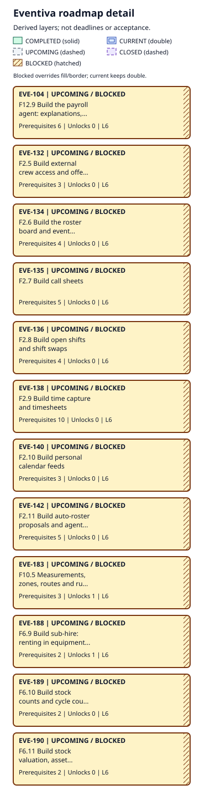

<!-- planning:generated:start -->
# Layer 6, group 1

[All layers](README.md) | [Full Mermaid](graph.mmd) | [Full SVG](../roadmap.svg)

Each row links to the complete mirrored specification/discussion. BLOCKED is an additional planning signal, not a replacement Linear status. Closed duplicates are not completed implementation. Related/duplicate relations remain in the issue page. Parent membership is not a dependency.

| Issue / source specification | Planning / Linear state | Recorded phase / project | All prerequisites | Open prerequisite blockers | Unlocks / precedes | Parent |
| --- | --- | --- | --- | --- | --- | --- | --- |
| [EVE-104](../issues/EVE-104.md) F12.9 Build the payroll agent: explanations, anomaly suggestions and approval gates | **UPCOMING / BLOCKED**; captured Linear: Backlog | F12.9; Eventiva product features | [EVE-29](../issues/EVE-29.md), [EVE-50](../issues/EVE-50.md), [EVE-52](../issues/EVE-52.md), [EVE-54](../issues/EVE-54.md), [EVE-96](../issues/EVE-96.md), [EVE-101](../issues/EVE-101.md) | [EVE-29](../issues/EVE-29.md), [EVE-50](../issues/EVE-50.md), [EVE-52](../issues/EVE-52.md), [EVE-54](../issues/EVE-54.md), [EVE-96](../issues/EVE-96.md), [EVE-101](../issues/EVE-101.md) | None recorded | [EVE-61](../issues/EVE-61.md) |
| [EVE-132](../issues/EVE-132.md) F2.5 Build external crew access and offer links | **UPCOMING / BLOCKED**; captured Linear: Backlog | F2.5; Eventiva product features | [EVE-43](../issues/EVE-43.md), [EVE-46](../issues/EVE-46.md), [EVE-131](../issues/EVE-131.md) | [EVE-43](../issues/EVE-43.md), [EVE-46](../issues/EVE-46.md), [EVE-131](../issues/EVE-131.md) | None recorded | [EVE-67](../issues/EVE-67.md) |
| [EVE-134](../issues/EVE-134.md) F2.6 Build the roster board and event staffing screens | **UPCOMING / BLOCKED**; captured Linear: Backlog | F2.6; Eventiva product features | [EVE-16](../issues/EVE-16.md), [EVE-50](../issues/EVE-50.md), [EVE-51](../issues/EVE-51.md), [EVE-131](../issues/EVE-131.md) | [EVE-16](../issues/EVE-16.md), [EVE-50](../issues/EVE-50.md), [EVE-51](../issues/EVE-51.md), [EVE-131](../issues/EVE-131.md) | None recorded | [EVE-67](../issues/EVE-67.md) |
| [EVE-135](../issues/EVE-135.md) F2.7 Build call sheets | **UPCOMING / BLOCKED**; captured Linear: Backlog | F2.7; Eventiva product features | [EVE-24](../issues/EVE-24.md), [EVE-25](../issues/EVE-25.md), [EVE-51](../issues/EVE-51.md), [EVE-73](../issues/EVE-73.md), [EVE-131](../issues/EVE-131.md) | [EVE-24](../issues/EVE-24.md), [EVE-25](../issues/EVE-25.md), [EVE-51](../issues/EVE-51.md), [EVE-73](../issues/EVE-73.md), [EVE-131](../issues/EVE-131.md) | None recorded | [EVE-67](../issues/EVE-67.md) |
| [EVE-136](../issues/EVE-136.md) F2.8 Build open shifts and shift swaps | **UPCOMING / BLOCKED**; captured Linear: Backlog | F2.8; Eventiva product features | [EVE-24](../issues/EVE-24.md), [EVE-42](../issues/EVE-42.md), [EVE-130](../issues/EVE-130.md), [EVE-131](../issues/EVE-131.md) | [EVE-24](../issues/EVE-24.md), [EVE-42](../issues/EVE-42.md), [EVE-130](../issues/EVE-130.md), [EVE-131](../issues/EVE-131.md) | None recorded | [EVE-67](../issues/EVE-67.md) |
| [EVE-138](../issues/EVE-138.md) F2.9 Build time capture and timesheets | **UPCOMING / BLOCKED**; captured Linear: Backlog | F2.9; Eventiva product features | [EVE-17](../issues/EVE-17.md), [EVE-33](../issues/EVE-33.md), [EVE-40](../issues/EVE-40.md), [EVE-42](../issues/EVE-42.md), [EVE-43](../issues/EVE-43.md), [EVE-45](../issues/EVE-45.md), [EVE-50](../issues/EVE-50.md), [EVE-51](../issues/EVE-51.md), [EVE-82](../issues/EVE-82.md), [EVE-131](../issues/EVE-131.md) | [EVE-33](../issues/EVE-33.md), [EVE-42](../issues/EVE-42.md), [EVE-43](../issues/EVE-43.md), [EVE-45](../issues/EVE-45.md), [EVE-50](../issues/EVE-50.md), [EVE-51](../issues/EVE-51.md), [EVE-82](../issues/EVE-82.md), [EVE-131](../issues/EVE-131.md) | None recorded | [EVE-67](../issues/EVE-67.md) |
| [EVE-140](../issues/EVE-140.md) F2.10 Build personal calendar feeds | **UPCOMING / BLOCKED**; captured Linear: Backlog | F2.10; Eventiva product features | [EVE-43](../issues/EVE-43.md), [EVE-46](../issues/EVE-46.md), [EVE-131](../issues/EVE-131.md) | [EVE-43](../issues/EVE-43.md), [EVE-46](../issues/EVE-46.md), [EVE-131](../issues/EVE-131.md) | None recorded | [EVE-67](../issues/EVE-67.md) |
| [EVE-142](../issues/EVE-142.md) F2.11 Build auto-roster proposals and agent staffing | **UPCOMING / BLOCKED**; captured Linear: Backlog | F2.11; Eventiva product features | [EVE-35](../issues/EVE-35.md), [EVE-52](../issues/EVE-52.md), [EVE-54](../issues/EVE-54.md), [EVE-130](../issues/EVE-130.md), [EVE-131](../issues/EVE-131.md) | [EVE-35](../issues/EVE-35.md), [EVE-52](../issues/EVE-52.md), [EVE-54](../issues/EVE-54.md), [EVE-130](../issues/EVE-130.md), [EVE-131](../issues/EVE-131.md) | None recorded | [EVE-67](../issues/EVE-67.md) |
| [EVE-183](../issues/EVE-183.md) F10.5 Measurements, zones, routes and rule checks | **UPCOMING / BLOCKED**; captured Linear: Backlog | F10.5; Eventiva product features | [EVE-41](../issues/EVE-41.md), [EVE-152](../issues/EVE-152.md), [EVE-238](../issues/EVE-238.md) | [EVE-41](../issues/EVE-41.md), [EVE-152](../issues/EVE-152.md), [EVE-238](../issues/EVE-238.md) | [EVE-220](../issues/EVE-220.md) | [EVE-108](../issues/EVE-108.md) |
| [EVE-188](../issues/EVE-188.md) F6.9 Build sub-hire: renting in equipment from other suppliers for an event | **UPCOMING / BLOCKED**; captured Linear: Backlog | F6.9; Eventiva product features | [EVE-123](../issues/EVE-123.md), [EVE-149](../issues/EVE-149.md) | [EVE-123](../issues/EVE-123.md), [EVE-149](../issues/EVE-149.md) | [EVE-198](../issues/EVE-198.md) | [EVE-63](../issues/EVE-63.md) |
| [EVE-189](../issues/EVE-189.md) F6.10 Build stock counts and cycle counts with offline counting | **UPCOMING / BLOCKED**; captured Linear: Backlog | F6.10; Eventiva product features | [EVE-149](../issues/EVE-149.md), [EVE-150](../issues/EVE-150.md) | [EVE-149](../issues/EVE-149.md), [EVE-150](../issues/EVE-150.md) | None recorded | [EVE-63](../issues/EVE-63.md) |
| [EVE-190](../issues/EVE-190.md) F6.11 Build stock valuation, asset depreciation and the per-period export to accounting | **UPCOMING / BLOCKED**; captured Linear: Backlog | F6.11; Eventiva product features | [EVE-69](../issues/EVE-69.md), [EVE-187](../issues/EVE-187.md) | [EVE-69](../issues/EVE-69.md), [EVE-187](../issues/EVE-187.md) | None recorded | [EVE-63](../issues/EVE-63.md) |
<!-- planning:generated:end -->
