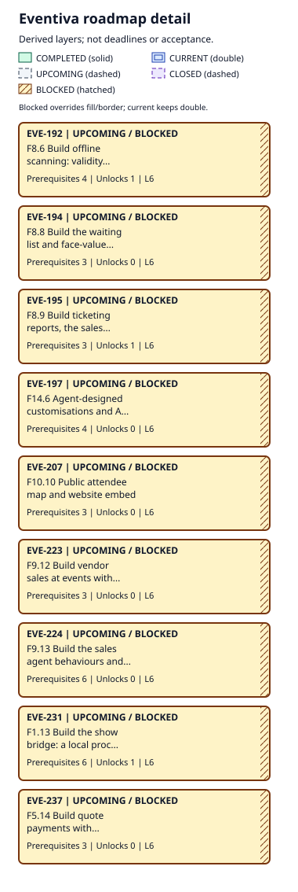

<!-- planning:generated:start -->
# Layer 6, group 2

[All layers](README.md) | [Full Mermaid](graph.mmd) | [Full SVG](../roadmap.svg)

Each row links to the complete mirrored specification/discussion. BLOCKED is an additional planning signal, not a replacement Linear status. Closed duplicates are not completed implementation. Related/duplicate relations remain in the issue page. Parent membership is not a dependency.

| Issue / source specification | Planning / Linear state | Recorded phase / project | All prerequisites | Open prerequisite blockers | Unlocks / precedes | Parent |
| --- | --- | --- | --- | --- | --- | --- | --- |
| [EVE-192](../issues/EVE-192.md) F8.6 Build offline scanning: validity snapshots, local scan ledger, sync and duplicate alerts | **UPCOMING / BLOCKED**; captured Linear: Backlog | F8.6; Eventiva product features | [EVE-17](../issues/EVE-17.md), [EVE-41](../issues/EVE-41.md), [EVE-51](../issues/EVE-51.md), [EVE-162](../issues/EVE-162.md) | [EVE-41](../issues/EVE-41.md), [EVE-51](../issues/EVE-51.md), [EVE-162](../issues/EVE-162.md) | [EVE-193](../issues/EVE-193.md) | [EVE-76](../issues/EVE-76.md) |
| [EVE-194](../issues/EVE-194.md) F8.8 Build the waiting list and face-value resale | **UPCOMING / BLOCKED**; captured Linear: Backlog | F8.8; Eventiva product features | [EVE-24](../issues/EVE-24.md), [EVE-114](../issues/EVE-114.md), [EVE-122](../issues/EVE-122.md) | [EVE-24](../issues/EVE-24.md), [EVE-114](../issues/EVE-114.md), [EVE-122](../issues/EVE-122.md) | None recorded | [EVE-76](../issues/EVE-76.md) |
| [EVE-195](../issues/EVE-195.md) F8.9 Build ticketing reports, the sales dashboard and attendee exports | **UPCOMING / BLOCKED**; captured Linear: Backlog | F8.9; Eventiva product features | [EVE-25](../issues/EVE-25.md), [EVE-30](../issues/EVE-30.md), [EVE-162](../issues/EVE-162.md) | [EVE-25](../issues/EVE-25.md), [EVE-30](../issues/EVE-30.md), [EVE-162](../issues/EVE-162.md) | [EVE-212](../issues/EVE-212.md) | [EVE-76](../issues/EVE-76.md) |
| [EVE-197](../issues/EVE-197.md) F14.6 Agent-designed customisations and AI fields | **UPCOMING / BLOCKED**; captured Linear: Backlog | F14.6; Eventiva product features | [EVE-52](../issues/EVE-52.md), [EVE-53](../issues/EVE-53.md), [EVE-185](../issues/EVE-185.md), [EVE-191](../issues/EVE-191.md) | [EVE-52](../issues/EVE-52.md), [EVE-53](../issues/EVE-53.md), [EVE-185](../issues/EVE-185.md), [EVE-191](../issues/EVE-191.md) | None recorded | [EVE-111](../issues/EVE-111.md) |
| [EVE-207](../issues/EVE-207.md) F10.10 Public attendee map and website embed | **UPCOMING / BLOCKED**; captured Linear: Backlog | F10.10; Eventiva product features | [EVE-178](../issues/EVE-178.md), [EVE-200](../issues/EVE-200.md), [EVE-238](../issues/EVE-238.md) | [EVE-178](../issues/EVE-178.md), [EVE-200](../issues/EVE-200.md), [EVE-238](../issues/EVE-238.md) | None recorded | [EVE-108](../issues/EVE-108.md) |
| [EVE-223](../issues/EVE-223.md) F9.12 Build vendor sales at events with split payments | **UPCOMING / BLOCKED**; captured Linear: Backlog | F9.12; Eventiva product features | [EVE-43](../issues/EVE-43.md), [EVE-174](../issues/EVE-174.md), [EVE-215](../issues/EVE-215.md) | [EVE-43](../issues/EVE-43.md), [EVE-174](../issues/EVE-174.md), [EVE-215](../issues/EVE-215.md) | None recorded | [EVE-107](../issues/EVE-107.md) |
| [EVE-224](../issues/EVE-224.md) F9.13 Build the sales agent behaviours and approvals | **UPCOMING / BLOCKED**; captured Linear: Backlog | F9.13; Eventiva product features | [EVE-29](../issues/EVE-29.md), [EVE-50](../issues/EVE-50.md), [EVE-52](../issues/EVE-52.md), [EVE-54](../issues/EVE-54.md), [EVE-215](../issues/EVE-215.md), [EVE-222](../issues/EVE-222.md) | [EVE-29](../issues/EVE-29.md), [EVE-50](../issues/EVE-50.md), [EVE-52](../issues/EVE-52.md), [EVE-54](../issues/EVE-54.md), [EVE-215](../issues/EVE-215.md), [EVE-222](../issues/EVE-222.md) | None recorded | [EVE-107](../issues/EVE-107.md) |
| [EVE-231](../issues/EVE-231.md) F1.13 Build the show bridge: a local process that fires cues to consoles, playback and media servers over OSC, MIDI, MSC and timecode | **UPCOMING / BLOCKED**; captured Linear: Backlog | F1.13; Eventiva product features | [EVE-41](../issues/EVE-41.md), [EVE-43](../issues/EVE-43.md), [EVE-44](../issues/EVE-44.md), [EVE-173](../issues/EVE-173.md), [EVE-210](../issues/EVE-210.md), [EVE-230](../issues/EVE-230.md) | [EVE-41](../issues/EVE-41.md), [EVE-43](../issues/EVE-43.md), [EVE-44](../issues/EVE-44.md), [EVE-173](../issues/EVE-173.md), [EVE-210](../issues/EVE-210.md), [EVE-230](../issues/EVE-230.md) | [EVE-232](../issues/EVE-232.md) | [EVE-73](../issues/EVE-73.md) |
| [EVE-237](../issues/EVE-237.md) F5.14 Build quote payments with commission deducted at source | **UPCOMING / BLOCKED**; captured Linear: Backlog | F5.14; Eventiva product features | [EVE-126](../issues/EVE-126.md), [EVE-174](../issues/EVE-174.md), [EVE-215](../issues/EVE-215.md) | [EVE-126](../issues/EVE-126.md), [EVE-174](../issues/EVE-174.md), [EVE-215](../issues/EVE-215.md) | None recorded | [EVE-66](../issues/EVE-66.md) |
<!-- planning:generated:end -->
