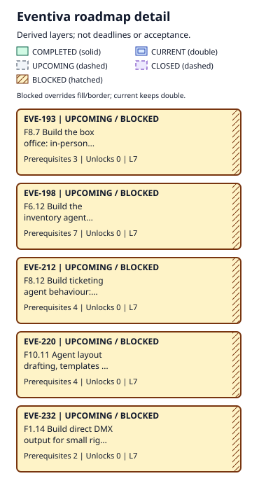

<!-- planning:generated:start -->
# Layer 7, group 1

[All layers](README.md) | [Full Mermaid](graph.mmd) | [Full SVG](../roadmap.svg)

Each row links to the complete mirrored specification/discussion. BLOCKED is an additional planning signal, not a replacement Linear status. Closed duplicates are not completed implementation. Related/duplicate relations remain in the issue page. Parent membership is not a dependency.

| Issue / source specification | Planning / Linear state | Recorded phase / project | All prerequisites | Open prerequisite blockers | Unlocks / precedes | Parent |
| --- | --- | --- | --- | --- | --- | --- | --- |
| [EVE-193](../issues/EVE-193.md) F8.7 Build the box office: in-person ticket sales, reprints and offline quota sales | **UPCOMING / BLOCKED**; captured Linear: Backlog | F8.7; Eventiva product features | [EVE-25](../issues/EVE-25.md), [EVE-162](../issues/EVE-162.md), [EVE-192](../issues/EVE-192.md) | [EVE-25](../issues/EVE-25.md), [EVE-162](../issues/EVE-162.md), [EVE-192](../issues/EVE-192.md) | None recorded | [EVE-76](../issues/EVE-76.md) |
| [EVE-198](../issues/EVE-198.md) F6.12 Build the inventory agent behaviours: shortages, inspections due, reorders and overdue returns | **UPCOMING / BLOCKED**; captured Linear: Backlog | F6.12; Eventiva product features | [EVE-45](../issues/EVE-45.md), [EVE-52](../issues/EVE-52.md), [EVE-54](../issues/EVE-54.md), [EVE-123](../issues/EVE-123.md), [EVE-151](../issues/EVE-151.md), [EVE-187](../issues/EVE-187.md), [EVE-188](../issues/EVE-188.md) | [EVE-45](../issues/EVE-45.md), [EVE-52](../issues/EVE-52.md), [EVE-54](../issues/EVE-54.md), [EVE-123](../issues/EVE-123.md), [EVE-151](../issues/EVE-151.md), [EVE-187](../issues/EVE-187.md), [EVE-188](../issues/EVE-188.md) | None recorded | [EVE-63](../issues/EVE-63.md) |
| [EVE-212](../issues/EVE-212.md) F8.12 Build ticketing agent behaviour: watchers, gate briefing and approval rules | **UPCOMING / BLOCKED**; captured Linear: Backlog | F8.12; Eventiva product features | [EVE-52](../issues/EVE-52.md), [EVE-54](../issues/EVE-54.md), [EVE-55](../issues/EVE-55.md), [EVE-195](../issues/EVE-195.md) | [EVE-52](../issues/EVE-52.md), [EVE-54](../issues/EVE-54.md), [EVE-55](../issues/EVE-55.md), [EVE-195](../issues/EVE-195.md) | None recorded | [EVE-76](../issues/EVE-76.md) |
| [EVE-220](../issues/EVE-220.md) F10.11 Agent layout drafting, templates and proactive checks | **UPCOMING / BLOCKED**; captured Linear: Backlog | F10.11; Eventiva product features | [EVE-52](../issues/EVE-52.md), [EVE-54](../issues/EVE-54.md), [EVE-183](../issues/EVE-183.md), [EVE-199](../issues/EVE-199.md) | [EVE-52](../issues/EVE-52.md), [EVE-54](../issues/EVE-54.md), [EVE-183](../issues/EVE-183.md), [EVE-199](../issues/EVE-199.md) | None recorded | [EVE-108](../issues/EVE-108.md) |
| [EVE-232](../issues/EVE-232.md) F1.14 Build direct DMX output for small rigs over sACN and Art-Net | **UPCOMING / BLOCKED**; captured Linear: Backlog | F1.14; Eventiva product features | [EVE-203](../issues/EVE-203.md), [EVE-231](../issues/EVE-231.md) | [EVE-203](../issues/EVE-203.md), [EVE-231](../issues/EVE-231.md) | None recorded | [EVE-73](../issues/EVE-73.md) |
<!-- planning:generated:end -->
