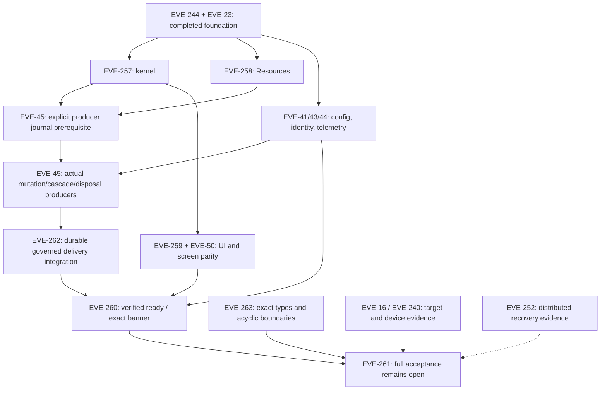

# Foundation and integration timeline

Last reconciled with Linear: 2026-11-17. Dates describe recorded decisions or this snapshot, not invented delivery deadlines. Status is the issue's observed status; repository source presence and focused tests do not close broader acceptance. Detailed contracts remain in the [modular specification](../architecture/modular-platform.md) and the [decision index](decisions.md).

## Completed foundation and decisions

| Step                                                                              | Observed state                                              | Meaning                                                                                                                                   |
| --------------------------------------------------------------------------------- | ----------------------------------------------------------- | ----------------------------------------------------------------------------------------------------------------------------------------- |
| [EVE-243](https://linear.app/resnovas/issue/EVE-243) house enrollment             | Done                                                        | Current governance/tooling baseline; external administration limitations remain in [enrollment](../smartcloud-enrollment.md).             |
| [EVE-244](https://linear.app/resnovas/issue/EVE-244) fresh workspace              | Done                                                        | Accepted foundation, not product capabilities.                                                                                            |
| [EVE-23](https://linear.app/resnovas/issue/EVE-23) contracts/schema/runtime split | Done                                                        | Existing package boundaries are the baseline, not work to repeat.                                                                         |
| [EVE-17](https://linear.app/resnovas/issue/EVE-17) offline engine selection       | Done                                                        | Selected record/document direction; native-iOS follow-up remains open.                                                                    |
| [EVE-45](https://linear.app/resnovas/issue/EVE-45) producer semantics             | Three defaults approved 2026-11-17; issue still In Progress | Fresh durable incarnation; ambiguous callback reconciliation; committed-transition provenance. Approval is not journal/kernel completion. |

## Current work and prerequisites

| Lane / issue                                                                                                                                                                              | Linear state at snapshot                                           | Current acceptance boundary                                                                                                                                                                                                                                                                                               |
| ----------------------------------------------------------------------------------------------------------------------------------------------------------------------------------------- | ------------------------------------------------------------------ | ------------------------------------------------------------------------------------------------------------------------------------------------------------------------------------------------------------------------------------------------------------------------------------------------------------------------- |
| [EVE-13](https://linear.app/resnovas/issue/EVE-13) platform direction                                                                                                                     | In Progress                                                        | Parent acceptance remains open; architecture decisions do not prove every implementation.                                                                                                                                                                                                                                 |
| [EVE-257](https://linear.app/resnovas/issue/EVE-257) kernel                                                                                                                               | In Progress                                                        | Controlled transitions, exact providers, scoped cleanup and serving generations; distributed recovery is a separate gate.                                                                                                                                                                                                 |
| [EVE-258](https://linear.app/resnovas/issue/EVE-258) Resources                                                                                                                            | In Progress                                                        | Privileged tenant-bound migrations, unchanged features/provider composition, immutable revision/history and SQL boundaries.                                                                                                                                                                                               |
| [EVE-41](https://linear.app/resnovas/issue/EVE-41), [EVE-43](https://linear.app/resnovas/issue/EVE-43), [EVE-44](https://linear.app/resnovas/issue/EVE-44) config, identity and telemetry | In Progress                                                        | Redaction, authorization/audit and correlated bootstrap/runtime evidence. EVE-43 adoption remains blocked. Exporter contract and documentation checkpoints do not prove production ingestion/security or complete adoption.                                                                                               |
| [EVE-45](https://linear.app/resnovas/issue/EVE-45) explicit SQL producer journal                                                                                                          | In Progress                                                        | The tested trusted-host journal persists fresh incarnations and unresolved intent, reconciles authoritative status and atomically confirms into the existing feed. It is a prerequisite, not automatic kernel mutation-owner wiring. See the checkpoint evidence below; broader acceptance remains open.                  |
| [EVE-262](https://linear.app/resnovas/issue/EVE-262) governed dispatch                                                                                                                    | Backlog                                                            | Governs observation-only subscriptions/protected release; EVE-45 owns durable producers/feed. Source may exist while the issue remains unaccepted.                                                                                                                                                                        |
| [EVE-259](https://linear.app/resnovas/issue/EVE-259), [EVE-50](https://linear.app/resnovas/issue/EVE-50) declarative UI/screen context                                                    | In Progress                                                        | Data-only schema plus action/projection parity; native/UI end-to-end acceptance is not proven here.                                                                                                                                                                                                                       |
| [EVE-263](https://linear.app/resnovas/issue/EVE-263) exact types/acyclic graphs                                                                                                           | Backlog, binding quality gate                                      | Review actual source/declarations/export graphs and runtime admission; do not treat old isolated audit counts as current clearance.                                                                                                                                                                                       |
| [EVE-261](https://linear.app/resnovas/issue/EVE-261) coordinated integration                                                                                                              | In Progress                                                        | Coordinator reserves shared manifests/root checks/LLMS/graph/final delivery. All required G01-G15 evidence must be explicit.                                                                                                                                                                                              |
| Documentation governance (under EVE-13/261)                                                                                                                                               | Implementation/review in progress, not a new approved Linear issue | This checkpoint publishes only the human timeline and decisions. The complete source mirror is frozen pending a verified canonical commit-hook correction for exact generated paths. The approved documentation-debt ratchet remains a separate reviewed delivery; no checker activation or global compliance is claimed. |

## Upcoming sequence

1. Review/freeze isolated contracts and focused evidence under the coordinator's path reservations. Clear applicable EVE-263 type/boundary findings without widening contracts or weakening checks.
2. Retain the tested explicit EVE-45 producer journal protocol while integrating its trusted mutation owners. Do not infer automatic production from the journal's crash/retry/status evidence.
3. Integrate automatic kernel producers at actual mutations, dependency cascades, disposal and lifecycle callbacks with stable callback idempotency keys. Snapshot comparison or successful method-return wrappers cannot establish committed transitions or authoritative provenance.
4. Combine kernel/resources/config/identity/telemetry with durable governed hooks; prove pinned workflows, cleanup, readiness and protected-release boundaries on the actual composed system.
5. Complete declarative UI/action/screen parity and [EVE-260](https://linear.app/resnovas/issue/EVE-260) (Backlog) exact archived word-art reference only after verified ready and telemetry. No invented banner or physical exactly-once claim.
6. Complete target-specific [EVE-16](https://linear.app/resnovas/issue/EVE-16) federation/OTA and [EVE-252](https://linear.app/resnovas/issue/EVE-252) multi-runner recovery evidence (both In Progress), and [EVE-240](https://linear.app/resnovas/issue/EVE-240) native-iOS follow-up (Backlog). Independent portable work need not wait for every broad issue; full platform acceptance does.
7. Reconcile evidence/decisions on Linear and Markdown, regenerate docs/graph in the coordinated window, run full gates and deliver only through the coordinator. Keep EVE-45/EVE-261 open until their own complete acceptance is demonstrated. No deployment or production readiness is authorized by this sequence.

## Producer and exporter checkpoint - 2026-11-17

The source includes the [producer journal](../../packages/integrations/sql/src/hook-producer.ts) and [governed diagnostic export](../telemetry-export.md). Producer implementation commit `489819054e61d27ecc018b676de6814e54947196` and exporter implementation commit `5c241cbe68dbe743b3474f4c24e46f783365f135` are rebased onto the delivered EVE-264 archive head `980cac6f682336e97da5d72dea72650570dab6c7`. The 480 archive renames preserve source bytes and the private-tests gitlink; this checkpoint does not rewrite the archive.

The journal commits unresolved intent before granting first callback execution. Duplicate admission never permits replay; a restarted incarnation cannot directly confirm its predecessor. Authoritative reconciliation and confirmation publish only the original immutable fact, atomically through the existing feed. Missing/foreign attempts fail with policy denial rather than exposing another tenant/runtime's existence. Additive migration 0008 is tested on both dialects, not run against production.

The exporter rechecks a default-off flag and live tenant/purpose/module-generation grant for every delivery and flush. It drops input text/attributes and denies Restricted/Vault and nonordinary operations. Its replaceable SDK adapter uses immediate diagnostic events with no retry/backlog, handles swallowed HTTP errors and retains cancellation ownership through delayed preparation. Existing local logging and host composition are unchanged. No new dependency version, external ingestion or production activation is included.

Executed on the combined implementation before the archive-only base rebase:

- `bash .amp/in/orb-backup/run-storage.sh node --run verify`: exit 0; all 85 Nx lint/typecheck/test/build/parity tasks (16 cache hits), then smoke for three projects plus 12 dependency tasks. The disposable approved PostgreSQL fixture was removed. Android export is not device execution.
- `bash .amp/in/orb-backup/run-storage.sh pnpm exec vitest run --config tests/storage/vitest.config.mts tests/storage/src/hook-producer.spec.ts tests/storage/src/hook-process.spec.ts --coverage.enabled=false`: two files, 20 tests passed. Separate SIGKILL/reopen processes prove both-dialect journal recovery without source callback replay, alongside rollback, authority/tenant isolation and stale-resolution races.
- `pnpm exec vitest run --config tests/telemetry/vitest.config.mts`: 37 tests passed; 98.28% lines and 95.1% branches. `pnpm exec vitest run --config tests/integrations/posthog-server/vitest.config.mts`: 11 passed; 96.72% lines and 92.85% branches. Transport is fixture-intercepted; these are not production delivery receipts.
- `pnpm nx sync:check`: all files up to date. Source graph: 166 files/578 edges/28 packages, zero violations or cycles. Emitted graph: 67 files/256 edges, zero violations or cycles. Final post-rebase checks and exact-head CI are recorded on EVE-45/EVE-261; pending CI is not counted as passed.

Independent documentation review confirmed all 62 new production callable attachments; the test/example pass documented 139 callable nodes with unchanged comment-free AST/tokens. Semantic rationale remains reviewed, not inferred from a heuristic count. The exact debt ratchet and full Linear mirror are held separately; no broad suppression or source-prose rewriting is used to pass a gate.

Next, connect actual lifecycle mutation owners, dependent cascades and disposal to stable callback keys and authoritative provenance. Public-method success or snapshot differences cannot establish these transitions. EVE-45/EVE-261 remain In Progress, EVE-260 remains gated by verified readiness, and EVE-43 component adoption remains blocked. No new product decision is required for this bounded prerequisite; full native/UI/security/distributed/production acceptance is unproved.

## Dependency roadmap

Solid arrows indicate implementation prerequisites from the modular specification/current EVE-45 plan, not new Linear blocking relations. Dotted arrows indicate broader target evidence required for complete integration. The text above is the accessible equivalent of this graph. Every issue node links to Linear.

## Acceptance ledger

The authoritative detailed matrix remains [specification G01-G15](../architecture/modular-platform.md#14-hard-readiness-gates-and-acceptance-evidence-ledger) and the live [EVE-261](https://linear.app/resnovas/issue/EVE-261) packet. This lane has not executed platform acceptance and marks none of those rows passed. Each completed checkpoint must name commit, command/output, runtime/provider, negative control and remaining limits. In particular, native/UI, production security/ingestion and full platform integration are **not proven** by this governance change.
