# Foundation and integration timeline

Last reconciled with Linear: 2026-11-17 (EVE-250/251 parameter checkpoint added 2026-11-18). Dates describe recorded decisions or this snapshot, not invented delivery deadlines. Status is the issue's observed status; repository source presence and focused tests do not close broader acceptance. Detailed contracts remain in the [modular specification](../architecture/modular-platform.md) and the [decision index](decisions.md).

## EVE-299 house adoption and licence prerequisite - 2026-11-20

The [funnel owner](https://ampcode.com/threads/T-b650d323-f82a-46fb-bedc-70c527baa29f) resumes from published `d40a76b742468e93bb42369de769b7621a71b8e3`. [Adoption START](https://linear.app/resnovas/issue/EVE-299#comment-00f3bc7e-83ce-43a8-baa2-1b43b143dd97) precedes Jonathan's additional three-package licence prerequisite, relayed by Puck on November 20; exact human-selection times are unknown. The [prerequisite record](https://linear.app/resnovas/issue/EVE-299#comment-c72ad25f-85ea-4c0d-8c52-f7bda0f0a21c) is explicitly [mirrored and read back](https://github.com/Resnovas/Eventiva/issues/1092#issuecomment-7038687715). This is not a refresh of the frozen issue capture.

| State | Evidence and next step |
| --- | --- |
| Completed targeted candidate work | Retained prebound TCP composition and port-zero fixtures pass 68 server tests with coverage and real process recovery; configuration still rejects port zero. Static source/declaration audits pass with zero violations. Twenty shared JSDoc rule/options probes pass with mature 65.4.5; cooldown is unchanged. Staged FormatJS and reference import/edit/build/package guards remain uncommitted in preserved stash `023189c6f2d1ccad5fe769a9efceb1dfbb1a22e8` and independent patch/archive backups. These are not full-gate or publication results. |
| Completed prerequisite source hook | Signed local `c8964c59ad2ffe3cc137efe384a763083348a0df`, tree `79f32e1d466869b5017cd411817ad0c8f09bebaf`, adds exactly the three [house #57](https://github.com/Resnovas/.github/pull/57) exceptions and [documentation](../dependency-security.md#jsdoc-licence-prerequisite-eve-299). Normal installed hook exits 0 in 821.476671s, 11:46:48.047029Z to 12:00:29.523715Z on November 20, below 1200s. Trace2 intervals including barriers: static 107.852s, root 52.148s, Node 39.304s, aggregate 601.784s, smoke 15.844s, features 4.368s. All 38 aggregate tasks and three smoke projects/17 tasks pass. Unchanged-registry manifest `2f875f5c-34c0-467d-9f86-89ce5dae2352` naturally selects zero features for six policy/docs paths. The [source checkpoint](https://linear.app/resnovas/issue/EVE-299#comment-b35f38fb-8cb2-4981-8625-6929ec9e7969) distinguishes local proof from publication and PR dependency review. |
| Current prerequisite graph and delivery | Clean-source Graphify check identifies four added document nodes/four edges. Regenerate mechanically, then require this separate graph/evidence commit's own normal hook within 1200s before publication and exact-head CI. No source-hook evidence substitutes for it. Vulnerability policy, cooldown, registry and all application gates remain unchanged. Failure holds publication without blind retry. |
| Upcoming adoption | Restore the preserved source candidate after the prerequisite lands. Accepted house #60/#62 are staged, not fully adopted; #63's all-rule header exemption needs its accepted merge revision. Continue package-by-package JSDoc, canonical budget/guidance and shared evidence adoption without removing existing product gates. Upgrade to 65.5.0 after November 26, not through a cooldown exception. |
| Separate approved performance work | Jonathan subsequently approved genuinely affected-only feature selection and fresh same-run Nx result reuse under exact-tree proof, retaining every required assertion, coverage and isolation obligation. Pipeline/registry reservations are confirmed. G archive `f584c35c094feef30df898d97dcce0a99c64f97513e82717cb652caec271b034`, all 42 internal checksums and both five-path projection trees independently verify; originals are preserved and not integrated. Qualify actual G under the same 1200-second bound. A normal house PR for the ordered pipeline, snapshot/Git isolation and installed-hook fixtures is also approved; no shared source is changed in this prerequisite. |

The linked-worktree hook defect was Git-local environment inheritance, unrelated to `externals`. Renewal and EVE-44 reservations remain untouched. No deployment, paid resource, new timeout, competing qualification or whole-issue closure is authorized by these checkpoints.

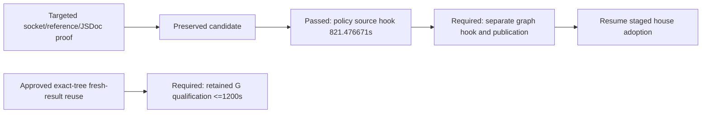

## EVE-261 mandatory child-phase evidence

On 2026-11-20, Puck relayed Jonathan's mandatory timing correction after the
exact attempted renewal-tree diagnosis. The coordinator confirmed four telemetry
harness/spec paths and this isolated documentation slice on published `d40a76b7`.
[EVE-261 START](https://linear.app/resnovas/issue/EVE-261#comment-77d21146-ce70-4759-ab3f-53258432f492)
and OPEN [GitHub #1035](https://github.com/Resnovas/Eventiva/issues/1035) retain
the non-closing lifecycle. Exact human-selection time is unknown.

- Completed regression: missing core root/finalizer journal and explicit close
  fail before correction; all 14 affected focused tests pass afterward. Static
  verification passes before documentation follow-through.
- Current qualification: core launches use the existing observer; genuine
  no-preload/no-fd3 controls retain asserted outer timing. Every existing budget
  and business assertion remains. Normal installed source/docs hook within1200s
  and separate clean graph hook/publication/CI remain required.
- Upcoming: after separately qualified delivery, renewal's owner may run one
  fresh measured qualification with full timing. No renewal adoption or retry
  occurs here. PR59 Windows decision/checks still block managed-core sync and
  step2; whole EVE-261 remains open.

The [canonical correction](../core-qualification/telemetry-timeouts.md#mandatory-phase-evidence)
owns behavior/evidence. Later delivery results must preserve the original failed
diagnostic and all historical captures; no main/renewal/funnel edits are included.

## Core approval evidence reconciliation I

START November 20, 2026: the [I owner](https://ampcode.com/threads/T-20b14e85-79c3-4f05-9bbd-92a8f7fc8a09) independently fetches published `origin/main` `c779e486a93d8c5b863b1958c50211745bae6f94` into isolated `agents/eve-275-packet-i`, not the coordinator's older local main or unpublished renewal. The full live discussion reaches terminal pagination; [EVE-275](https://linear.app/resnovas/issue/EVE-275) remains In Progress and actual [GitHub #1063](https://github.com/Resnovas/Eventiva/issues/1063) OPEN with normal linkback6988293684. [Linear START](https://linear.app/resnovas/issue/EVE-275#comment-48cb133a-d640-4538-8c9f-96f9ec8e12f8) is explicitly [mirrored/read back](https://github.com/Resnovas/Eventiva/issues/1063#issuecomment-7036520194). This bounded inspection does not refresh the historical issue capture.

| State | Evidence and next step |
| --- | --- |
| Completed source/publication inspection | B correction/head `8fa5b765`/`129069e0`, A source/head `29317cb3`/`e0efc5e4` and D approved fixture/source/head `84e4ac97`/`009dc422`/`3ff2251b` are ancestors of fetched main. B policy and D runtime files are byte-unchanged there. Permanent policy/consent coverage and actual injected-policy SQL issuance are present; exact captured resource grants replace the historical event-wide follow-up gap. [Session-policy](../core-qualification/session-policy.md#current-published-state---packet-i-2026-11-20), [cancellation](../core-qualification/resource-cancellation.md#current-published-state---packet-i-2026-11-20) and [wiring](../core-qualification/approval-wiring.md#current-published-state---packet-i-2026-11-20) capsules map clauses/source/evidence/limits without rewriting historical bodies. |
| Completed historical hosted inspection | Fresh `gh api` reads verify B application44519309355, A44617567119 and D44638123407 at their exact heads, each completed/success. D check-runs17success/7skip; older failed/cancelled/duplicate records and B's separate scheduled mirror-freshness failure remain historical, not universal green or I CI. Past fixture-backed full-gate counts remain explicitly reported past execution. |
| Current I verification | Only the three additive capsules, narrow chapter35 pointer and this isolated subsection are authored; LLMS/clean graph are mechanical. Run unchanged docs/root/docgen/strict captured planning; require natural not-applicable/zero-interface selection with registry unchanged. Normal source/docs hook then separate graph hook must each pass within1200s, approved pinned disposable PostgreSQL, Trace2/per-stage timing. Failure/overrun holds publication with exact patch/logs preserved; no retry-to-green or borrowed proof. |
| Upcoming I delivery and exclusions | After its own gates: signed direct-main source/docs and separate clean graph, independent remote read-back, non-closing paired lifecycle and exact-head I CI. No source/test/tool/root/registry/config writes, runtime fix, new policy/tests, renewal/G/H/F/trust/EVE-291/PR59 adoption or broad closure. No production/release activation, spend/settings/dependency change; EVE-248 January2027 unchanged. |

**Source/docs hook passed, 2026-11-20T10:16:04Z (second precision):** signed local I source `46ab4e206eefec67e5f441657efe46bdb149654d` independently verifies G. Actual installed pre-commit exits0 in1002.902125s, commit-msg exits0 in0.062792s and containing Git exits0 in1003.548049s, below the unchanged1200s limit with approved pinned disposable PostgreSQL. Trace2 intervals including each following snapshot barrier, not exact subprocess durations: static73.493s, root32.286s, Node27.048s, aggregate773.177s, smoke94.737s, features2.036s. Aggregate38/38tasks (15cache hits), smoke3projects/17tasks (11hits), normal storage/server/runtime/telemetry and actual migration/module-run/Cluster pass. Final manifest `09fe2b53-0d37-4ce1-aec2-3607e61bd472` naturally selects no interfaces/results and is not-applicable for exactly six documentation paths; registry and serial execution remain unchanged. Fresh static, root104documentation fixtures/301editableTS/zero findings, docgen/check and strict captured planning258issues/692edges/zero unresolved or stale also pass; none is live all-issue freshness or cold-budget acceptance. The [source checkpoint](https://linear.app/resnovas/issue/EVE-275#comment-d4de160e-54da-45ed-8bb2-6938cb5bd109) is explicitly [mirrored/read back](https://github.com/Resnovas/Eventiva/issues/1063#issuecomment-7036984462). Separate clean graph/evidence hook, publication and exact-head hosted CI remain independently required; their subsequent outcomes belong on this same non-closing lifecycle pair, not a retrospective rewrite of this local checkpoint. No failed gate or retry occurred in this I source attempt.

## EVE-299 static deduplication

On 2026-11-20, Puck relayed approval for the [funnel owner's](https://ampcode.com/threads/T-b650d323-f82a-46fb-bedc-70c527baa29f) duplicate-static removal only. Exact human-selection time is unknown. [Linear START](https://linear.app/resnovas/issue/EVE-299#comment-cc14d9dd-20a8-49a4-ad9e-85e14e04c301) is independently [mirrored on GitHub #1092](https://github.com/Resnovas/Eventiva/issues/1092#issuecomment-7033313568), related RES-66. Coordinator cleared the exact pipeline and verification-doc sections; telemetry, storage and renewal work remain separate. The [registry](../verification/registry.md) owns the ordered pipeline and snapshot contract.

| State | Evidence and next step |
| --- | --- |
| Completed local regression | The installed-hook positive case fails before the fix because it observes STATIC_OK twice. Shared pipeline now passes all 12 runner/pipeline fixtures, including every stage once, standalone execution, static failure before documentation, immediate static/final snapshot rejection and nested Git histories. Static verification passes 15 builds, 83 lint/type tasks and both boundary graphs with zero violations before documentation work. |
| Retained dedup-only failure | Normal hook naturally exits 1; fixture/commit/cleanup wall upper bound 1123.92s, not exact hook time. Single static lint/type body 79s, aggregate 15m31s with 36 successful tasks/15 cache hits. Telemetry 89/92 and runtime 678/680 fail bounded child ETIMEDOUT; smoke/features never start. No commit/push or retry. Exact patch/tree and logs remain preserved. |
| Current combined qualification | Coordinator relays Puck approval for exactly this dedup slice plus the cleared NodeRuntime subpath import/docs below. File-tool archive SHA256 f3724bb40bc4fe21e138ebcd2663ce6c9c1cb1d7b2f5ad7d902b7382e45e3158 and all manifest entries verified; only four transferred hunks applied, no generated overwrite. Combined static passes before documentation. Source/docs commit and separate graph chore each require their own normal hook within 1200s; no rule-8 exception, bypass or evidence reuse. |
| Completed combined source hook | Signed source e579dd6d3dacccae14bd1e62b83ddf422ad18685, tree efaf05b697b0c26f95bc0ac295239baef2ae9e38, passed the actual installed hook in 1142.649279s, exit0, from 2026-11-20T08:04:10.471325Z to 08:23:13.120636Z. Trace2 stage intervals including barriers: static95.289s, root44.715s, Node34.500s, aggregate646.659s (38/38 tasks,29 cache hits), smoke126.609s (17 tasks,11 hits), features194.719s. Manifest8b28151e-31cc-4dab-bc98-3f67bc8aa732 passes backend-surfaces and funnel-runner with unchanged serial execution. The 57.350721s margin is this run's result, not a cold-budget guarantee or causal isolation of the import. Separate graph hook, publication and exact-head CI remain independently required and are recorded on the paired issues. |
| Upcoming and excluded | Publish independently verified source and regenerated graph, record full-hook timing and exact-head CI. Same-run proof reuse and any serial-contract amendment still require Jonathan. Static dedup alone cannot resolve G's measured 479.776-second excess. No dependency, production operation or shared-house edit is included. |

The retained runtime failures both belong to `real diagnostic server telemetry composition` in `tests/telemetry/src/server.spec.ts`: line198, `runs the real main and drains one correlated console diagnostic, never ready or banner` (2341ms, status null, SIGTERM), and line229, `flushes the real file layer before process exit and releases its scoped lock` (2312ms, status0, signal null). Both report `Bounded child did not complete normally.` / `ETIMEDOUT`; successful application exit is not timely parent close. Runtime target took 462.63s; telemetry target 85.30s. No claim that the import correction fixes these two observations precedes combined verification. The [dedup failure and combined authorization record](https://linear.app/resnovas/issue/EVE-299#comment-24e2200d-52ca-444c-b5ec-0e59845cb2e9) is independently [mirrored](https://github.com/Resnovas/Eventiva/issues/1092#issuecomment-7033812502).

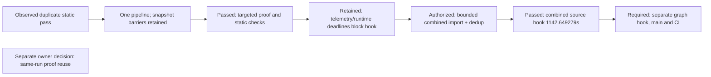

## Core qualification reconciliation H

START 2026-11-20T06:39Z (minute precision): [H owner](https://ampcode.com/threads/T-191ac145-222c-496f-bac9-a3b9e52e2e1b) reads Packet H and fetches `origin/main` `a959f9ea2042fb6d850d06f953e6bf7abda70a20` into isolated `agents/core-reconciliation-h`. Verified live pairs remain In Progress [EVE-277](https://linear.app/resnovas/issue/EVE-277) / OPEN [#1065](https://github.com/Resnovas/Eventiva/issues/1065) and In Progress [EVE-278](https://linear.app/resnovas/issue/EVE-278) / OPEN [#1066](https://github.com/Resnovas/Eventiva/issues/1066). [277 START](https://linear.app/resnovas/issue/EVE-277#comment-e55ee2a9-f9f8-477b-975e-8fce10732e9f) / [GitHub read-back](https://github.com/Resnovas/Eventiva/issues/1065#issuecomment-7032467089) and [278 START](https://linear.app/resnovas/issue/EVE-278#comment-d957ad4e-f201-463b-8b80-0952e2124870) / [GitHub read-back](https://github.com/Resnovas/Eventiva/issues/1066#issuecomment-7032467311) preserve non-closing lifecycle evidence. This bounded reread does not refresh the historical all-issue capture.

| State | H evidence and remaining boundary |
| --- | --- |
| Completed source/publication reconciliation | [Bootstrap report](../core-qualification/bootstrap-diagnostics.md#current-published-state---packet-h-2026-11-20) and [type-boundary report](../core-qualification/types-boundaries.md#current-published-state---packet-h-2026-11-20) add clause/source/evidence/gap maps. Integration01517213/head23baec94 is published and ancestral to fresh main; helper/gate/type fixture match current source. Later telemetry test orchestration is distinguished from unchanged privacy assertions. Historical failures, amendments and local-only checkpoints remain intact. |
| Completed historical CI verification | H independently reads application run44493038906: exact23baec94, completed/success; 17 successful checks and seven intentional skips. Reported combined105-task/three-smoke local verification remains historical, including earlier exit124/interrupted storage failures and unknown cause. Later F run44686200946 on34e39ccd independently succeeds; its history includes an older cancelled smartcloud, later successes and skipped duplicate house/release/graph checks, not universal historical success. Neither head is H CI. |
| Initial preparatory checks and retained hold | Fresh `node --run verify:static` passes15builds/83tasks, source296files/1450edges and emitted100files/502edges, zero violations/cycles. `node --run check` passes104documentation fixtures/301editableTS/zero findings or ratchet violations; docgen and strict captured planning258issues/692edges/zero unresolved/stale pass. Existing feature runner selects zero interfaces with status not-applicable for the five documentation paths, without registry edits. The first unchanged installed hook reports telemetry91pass/1fail: `tests/telemetry/src/bootstrap-diagnostics.spec.ts:80`, observed child ETIMEDOUT in the `telemetry_enabled: 'false'` output/exit control. Cause was unestablished at that checkpoint; no declaration regression or privacy leak was inferred. H commit/publication/CI were held, not passed. No cold/warm acceptance follows from cache hits. |
| Upcoming / deliberately open | Whole EVE-277/278/Core, future EVE-263 coverage, full credential/provider/native acceptance and production authority remain separate. A new source/test need requires its exact clause/path and another reservation, not H scope expansion. Storage/runtime/resources evidence-budget remediation stays with its funnel owner and Jonathan; no timeout increase, reuse implementation or registry change here. |

H delivery attempt ended 2026-11-20T07:07:16.191135Z with exit1, not timeout124. Git trace2 measures the unchanged installed pre-commit from06:47:36.672865Z at **1179.518258 seconds**, inside1200s but failed. Its static checks pass; aggregate test/build/parity reports37successful tasks (15cache hits) and only `@eventiva/telemetry-tests:test` failed after15m18s. Normal storage/server and actual migration/module-run/Cluster conformance pass in that attempt. Smoke and the final feature stage are not reached; the separately executed docs-only feature manifest is not substituted for them. No commit-msg hook, signed H commit, push or H-specific hosted CI occurs. The reports' original historical bodies remain byte-identical. H is preserved locally pending the exact telemetry control's owner disposition; no blind rerun or scope expansion is authorized by this hold.

**Authorized resumption, 2026-11-20:** [coordinator/Puck relay](https://ampcode.com/threads/T-01a1e940-37a3-7691-a5c0-e935b711c99a) clears H to rebase only its held docs patch onto published [e579dd6d](https://github.com/Resnovas/Eventiva/commit/e579dd6d3dacccae14bd1e62b83ddf422ad18685) / [fab62e1b](https://github.com/Resnovas/Eventiva/commit/fab62e1b1a62eff5dd70f7d566510c599b25e472), regenerate mechanical outputs, pass the normal source/docs hook and separate graph hook within1200s each, then push and verify exact-head CI. H fetch independently confirms that main head; only an additive timeline insertion conflicted, resolved without changing the funnel owner's section. [Upstream CI44704251637](https://github.com/Resnovas/Eventiva/actions/runs/44704251637) is independently in progress at resume, not accepted. Permission explicitly does not wait for that run, but any failure requires stopping/reporting. The initial1179.518258s failure, original patch/stash/logs and all unpublished lanes remain preserved. Resumption is not fresh gate success or publication; final H timings/revisions/CI belong on both owning lifecycle pairs.

**Resumed local source/docs gate passed, 2026-11-20T09:01:21Z:** signed H source `c5ecfae47a2faa467715f766d9c608bac0c40ff0` independently verifies G. Installed pre-commit exits0 in986.699353s (08:44:53.949135Z to09:01:20.648509Z), commit-msg exits0 in0.138500s, and containing Git invocation exits0 in987.847146s under the unchanged fixture wrapper's1200s bound. Aggregate38/38tasks passes in10m18s with30cache hits, including normal storage/runtime/server, telemetry and actual migration/module-run/Cluster; smoke passes all3projects/17tasks in2m34s with11cache hits. Final manifest `6e45f361-e0ff-453b-964b-801ee1b2c875` is genuinely not-applicable for exactly5documentation paths/zero interfaces, registry unchanged. Fresh root104fixtures/301TS/zero, docgen and strict captured planning258/692/zero pass; this is not live all-issue freshness or cold/warm acceptance. Later exact-head upstream subscription reports all executed fab62e1b checks successful, with intentional skips retained. Original H failure remains historical, not overwritten. Separate graph/evidence hook, normal direct-main push and H-specific hosted CI are still required, not inferred from this local checkpoint.

Only the two qualification reports, a narrow chapter20 evidence pointer and this isolated subsection are authored, with mechanical LLMS/clean-source graph as required. Renewal, G's held local3d31ced7, telemetry, EVE-291, trust and PR59/step2 remain untouched. EVE-248 stays January2027; budgets/settings/dependencies/spend and release authority are unchanged.

```mermaid
flowchart LR
    HStart["H: fresh main and verified live pairs"] --> HRead["Published source and exact-head evidence"]
    HRead --> HDocs["Current capsules; historical failures preserved"]
    HDocs --> HGate["Installed hook: telemetry child deadline failure"]
    HGate --> HResume["Published correction; authorized H requalification"]
    HResume --> HSource["Passed: H source/docs hook 986.699353s"]
    HSource --> HOpen["Required: graph hook, publication and hosted CI"]
```

## Approval finalization qualification F

START 2026-11-20T05:24:12Z: [independent F owner](https://ampcode.com/threads/T-5c7c1b4c-f6aa-448d-82f3-f6c5692c1890) starts from fetched `origin/main` `69f9866e4701a1f2ea8ddbe3f326eb75eb235dd0`, not unpublished renewal. [Linear START](https://linear.app/resnovas/issue/EVE-275#comment-913b839c-b55a-4584-8bbf-1ad9554afa3b) and its [independently read explicit GitHub mirror](https://github.com/Resnovas/Eventiva/issues/1063#issuecomment-7031300107) record the bounded allocation. This does not refresh the historical snapshot or close EVE-275/Core.

| State | Evidence and next step |
| --- | --- |
| Completed red qualification | [Linear red evidence](https://linear.app/resnovas/issue/EVE-275#comment-15cc7936-b349-4a44-9ef8-d0abe8ae1fff), independently [mirrored](https://github.com/Resnovas/Eventiva/issues/1063#issuecomment-7031377534): unchanged provider fails6/14 cases on real SQLite/PostgreSQL, leaking finalization SQL/connection/proof canaries. Independent observer proves lost-ack deletion committed; rejected COMMIT/ROLLBACK leave unsettled writers, not restoration. |
| Completed local correction and full qualification | Only SQL Cause leaves normalize to existing bounded unavailable; arbitrary defects/interruption and cause structure remain. Focused61/61 and normal storage333/333 pass with all coverage thresholds; provider50/50 statements,59/59 branches,9/9 functions. Signed source3f1de76acd7aadacfe89fd421664af576e683316 passes the unchanged installed static/full hook: aggregate38tasks, smoke17tasks and final uncached storage333/333. Root/strict captured planning and both boundary graphs pass. The [canonical report](../core-qualification/approval-retention.md#approval-finalization-qualification-f---2026-11-20) owns commands and the preserved scratch-archive hook failure. |
| Current evidence and delivery | F-only evidence/clean-source graph accompany signed direct-main delivery; exact published revisions and hosted CI are recorded separately in the paired lifecycle. Local success is not hosted acceptance. Unknown commit outcome is not zero committed deletions; failed rollback is not restoration. Original-cursor retry requires a usable, settled connection; fixture recovery is not provider pool repair. |

Only SQL `approval-retention.ts`, new `approval-finalization.spec.ts`, retention report/chapter34 and this subsection are authored; LLMS/graph regenerate mechanically. G, renewal, process and instrumentation paths stay untouched. No second transaction owner, new public semantics, automatic retry, activation or EVE-248/budget/settings change is authorized.

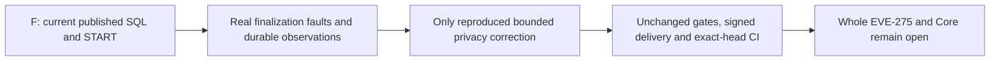

## Structural function telemetry START - 2026-11-20

This bounded live checkpoint does not refresh the historical all-issue capture. [This existing owner](https://ampcode.com/threads/T-d57222d4-a392-4a67-bcea-43f0bda5323a) starts structural proof from published `50e5dc18`, without adopting D/renewal source or creating another lane. [EVE-44](https://linear.app/resnovas/issue/EVE-44), In Progress, maps to independently OPEN [GitHub #811](https://github.com/Resnovas/Eventiva/issues/811) with its matching linkback. The [canonical contract](../architecture/function-telemetry.md) owns Jonathan's seven selections, proposal, exact paths and acceptance.

The [binding selections and START](https://linear.app/resnovas/issue/EVE-44#comment-78250693-15bd-4e78-9b98-ab1c6bed6d92) supersede the earlier plan's pending decisions, exemptions,4096 capacity and proposed cost thresholds. Earlier plan-only source0553d7fa/head50e5dc18 and its successful104-fixture/295-TS root/strict captured planning checks remain historical, not verification of this new source slice. Current proof and publication evidence belong in the canonical contract and paired lifecycle.

| State | Evidence, ownership and next step |
| --- | --- |
| Completed source review | Historical helper establishes broad instrumentation, not universal coverage. Effect.fn creates spans for Effect execution but changes pure APIs; service proxies miss private calls. Metric.trackDurationWith is success-only. Current wire supports logs/spans, not metric export. No archive execution/edit. |
| Selected policies | Production-local signals default TRUE, timers production FALSE/tests TRUE and mandatory; remote OFF/opt-in. Counters/pre-approved static strings only; no PII/secrets/raw errors. No first-party exemptions,8192 operations, p95 per-step review and changed-function optimization JSDoc evidence. No unselected performance tolerance. |
| S1 STARTED | NEW tools/function-telemetry/structure.mjs and structure.test.mjs: executable-body inventory and changed-function record proof. Every occurrence stays BLOCKED pending emitted instrumentation proof; no wrapper-name acceptance or production coverage claim. Canonical architecture/chapter37 and isolated notes only; semantic transform/adapters still need proof. |
| Independent ownership | D owns step1 final acceptance, step2 shared process/timing migration, normal house PR and exclusive root package.json/nx.json/tools/verification pipeline work. Latest correctly configured fixture target580/580 passed; full gate pending. If that20m run times out, later Puck direction moves measured pipeline work before step1 delivery instead of repeating. C delivered/hosted-CI complete/storage released; renewal remains preserved/unpublished, no adoption. |
| Upcoming gates | After S1 and D exact-path release: one central-production primitive owner, one shared transform/target-adapter/checker owner, at most two disjoint migrations and one integrator. Refresh occupancy at START, total<=5; existing phase gates remain. No parallel root/Nx/ESLint author here. |
| Precise blockers | Constructors/default parameters, generators/async/Stream/React lifetime, synchronous fiber context, all-target emission and finite collector self-observation need semantic proof. D root reservation blocks that wiring only. Missing export credentials do not block safe local proofs. EVE-248 January2027; budgets/settings unchanged; paid work needs an explicit amount. |

Later [binding additions](https://linear.app/resnovas/issue/EVE-44#comment-81e08c30-6774-4042-b14e-faa81fa75663) require agent-performed opportunistic nearby optimization with benchmarks/JSDoc evidence, plus tree-shakeability, static unused-source analysis, runtime execution coverage and a joined verification report. The canonical plan owns required negative controls and safe removals; nonobservation is not proof of deadness. **Build-time mechanism decision is PENDING Jonathan: keep this slice PROOF-ONLY.** No production adapter/transform/global wiring or dead-code removal follows before that answer. S1 inventory/review proofs continue locally, without adding a lane or competing with D roots.

Later interim Puck relay, NOT a final mechanism selection: Jonathan leans toward decorators; compiler-specific transform proof is now FROZEN. Only inventory and semantics applicable to both designs continues. The [canonical interim checkpoint](../architecture/function-telemetry.md#interim-source-level-direction-and-transform-proof-freeze) records unchanged strict-TS decorator acceptance versus direct-Node source rejection, concurrent-fiber parent-read evidence and construction-time non-generator Effect.fn behavior. No production decorator/helper wrapper, loader/config change or implicit tiny/internal exemption follows. Await Jonathan's final mechanism answer; D retains root/process ownership.

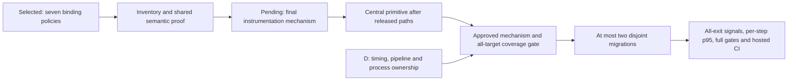

## Approval retention C START - 2026-11-19T21:20:48Z

This dated C checkpoint supersedes the earlier undispatched-C occupancy below, not A/B evidence or the historical planning capture. The existing proof/B owner starts packet C in isolated `repo-approval-retention` / `agents/eve275-approval-retention` from fetched main `e0efc5e4`, preserving every retained proof/provider/fixture/B ref and checkout. [Linear START](https://linear.app/resnovas/issue/EVE-275#comment-9f12d2fd-3761-4cd3-bfda-c9d16fcc79c2) and [independently read explicit GitHub mirror](https://github.com/Resnovas/Eventiva/issues/1063#issuecomment-7022745290) own the non-closing lifecycle. The [canonical C report](../core-qualification/approval-retention.md) owns exact paths, typed maintenance handshake and executed evidence.

| State | C evidence and next step |
| --- | --- |
| Completed prerequisite | Published A supplies the exact producer/CAS terminal retention anchor; source `29317cb3`, separately approved setup fixtures `ee3f367b`/`63cd0c17` and head `e0efc5e4` independently have valid signatures. Reported A local gates are not rerun C evidence or hosted acceptance. |
| Completed C local qualification, 2026-11-20 | New contracts/SQL maintenance capability, storage spec/report/chapter34, additive `0013.sql` migrations and only approval-retention exports preserve canonical terminal retention and both expiry/retention floors. Corrected 45-case real-SQL proof passes; normal SQL coverage 47/47 statements, 55/55 conditionals, 7/7 methods. Ordinary rebase onto independently signed D head `3ff2251b`; fixture-backed unchanged full verify passes all 105 aggregate tasks and all three smoke projects. The initial exit124, interruption, missing-fixture failures and pre-correction success remain historical, not substituted for final acceptance. No existing approval source/spec or D cancellation path is changed. |
| Renewal START, disjoint owner | Existing verified Sol A owner starts at 2026-11-19T21:50:34Z from clean retained `repo-core-integration` at `e0efc5e4`; [binding ingress amendment and START](https://linear.app/resnovas/issue/EVE-275#comment-40e147da-187e-46c8-9d60-e4eb7b183160) independently read. Exact reservation: contracts `identity.ts` session metadata only; OIDC `session.ts` issuance; server `approval-consent.ts` login wrapper only; new server `session-renewal.ts`/spec and permanent coverage include; narrow OIDC session tests; new report/chapter36; identity-OIDC guide and decision index. No C retention/approval schema/CAS/SQL/migration/manifest or D paths. At START, direct-human CLI eligibility was selected but its trusted human-versus-script mechanism remained unresolved; that eligibility is superseded by the later option B decision below. No source acceptance or activation inferred. |
| Renewal option B, superseding owner decision | [Linear amendment](https://linear.app/resnovas/issue/EVE-275#comment-1c8b5a47-353f-4b7c-a2a8-3ca3d2875791), independently read, recorded 2026-11-19T23:10:43Z; original human-selection time unknown. CLI activity NEVER renews; sign-in is the human proof. Only real human mutations and interactive reads/navigation on server-allowlisted first-party web/native routes can renew one-hour idle within the eight-hour absolute cap; polling, prefetch, background sync, token refresh and agents remain excluded. No tickets or remaining CLI activity-proof mechanism blocker. This supersedes direct-human CLI eligibility, not the disjoint path reservation, C/D boundaries or activation limits. |
| Renewal diagnosis hold, separately owned | [Explicit GitHub mirror](https://github.com/Resnovas/Eventiva/issues/1063#issuecomment-7025774667) independently read; source Linear `c42e6105-4208-40e1-ab81-213709798e0f`. Renewal stays preserved/unpublished on D main; further retries await the separately owned EVE-261 telemetry diagnosis. Observed failures are Vitest 5000ms deadlines, not child ETIMEDOUT; slow phase/root cause is unproved. C neither adopts renewal nor changes gates, timeouts or that diagnosis scope. |
| Current delivery / upcoming limits | Finish evidence-only root/strict/build checks and clean-source graph, publish signed C directly and follow exact-head CI through the paired lifecycle. C storage reservations release explicitly at verified delivery; later storage crash-probe harness work awaits its separate exact-path START. Forced SQL finalization/commit-acknowledgement fault recovery remains unqualified, not a rollback guarantee or new protocol. No production migration, scheduler, endpoint or activation is authorized. |

Whole EVE-275/Core remains open. A owns rolling-session follow-up; explicit resource-scoped cancellation is independently owned. EVE-248 stays January 2027; budgets/settings/spend and paused work remain unchanged. Refs: EVE-275. Refs: Resnovas/Eventiva#1063.

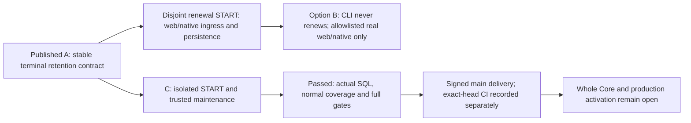

## EVE-299 funnel review and local migration - 2026-11-20

The [existing owner](https://ampcode.com/threads/T-b650d323-f82a-46fb-bedc-70c527baa29f) owns [EVE-299](https://linear.app/resnovas/issue/EVE-299) and independently verified [GitHub #1092](https://github.com/Resnovas/Eventiva/issues/1092#issuecomment-7024950683). Investigation preceded issue creation at 23:17:55Z on November 19; its exact start time is unavailable. The earlier [owner hold](https://linear.app/resnovas/issue/EVE-299#comment-6a0a4d03) was independently read on [GitHub](https://github.com/Resnovas/Eventiva/issues/1092#issuecomment-7025280225). Linear resumed In Progress at 23:50:28Z and was independently reread on November 20; the intake thread avoided duplicate implementation. Related house work is now RES-66/RES-67, formerly SMC-174/175. This bounded live update does not refresh the frozen issue snapshot.

| State | Evidence and next step |
| --- | --- |
| Completed local review | [Canonical Markdown](../funnel-review.md) and [review artifact](https://ampcode.com/artifacts/eventiva-funnel-review-76ce8e7a-41cf-435b-b045-18c080f149b8) classify source examples, static checks, verification, retained authority and redundant guidance. Vendor/history ownership is preserved. |
| Approved implementation choices | Jonathan's Puck relays approve a synchronously registered minimal shell, then flag initialization before product rendering, with no useEffect; isolated synthetic PR PostgreSQL fixtures alongside trusted-event tests after trust review; affected-only CI evidence retained seven days under the existing artifact audience. The latest shell decision supersedes before-registration acquisition. Exact owner-selection times are unavailable; no production authority is implied. |
| Implemented locally, not delivered | Corrective React/timer lint, bootstrap readiness/failure/cleanup proof, static-first verify/CI, 30-entry Markdown interface-family registry with independent source/reverse-import coverage, evidence runner, staged-tree pre-commit guard, isolated PR fixture and seven-day upload. Local AGENTS links canonical mechanics and retains the promotion loop; managed house content is preserved. |
| Executed verification | Rebased onto main a5abfb9a. Static command passes 15 builds and 83 tasks; root check passes 104 documentation fixtures and strict zero across 298 editable TypeScript files. Full test/build/parity and three smoke projects pass. Affected evidence then fails backend replay counts 3/0/0 versus 2/0/0; the other 19 families pass. Pre-commit refuses the commit. Serialized server proof now passes all 13 prerequisites and server tests in 2m54s; full final-tree evidence must rerun. Ready/loading/failed web states are inspected, not native-device proof. |
| Shared adoption blocked | House PR56 is merged at 6cabf3afd23652fe1816c81bc1041ab2bf4b000f; Puck requested adoption on November 20. Exact merged docs-budget checker fails with Git ENOBUFS on Eventiva's 3,303,046-byte path inventory. It also counts generated mirror regions despite its exclusion contract. Both defects are reported to the RES-67 pod; no downstream suppression or shared edit. Shared JSDoc rules remain unenforced: retain global guidance. |
| Upcoming | Canonical fixes and reviewed sync; enable shared JSDoc/source-absence rules while preserving AST gates; remediate authored documentation budgets; migrate table/evidence to accepted APIs with source-derived interfaces and explicit unsupported outcomes. Complete final-tree verification, graph publication, signed delivery and hosted CI. No deployment follows from build-info tooling. |

EVE-299 moved to Blocked with Handoff Blocked at 2026-11-20T01:37:28Z. The [Linear checkpoint](https://linear.app/resnovas/issue/EVE-299#comment-ca75ae96-db96-4a00-ae13-30ab26eb8725) was independently verified on [GitHub #1092](https://github.com/Resnovas/Eventiva/issues/1092#issuecomment-7027649075). No new dependency, thread, production operation, access change or shared `Resnovas/.github` edit. All work remains local/uncommitted; no change to unrelated issue status or EVE-248 deferral.

Later on November 20, [house PR60](https://github.com/Resnovas/.github/pull/60) at bedb6abe4770137f9247b2e1d842620368dc3835 was independently confirmed OPEN/draft. Its exact document checker runs against Eventiva without the inventory failure and reports 13 remaining authored/managed budget findings. This is a read-only candidate probe, not adoption; acceptance/merge and reviewed sync remain pending.

Implementation resumed at 2026-11-20T01:41:14Z, superseding the blocked state above. Jonathan approved only `eslint-plugin-jsdoc@65.5.0` with unchanged ESLint/parser versions, package-by-package enforcement then global activation without baselines/suppressions, and independent passing direct-main slices without waiting for PR60. The [Linear authorization](https://linear.app/resnovas/issue/EVE-299#comment-1fedc63b-0569-45cb-a08e-3899147d4985) is independently [mirrored on GitHub](https://github.com/Resnovas/Eventiva/issues/1092#issuecomment-7027709956). The first slice keeps shared adoption separate. Evidence serialization is now an enforced runner contract: eight fixtures pass, including real Nx prerequisites sharing an exclusive synthetic resource; concurrent control fails with EEXIST. Independent randomized backend databases and distinct ports rule out a single obvious shared database/port; the historical replay failure's precise cause remains unproven. Integrated main is now 80bc555a; final full gates and delivery remain pending.

Local acceptance completed 2026-11-20T02:28:34Z: pre-commit static/full gates and all 20 uncached affected-feature proofs passed, including the unchanged backend replay assertion. Signed source commit `9e379bf6a5c6629752d14e822dd673ae51894c81` carries EVE-299 / Resnovas/Eventiva#1092 / RES-66 references. Graph/evidence publication and exact-head CI follow separately; this does not close EVE-299. The original failed collection remains preserved. Shared enforcement still requires staged adoption; the approved plugin fails the existing seven-day cooldown because it was published November 19. An exact-version exception or waiting until November 26 is the [owner prerequisite](https://linear.app/resnovas/issue/EVE-299#comment-56a2f790-605b-440a-a83c-c1ad84eb2e9a), independently [mirrored on GitHub](https://github.com/Resnovas/Eventiva/issues/1092#issuecomment-7027919574). No cooldown policy change or active-workspace dependency installation occurred.

Published on November 20: signed [source 9e379bf6](https://github.com/Resnovas/Eventiva/commit/9e379bf6a5c6629752d14e822dd673ae51894c81) and [graph/evidence 5ca8059d](https://github.com/Resnovas/Eventiva/commit/5ca8059d15d582bdc0165b975db52fa0a17eeb86) are on main. This supersedes the local-only delivery state above; exact-head [application CI](https://github.com/Resnovas/Eventiva/actions/runs/44663334032) is running and subscribed. The separate EVE-261 timing owner is CLEARED for measured parallelism of two in non-feature stages and Android-to-web ordering, retaining stage order and the tested serial feature-evidence runner. Root serial settings were inherited, not a new correctness requirement; the EVE-299 registry wording is corrected here. No root edits collide. Shared JSDoc/cooldown, shared registry/evidence adoption, authored budget remediation and managed-guidance reduction remain upcoming; the whole issue stays open.

Hosted CI subsequently failed four backend tests with a proven duplicate-listener collision, not the historical replay count. The [diagnosis](https://linear.app/resnovas/issue/EVE-299#comment-6f7eefb4-6c7d-4399-a797-5d5c1c986372) is independently [mirrored](https://github.com/Resnovas/Eventiva/issues/1092#issuecomment-7029279944). Explicit concurrent consent/HTTP-client execution reproduces four failures and three passes at port 34565; the isolated consent listener passes all seven unchanged tests. The registry keeps the concurrent regression as its 31st interface entry. Static analysis passes; full gates and publication of the bounded repair remain pending. The timing owner retains root scheduling; this owner changes the consent fixture only. After delivery, the requested rule rejects fixed fixture listeners with a bind-zero/read-assigned-address diagnostic; complete Cluster migration must preserve validated production profiles and socket ownership. See the [repair evidence and shared candidate](../funnel-review.md#hosted-fixture-collision-and-bounded-repair).

At 2026-11-20T03:46Z, the bounded listener repair is published as [f802d14b](https://github.com/Resnovas/Eventiva/commit/f802d14bfe27666072bdc8c417d47f0ff6d1e729) after the full installed gate and both affected backend proofs passed. [Tracker evidence](https://linear.app/resnovas/issue/EVE-299#comment-a424f63f-1772-4f5f-8752-6a5f1cf6208c) is [mirrored](https://github.com/Resnovas/Eventiva/issues/1092#issuecomment-7029751709); hosted acceptance remains pending. Current priority is the separately reproduced installed-hook Git-environment failure blocking EVE-261 linked-worktree commits. The runner amendment passes static checks and nine fixtures, including a real installed-hook nested-history/outer-tree regression that fails before the fix. Full gates/publication follow; the timing owner keeps root scheduling ownership. Upcoming port-zero enforcement needs reviewed prebound-socket composition rather than a reservation/rebind race. Shared JSDoc cooldown, API adoption and managed guidance remain open.

The hook repair subsequently passed full installed pre-commit verification and affected proof, then shipped as [8b3e4b90](https://github.com/Resnovas/Eventiva/commit/8b3e4b90c27c9fa2e53f536708bed04064906904). Its [delivery evidence](https://linear.app/resnovas/issue/EVE-299#comment-8fbd1ee5-50c6-46d6-9e35-0b1614811c96) is [mirrored](https://github.com/Resnovas/Eventiva/issues/1092#issuecomment-7030092968); the EVE-261 owner was notified directly to rebase and resume normal hook-backed delivery. Listener-repair [hosted application CI passed](https://github.com/Resnovas/Eventiva/actions/runs/44669951611). Hook-head hosted acceptance remains pending; graph/evidence refresh is current. The two owner decisions and shared-adoption work above remain upcoming, not complete.

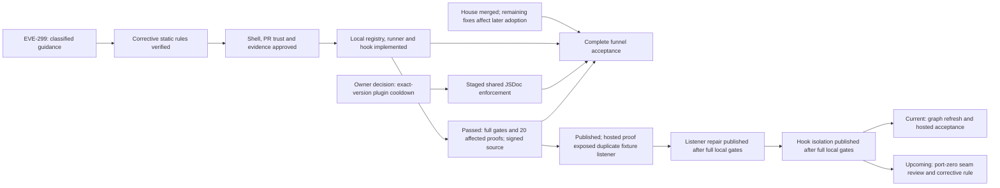

## EVE-261 H bootstrap import correction - 2026-11-20

This additive checkpoint does not rewrite the historical source capture or H's
separately owned qualification reconciliation. Puck assigned the [existing
process owner](https://ampcode.com/threads/T-5dcbf3b4-41e4-4df0-906d-93629eebe199)
to diagnose H's observed `telemetry_enabled: false` child timeout on published
`a959f9ea`, with frozen dependencies and no unpublished renewal adoption.
[EVE-261 diagnosis checkpoint](https://linear.app/resnovas/issue/EVE-261#comment-edcd0e8f-56a8-4d60-bc09-ca843f514141)
records the narrow START; the coordinator cleared exactly one server import
line, and Puck cleared only the existing pinned local disposable fixture.
The [canonical report](../core-qualification/telemetry-timeouts.md#h-follow-up-avoid-unrelated-bootstrap-imports---2026-11-20)
owns phase rows, actual commands, measurements and remaining delivery limits.

| State | Evidence / next step |
| --- | --- |
| Completed diagnosis | H child root-start 2123 ms, root success 2255 ms, deadline 2303 ms, exit/close 2320 ms. Controlled two-CPU load reproduces expiry; unrelated platform root-barrel imports account for avoidable startup work. Exact final pre-exit wait and H's contemporaneous CPU pressure are not established. |
| Corrected and locally qualified | One `NodeRuntime` subpath import, no lifecycle/body/test/budget/configuration changes. Fixed load comparison: baseline 3/3 deadlines, candidate 3/3 natural closes 1481-1780 ms; literal existing control subsequently passes without diagnostic loader. Static 15 builds/83 tasks and uncached telemetry 92/92 with unchanged coverage pass. No speedup percentage or whole-host determinism claim. |
| Separate pipeline finding | H's natural hook failure took 1179.518258 s: approximately 261.5 s before the rounded 918 s aggregate, with duplicate static lint/typecheck bodies 70/75 s. Other aggregate targets continued after telemetry failure; smoke/features never started. Funnel owner receives the breakdown; this lane changes no pipeline source. |
| Actual delivery blocker | Normal installed staged-tree hook passed all 38 aggregate tasks in 14m45s, then exited 124 at the unchanged 1200 s outer bound during smoke; serial feature proof was unreached. Both static passes passed (78/72 s lint/type bodies). No commit/push or retry; H remains held. |
| Approved integrated next step | Coordinator/Puck authorize exactly the import fix plus approved static-dedup source/docs as one snapshot, qualified/delivered by the funnel owner under EVE-261/#1035 and EVE-299/#1092. Transfer exact authored sections/evidence with hashes; preserve originals and regenerate, never overwrite, LLMS/graph. Every gate/budget/serial contract remains; hold on another overrun, no blind retry or larger-orb/spend permission. |
| Preserved holds | PR59 Windows-native ownership needs Jonathan's decision and normal managed merge/sync; local-suite step2 remains blocked. #1052 compiler/storage failures, renewal and H's five-file patch remain separately owned. EVE-261/Core remains open. |

```mermaid
flowchart LR
    HRed["Retained H child timeout"] --> Diagnose["Reproduce and isolate unrelated imports"]
    Diagnose --> Import["Cleared one-line NodeRuntime subpath"]
    Import --> Local["Passed: unchanged load control, static, telemetry"]
    Local --> Hook["Aggregate passes; smoke hits 1200 s bound"]
    Hook --> Integrated["Authorized: import + static dedup, funnel owner"]
    Integrated --> Publish["Required: full bounded gates, signed publication, CI"]
    Publish --> HResume["Then H can resume its own gate"]
```

## EVE-261 aggregate bootstrap timeout investigation - 2026-11-20

The restored [existing owner](https://ampcode.com/threads/T-01a1f129-c14c-7069-b343-1563380b020c)
investigates Jonathan's bounded assignment through the
[coordinator](https://ampcode.com/threads/T-d57222d4-a392-4a67-bcea-43f0bda5323a).
The [canonical report](../core-qualification/telemetry-timeouts.md) preserves
exact evidence, controls, source history and superseding timing direction. The live
pair was independently read: [EVE-261](https://linear.app/resnovas/issue/EVE-261)
In Progress / [GitHub #1035](https://github.com/Resnovas/Eventiva/issues/1035)
OPEN, with normal linkback 6901726475. No EVE-275 ownership is inferred.

| State | Evidence / next step |
| --- | --- |
| Completed investigation controls | Supplied archive verified at SHA256 `38af69bda4695d07a2eaabb4209c87260f1fbde31452199ec81c303918b1a034`. Historical 5652/7851 ms failures explicitly hit Vitest 5000 ms, not a recorded child 10000 ms timeout. Pinned-runner experiment rejects both over-budget sync/async pairs; short sync control passes. Historical slow phase and contention/native-deadlock attribution remain unknown. |
| Current step 1 | Fresh initial base `3ff2251b8702be0f5061bff05bb18a3f2ce5228b`; START at 2026-11-20T00:05:51Z after read-only inspection (earlier exact time unknown). [Original START](https://linear.app/resnovas/issue/EVE-261#comment-bdca1ff3-838c-409c-ae08-fc9ce92936ea) is superseded in scope by [binding timing/flag amendment](https://linear.app/resnovas/issue/EVE-261#comment-57c1772f-5827-4972-8569-4ec880c9bce9) and [verified explicit mirror](https://github.com/Resnovas/Eventiva/issues/1035#issuecomment-7026336333). Budgeted async harness, mandatory test-default-ON Flags and actual scoped lint proofs implemented locally. Telemetry 92/92 and unchanged coverage pass; timed run retained records. Integrated verification passed as recorded below; final staged-tree pre-commit, clean graph, publication and exact-head CI remain separate delivery evidence. |
| Gate blocker and approved optimization | [Checkpoint](https://linear.app/resnovas/issue/EVE-261#comment-c28ccd5a-a236-404a-80bd-3e5326ce22cb), [independently posted mirror](https://github.com/Resnovas/Eventiva/issues/1035#issuecomment-7027653722). Correctly configured unchanged-20m run exited 124 after all 105 main tasks passed in 18m22s (49 cache hits, 5m24s critical path); web export was interrupted, Android/all three smoke targets unrun. Jonathan pulled pipeline optimization before delivery rather than another unchanged retry. First cold-Nx-cache two-task candidate with serial smoke subsequently passed all gates in 17m04.72s on signed base `4e227d94`; this is a local pass, not delivery or a controlled ratio to the cached baseline. |
| Comparable parallelism and smoke qualification | Same two-CPU host, fixture, seven stages, disabled Nx cache and unchanged 20m wrapper: two tasks passed in 15m24.58s, main/smoke longest paths 359.529/82.231s, peak descendant RSS 1011844 KiB. Four failed five test targets in 15m35.82s, paths 617.244/90.273s, RSS 785824 KiB; all smoke/dependency tasks passed. Diagnostic continuation retains every stage and nonzero exit; normal verify remains fail-fast. Additive root Android -> web dependency prevents shared Metro `--clear` overlap. Actual intervals show 5 ms export gap at both settings, server/web overlap 1249/1013 ms and browser/Android overlap 4909/6027 ms. Retain two, already one task per CPU. Failed four is not a speedup; OS/compiler cache state was not flushed. See canonical report for raw evidence, setup failure and limits. Step 1 remains unpublished/unaccepted. |
| Read-only startup profile | Unchanged real main, isolated environment and 2300 ms bound: unobserved/preloaded/sampled controls exit 0 in 1.00/1.03/1.20s, empty stderr and startup record. Preloaded root starts at 868 ms and Node exits at 982 ms; sampled self time includes Node compilation/package lookup/GC. No historical causal repair, fastest-possible source claim or protected source/fixture/config change. |
| Static-first integration | EVE-299 owner explicitly cleared two-task non-feature root stages and the additive Android -> web edge; preserve all upstream stages/order and serial feature commands/prerequisites. On base `5ca8059d`, unchanged-20m fixture command `node --run verify && node tools/verification/run.mjs --base 5ca8059d15d582bdc0165b975db52fa0a17eeb86` passed in 983.71s, exit 0: static 83 tasks, main 38 tasks, all 3 smoke projects/17 tasks, explicit telemetry 92/92, funnel-policy 33/33 and funnel-runner 8/8. This integrated cached pass is separate from the old cold-Nx-cache comparison. Subsequent function-review records preserve the passing executable AST and have zero installed optimization-record findings. Registry-only `b5f3d5e0` was then rebased; normal final gates/publication are not inferred from the earlier run. |
| Installed-hook delivery blocked | Real staged commit exited 1 in 150.67s before application tests: inherited outer Git-local environment let documentation temporary-history fixtures rewrite the task index, then execute the outer relative hook from the fixture directory and fail missing-runner lookup. HEAD/disk preserved; corrupted index backed up and exact task staging restored. No hook bypass, new commit or push. Funnel owner/Puck hold the narrow environment-isolation correction; installed-hook/nested-history proof and normal final gates must pass before delivery. Earlier direct-run success does not qualify this path. |
| Hook correction integrated; delivery resumes | Supersedes the active blocker, not the failed-run evidence above: [published owner correction](https://github.com/Resnovas/Eventiva/commit/8b3e4b90c27c9fa2e53f536708bed04064906904) isolates only verification-child Git-local environment and adds a real installed-hook linked-worktree regression. Listener repair is also on main. Rebase preserves both fixes, chapter-11's installed-hook paragraph, parallel-2 root work and serial feature evidence. Normal staged verification, signed delivery and exact-head CI outcomes are recorded on the live EVE-261/#1035 pair; earlier direct-run success does not substitute for those outcomes. No runner, fixture, PR59 merge or broader acceptance scope is adopted here. |
| Corrected installed-hook acceptance | Real signed source commit passed the unchanged fixture/20m installed hook in 1023.26s, exit 0: static 83 tasks, main 38 tasks/10m56s, all 3 smoke projects/17 tasks/1m14s, selected telemetry 92/92, funnel-policy 33/33 and funnel-runner 9/9. Nested-history/index-guard proof passes and staged tree remains unchanged. Rebased the subsequent graph/docs-only owner follow-through `fef2b55f` without executable changes; final clean-source graph/evidence commit uses the normal hook again. Exact signed publication and hosted CI outcomes remain independently recorded on EVE-261/#1035, not inferred or whole-Core acceptance. |
| Canonical house proposal | [House PR 59](https://github.com/Resnovas/.github/pull/59) is open/draft at `ed465c31`, not merged or synced. Six OS/Node matrix jobs, aggregate CI and current required checks pass. `linear-code[bot]` marked ready at 01:19:06Z and 01:52:00Z; this agent restored draft through the authorized account at 01:20:57Z and 01:52:55Z, not human readiness. Readiness rerun passed 01:54:36Z; normal smartcloud rerun passed 01:57:41Z. No settings/protection change. Normal human acceptance/merge/sync still precedes managed adoption. |
| Upcoming step 2 | C released storage at 2026-11-20T00:28:24Z after signed `a5abfb9a`; coordinator subsequently cleared exact same-core extraction, adapters, IPC/storage/tool migration and minimal wiring. Proceed after step-1 checkpoint; preserve valid deadlines and all crash/finalization controls. Managed `tools/typecheck/tests.ts` and editor runner await the authorized canonical house PR's normal merge/sync, not an exclusion/baseline. No whole-renewal/Core acceptance, production activation, dependency/spend, session/retention/cancellation source change or EVE-248 work. |

Dependency: preserved failures -> runner controls -> confirmed performance contract -> timed harness/enforcement -> coordinated repository-wide migration;
historical causal repair remains dependent on missing slow-case evidence, not
on a green retry. No shared decision or implementation sequence is replaced.

## Approval A integration and B delivery checkpoint - 2026-11-19

This current checkpoint supersedes the status, not provenance, of the START/planning entries below. [A evidence](https://linear.app/resnovas/issue/EVE-275#comment-8779ba39-b3b1-4487-81d6-d854435971c1) distinguishes executed local work from publication. The [canonical wiring report](../core-qualification/approval-wiring.md#current-implementation-checkpoint---2026-11-19) owns the detailed handshake and limits.

| State | Evidence and next step |
| --- | --- |
| Completed B | Source correction `8fa5b765`, graph/head `129069e0` published; bounded `JsonValue \| undefined` ingress replaces rejected erased unknown. Final hosted CI: 17 executed successes, seven skips, zero failures. [CI](https://github.com/Resnovas/Eventiva/actions/runs/44519309355), [Code Quality](https://github.com/Resnovas/Eventiva/actions/runs/44519308302) and [independently read B mirror](https://github.com/Resnovas/Eventiva/issues/1063#issuecomment-7008934319). No production configuration chosen. |
| Completed A local acceptance; signed publication tracked on EVE-275/#1063 | Registered consent, invocation-bound get/use/transaction, post-handler transactional use, live replay, approved-read audit/use and same-client routing pass the unchanged full `verify` within 20 minutes: 105 aggregate tasks/79 cache hits, 15 builds, 132 boundary/compiler tests, zero source/declaration violations/cycles and all three smoke projects. Normal reports: runtime 675/675, storage 270/270, contracts 575/575, server 67/67. Both approved synthetic preparations preserve all 63 assertion statements and are isolated into separate signed commits. [Acceptance](https://linear.app/resnovas/issue/EVE-275#comment-7ab6b835-1120-45dd-9239-19ac3c6e8f21). Earlier failures/timeouts remain in the report; local success is not hosted CI or whole-Core acceptance. |
| Upcoming C, undispatched | Exact terminal retention producer contract checked locally; first use/cancel replaces provisional expiry anchor and replay does not renew it. C owns no files yet. Proposed disjoint retention capability/spec/report and next unallocated migrations await final handshake/publication; cleanup is not implemented. |
| Approval received; remaining limits | Jonathan explicitly replied `Approved` to BOTH setup-only fixture corrections, relayed by Puck on 2026-11-19; exact human-selection time unknown. [Resumption provenance](https://linear.app/resnovas/issue/EVE-275#comment-05fd0efd-e0fa-4e05-9096-515baa9b5c09) supersedes only those holds, extends module-run preparation ownership and requires one signed commit per correction. All claim/epoch/fence/recovery-required assertions and real migration names remain unchanged. Original staged snapshot/refs/bundles/backups preserved. No step-up, spend or activation. EVE-275/Core open; EVE-248 January 2027, budgets/settings unchanged. |
| Binding policy selected; technical follow-up remains | [New owner decisions](decisions.md#rolling-sessions-and-resource-scoped-cancellation---2026-11-19) select real-activity-only one-hour sliding idle expiry, a hard eight-hour maximum from sign-in and trusted server authentication settings/optional bounded tenant overrides. [Renewal amendment](https://linear.app/resnovas/issue/EVE-275#comment-242cf365-1011-42c5-bde4-cc046d157bb0) and [verified GitHub mirror](https://github.com/Resnovas/Eventiva/issues/1063#issuecomment-7022234068) resolve idle/absolute bounds; activity classification/trusted ingress still need Jonathan's agreement. Explicit resource-scoped `approvals.cancel` grants, not implicit lead roles, are selected. Renewal and resource-permission reconciliation follow A publication; neither is implemented or activated by A. |

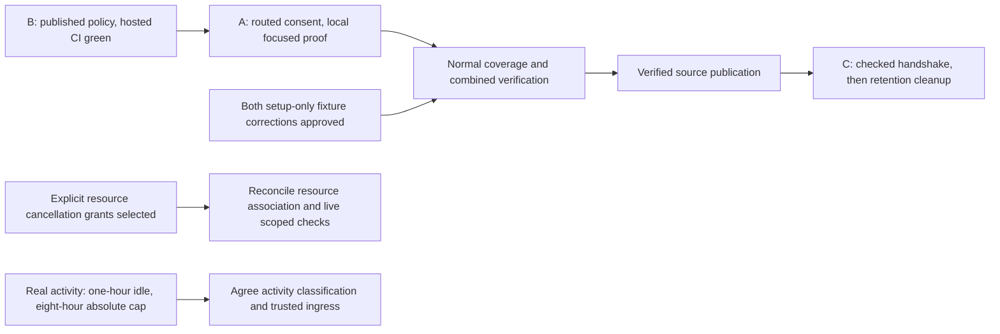

## Approval wiring implementation START - 2026-11-19

Puck assigns the existing Core owner packet A and an existing idle GPT-6.1 Sol owner packet B within the [exact packet reservations](../core-qualification/approval-wiring.md#implementation-start---2026-11-19t112440z). A's actual investigation START is 2026-11-19T11:24:40Z against clean fetched main `e7370b02`, recorded on [Linear](https://linear.app/resnovas/issue/EVE-275#comment-7d344299-2ec9-48b4-ad43-0b058fe1ca3f) and independently verified [GitHub](https://github.com/Resnovas/Eventiva/issues/1063#issuecomment-7007748173). Only retained provider `bb5df959` is reconciled without a commit; exact 11-file scope is checked. Unaccepted fencing candidate `a5645a1e` is excluded and remains separately retained. No new source acceptance or publication is claimed.

Current: A owns registered consent, routed identity/proof/Storage/Integrity, transactional use and live replay, preserving Caller semantics; event port/binding denies unavailable authority while own/tenant paths proceed. B's actual investigation START is 2026-11-19T11:25:41Z in the existing GPT-6.1 Sol provider owner's separate `repo-session-policy` / `agents/eve275-session-policy` worktree, also from fetched `e7370b02`; only its new session-policy module/spec/report are reserved. Its [Linear START](https://linear.app/resnovas/issue/EVE-275#comment-de8e6c56-629d-4efe-b93f-5d9e8b39301d) has an independently read [GitHub mirror](https://github.com/Resnovas/Eventiva/issues/1063#issuecomment-7007804596). A accepts B's proposed fresh tenant-scoped policy API for implementation, not as completed declarations/tests; A owns the narrow server coverage-include seam. The [handshake and source correction](../core-qualification/approval-wiring.md#accepted-b-integration-handshake---2026-11-19) distinguish the local development/staging onboarding hour from an unselected production maximum. Upcoming: coordinate the shared record/retention port before assigning C. Missing actual session configuration/event-source choices and the exact fixture decision remain with Jonathan/Puck; they do not stop independent technical portions. No new thread/subscription capacity, dependency, spend, activation or EVE-248/budget/settings change. Whole EVE-275/Core remains open.

## Next approval production wiring - 2026-11-19

The [concrete EVE-275 packet](../core-qualification/approval-wiring.md) reconciles freshly fetched main `b5e16e8ac59ba628b7b240550844496421a1109e`, inspected retained provider source and its live final Linear evidence. This dated checkpoint supersedes earlier pending Caller CI/provider-running observations, without rewriting their history or the frozen planning capture. The packet defines technical implementation scope, not new product approval or implementation acceptance. No new thread or production source adoption occurred.

| State | Evidence / next step |
| --- | --- |
| Completed | Caller exact-head hosted CI: 17 executed successes, seven intentional skips, no failures. [Application CI](https://github.com/Resnovas/Eventiva/actions/runs/44503825634) and [Code Quality](https://github.com/Resnovas/Eventiva/actions/runs/44503823503) complete. |
| Retained, publication-held | Provider `bb5df959` and separate AI-11-pending fixture `a5645a1e` remain signed/local. Owner's normal runtime 664/664 and storage 266/266 pass on the older base plus held candidate, not the combined publishable tree. [Final Linear evidence](https://linear.app/resnovas/issue/EVE-275#comment-5d71a93b-153c-4796-8c7e-c37895e5aff8) independently read; missing final GitHub synchronization repaired by [explicit mirror](https://github.com/Resnovas/Eventiva/issues/1063#issuecomment-7007430441). |
| Current planning, no implementation started | Packet A: one owner for registered human consent, exact input/target-key binding, route-local same-client identity/proof/Storage/Integrity and successful-use transaction, including approval-requiring reads. Packet B: independently eligible mandatory session-policy capability with explicit test values and no chosen production default. |
| Upcoming, dependency-bound | Packet C: actual terminal-event retention cleanup after provider reconciliation and A's shared record/port handshake. Exact path sets are in the packet; shared manifests, guides, timeline/LLMS/Graphify remain single-owner. Do not count coupled retention/event work as extra independent lanes. |
| Material choices / limits | Select actual session duration/configuration authority and the authoritative event-lead source from concrete options in the packet. Existing cancellation/lifetime/retention contract is approved; no one-hour assumption, step-up/dependency/spend/activation inference or stop-all external-credential hold. EVE-248 stays January 2027; budgets/settings unchanged. |

Dependency sequence: published Caller plus retained-provider adoption and exact fixture acceptance lead to combined wiring qualification; independently built required policy capability joins wiring; the stable record/port unlocks retention; trusted event authority unlocks event-lead acceptance. Partial technical work does not close whole EVE-275/Core.

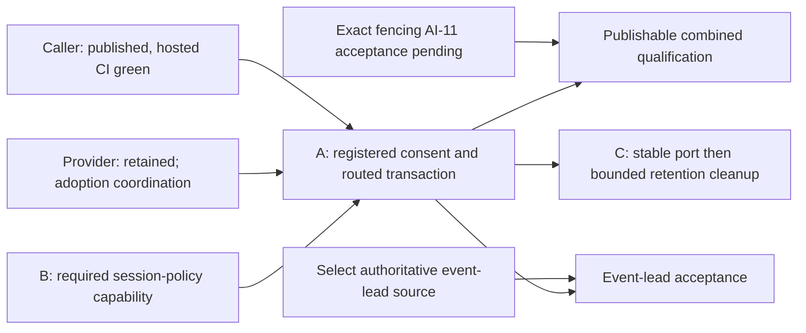

## Combined Core integration and Caller repair - 2026-11-19

Jonathan, relayed by [Puck](https://ampcode.com/threads/T-01a1e940-37a3-7691-a5c0-e935b711c99a), originally authorized local integration/qualification of the completed EVE-277/278 fixes and Caller/proof evidence, with final combined verification after the exact EVE-276 handoff. The [sole integration owner](https://ampcode.com/threads/T-d57222d4-a392-4a67-bcea-43f0bda5323a) started a separate `agents/core-local-integration` checkout from freshly fetched main `9fb0bda2167be0499a4a3ed729c5fa033f23dd7a`. Retention refs/bundles remain intact. Jonathan subsequently explicitly authorized publication and the bounded canonical Caller repair; exact human-selection time is unknown. [Linear START and approval provenance](https://linear.app/resnovas/issue/EVE-275#comment-5bd241f2-ca35-42d8-8a7b-14f8439c9102) and [verified GitHub START](https://github.com/Resnovas/Eventiva/issues/1063#issuecomment-7004681684) record the amendment. His later 2026-11-19 relay resolves the human-approval product contract below and resumes its existing owner separately; this supersedes the former policy/provider hold only within the approved scope. Dependencies, spending and activation are not authorized by either change.

| State | Actual activity and evidence | Next prerequisite |
| --- | --- | --- |
| Completed local combined qualification | Original EVE-277 qualification/fix, EVE-278, exact EVE-276 source and Caller/proof evidence applied from verified retained objects. People/agent loader and declaration-boundary guides updated by the single integration owner; LLMS regenerated. Integrated tool suite passes 132/132; root check passes 104 fixtures/282 TS files/zero findings. | Fixture-backed combined `verify` exits 0 under the unchanged 20-minute timeout: 105 aggregate tasks (79 cache hits), all 15 builds, zero source/declaration boundary violations and all three smoke projects (11/17 smoke/dependency cache hits). This is combined local evidence, not production or whole-Core acceptance. |
| EVE-276 exact handoff verified | Signed source `1f819107abc782bfdeeb25a56aa95824083dab3e` and graph head `ad8dcbdf8f0341d97ef2edee7e3af9decf985605` transferred in an actual bundle; checksum/base/signatures independently match. All imported production paths match that source byte-for-byte. Its standalone full pass remains worker evidence, not integrated acceptance. | Original worktree/refs/bundles preserved. Shared generated outputs regenerated for the combined source instead of copying the worker graph/LLMS. |
| Combined signed publication | Normal `git push origin HEAD:main` exits 0; independent remote read-back matches signed source [01517213](https://github.com/Resnovas/Eventiva/commit/01517213fc9ce35aefb0683e7515e8c63b3f6aca) and graph/head [23baec94](https://github.com/Resnovas/Eventiva/commit/23baec94dc9f7dbdf5df70bccf92862bcff2eb09). Actor TGTGamer has admin/push; active/effective rules show administrator Always allowance. No force/bypass flag or settings change. | Exact-head hosted CI completes 2026-11-19T09:20:53Z: all 17 executed checks succeed; seven intentional graph-check/release-publication skips are not executed passes. [Application CI](https://github.com/Resnovas/Eventiva/actions/runs/44493038906) and [final Code Quality](https://github.com/Resnovas/Eventiva/actions/runs/44493038519) pass. Legacy branch-protection read returns 403, not proof of absence. |
| Approved Caller repair START 2026-11-19T09:07:09Z; local acceptance complete | Both original owners explicitly release execution/runtime-test/Caller-report reservations with clean retained trees and no parallel implementation. Coordinator owns the executor provision plus deferred host Caller-only overlay against integrated 276. Public-path unchanged source: 7 failed/8 passed; executor-only: 3 failed/12 passed; full placement focused: 153 passed across four files. Normal affected lint/typecheck passes 11 tasks; corrected-fixture real SQL focus passes 30 tests in three files. | Jonathan explicitly accepts isolated AI-11 product-fixture correction `3c54a0f577c5faee9a292678aa4ab30242cd8849`: preserve presented identity, original foreign-read denial and new foreign-write/unchanged-state controls; no product source or weakened assertion. Two earlier full-run timeouts remain recorded, the first with two fixture failures. Third unchanged `verify` exits 0 within 20 minutes: 15 builds, 105 aggregate tasks/71 cache hits, server and actual process conformance, zero source/declaration violations/cycles and all three smoke projects/14 of 17 cache hits. Exact signed delivery/hosted results are tracked on EVE-275/#1063; this local pass is not hosted CI or whole-Core acceptance. |
| Approval provider START 2026-11-19T09:28:43Z | Existing [proof owner](https://ampcode.com/threads/T-01a1f129-c9e5-733f-bdbd-2dc010253693) resumes on `agents/eve275-approval-provider` from fetched `23baec94`, preserving the original proof ref/bundle. Canonical report and [Linear START](https://linear.app/resnovas/issue/EVE-275#comment-514bdca6-fea6-45e9-b76f-35dfdcfbca7b) precede reserved source edits; coordinator independently reads [GitHub mirror](https://github.com/Resnovas/Eventiva/issues/1063#issuecomment-7005178087). Disjoint source/test/report, migrations `0012.sql` and narrow subpath exports reserved. | No configured session maximum is present in inspected active source; require trusted configuration, not the one-hour test fixture. Owner reports no trusted event-lead resolver; that cancellation stays fail-closed. Coordinate exact preparation/write-key/tenant-client/commit-use seams; standalone provider work is not complete wiring acceptance. |

For the published baseline, executed command: `bash /home/user/workspace/repo/.amp/in/orb-backup/integration/verify-with-postgres.sh node --run verify`, from the isolated integration checkout. The immutable helper runs `timeout 20m` with the approved pinned disposable SCRAM/non-superuser PostgreSQL fixture. The first baseline attempt exited 124 at timeout: its completed shutdown log records 103 successful tasks, storage stopped with 15 failures and server tests not run. The interrupted output does not establish whether those failures arose from source or fixture teardown; no clean first-pass claim is made. The same-gate fresh-fixture baseline repeat exits 0, including normal storage/server tests and actual Cluster/module-run/migration conformance. Both baseline logs remain in the coordinator's private integration backup. No source, assertion, threshold, exclusion, parallelism or timeout was weakened. Baseline fixture/container/network cleanup completed; this is separate from the later Caller fixture runs.

Current: coordinator has completed the explicitly approved Caller repair's local acceptance; its signed delivery/hosted outcome is maintained on EVE-275/#1063. Published combined-integration CI is complete and green. The existing approval owner has begun the separately approved provider increment. Upcoming: exact-head Caller CI follow-up and coordinated provider/seam integration with its own acceptance evidence. Record final heads/evidence on the existing verified EVE-275/#1063, EVE-276/#1064, EVE-277/#1065 and EVE-278/#1066 pairs without closing whole issues or changing predecessor relations. Earlier per-lane passes remain separately attributed. EVE-291, paused work, EVE-248 January 2027 and budgets/settings stay unchanged. This dated section supersedes earlier publication holds and historical lane occupancy below, not their recorded evidence.

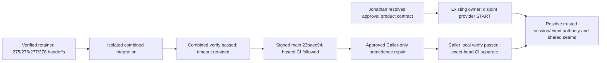

### Approved Caller amendment and separate approval-provider contract

Jonathan explicitly selected the [Caller recommendation](https://ampcode.com/artifacts/caller-repair-recommendation-28656c5d-3f10-4c4c-9bf4-07270913f662): canonical invocation Caller takes precedence over a module Layer's Caller. Providing Caller only around the executor loses to the inner host module provision; the earlier executed six-case Effect probe distinguishes that placement. The authorized bounded repair provides resolved Caller before the read/write split and overlays only that deferred Caller onto the module context. Rejecting Caller-producing Layers at activation was not selected. Exact EVE-276 and Caller ownership releases are received. Preserve module/transaction services, admission/commit checks and historical replay output; generic synthetic substitution remains distinct from a current-ingress exploit. The [Caller report](../core-qualification/caller.md) retains historical characterization and records repair acceptance separately.

Jonathan's later 2026-11-19 product-contract relay through Puck supersedes the pending policy choices in the [earlier recommendation](https://ampcode.com/artifacts/eve-275-trusted-human-approval-owner-decision-packet-c071dd07-b9c6-4786-9a1e-638d7ba67fe5). Exact human-selection time is unknown. Consenting humans may cancel their own pending approval. Event leads within their events and tenant security admins within their tenant may cancel others' pending approvals using a dedicated, independently grantable, scope-limited cancel-approvals permission. Tenant lifetime ranges from five minutes to the actual configured session lifetime; effective expiry is the earlier of that window or actual session expiry. One hour was suggested, not confirmed. Exact-known long-running work may be approved at start. Execution AND replay recheck live session, delegation, permissions and approval, denying on any failure. Changed input OR a new write key requires fresh consent. Minimal decision evidence defaults to six months after use, revocation or expiry, tenant configurable from 90 days to two years. Existing dedicated tenant SQL/infrastructure and consent boundaries remain; no inferred step-up support, dependency, spending or activation.

The exact contract was relayed to the existing proof owner, not a new thread. Reserved handwritten footprint: new `packages/{contracts,runtime,integrations/sql}/src/approval.ts`, `tests/{runtime,storage}/src/approval.spec.ts`, `storage/migrations/{postgres,sqlite}/0012.sql`, `docs/core-qualification/approval-provider.md`, and narrow approval subpath exports in those three package manifests. No dependency/version/root changes. Its canonical report will own detailed implementation evidence. Integration retains Caller source/tests/report/actions and shared timeline/LLMS/Graphify. Source checks must establish actual session configuration and trusted event-lead authority rather than fabricate them. Public registered preparation, trusted write-key binding and route-local same-client provider composition remain concrete source amendments to coordinate; standalone provider success will not imply complete execution/replay acceptance. No raw-wire hashing, duplicate registry, global compute-client proof store or inferred human consent.

Source resolution at START: `packages/integrations/oidc/src/session.ts:39-70` requires server-supplied `expiresAt`, not a configured lifetime maximum. The one-hour value in `apps/server/tests/keycloak.conformance.ts:143` is fixture-only. The provider owner requires a trusted `sessionLifetimeMs` parameter, validates the tenant window from five minutes through that value, and caps by the actual live SQL session expiry without choosing a default. The owner reports no active trusted event/action-to-event/event-lead resolver; own-pending cancellation and explicit tenant-scoped `approvals.cancel` can use live SQL roles/teams, while event-lead cancellation stays fail-closed until real authority exists. Remaining integration must use trusted registered `ActionBinding.prepare`, pass exact action/version/canonical hash/write key to lookup, and mark successful use inside Integrity's authoritative transaction so failed writes do not consume pending consent. These are bounded source prerequisites, not a blanket external-credential blocker or permission to infer step-up.

The provider's later normal gates expose a specific fixture collision: published `tests/runtime/src/run-fencing.spec.ts:481` inserts synthetic future `0012.sql`, which now conflicts with the approved real migration. The coordinator independently reads that statement and releases only its synthetic-history preparation to the existing provider owner, preserving claim/fence denial and unchanged epoch assertions. No duplicate patch or migration rename is authorized. AI-11 maintainer acceptance remains pending for that amendment only; Jonathan explicitly accepts the separate Caller product-fixture correction. The provider owner reports focused SQL 12/12 and policy 3/3 plus affected static gates passing. Its local derived-future-name candidate permits serial runtime 663/663 assertions to pass, but normal runtime branch coverage 88.77% remains below unchanged 90%; other serial gates and an added public provider lifecycle test are pending, not complete acceptance. Retained-until metadata and immutable history do not establish purge enforcement. Its canonical report owns detailed clause evidence; shared production wiring remains unimplemented here.

## Five-lane Core qualification dispatch - 2026-11-19

Latest checkpoint at 00:50 UTC supersedes the occupancy below: EVE-278 completed both approved amendments and released its slot. ONE active worker remains, EVE-276, independently observed using tools; four slots are vacant and no replacement is authorized and nonoverlapping. EVE-278 signed local `f7747f9a98c5aa8a1571b15bc9261268e8a45bdd` is preserved in a retention-only ref, not integrated. Bundle prerequisite, signature, authorized author/sign-off, dual non-closing refs and exact four-file scope independently verify. [Completion mirror](https://github.com/Resnovas/Eventiva/issues/1066#issuecomment-6996180065) independently read. Worker reports 132 tool tests, all 15 builds, final 25-task affected aggregate and root check passing; first-party declaration restrictions exclude vendor internals while forbidden SQL imports still reject. No combined-tree/full verify or whole-issue acceptance is inferred. Final shared integration/guides/LLMS/Graphify remain pending; no publication authority added. Caller needs separate source authorization and EVE-276 ownership release; production approval composition needs the bounded provider/persistence/provenance decision, not external credentials.

Jonathan explicitly requests up to five concurrent unblocked Core lanes, relayed by [Puck](https://ampcode.com/threads/T-01a1e940-37a3-7691-a5c0-e935b711c99a). Exact human-selection time was not supplied. The [sole dispatch coordinator](https://ampcode.com/threads/T-d57222d4-a392-4a67-bcea-43f0bda5323a) created four separately owned GPT-6.1 Sol qualification orbs alongside the existing EVE-276 implementation owner. This is actual dispatch, not passing acceptance, new downstream scope or publication authority. Each completion reports to the coordinator for immediate prerequisite/ownership review and eligible replenishment; no sixth lane is authorized by this checkpoint.

Latest lifecycle: the EVE-275 Caller/proof-boundary and EVE-277 owners have completed their bounded handoffs, leaving TWO active lanes (EVE-276 and EVE-278) plus three vacancies. No replacement has been dispatched. Caller retains signed local `1f186e9b08bae644547e8918e4d9d926f2dd4ef3`, worker-reported clean normal runtime 653 tests with every unchanged coverage metric above 90% and root check passing. Generic propagation remains unqualified: the canonical-output probe fails two synthetic replacing-resolver cases while eight controls pass; current production ingress is not a demonstrated exploit/regression. [Paired Caller completion evidence](https://github.com/Resnovas/Eventiva/issues/1063#issuecomment-6995917255). Its source amendment needs explicit authorization and coordinated ownership of `execution.ts`, still reserved to EVE-276. EVE-277 retains signed local `122a1901d165c526b0b4348222db33aa7cd34a25` after its original qualification; the amendment bundle prerequisite and SHA256 match were independently verified and both bundles preserved, not integrated. Its bounded loader disclosure is locally resolved; whole-issue acceptance/publication and full amended-tree verify are not claimed. Proof qualification retains signed local `e12029467fe94acd1e7127a1b2e7542164882423`, with its transferred bundle prerequisite and SHA256 independently verified; no production accepting approval provider or durable audit spool was found, so a scoped trusted-human approval implementation/composition is the remaining prerequisite, not generic external credentials or authorization to choose custody/crypto. Other concrete repairs remain owned by the two active lanes; EVE-291 is retained separately. The coordinator reports vacancies without counting idle retention, inventing another proof or authorizing protected-source overlap. Earlier five-active observations below remain historical, not the latest count.

Current lifecycle supersedes the earlier pending-amendment observations below: EVE-277 completed blocked qualification at signed local `1b3e87271ebe5be8ff62d9193ba34dea93a71288`, released its slot, then resumed after Jonathan explicitly approved bounded loader sanitization, relayed by Puck on 2026-11-19. No replacement filled the vacancy. At 00:31 UTC the coordinator independently observed all five existing owners active on GPT-6.1 Sol: EVE-276, resumed EVE-277, EVE-278, EVE-275 Caller and EVE-275 proof/audit. The idle handoff was not counted during the vacancy. The transferred EVE-277 bundle passes `git bundle verify` and its reported SHA256 matches; it remains preserved, not integrated. [Actual handoff mirror](https://github.com/Resnovas/Eventiva/issues/1065#issuecomment-6995801659) was independently read. Worker reports normal telemetry 87 tests and server 42 tests plus SQL process conformance passing unchanged coverage; full verify was unrun at handoff, and the exported loader failure remained unresolved.

The additive EVE-277 reservation is ONLY `apps/server/src/cluster-profile.ts`: bounded typed configuration failure without raw input or underlying cause, with malformed JSON, invalid edition/provider and valid controls in its existing reserved new tests. [Approved restart record](https://linear.app/resnovas/issue/EVE-277#comment-ad915db4-5216-42dc-b36f-0624fa14f2d2). EVE-278 is authorized to change ONLY `tools/resources/boundaries.mjs` and `tools/resources/boundaries.test.mjs` for existing feature SQL traversal over exported declarations, including resolved import-type/path-alias closure and direct/transitive/alias/legal controls. [Initial SQL approval record](https://linear.app/resnovas/issue/EVE-278#comment-38bb8587-39fc-48fe-9b7a-591aeb3057dc). Jonathan subsequently explicitly approved applying the existing `any`/`unknown` audit across first-party repository-owned reachable declarations, with his exact limit: "as long as we dont go trying to control node packages and dependencies. Just handle files and code we actually control". [First-party-only approval](https://linear.app/resnovas/issue/EVE-278#comment-ae187ba8-fd3a-4490-b2c1-7ab6465d6295) supersedes the pending-clarification checkpoint. Third-party `node_modules` and external dependency declarations are outside recursive type-escape enforcement and remain unmodified; first-party bridges/re-exports retain all existing restrictions and no new exceptions. Forbidden SQL imports must still be detected, including imports targeting third parties. Paired controls must prove first-party transitive escapes fail and third-party declarations are not recursively policed. Neither amendment authorizes new rules/dependencies, threshold changes, schema/default/topology changes or publication. Both owners must record amendment START and red/green evidence, retain signed dual non-closing task references, and report completion for replenishment. Final fixture-backed combined-tree verification, generated outputs and shared lifecycle reconciliation remain pending integration; no aggregate acceptance is inferred from independent trees. EVE-291 and all paused work remain separate and protected.

Bounded live reads independently fetched [main 9fb0bda2](https://github.com/Resnovas/Eventiva/commit/9fb0bda2167be0499a4a3ed729c5fa033f23dd7a), read EVE-275/277/278 descriptions, comments and blocking relations, and verified actual OPEN GitHub mirrors and normal linkbacks. Incoming EVE-19/40/23/244 are Done where required. No active competing qualification owner was found; the former telemetry lane has no active telemetry writer and its formatter checkpoint remains paused. No dependency edge, frozen issue snapshot or broader acceptance was changed. EVE-277/278 moved from Backlog to In Progress with Code ownership recorded; the two EVE-275 clauses share the existing open issue without duplicating it.

| Lane and owner | Current scope and exact independent write reservation | Evidence and next gate |
| --- | --- | --- |
| [EVE-276 / #1064](https://linear.app/resnovas/issue/EVE-276), [existing owner](https://ampcode.com/threads/T-1a1a9bed-10b0-421c-af69-b276a45b8754) | Approved Option A exact retained run snapshot and tenant epoch fencing; all previously acknowledged source/test/config/docs reservations stay exclusive. Additive `tests/storage/vitest.config.mts` includes only `../runtime/src/run-fencing.spec.ts` so real SQL fence tests measure SQL coverage. | Historical server branch coverage 80.43% failed unchanged 90% ([Linear blockage](https://linear.app/resnovas/issue/EVE-276#comment-d744d88d-6ee2-4fd0-a3fc-1bac01a8f77b), [GitHub mirror](https://github.com/Resnovas/Eventiva/issues/1064#issuecomment-6995598719)). Worker reports first complete verify passing 105 aggregate tasks and all three smoke projects, then a schema-history diagnostic regression found and corrected within the reserved paths. Final normal server 52 tests passes, branches 95.32%; final full repeat and signed retention remain pending. The earlier complete pass does not certify this final amended source; no publication. |
| [EVE-277 / #1065](https://linear.app/resnovas/issue/EVE-277), [retained bootstrap handoff](https://ampcode.com/threads/T-1fa09960-d530-4bbc-ad78-45950e5f7336) | COMPLETE local helper sanitization and qualification; slot released. Exactly four authorized source/spec/report paths, signed retained checkpoint preserved. | Worker reports red one failure/three controls before source edit; amended loader 15 tests and 100% coverage, telemetry 87 tests, normal server 44 tests plus SQL process conformance, 25 static/build tasks and root check pass. Full amended-tree verify unrun. Required loader closed-error agent-guide note, generated integration and final combined gates remain coordinator work. [Completion](https://linear.app/resnovas/issue/EVE-277#comment-74f5aae6-e9a8-4d8f-a467-17ec5a497c6a). |
| [EVE-278 / #1066](https://linear.app/resnovas/issue/EVE-278), [boundaries owner](https://ampcode.com/threads/T-01a1f129-b910-77ec-bb42-805a57758ac3) | `tests/boundaries/**` tests/fixtures, `tests/runtime/src/action-types.spec.ts`, `docs/core-qualification/types-boundaries.md`; approved additive `tools/resources/boundaries.mjs` and `.test.mjs` for SQL traversal and existing type-escape audit of first-party reachable declarations only. | Worker reports both approved amendments green: 132 tool tests, owned relative/import-type/alias/workspace-symlink escapes rejected; vendor declaration internals unpoliced and forbidden SQL imports still rejected. CLI legal/SQL/owned-unknown/vendor-any changes 0,0,0,0 to 0,1,1,0. Final root/project repeat and signed retention pending; these are not coordinator-rerun or combined-tree results. |
| [EVE-275 / #1063](https://linear.app/resnovas/issue/EVE-275), [Caller retained handoff](https://ampcode.com/threads/T-01a1f129-c14c-7069-b343-1563380b020c) | COMPLETE bounded qualification, not accepted propagation. Slot and `tests/runtime/src/caller-qualification.spec.ts`, `docs/core-qualification/caller.md` reservations released; unpublished signed checkpoint preserved. | Worker reports final immutable-helper normal runtime/root exit 0, 653 runtime tests; canonical-output probe two failures/eight controls. No production fix or current-ingress exploit demonstrated. Protected source ownership/authorization remains required. |
| [EVE-275 / #1063](https://linear.app/resnovas/issue/EVE-275), [retained proof handoff](https://ampcode.com/threads/T-01a1f129-c9e5-733f-bdbd-2dc010253693) | COMPLETE bounded qualification; slot released. Exactly new runtime proof-boundary spec and report retained, no invented SQL provider spec. No production/config/shared edits. | Worker reports 123 focused runtime plus 32 actual PostgreSQL/SQLite conformance tests, test typecheck, full normal verify across 34 projects/dependencies and all smoke targets, final root 104 documentation fixtures/276 TS zero findings passing. Verify ran 20m18s without the documented 20m timeout, so no time-envelope certification. Production accepting approval/step-up composition still absent; durable SQL audit persists-or-fails and rollback does not reverse external effects. No whole Core acceptance. |

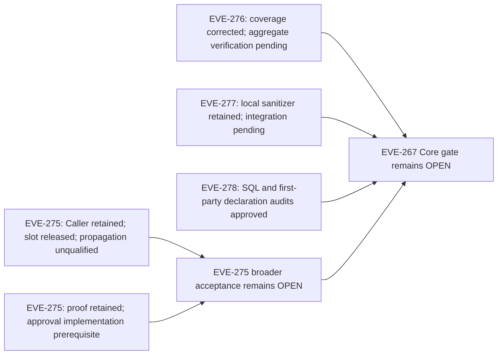

The qualification lanes read/run other production and existing tests only, except their expressly reserved tests/fixtures and the bounded EVE-277/278 amendments above. A further discovered production defect requires a concrete coordinated scope amendment, not silent overlap with EVE-276. Each writes its own canonical report START before work and reports start/blockage/handoff/verification on the verified tracker pair. The coordinator owns shared timeline, guide/generated integration, tracker descriptions/relations/status and review of prerequisites; generated files are regenerated separately for the exact retained tree rather than copied between independent orbs. Every task/generated commit requires dual non-closing owning EVE ID and `Resnovas/Eventiva#1063`, `#1064`, `#1065` or `#1066` as appropriate.

At initial dispatch all five slots were assigned; the latest two-active/three-vacant count above supersedes that occupancy. Source presence and new test assertions do not close whole issues or Core. EVE-275 published source and one-file companion are CI-green, but remaining clauses are open; EVE-291 remains a separate unpublished retained handoff, not adopted or duplicated. Paused assets/exports/checkpoints/backups, trust, importer and formatter remain protected. EVE-248 is deferred until January 2027; settings/budgets/default-off controls are unchanged. No new dependencies, financial amount, spend, external ingestion, production activation, architecture choice, push or PR is authorized. Missing external credentials block only the clauses that actually require them. This local dispatch timeline is retained separately from the older roadmap patch and EVE-276 work, not published or integrated.

Early EVE-275 qualification findings are worker-reported, not coordinator-rerun or acceptance: the proof owner finds no production accepting approval store/provider, only fail-closed denial, a volatile test map and mandatory backend injection. Scoped trusted human issuance/lookup/revocation plus step-up evidence/composition against the approved A2 contract is a remaining implementation prerequisite, not an external-credentials excuse. The Caller owner reports 147 passing characterization/existing tests exposing presented-versus-resolved handler identity under a synthetic replacing resolver; current production IdentitySecurity preserves all five identity identifiers and HTTP/Cluster re-resolve, so no current-ingress exploit is demonstrated. Any protected execution amendment needs ownership and module-layer override evaluation before authorization. Both owners continue independent controls within reservation; these findings do not stall other lanes. [Dated Linear findings](https://linear.app/resnovas/issue/EVE-275#comment-4f3a5c61-060f-4442-a175-de13a7ea9bfd).

Historical pre-approval findings: EVE-277 reports a concrete exported-loader canary leak through failed Exit serialization and Cause formatting for invalid edition input; its valid-host/invalid-port control does not leak and main's outer bootstrap diagnostics remain sanitized. Coordinator source inspection confirms `apps/server/src/cluster-profile.ts` directly returns Config/Schema failure. [Exact scope decision](https://linear.app/resnovas/issue/EVE-277#comment-3a694065-56b4-4bd7-8830-206f78401ee5) was escalated to Puck with unchanged schema/defaults/topology/dependencies and no publication. EVE-278 reports 116 existing fixture tests and source/emitted graph gates passing, but independently reproduces direct and transitive SQL-only exported declarations accepted when feature source is clean. Explicit existing feature SQL traversal rejects the same declarations. [Original SQL amendment request](https://linear.app/resnovas/issue/EVE-278#comment-c1aee8e7-c86b-48f2-aac7-186220a2646b) precedes the approvals recorded above. Type-escape closure authority comes only from the subsequent explicit first-party-limited approval, not the earlier requests or SQL-only approval.

## Core post-handler approval correctness - 2026-11-18

[EVE-275](https://linear.app/resnovas/issue/EVE-275) / OPEN [GitHub #1063](https://github.com/Resnovas/Eventiva/issues/1063) own this bounded core repair, not resumption of EVE-118. This [implementation thread](https://ampcode.com/threads/T-36b919dc-3a62-4551-b698-48f4511ddb58), under Jonathan's accountability, independently read the complete live core issue, terminal comment connection, actual GitHub issue and [EVE-275 linkback](https://github.com/Resnovas/Eventiva/issues/1063#issuecomment-6988293684). Jonathan's explicit narrow approval is relayed by [Puck](https://ampcode.com/threads/T-01a1e940-37a3-7691-a5c0-e935b711c99a); exact human-selection time is unknown. The [sequencing coordinator](https://ampcode.com/threads/T-d57222d4-a392-4a67-bcea-43f0bda5323a) confirms sole implementation ownership and no reservation collision; it owns tracker graph/description, not implementation. This bounded live read does not refresh the frozen issue snapshot or clear whole core gate EVE-267.

| Transition | Actual activity / bounded evidence | Remaining boundary |
| --- | --- | --- |
| Start 2026-11-18T18:53:17.205Z | [Linear start](https://linear.app/resnovas/issue/EVE-275#comment-17b4bcca-c959-46b0-807e-a83a1ae6120b) independently verified on [GitHub](https://github.com/Resnovas/Eventiva/issues/1063#issuecomment-6988352545) at 18:53:18Z. Core branch starts at main bdae3e5d. Exact footprint: execution.ts, new runtime execution-approval-commit.spec.ts, actions guide/chapter12 index and narrow rebased generated companions. Existing execution/host suites read/run only; no wiring/dependency/API change. | Actual SQL red/green proof and full strict-zero/latest-main gates pending. Paused asset sources, two exports and original checkpoint are separately retained in a named stash plus checksummed private archive/patch; absent from core tree/commits. |
| Independent SQL proof 2026-11-18T19:03:06.409Z | [Linear checkpoint](https://linear.app/resnovas/issue/EVE-275#comment-11a7ffb0-b2c1-4988-8f15-b9e815bd8c11) independently verified on [GitHub](https://github.com/Resnovas/Eventiva/issues/1063#issuecomment-6988585941) at 19:03:07Z. Unchanged bdae3e5d execution source: 4 approval raise/revoke failures and 4 authorized controls across actual PostgreSQL/SQLite; unauthorized domain/guard histories, action_commit and successful receipts persist. Reserved private commit-phase fix: 4 files / 145 tests pass, including the expanded 12-case SQL suite plus unchanged execution/host/action-type suites. A disposable blanket-admission-after-handler control fails legitimate self-mutation with version-conflict, then is removed. | Full verification and signed local retention current. Commit revalidation preserves fresh authority, approval and timing without repeating consumed state/version/dependency/capacity preconditions. SQL rollback does not reverse external effects or certify Caller propagation/production proof services. Whole EVE-275/core gate stays open. |
| Full-gate blockage and handoff 2026-11-18T19:27:00.462Z | [Linear blocker](https://linear.app/resnovas/issue/EVE-275#comment-d5deefe6-4d9b-472c-9adf-8779a12e5280) independently verified on [GitHub](https://github.com/Resnovas/Eventiva/issues/1063#issuecomment-6989192760) at 19:27:01Z. `node --run verify` exits 1: 103 aggregate tasks pass, including real cluster/migration and runtime/storage/resource suites; only server:test fails (39 passed / 1 failed). Existing http-action-batch.spec.ts:729 expects item 1 committed after its own handler revokes its SQL session; the new core gate rolls it back. Smoke is not reached. | Requested additive TEST-ONLY reservation for this existing batch spec before editing. Session/membership/permission/action revocation must roll back item 1 with no successful dedup/receipt/history or suffix; batch/transport-only toggles retain the committed prefix. Coordinator independently confirms the conflation and no colliding writer, but collision clearance is not Puck's approval. Original scope/acceptance remain blocked until explicit amendment confirmation. No HTTP production/API/policy expansion. |
| Owner-approved test amendment received 2026-11-18T19:28:18.302Z | [Linear approval provenance](https://linear.app/resnovas/issue/EVE-275#comment-2324b782-1671-4688-b4aa-056f478e5251) independently verified on [GitHub](https://github.com/Resnovas/Eventiva/issues/1063#issuecomment-6989225625) at 19:28:19Z. Jonathan explicitly approves only the additive existing apps/server/tests/http-action-batch.spec.ts reservation, relayed by Puck; exact human-selection time is unknown. Coordinator confirms sole ownership and no collision. The first focused amended batch run passes 2 tests, preserving other controls and transport prefix/replay. | Original reservation blockage is superseded by this explicit approval, not by collision clearance. Complete SQL authority/history/successful commit/receipt rollback assertions and rerun focused/full gates. No production HTTP/API/host/SQL/policy/dependency expansion. Planner retains its separate current-sequence section. |
| Amended full qualification verified 2026-11-18T19:47:31.358Z | [Linear verification](https://linear.app/resnovas/issue/EVE-275#comment-890ebb3c-85aa-418e-bf4e-e5aa55654291) independently verified on [GitHub](https://github.com/Resnovas/Eventiva/issues/1063#issuecomment-6989664147) at 19:47:32Z. Focused runtime/host/type checks pass 145 tests; the amended actual-PG batch spec passes 2 tests, including SQL identity rollback and transport-prefix replay. On fetched main bdae3e5d plus the combined source/test tree, fixture-backed `node --run verify` exits 0: build for 15 projects; lint/typecheck/test/build/parity for 34 projects plus 2 dependency tasks; source/emitted boundaries; smoke for 3 projects plus 14 dependency tasks. `node --run check` passes again before the batch commit. Strict documentation: 275 files / 0 findings; strict reviewed captured planning: 258 issues / 692 edges / 0 unresolved / 0 stale. | Supersedes the full-gate test-expectation blockage, not the retained original red evidence. Action-authority revocation leaves domain/history/successful dedup/receipt unchanged and no suffix; SQL identity writes roll back. Batch/transport-only switches preserve the authorized prefix and original replay evidence. Actual SQL proof still assumes fixture-bound Caller, synthetic wildcard target grants and trusted approval references; it does not certify production proof stores, Caller propagation, external-effect reversal or whole core qualification. |
| Retention/publication | Signed local [core source c2e4178b](amp-changes:commit/c2e4178bd00991eea70279c323d7e1e4270e0375) and separate [batch expectation 27ebb42e](amp-changes:commit/27ebb42e15f4791c1005023c54e6e8733acceca0), both signature G, Jonathan author/sign-off, accurate model credit and dual non-closing references. Canonical/generated companions and final retained heads are recorded on the paired task; no remote CI is inferred from local gates. | GH006 publication route remains unresolved; next decision belongs to Jonathan/Puck, not an assumed active implementation lane. No push, PR, credential/protection bypass, activation or paid work. Paused asset stash and checksummed backup remain intact and excluded. Core qualification/parents remain open. EVE-248 stays January 2027 only. |

```mermaid
flowchart LR
    Approval["Narrow owner-approved EVE-275 / #1063 repair"] --> Proof["Synthetic real SQL host red/green and self-mutation controls"]
    Proof --> Amendment["Explicit owner-approved batch-spec amendment"]
    Amendment --> Gates["Amended full verification and strict-zero pass"]
    Gates --> Retain["Retain verified local core only"]
    Retain --> Route["Publication route hold at local retention"]
    Route --> Publish["Owner-authorized signed fast-forward to main"]
    Publish --> CI["Published core exact-head hosted CI passed"]
    CI --> Handoff["Bounded evidence handoff; whole core remains open"]
```

The retention/publication row above records the earlier local hold, not the current delivery state. The latest dated transition below supersedes the earlier hold and CI-pending checkpoints only for the verified bounded core repair; historical GH006 causation remains unproven.

| Transition | Actual activity / bounded evidence | Remaining boundary |
| --- | --- | --- |
| Authorized signed publication, recorded 2026-11-18T22:37:15.173Z | [Linear publication record](https://linear.app/resnovas/issue/EVE-275#comment-8a12e6d8-5789-4a1d-8f4b-e9e642734f8a) independently verified on [GitHub](https://github.com/Resnovas/Eventiva/issues/1063#issuecomment-6993703181) at 22:37:57Z. Jonathan explicitly authorizes the normal signed fast-forward push, relayed by Puck; exact human-selection time is unknown. Fresh [main bdae3e5d](https://github.com/Resnovas/Eventiva/commit/bdae3e5ddc717e191c7aa8d115bf2e1ab40f94c1) is an ancestor of the unchanged four-commit [published head dc37e205](https://github.com/Resnovas/Eventiva/commit/dc37e205f1fe07aea5657c8fa6a4d6c88ff622c6); all signatures are good, with Jonathan author/sign-off and accurate AI credit. `git push origin HEAD:main` exits 0, and independent `git ls-remote origin refs/heads/main` confirms the exact head. GitHub applies its existing administrator allowance and reports queue/PR/expected-check/secret-scanning-PR rule exceptions; this lane uses no explicit bypass flag, force push, credential or protection change. | [Exact-head hosted CI](https://github.com/Resnovas/Eventiva/actions/runs/44413145585) is pending at this publication checkpoint, superseded by the final CI transition below rather than inferred from prior passing local gates. An exact-head main subscription follows all checks. EVE-275, EVE-267 and broader parents remain open; production proof stores, Caller propagation and external-effect reversal remain outside this SQL proof. Paused asset stash and both checksum-verified backups remain intact and excluded. No production activation or paid work; EVE-248 remains January 2027 only. |
| Final hosted CI completed 2026-11-18T23:00:57Z | [Linear final CI evidence](https://linear.app/resnovas/issue/EVE-275#comment-813d642d-87dd-4a71-86bb-a5f36cdf7e0a) records the complete exact-head rollup for [published core dc37e205](https://github.com/Resnovas/Eventiva/commit/dc37e205f1fe07aea5657c8fa6a4d6c88ff622c6). [Verify, smoke and application check](https://github.com/Resnovas/Eventiva/actions/runs/44413145585) pass, with verify completed at 22:47:26Z and application check at 22:47:32Z. [House check and smartcloud](https://github.com/Resnovas/Eventiva/actions/runs/44413145433), [House CodeQL](https://github.com/Resnovas/Eventiva/actions/runs/44413145779), [Code Quality](https://github.com/Resnovas/Eventiva/actions/runs/44413142994), workflow lint, Scorecard, Graphify refresh and settings/labels/sync checks all pass. Graph check and release-publication jobs are intentionally skipped, not counted as executed success. No failing check, rerun or production source fix is indicated. | Supersedes the preceding CI-pending state, not whole EVE-275/EVE-267 acceptance. Next qualification owner is Puck/sequencing coordinator for remaining clause-level evidence, including canonical Caller propagation and production proof stores; SQL rollback does not reverse external effects. No asset resumption, paid work, production activation or EVE-248 work before January 2027. Excluded asset stash and checksum-verified backups remain intact. |

## Tenant-local module run pins and fencing - EVE-276 - 2026-11-18

[EVE-276](https://linear.app/resnovas/issue/EVE-276) / OPEN [GitHub #1064](https://github.com/Resnovas/Eventiva/issues/1064) own this bounded Option A implementation. Jonathan's explicit approval, relayed through the [sequencing coordinator](https://ampcode.com/threads/T-d57222d4-a392-4a67-bcea-43f0bda5323a), selects tenant-local immutable exact module/provider/schema identity and monotonic owner-incarnation epochs. The tenant epoch-transfer commit linearizes takeover; transactions ordered before transfer may finish. Exact recorded artifacts are mandatory on recovery, without latest fallback. The exact human-selection time is unknown. This is not immediate Cluster-membership fencing or approval for a multiversion distribution service.

| Transition | Actual activity / bounded evidence | Remaining boundary |
| --- | --- | --- |
| Coordination start 2026-11-18T23:12:07.994Z | Independently read the full live issue and terminal two-comment connection, OPEN GitHub issue, normal [linkback](https://github.com/Resnovas/Eventiva/issues/1064#issuecomment-6988294927), and mirrored [start](https://github.com/Resnovas/Eventiva/issues/1064#issuecomment-6994380429). Sole [implementation owner](https://ampcode.com/threads/T-1a1a9bed-10b0-421c-af69-b276a45b8754) inspected source before requesting the exact reservation. | This is bounded live evidence, not a refresh of the frozen all-issue snapshot or whole-core acceptance. |
| Implementation start 2026-11-18T23:14:26Z | Coordinator acknowledged the exact footprint and actual prerequisites before code edits. Isolated branch agents/eve-276-option-a starts from freshly fetched main 9fb0bda2, preserving the published EVE-275 top checkpoint. Published EVE-275 commit-phase checks, SQL atomicity, private transaction pairing and tenant-bound host construction suffice to begin. EVE-291 unpublished timing work is neither needed nor adopted. This START entry precedes implementation edits. | Implement and prove exact-artifact recovery, stale-owner/replay rejection, same-transaction A1 and independent-output fencing, actual PostgreSQL/SQLite adversarial controls and actual two-process handover. Local signed retention only; no push, PR, deployment, new dependency or provisioning. |
| SQL and process qualification, recorded 2026-11-19T00:00Z | `pnpm exec vitest run --config tests/runtime/vitest.config.mts tests/runtime/src/run-fencing.spec.ts --coverage false` passes 4 tests on independent actual PostgreSQL/file SQLite clients. Assertions cover stale exact-input replay and new writes, ordering before committed transfer, current-owner success, domain/history/outbox/dedup/success-receipt rollback, input conflict, tenant separation, live revocation and independently transacted output. `node apps/server/tests/module-run-handover.mjs` passes `module-run-conformance-passed`: killed PID 153000 and successor 153017 execute retained 1.0.0/config under a 2.0.0 default, producing 13 -> 40 -> 121 without repeating the completed executor. Live independent PIDs 153034/153017 reject stale owner/cached transport/output after epoch 4 transfer. Three separate missing/provider/schema restart controls retain epoch 1, original snapshot and raw-entry count, refusing recovery without repinning. | These are synthetic trusted compositions on disposable local SQL, not production proof-store, public-ingress, partition, cancellation or SLA certification. PostgreSQL takeover waits behind the earlier owner row lock; SQLite refuses the competing BEGIN IMMEDIATE, which is not a transfer, then succeeds after release. |
| Negative candidates and coverage amendment, recorded 2026-11-19T00:00Z | Temporarily removing the A1 pre-dedup fence makes the actual SQL suite fail 3/4 tests, including both stale exact-input replays and PostgreSQL ordering. Temporarily selecting catalog.current makes the then-7 artifact tests fail 2/7: retained-version selection and missing-artifact refusal. Both candidates are removed and restored runs pass. The acknowledged additive server Vitest include exposes helper coverage at 85.71% lines/71.42% functions, a failed gate rather than success. Real-host retained registration, incomplete matching provider binding and missing registered module controls raise the suite to 10 passing tests and module-run.ts to 100% statements/branches/functions/lines. | No threshold, exclusion, test selection or dependency is weakened. Earlier credential-missing full runtime and source-drift/strict-rationale check failures are retained as failures, then corrected through fixture setup, the approved single source-review digest amendment and a meaningful test invariant comment. The original planning snapshot/relations/curated authority and other source reviews are unchanged. |
| Aggregate coverage correction, recorded 2026-11-19T00:19Z | The first aggregate attempt timed out at 20 minutes; the next completed with failed server branch coverage (80.43%) and SQL coverage, not acceptance. The acknowledged SQL include now measures the real fence scenarios; thresholds/exclusions are unchanged. Added real in-process orchestration, sender and independent wire receiver controls: 12 module tests pass; the full server suite passes 12 files/52 tests with 97.82% statements, 95.28% branches, 96.34% functions and 98.25% lines. Direct server test typecheck passes; targeted ESLint has 0 errors/4 test-only non-null warnings. | Full final combined-tree verification, SQL coverage and signed source/clean-source graph retention remain pending. Existing gate failures are not waived. |
| Final source verification 2026-11-19T00:48Z | `timeout 40m node --run verify` exits 0 on the final implementation: build for 15 projects, all 105 lint/typecheck/test/build/parity tasks across 34 projects plus 3 dependencies, all 3 smoke projects, source/declaration boundaries with 0 violations. Strict check passes 104 fixtures and 278 editable TypeScript files/0 findings; strict reviewed planning passes 258 issues/692 edges/0 unresolved/0 stale. Full runtime separately passes 30 files/647 tests (96.85% lines/92.79% branches), SQL 17 files/254 tests (95.66% lines/92.56% branches), server 12 files/52 tests (98.25% lines/95.32% branches). Final review added actual tenant schema-history drift: its control fails with unavailable before the narrowed recovery-required mapping and passes afterward with unchanged epoch; the full aggregate was repeated after that fix. | Implementation verification is complete; retain signed source and clean-source graph commits locally and mirror the exact heads through the coordinator. No publication is authorized. Whole EVE-276/EVE-267 and structured predecessor acceptance remain open. Fresh authority/approval/deadline and authorized self-mutation remain mandatory. SQL rollback cannot undo external effects. EVE-248 stays January 2027; budgets/default-off remain unchanged. |

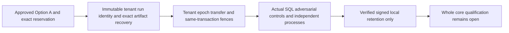

## Mapped-preview permutation proof - 2026-11-18

The revision-17 rank-2 [packet](https://ampcode.com/artifacts/next-implementation-packets-cd16f2fd-d187-4163-9463-9270422c87b0)
dispatches a proof-only extension of the existing catalogue contract spec.
This [implementation thread](https://ampcode.com/threads/T-01a1edbf-813f-7417-b69b-408647dfd0f5)
independently read the complete live EVE-247 description/terminal comments,
actual open [GitHub #1017](https://github.com/Resnovas/Eventiva/issues/1017)
and its EVE-247 linkback. The original owner-selection time is unknown.
The active import-process proof lane retains its separate fixtures and
catalogue people/agent guides; this task changes no shared issue ownership,
assignee or status. Broader EVE-247 stays open.

| Transition | Actual activity and evidence | Remaining boundary |
| --- | --- | --- |
| Started 2026-11-18T17:39:44.187Z | [Linear start](https://linear.app/resnovas/issue/EVE-247#comment-28bab3a1-8b54-4ce2-8b7a-73793539c482) and independently read-back [GitHub start](https://github.com/Resnovas/Eventiva/issues/1017#issuecomment-6986554210) identify this lane and its single handwritten test reservation. Current base a909d508. Existing catalogue suite passes 5 tests before edits. | Implement bounded independent-oracle permutations and disposable incorrect-candidate controls. No production mismatch is presumed; request a source amendment before expanding if one appears. |
| Focused checkpoint 2026-11-18T17:48:54Z | [Linear evidence](https://linear.app/resnovas/issue/EVE-247#comment-70d44f1c-7798-4fe7-8a1d-c6d75a505842) and independently read-back [GitHub evidence](https://github.com/Resnovas/Eventiva/issues/1017#issuecomment-6986769783). Catalogue spec: 6 tests pass, preserving the original 5. A handwritten oracle checks 200 deterministic row/reference permutations plus 5 perturbations twice with frozen inputs. Disposable first-duplicate-wins and shifted-private-payload candidates fail that actual oracle through assertion differences. Unchanged runtime import/product controls: 2 files / 10 tests pass across PostgreSQL and SQLite. | No production mismatch or amendment. Exact positioned private stock, all-valid-duplicate refusal, invalid-row independence, ambiguity, punctuation/internal-space and variant boundaries are covered with synthetic fixtures only. |
| Combined acceptance and delivery verified 2026-11-18T18:30:35Z | After rebasing onto invoice delivery f4d109f4, `node --run check` and fixture-backed `node --run verify` pass: lint/typecheck/test/build/parity for 34 projects plus dependencies, source/emitted boundaries and 17 smoke/dependency tasks. Strict scanner: 274 files / 0 findings; ratchet: 0 findings/candidates/violations. Strict reviewed planning: 258 issues / 692 edges / 0 unresolved / 0 stale. Nx sync is current; planning/LLMS regenerated without output drift. | Signed [source a2070577](https://github.com/Resnovas/Eventiva/commit/a20705775773954e4939b171b7cae4f64a03fa58) and clean-source [graph 3bdb8181](https://github.com/Resnovas/Eventiva/commit/3bdb81815832734da5b1fa59d9a43fad0a11fa8e) are published on main with signatures G and dual non-closing references. Graph parity passes. [Linear delivery](https://linear.app/resnovas/issue/EVE-247#comment-0befe5a6-7307-4102-9284-0b4c68c2c707) and independently read-back [GitHub delivery](https://github.com/Resnovas/Eventiva/issues/1017#issuecomment-6987825085) preserve broader issue and active-lane status. Exact-head hosted CI is subscribed/pending, not claimed green. No compiler, parser, runtime, process-lane guide/fixture or protected approval-path edits. |
| Broader catalogue acceptance | Open / upcoming | Consented samples, lawful source acquisition, supplier discovery/export compatibility, reviewed journeys and agreed quality metrics remain open. Pure preview has no ActionHost/Integrity dependency and does not resolve the known post-handler approval gap. |


No production/parser, property-testing dependency, protected execution/host/trust,
paused asset/export, invoice/formatter, stock, real supplier data/rights,
spending, activation or EVE-248 work is authorized by this proof.

## Development task traceability rollout - 2026-11-18

[EVE-266](https://linear.app/resnovas/issue/EVE-266) and its independently verified automatic [GitHub mirror #1053](https://github.com/Resnovas/Eventiva/issues/1053) own this bounded house/Eventiva guidance and offline commit-enforcement rollout. The [implementation thread](https://ampcode.com/threads/T-aab6c3a2-486c-4ef0-a267-8df2b3e6996e) follows Jonathan's [requesting thread](https://ampcode.com/threads/T-01a1e940-37a3-7691-a5c0-e935b711c99a). This is contemporary evidence, not a full live refresh of the historical all-issue capture. No application lane, dependency or read-only audit status is changed.

| Transition | Actual activity and evidence | Remaining whole-issue acceptance |
| --- | --- | --- |
| Started 2026-11-18; exact initial discovery time unknown | Read-only governance review found no owning task. SMC-156 is an earlier completed hook rollout; broader issues were not repurposed. Dedicated EVE-266 created at 15:54:34.654Z after authorization, In Progress with this thread and bounded scope. | Resolve and independently verify the automatically mirrored GitHub issue before task commits. |
| Mapping resolved; implementation active 2026-11-18 | Linear attachment and terminal sync comment identify Eventiva#1053; GitHub OPEN issue and EVE-266 linkback independently read. No duplicate created. [Checkpoint](https://linear.app/resnovas/issue/EVE-266#comment-4933fd9f) records the pair and normal upstream acceptance boundary. | Local guidance, tests/gates, signed delivery, house human acceptance and normal downstream sync remain separate. |
| Focused enforcement verification completed 2026-11-18 | On house base bb465f5 with task edits, `node --test test/commit-check.test.mjs` first reports 9 pass / 3 fail on the unchanged checker, then 12 pass / 0 fail with the opt-in syntax guard. Generated docs/graph subjects, wrong/bare/pull references, git comments/diff, invalid prefix and unmapped compatibility are exercised. | Full house render/test/check and Eventiva documentation/check; local proof is not published or accepted enforcement. |
| House proposal delivered 2026-11-18T16:03Z; draft boundary verified at 16:04Z | Signed [source](https://github.com/Resnovas/.github/commit/9be987c27b06c5f1243333c0b01fccc42b4149a6) and [graph](https://github.com/Resnovas/.github/commit/d775961ca4c6e07019230bf003aa772abd79b867) are published in [house PR #50](https://github.com/Resnovas/.github/pull/50). Normal render reports 304 files/3 changed; `node --run test` passes 92 tests, 100% lines/98.58% branches; `node --run check` passes. `linear-code[bot]` marked it ready at 16:04:06Z; this task restored draft status and verified it. [Progress reply](https://github.com/Resnovas/Eventiva/issues/1053#issuecomment-6984016905) independently confirms tracker synchronization. | Remote CI remains pending; human house acceptance and normal managed downstream sync are not performed or inferred. |
| Eventiva partial delivery verified 2026-11-18T16:07:33Z | Remote main independently resolves to signed [graph head](https://github.com/Resnovas/Eventiva/commit/0e9373634f10b0376de4ff31f57f125a2025c7ce), following signed [local guidance source](https://github.com/Resnovas/Eventiva/commit/7c4d62d30aa7df5d9fe1b1c174ead112b19826ba). Both cite EVE-266 / Eventiva#1053 without closure. Rebased onto e1b78bdc without application-lane edits; planning/LLMS/clean-source Graphify regenerated. `node --run check` passes 104 fixtures, 258 mirrored issues/593 comments/0 stale pages, planning 692 edges/0 unresolved/0 stale, 265 editable TypeScript files/0 strict findings. `node tools/documentation/planning.mjs --check --require-reviewed` passes. [Delivery reply](https://github.com/Resnovas/Eventiva/issues/1053#issuecomment-6984124232) independently confirms synchronization. | No full application verify or hosted CI success is claimed. Exact-head CI subscriptions remain active; this checkpoint is not full enforcement adoption. |
| Handoff recorded 2026-11-18T16:07:57.895Z | Latest full issue/comments read identifies no other active EVE-266 slice. Set On Hold, Agent = Product, Handoff = Needed; Jonathan remains next acceptance owner. Implementation is not running. [Synced handoff](https://github.com/Resnovas/Eventiva/issues/1053#issuecomment-6984135563) is independently visible; its 16:08Z label is rounded, while the API's actual transition time is recorded here. This thread publishes only the final checkpoint, not another implementation slice. | Jonathan must review/accept the house proposal normally; managed Eventiva sync and rendered EVE-checker verification then remain. Both issues stay open. No tracker-access blocker; gateway/Graphify Cloud memory are unavailable, so direct connected Linear/GitHub and the local graph supplied evidence. |
| Security correction resumed 2026-11-18T16:10:01.686Z | [Review finding](https://github.com/Resnovas/.github/pull/50#discussion_r4617067339) identified executable interpolation of prefix configuration. Restored In Progress / Code for this bounded fix, superseding the earlier handoff while work ran; [resume reply](https://github.com/Resnovas/Eventiva/issues/1053#issuecomment-6984190054) independently confirms synchronization. Rendered-CLI regression failed 11 pass / 1 fail because the injected prefix bypassed validation. | Correct configuration transport and rerun full house gates; no sync-engine/application/dependency change or downstream managed adoption. |
| Correction verified and renewed handoff 2026-11-18T16:13:02.010Z | Signed [security fix](https://github.com/Resnovas/.github/commit/00e4bcad5913d6bf73bd3e211d5167d5fa0d1353) and [graph head](https://github.com/Resnovas/.github/commit/769a48f8109e25b1bbc66fe2229f7aa241844599) are pushed to PR #50. Prefix renders into plaintext data, never executable JavaScript. Quote/backtick/embedded-newline payloads fail without execution; missing data fails closed. Focused suite passes 12/12; full house test remains 92/92 with 100% lines/98.58% branches; render (305 files) and check pass. Restored On Hold / Product / Needed; no coding slice remains active. [Renewed handoff](https://github.com/Resnovas/Eventiva/issues/1053#issuecomment-6984286268) is independently visible. | Jonathan remains next acceptance owner. The integration bot re-readied PR #50 at 16:12:34Z; this task restored and verified draft again without changing integration settings. House acceptance, normal downstream checker plus data-file sync, final EVE enforcement checks and hosted CI remain separate. |
| House acceptance and managed Eventiva sync | Upcoming; not running or accepted. Canonical template/checker source is proposed upstream, never copied into downstream managed blocks. Eventiva-local procedure applies now; `TASK_LINEAR_PREFIX: EVE` is pending checker activation. | Next acceptance owner is Jonathan for house review/acceptance, followed by normal downstream managed sync and final checks. EVE-266 stays open; no whole-issue Done/closure or production authority. |

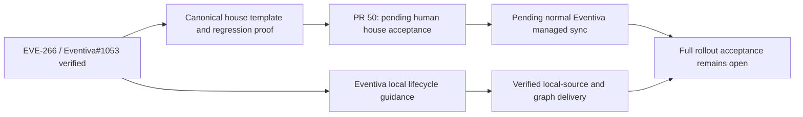

## Authenticated client discovery checkpoint - 2026-11-18

The revision-11 rank-1 [packet](https://ampcode.com/artifacts/next-implementation-packets-cd16f2fd-d187-4163-9463-9270422c87b0)
and [dispatch](https://ampcode.com/threads/T-01a1e940-37a3-7691-a5c0-e935b711c99a)
authorize the six named client/test/example files plus generated outputs and
this narrow evidence checkpoint. Original owner-selection time is unknown.
This [task thread](https://ampcode.com/threads/T-01a1edbf-66b8-7570-b2b1-31c82b6132c5)
independently verified Linear's attachment and GitHub's linkback: the pair is
[EVE-46](https://linear.app/resnovas/issue/EVE-46) / [GitHub #813](https://github.com/Resnovas/Eventiva/issues/813),
Backlog/open, not the unrelated numeric GitHub issue 46. Actual start was
recorded at 2026-11-18T16:04:07.089Z on [Linear](https://linear.app/resnovas/issue/EVE-46#comment-e6473c02-d459-4cc4-97cc-7f2825aafa9b)
and [GitHub](https://github.com/Resnovas/Eventiva/issues/813#issuecomment-6984038070).
No actual blocker, pause or handoff occurred at that start checkpoint. Detailed
contract and reversible engineering limits stay in the [client guide](../http-client.md#discover-current-private-inventory).
The complete historical source snapshot is not refreshed by this bounded read.

The later [actual blockage](https://linear.app/resnovas/issue/EVE-46#comment-a9559531-873d-4ee4-b4fe-f5971834502e)
was the packet's unconditional no-permission empty-path expectation: the
current server advertises batch-only with both transport gates on, including
unchanged request-item/output `{ not: {} }` schemas. The [accepted correction](https://linear.app/resnovas/issue/EVE-46#comment-6cf18040-a9e8-45eb-b819-ae105bfeab78)
changes this client proof only, not server policy. Exact blockage/clarification
times are the cited live comments; original owner-selection time is unknown.
The dispatch owner supplied the interpretation; no implementation handoff or
pause occurred. Revised real HTTP proof passes: exactly batch-only with both
gates on, empty paths with batch off, denied no-role single/batch calls and no
business mutation/commit. Previously discovered invocation is denied after
live permission/flag/session revocation. Route advertisement is not action
authorization. Both verified trackers retain the revised scope and remain open.

| Step | State | Evidence / remaining boundary |
| --- | --- | --- |
| Existing single/batch clients | Previously delivered | Source and graph delivery remain intact. Exact-head b9248f6d and 3c63b220 hosted events report every executed check successful; skipped release/PR-only jobs do not establish deployment. |
| Discovery implementation and portable controls | Completed locally | Fourteen portable tests pass with 100% coverage: explicit current-proof GET, detached JSON-valued result, actual 1 MiB intake, structural limits, exact JSON/reference/extension preservation, safe failures and real held-body cancellation. Existing single/batch conformance remains green. |
| Actual JWT/SQL/Cluster and native/web acceptance | Focused proof passed | Three HTTP files/six tests pass against real signed JWT, current SQL identity, Cluster and loopback HTTP, preserving unchanged server conformance. Complete inventory/input-output/policy schema equality, both gates, no-role advertisement/denied execution and live revocation pass. Android Hermes and web client-entry bundles compile; inspected source maps have no server/runtime/SQL/OIDC/platform-node/history imports. This is not native-device execution. |
| Latest-main gates and signed delivery | Verified locally; bounded delivery evidence on paired trackers | Disposable-PostgreSQL `node --run verify` passes all 104 aggregate tasks and 17 smoke/dependency tasks, including native/web exports and browser smoke. Source/declaration/resource/cycle boundaries report zero violations; standalone documentation and the ratchet report zero findings/violations. Reviewed planning and `nx sync:check` pass. Rebased onto planning-only main e2f6f461 and then location metadata head dcfca0df, preserving both lanes' entire checkpoints and leaving their handwritten sources unchanged. LLMS/planning and clean-source Graphify are regenerated; the full gate is repeated before delivery. Exact signed revisions, actual delivery/handoff time, final counts and separate hosted status are recorded on EVE-46/#813, not inferred from local verification. No server implementation/config/export/dependency or accepted-debt/checker changes. |
| Broader EVE-46 acceptance | Upcoming / separate | No generated SDK, executable schemas, dynamic invocation, streaming/output transport, offline queue, new credential issuance, public deployment, paid work or whole-issue completion. Default-off flags and production refusal remain unchanged; EVE-248 stays deferred. |

```mermaid
flowchart LR
    Mapping["Verified EVE-46 / GitHub 813 and actual start"] --> Proof["Explicit trusted-origin current-proof GET"]
    Proof --> Bound["Bound actual bytes and JSON structure"]
    Bound --> Snapshot["Detached private historical JSON snapshot"]
    Snapshot --> Refresh["Refresh with live SQL identity and flags"]
    Refresh --> Gates["Native/web and latest-main full gates"]
    Gates --> Delivery["Signed source/graph and exact-head CI"]
    Delivery --> Later["Separate generated SDK and streaming acceptance"]
```

## Preparation-only invoice drafts - started 2026-11-18

The revision-11 [packet/dispatch](https://ampcode.com/threads/T-01a1ee61-3b8d-76e1-acd9-cd77319ec06c)
selects this bounded slice. Verified live pairs are EVE-126 / GitHub #893 and
EVE-246 / GitHub #1016, both Backlog/open. Start was recorded at
2026-11-18T16:02Z on [EVE-126](https://linear.app/resnovas/issue/EVE-126#comment-11777eee-b6b3-495d-b88f-703caf47a9fe),
[EVE-246](https://linear.app/resnovas/issue/EVE-246#comment-056dcba9-dd2f-40fc-8b96-81fe170ab802),
[#893](https://github.com/Resnovas/Eventiva/issues/893#issuecomment-6983983443) and
[#1016](https://github.com/Resnovas/Eventiva/issues/1016#issuecomment-6983984536).
Exact original owner-selection time is unknown. The historical capture is unchanged.

Reservation: additive contracts invoice.ts, new runtime invoice-draft.ts,
matching contracts/resources invoice-draft specs, payments guide, chapter
32_invoice_drafts index/example and only additive runtime ./invoice-draft
source/types/default export. Shared LLMS/planning/Graphify are regeneration
surfaces. Product/import/compiler/SQL/CRM/contact/location/HTTP/trust and EVE-266
sources remain read-only; preserve all location/kit exports.

| Step | State | Evidence / remaining boundary |
| --- | --- | --- |
| Live packet/issues and tracker pairing | Completed at start | Revision 11, full live descriptions and terminal comments for EVE-126/246/69; GitHub issue bodies/states independently checked; base e1b78bdc. |
| Canonical snapshot persistence and real SQL proof | Completed locally 2026-11-18 | Fifteen PostgreSQL/SQLite public-host tests pass; contracts configuration includes these plus two new contracts tests, 17/17 passed. Exact huge amounts, 1048576/1048577 UTF-8 byte boundaries, strict codec, reopened hosts/history/original SQL result+receipt, retained request mutation before persistence, current policy/identity/flags, actual telemetry and post-write failure/interruption rollback exercised. Independent PostgreSQL pools yield one revision-two successor/two history rows. |
| Contention experiment and integration checkpoint | Completed locally 2026-11-18 | A forced barrier after both preflight reads timed out: live pg_stat_activity showed one transaction at a resource read and the other waiting on existing `UPDATE identity_guard SET version = version WHERE id = 1 RETURNING id`. Test now respects canonical tenant serialization rather than bypassing it. Rebased onto 0e937363; root check passes, standalone docs 269/0, ratchet 0 candidates/violations, strict planning 258 issues/692 edges/0 unresolved/0 stale and Nx sync current. Full verify running; [EVE-126 checkpoint](https://linear.app/resnovas/issue/EVE-126#comment-f0666227) and [EVE-246 checkpoint](https://linear.app/resnovas/issue/EVE-246#comment-17bba536) record bounded evidence, not whole-issue acceptance. |
| First full gate and location integration | Completed / rechecking 2026-11-18T16:46Z | `node --run verify` exits 0 on e2f6f461 plus the complete invoice slice: 34 projects and two dependency tasks pass lint/typecheck/test/build/parity; three smoke projects and 14 dependencies pass. Source/declaration boundaries and cycles are zero. Initial explicit-unknown annotations and an intentionally unsafe negative-test literal were corrected without waivers. Newer location main dcfca0df is integrated with both export keys preserved; LLMS/planning regenerated, strict docs/reviewed planning/Nx sync rerun. Full combined-tree verification and signed delivery follow; no hosted-CI success claimed. |
| Discovery and contact integration | Focused proof complete; combined gate running 2026-11-18T17:29Z | Full verify also passed on dcfca0df and c88b5cb0. A two-tenant/single-database fixture failed at duplicate identity seeding; inspection confirmed permanently one-tenant databases, not a supported shared-database isolation scenario. The corrected proof denies a foreign caller on the original host and preserves same-ID independence in correctly routed databases. Seventeen focused tests pass after contact source 5228a28a/graph 6ff9af0f: only the invoice fixture now supplies the CRM module's new live security assembly context. Contacts, locations and HTTP sources remain unchanged. Documentation-only contact checkpoint a909d508 is integrated during verification without changing tested TypeScript; LLMS/planning and strict/root checks repeat on that final tree. |
| Latest-main generated outputs and signed delivery | Pushed 2026-11-18T17:50:59Z; hosted CI pending | Disposable PostgreSQL-backed `node --run verify` exits 0 with contact source 5228a28a and final documentation main a909d508 integrated: 15 builds, all 104 aggregate tasks and 17 smoke/dependency tasks pass, observed complete 17:48:30Z. Workspace source/declarations: 264 files/1179 edges and 95 files/448 edges, zero violations or cycles. Final-tree root check passes; strict scanner 274 files/0 findings, ratchet 0 candidates/violations, reviewed planning 258 issues/692 edges/0 unresolved/0 stale and Nx sync current. LLMS/planning regenerated; signed [source aaea397a](https://github.com/Resnovas/Eventiva/commit/aaea397aa794be0c8f65b5def30b4c7aede939eb) and [clean-source graph/head a1b44598](https://github.com/Resnovas/Eventiva/commit/a1b44598a509b1b061cc17dcd6016825a657011a) are verified on remote main. Both signatures are G, with Jonathan author/sign-off and accurate model credit. Exact-head CI subscribed; no hosted success inferred. |
| Delivery reconciliation and bounded handoff | Recorded 2026-11-18T17:51Z | Actual SHAs, commands, corrected fixture experiments, no-activation limits and remaining acceptance recorded separately on [EVE-126](https://linear.app/resnovas/issue/EVE-126#comment-5cece823-b72c-4b7a-856b-e68752a626c2), [EVE-246](https://linear.app/resnovas/issue/EVE-246#comment-74e7f3a8-cfe2-4ce0-b061-d792dfd3c88a), [GitHub #893](https://github.com/Resnovas/Eventiva/issues/893#issuecomment-6986864746) and [GitHub #1016](https://github.com/Resnovas/Eventiva/issues/1016#issuecomment-6986865480); both GitHub delivery bodies independently reread. Both broader issues remain open. No external blocker or implementation handoff remains; coordinator selects later acceptance work. Shared execution/replay semantics are preserved, not globally repaired. Gateway/Graphify Cloud unavailable; connected Linear, authenticated GitHub and local graph supplied evidence. |
| Broader statutory/provider/UI acceptance | Open / separate | No issue/send/approval/number/PDF/legal snapshot/ledger/provider/outbox/payment, financial or merchant authority, UI/sync, paid work or production. EVE-248 stays January 2027. |

```mermaid
flowchart LR
    Canonical[Explicit canonical InvoiceRevision] --> Parties[Active accessible tenant Organisation references]
    Parties --> Draft[Same-owner Resource snapshot and CAS revision]
    Draft --> History[Immutable history and durable successful commit]
    History --> Recovery[Original-key reopen and replay]
    Recovery --> Gates[Strict-zero and current-main full verification]
    Gates --> Delivery[Signed source and clean-source graph]
    Delivery --> Later[Separate statutory provider and release acceptance]
```

The [payments guide](../payments.md#durable-preparation-only-invoice-drafts---eve-126--eve-246)
owns complete fields/defaults, engineering byte/revision bounds, same-owner
composition and shared replay limitations. No genuine blocker or handoff is
known at this checkpoint; new blockage, handoff and delivery evidence must be
recorded on both tracker pairs and here rather than inferred from source presence.

## Portable typed sequential batch client - 2026-11-18

The owner-relayed revision-8 [packet](https://ampcode.com/artifacts/next-implementation-packets-cd16f2fd-d187-4163-9463-9270422c87b0)
and [dispatch](https://ampcode.com/threads/T-01a1e940-37a3-7691-a5c0-e935b711c99a)
authorize the six-file client extension only. Live EVE-46 and all eight then-current
comments were read after rebasing onto delivered batch head `21438ec0`.
The [bounded checkpoint](https://linear.app/resnovas/issue/EVE-46#comment-f41e174b-fddc-4504-aad1-9ba760276aeb)
separates execution from authorization; EVE-46 remains Backlog/open. Detailed
contracts stay in the [client guide](../http-client.md); the frozen mirror and
strict-zero documentation governance are unchanged.

| Step | State | Evidence / remaining boundary |
| --- | --- | --- |
| Prior single-action hosted CI | Completed | Exact-head b9248f6d reports every executed check successful. Release and PR-only jobs are skipped, not deployment. Delivered server-batch head 21438ec0 was independently checked: CI pending/no failed checks, not yet a green-CI claim. |
| Canonical tuple codecs and request boundary | Completed locally | Nine portable tests, 100% coverage. Distinct domain/wire and positional types, original keys, literal single POST, 0/1/10/11 bounds, all-item encoding/key checks, exact multibyte 65536/65537-byte bound, detached request across suspended proof, fresh proof, strict sanitized responses and real single/batch Fetch socket interruption pass. |
| Real HTTP/JWT/SQL/Cluster recovery | Completed locally | New and unchanged HTTP/batch conformance: three files/five tests pass. Order [7,2,9] returns [{total:33},{label:middle:1},{total:44}]. Replay keeps exact stored commits and business order. Server-side second-item resource refusal retains [7,2,9,11], no third/no partial success. Same-key recovery returns [54,recover:4,72], retains prior commits and produces [7,2,9,11,22,13] with six total commits. Hidden/unknown/sensitive/foreign tenant, flag-off and current permission/session revocation controls pass. |
| Latest-main full gates and signed delivery | Verified locally; signed delivery recorded on EVE-46 | Rebased onto CRM main dd2e9796 and repeated after CI-only main c1db3cbb, preserving strict-zero governance. Disposable-PostgreSQL `node --run verify` passes all 104 aggregate tasks (finally 78 cached) and 17 smoke/dependency tasks (14 cached), including normal native/web builds and browser smoke. Independent adapter-entry Android Hermes and web bundles also compile; inspected dependency maps contain no server/runtime/SQL/OIDC/platform-node/history imports. Nx sync and strict reviewed planning pass; standalone documentation reports 259 editable files, zero findings. Source/emitted boundaries and cycles remain zero. LLMS/planning and clean-source Graphify are regenerated; exact signed revisions and separately pending/passed hosted CI are recorded on EVE-46. No checker, debt or threshold weakening. |
| Remaining SDK and release | Upcoming / separate acceptance | No discovery or generated full SDK, streaming/output transport, offline queue, rollback/partial-result guarantee, device runtime, production activation or paid work. Server/compiler/dependency/export/config sources are read-only for this packet; EVE-248 and budgets stay unchanged. |

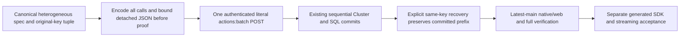

## Private nested kit checkpoint - 2026-11-18

[EVE-81](https://linear.app/resnovas/issue/EVE-81) rank 2 follows revision 7 of
the [implementation packets](https://ampcode.com/artifacts/next-implementation-packets-cd16f2fd-d187-4163-9463-9270422c87b0)
and its [Puck dispatch](https://ampcode.com/threads/T-01a1e940-37a3-7691-a5c0-e935b711c99a).
The [dated implementation evidence](https://linear.app/resnovas/issue/EVE-81#comment-990d77fb-141a-4ce0-8195-f10727cfcf25)
supplements the unchanged historical capture; the issue stays Backlog. Detailed
contracts, engineering bounds and actual SQL test composition live in the
[kit guide](../inventory-kits.md), not in a second platform specification.

| Step | State | Evidence / remaining boundary |
| --- | --- | --- |
| Private Product catalogue | Previously delivered | Existing create/update/archive/get/list remain unchanged; a kit retains Product identity and does not own Product/product-guard writes. |
| Private nested composition and transactional graph guard | Implemented; focused verification passed | Sensitive online-only define/get, full-list composition revisions and existing default-off inventory gate. Real PostgreSQL/SQLite common-host tests cover exact nested/optional values, all-edge cycles, opposite-edge contention, replay/history, atomic rollback, tenant isolation and engineering bounds. PostgreSQL revocation test observes a real SQL lock wait; synchronous SQLite retains explicit independent-client busy refusal. |
| Latest-main gates and signed delivery | Full local gates passed; signed SHAs and hosted CI recorded separately | Rebased onto HTTP batch 21438ec0, CRM dd2e9796, CI pins 165a9a66/c1db3cbb, typed batch client 3c63b220 and Expo-pin graph head f3e6e6c5; repeated fixture-backed `node --run verify` after each race. Final run: 34 aggregate projects, 104 successful tasks (79 cached), source/declaration boundaries and three smoke projects passed. Focused tests passed 2 contracts and 15 kit/product/import cases, including retained-target and corrupt/oversize-codec controls. `node --run check`, Nx sync and strict reviewed planning passed; scanner reports 264 editable files / 0 findings, planning 258 issues / 692 edges / 0 unresolved / 0 stale. Concurrent exports/checkpoints are preserved; LLMS/planning and clean-archive Graphify accompany delivery. Exact signed source/graph SHAs and remote CI state belong on the owning issue, not an inferred acceptance claim. |
| Broader EVE-81 acceptance | Upcoming / separately scoped | Rich product fields, provider discovery, UI/control binding, offline convergence and stock/fulfilment remain open. No import/product/compiler/SQL or protected execution source change, dependency, paid work or production activation. EVE-248 remains deferred until January 2027. |

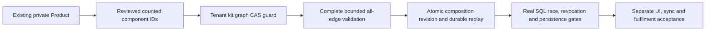

## Synthetic metadata import checkpoint - 2026-11-18

The owner-relayed revision-7 rank-1 packet in the [dispatch thread](https://ampcode.com/threads/T-01a1e940-37a3-7691-a5c0-e935b711c99a) authorizes bounded EVE-247/EVE-81 metadata import implementation, not real supplier rights or production activation. The dated [EVE-247 checkpoint](https://linear.app/resnovas/issue/EVE-247#comment-1a456d18-80b6-4016-90d4-e24d078f809c) and [EVE-81 checkpoint](https://linear.app/resnovas/issue/EVE-81#comment-37fdf03f-f4b4-4c89-a9a3-4c59c9c23f7c) distinguish focused execution from pending combined delivery. The [catalogue guide](../catalogue.md#synthetic-durable-metadata-import---2026-11-18) owns the contract and limitations. The historical captures below remain unchanged.

The candidate above the [sequential-batch graph head](https://github.com/Resnovas/Eventiva/commit/21438ec04af01f6b16f411977e9193beb95e1a77) passed fixture-backed `node --run verify`: 34 projects' lint/typecheck/test/build/parity, source/declaration boundaries and three smoke projects. The strict scanner reports 255 editable TypeScript files with zero findings; strict planning reports 258 issues, 692 edges and zero unresolved/stale outputs. Later rebased delivery evidence and exact signed SHAs are recorded as replies to the live checkpoints, separately from this executed local result. No scanner, ledger or coverage gate is weakened.

| Phase | Bounded state |
| --- | --- |
| Completed locally | Synthetic stage/get/cancel and one-row confirmation through the existing product action; PostgreSQL/SQLite public-host tests exercise shared-owner savepoints, rollback, fiber interruption, discarded-reply replay and fresh rights/flag/permission refusal on identical replay. No quantity is applied. |
| Current | Final latest-main revalidation, generated graph refresh, signed direct-main delivery and live issue evidence. Remote CI and broader issue acceptance remain separate from the executed local gates. |
| Upcoming | Real source consent/evidence, mapping/correction UI, export compatibility and wider import acceptance remain open; stock, whole-plan atomicity/undo and production activation are not included. EVE-248 stays deferred. |

```mermaid
flowchart LR
    product[Existing private product create] --> row[One reviewed metadata row]
    evidence[Fresh synthetic source and evidence checks] --> stage[Durable reviewed plan]
    stage --> row
    row --> receipt[Product and row commit together]
    receipt --> replay[Same key and input replay with fresh authority]
    receipt -. not implemented .-> stock[Stock and whole-plan undo]
```

## Physical location metadata checkpoint - 2026-11-18

[EVE-103](https://linear.app/resnovas/issue/EVE-103) remains Backlog/open. The owner-relayed [revision 10 packet and dispatch](https://ampcode.com/threads/T-01a1e940-37a3-7691-a5c0-e935b711c99a) select only physical warehouse/zone/bin metadata, not the append-only ledger or archive authority. The [bounded live issue checkpoint](https://linear.app/resnovas/issue/EVE-103#comment-ddd54a8f-bada-472f-a508-6c5cce1998e5) records actual focused execution; the [location guide](../inventory-locations.md) owns the detailed contract. Frozen source captures and review digests remain unchanged.

Task-owned traceability was independently verified at 2026-11-18T16:22:30Z: the Linear attachment/sync comment resolves to OPEN [Resnovas/Eventiva#870](https://github.com/Resnovas/Eventiva/issues/870), whose linkback identifies EVE-103. The [active delivery checkpoint](https://linear.app/resnovas/issue/EVE-103#comment-550ef073-3166-4292-8e6b-6d1a0f7b7203) is independently visible in its [GitHub mirror reply](https://github.com/Resnovas/Eventiva/issues/870#issuecomment-6984512064), not merely assumed synchronized. Initial implementation-start time is unknown; first focused evidence is timestamped 14:50:21.275Z. This [task thread](https://ampcode.com/threads/T-36b919dc-3a62-4551-b698-48f4511ddb58) owns only metadata verification/delivery under Jonathan's accountability; no other active EVE-103 slice is identified in the current terminal comment read. Broader Backlog/open status and existing labels are preserved.

Latest-main gate completion was observed at 2026-11-18T16:32:41Z. Exact signed publication/head and hosted-CI timestamps are recorded separately on the mapped pair, not predicted in this source checkpoint. At bounded delivery this metadata implementation is handed off; no ledger implementation is active here. The next owner is Jonathan for selecting separate ledger/archive/UI/offline acceptance; CI follow-up is not broader feature work. Every source/generated graph commit uses non-closing `Refs: EVE-103, Resnovas/Eventiva#870`.

| Step | State | Evidence / remaining boundary |
| --- | --- | --- |
| Exact reservation and live source review | Completed | Revision 10/current EVE-103 description and complete comment page read. Only location source/specs/guide/chapter31 and additive subpath exports; shared amendment recorded with Puck before edits. No Resources/SQL/compiler/workflow/trust implementation changes. |
| Tenant graph invariant and local host contract | Implemented; focused proof passed | 13 tests in two files pass against real PostgreSQL/SQLite: immutable kind/revisions/history, nonsequential paging and root/exact filters, reopen, stable original committed replay, failed ancestry, 105-deep cycle, 1024 accepted/1025 refused ancestor bound, live denials, rollback/interruption at guard/before/after write and original-key recovery. Post-guard flag/resource revocation preserves other-tenant progress. No archive/stock/product/kit/import registration or resource writes. |
| Independent concurrent graph isolation | Proven for bounded PostgreSQL interleavings | Separate client pools/owners coordinate absent/stale guard reads: concurrent initialization succeeds; reverse and disjoint four-node cycles have one winner. Dedicated graph fixture removes only unrelated identity mutex, retaining SQL identity/grants; ordinary tests keep it. Deliberate guard-CAS bypass makes the test fail with two winners, then is restored. This is not universal SQLite multiprocess or production acceptance. |
| Latest-main gates and signed delivery | Verified locally; signed delivery recorded on EVE-103 | Full disposable-PostgreSQL `node --run verify` passes on c1db3cbb, typed-client/workflow main f3e6e6c5, kit main d52e4ef4, workflow-only 682518a8, metadata-import e1b78bdc and traceability e2f6f461: 104 aggregate tasks (finally 79 cached), then 17 smoke/dependency tasks (14 cached), including original/new HTTP, kit and import controls, native/web exports and browser smoke. Standalone documentation: 270 editable files, zero findings; ratchet: zero violations. Nx sync and strict reviewed planning pass (258 issues, 692 edges, zero unresolved/stale). Source/emitted boundaries and package cycles remain zero. Other lanes' checkpoints/exports/workflows are preserved; LLMS/planning are regenerated. Clean-source Graphify, exact signed revisions and separately pending/passed hosted CI are recorded on EVE-103. Local success is not provider/device/production acceptance. |
| Remaining EVE-103 and activation | Upcoming / separately authorized | Ledger/movements/derived levels, LocationNotEmpty archive query, negative-stock/financial acceptance, UI/offline/native/provider parity. Inventory flag stays default-off; no production, public deployment or paid work. EVE-248 stays January 2027 only. |

```mermaid
flowchart LR
    Packet["EVE-103 physical metadata slice"] --> Guard["Tenant graph guard before ancestor reads"]
    Guard --> Location["Revisioned names and parent edges"]
    Location --> SQL["Two-dialect persistence and rollback"]
    Guard --> Race["Independent PostgreSQL reverse and longer races"]
    SQL --> Gates["Latest-main strict full gates"]
    Race --> Gates
    Gates --> Later["Separate ledger and stock-authorized archive acceptance"]
```

## Portable HTTP client checkpoint - 2026-11-18

The owner-relayed revision-6 rank-1 packet and bounded clarifications in the
[dispatch thread](https://ampcode.com/threads/T-01a1e940-37a3-7691-a5c0-e935b711c99a)
authorize this client slice and the mechanically required additive Nx server
build reference plus the one-line complete-package hygiene registration,
not a server/compiler change. Live EVE-46 and its terminal four-comment page were read before the new
[client checkpoint](https://linear.app/resnovas/issue/EVE-46#comment-42aeaf15-2adf-4dd4-98ca-b31ec7cd443a).
It remains Backlog. The [client guide](../http-client.md) owns the contract;
the historical issue snapshot and current JSDoc governance remain unchanged.

| Step | State | Evidence / remaining boundary |
| --- | --- | --- |
| Existing HTTP delivered-scope CI | Completed | Exact-head 93b22058 subscription reports every executed check successful; skipped release/PR-only jobs are not deployment. |
| Canonical portable client and live backend conformance | Implemented; focused checks passed | Four portable tests at 100% coverage; two real loopback SQL/Cluster HTTP tests including the unchanged original HTTP scenario. Exact domain/wire codec distinction, typed sanitized malformed-response failures, real Fetch interruption, single sends, asymmetric branded output, stable stored commit receipt with fresh invocation receipt, changed-input refusal, current permission/session revocation and transformed-discovery denial pass. |
| Latest-main integration gates | Completed locally | Full verification passed on strict-zero main and again after rebasing onto commerce head fd61cf59: 104 aggregate tasks and 17 smoke/dependency tasks, including Android/web exports and browser smoke. Source/declaration boundaries have zero violations/cycles. Strict documentation reports 251 editable files and zero findings; no debt/suppressions. Nx sync is current. Independent adapter-entry bundles and three deliberately rejected type probes supplement normal builds, not device-runtime acceptance. |
| Signed delivery and exact-head hosted CI | Current / see live issue | Paired docs and LLMS are regenerated; clean-source Graphify, signed revisions and actual hosted results are recorded on EVE-46. Local success does not imply hosted CI acceptance or deployment. |
| Whole EVE-46 and activation | Upcoming / separately authorized | This is not the full generated inventory SDK, batch client, streaming, machine credential issuance, offline engine or device-runtime acceptance. The separate batch lane retains its files. No public deployment, paid work or production activation. |

```mermaid
flowchart LR
    Spec["Canonical ActionSpec domain and wire codecs"] --> Client["Portable single-attempt HttpApi client"]
    Proof["Current separately protected bearer proof"] --> Client
    Client --> HTTP["Existing local authenticated HTTP"]
    HTTP --> Durable["Existing Cluster plus SQL commit and live policy"]
    Durable --> Gates["Native/web and latest-main full gates"]
    Gates --> Later["Separate generated SDK and streaming acceptance"]
```

## Sequential local HTTP batches - 2026-11-18

[EVE-46](https://linear.app/resnovas/issue/EVE-46) remains Backlog/open. The
owner-relayed [revision 6 packet](https://ampcode.com/artifacts/next-implementation-packets-cd16f2fd-d187-4163-9463-9270422c87b0)
and [Puck dispatch](https://ampcode.com/threads/T-01a1e940-37a3-7691-a5c0-e935b711c99a)
authorize only this default-off local/test batch sub-slice. The
[bounded issue checkpoint](https://linear.app/resnovas/issue/EVE-46#comment-aecfe4dd)
records implementation and focused execution separately. Detailed wire and
recovery contracts remain in the [HTTP guide](../http-actions.md#sequential-non-atomic-batches).
No historical issue capture, documentation debt or source-review digest is rewritten.

| Step | State | Evidence / remaining boundary |
| --- | --- | --- |
| Exact reservation and live contract review | Completed | Read revision 6/live description and all four then-current comments; recorded exact additive server wiring with Puck before edits. Client lane confirms no implementation overlap. Original HTTP entry/spec and protected trust/output sources stay unchanged. |
| Non-atomic ordered execution and recovery | Implemented; focused verification passed | Real loopback, signed JWT, live SQL identity and SQL Cluster/backend. Order [9,2,7] gives [63,15,51]; invalid later structure/visibility causes zero dispatch evidence. Failed item 2 preserves item 1; retry preserves original SQL committed receipt/output and executes only the allowed suffix. Wire receipts remain fresh per invocation. Mid-batch session/membership/permission/action/batch/transport revocation, audit loss, hidden metadata, 10-item bound, timeout and real client disconnect pass. |
| Original HTTP compatibility and shared gates | Verified locally; signed delivery recorded on EVE-46 | Both uncached HTTP targets pass with the original spec and coverage thresholds unchanged. Rebased and repeated full gates after strict-zero main 099c7fc9, commerce main fd61cf59 and typed-client main b9248f6d: `node --run check` and disposable-PostgreSQL `node --run verify` pass, finally including 104 aggregate tasks and 17 smoke/dependency tasks. Standalone documentation scanner: 254 editable files, zero findings; ratchet: zero violations. Strict reviewed planning: 258 issues, 692 edges, zero unresolved/stale outputs; Nx sync current, source/declaration boundaries and cycles zero. Client wiring and its checkpoint are preserved; LLMS/planning and clean-source Graphify accompany signed delivery. Exact revisions and separately pending/passed hosted CI are recorded on EVE-46. No debt, suppression, checker or threshold weakening; local success is not whole-issue acceptance. |
| Remaining EVE-46 and activation | Upcoming / separate acceptance | The portable client's separate checkpoint appears above; machine issuance, streaming/UI-message protocol and offline engine remain broader work. No public deployment, production activation or paid call. EVE-248 stays deferred until January 2027. |

```mermaid
flowchart LR
    Proof["Verified bearer plus live SQL authority"] --> Preflight["Whole bounded envelope and visibility"]
    Preflight --> Sequential["Sequential existing Cluster invocations"]
    Sequential --> Prefix["Committed prefix survives refusal or timeout"]
    Prefix --> Recovery["Explicit recovery with original keys and inputs"]
    Recovery --> Gates["Latest-main gates and signed delivery"]
    Gates --> Remaining["Separate broader EVE-46 acceptance"]
```

## Organisation work-contact checkpoint - 2026-11-18

[EVE-68](https://linear.app/resnovas/issue/EVE-68) continues from the delivered
organisation backend under the owner-relayed
[revision 10 rank-1 packet](https://ampcode.com/artifacts/next-implementation-packets-cd16f2fd-d187-4163-9463-9270422c87b0).
The [scope checkpoint](https://linear.app/resnovas/issue/EVE-68#comment-2ab7c5ec-9d28-4283-964d-bb422021dba5)
separates the dispatch from executed acceptance; the
[16:00 UTC verification](https://linear.app/resnovas/issue/EVE-68#comment-207dc958-d085-4886-95ea-97d66d2b50c3)
and [16:33 UTC combined verification](https://linear.app/resnovas/issue/EVE-68#comment-cd5e2833-38a7-4ca8-9ff4-f5972d5f1489)
record initial focused/full gates separately from publication. The
[17:18 UTC latest-main repeat](https://linear.app/resnovas/issue/EVE-68#comment-95d4b0f3-124a-492d-8283-0ba30092ce5e)
preserves the separately delivered location and authenticated HTTP work. The
[CRM guide](../crm-organisations.md#manage-organisation-work-contacts) owns
the detailed contract; this checkpoint does not rewrite the frozen capture.

This [implementation thread](https://ampcode.com/threads/T-01a1edbf-813f-7417-b69b-408647dfd0f5)
owns the bounded slice, with start recorded at 14:38:21 UTC and implementation
verification repeated through 17:18:12 UTC. The verified pair is EVE-68 /
[Resnovas/Eventiva#835](https://github.com/Resnovas/Eventiva/issues/835): its
existing integration linkback was independently read. Contact comments had not
mirrored to GitHub, so the [16:18:20 UTC explicit checkpoint](https://github.com/Resnovas/Eventiva/issues/835#issuecomment-6984409366)
synchronizes that surface without claiming automatic synchronization. No other
CRM slice is claimed active or handed off.

The post-publication live read on 2026-11-18 reports **In Progress**, not the
earlier 17:18 UTC Backlog checkpoint. The issue reports updatedAt
17:22:42.795 UTC; that is not established as the status-transition time or a
new acceptance decision. The dated later-status annotation reflects this newer
read while preserving the frozen capture. Signed
[contact source](https://github.com/Resnovas/Eventiva/commit/5228a28ae72fa252b6cf7e3eef9cc4c96b0e53c6)
and [graph/head](https://github.com/Resnovas/Eventiva/commit/6ff9af0fffa8030310dc713cef2116733784a7db)
are delivered, with matching read-back
[Linear evidence](https://linear.app/resnovas/issue/EVE-68#comment-6ee19fe8-b30c-474b-a1d3-f024ed5812df)
and [explicit GitHub evidence](https://github.com/Resnovas/Eventiva/issues/835#issuecomment-6986135835).
Hosted CI is subscribed and pending; broader EVE-68 remains open.

| Step | State | Evidence / remaining boundary |
| --- | --- | --- |
| Sensitive organisation work contacts | Implemented; focused verification passed | Six public add/update/remove/set-primary/get/list operations, default-off CRM and live action/target/resource authority. Strict parent/kind/work label and UUIDv7 identity; exact syntax-preserved values, revisioned tombstones, no dedupe/verification or parent-pair rewrites. Existing lowercase action grammar is preserved as crm.contact-point.* / set-primary, not camelCase aliases. |
| SQL atomicity and recovery | Focused verification passed | Actual hosts/providers on both PostgreSQL and SQLite cover fresh reopen, original-key replay/lost reply, unchanged durable commit evidence, partial-switch/create/interruption rollback, same-revision and primary races, 100-row boundaries, tenant isolation and live revocation. Real emitted action/resource spans and captured logger/error canaries remain value-free. Archived-parent fresh refusal is distinct from still-authorized historical replay. |
| Latest-main full gates | Completed; canonical evidence and graph finalized separately | Full focused/check/verify repeats preserve kit/dependency-policy, catalogue-import, task-traceability, location main dcfca0df and authenticated HTTP main c88b5cb0. Final focused proof passes 17 tests, including 14 actual-host PostgreSQL/SQLite scenarios. Full verify passes 15 builds (13 cached), 104 aggregate tasks (70 cached), then 17 smoke/dependency tasks (11 cached). Source graph: 260 files / 1137 edges / 34 packages / zero violations or cycles; emitted graph: 94 files / 426 edges / zero violations or cycles. Strict scanner: 270 files / 0 findings; ratchet: 0 violations. Strict reviewed planning covers 258 issues / 692 edges / zero unresolved or stale outputs. Nx sync is current; LLMS/planning regenerated. Final evidence-only root/strict checks and clean-source Graphify accompany signed delivery; hosted CI is separate. |
| Signed delivery and hosted CI | Verified increment; publication and remote outcome recorded separately | The owning EVE-68 / GitHub #835 pair records exact signed source/graph main SHAs and independent CI outcome. Clean-source Graphify and final evidence-only root checks accompany delivery; no remote CI success, broader acceptance or production activation is inferred from local gates. |
| Broader EVE-68 | Open / upcoming | Provider discovery is still incomplete on bounded/composed schemas. Person/personal kinds, affiliations, private/team sharing, masking/undo, UI/offline/native and transport parity remain separate. No production/paid activation; EVE-248 remains January 2027-deferred. |

```mermaid
flowchart LR
    Packet["Revision 10 organisation-only work contacts"] --> Actions["Six sensitive public host actions"]
    Actions --> Guard["Persisted organisation and kind guard"]
    Guard --> Atomic["Atomic complete-page primary switch and tombstones"]
    Atomic --> SQL["Real PostgreSQL and SQLite recovery and race proof"]
    SQL --> Gates["Strict-zero and latest-main full gates"]
    Gates --> Delivery["Signed source and clean graph delivery"]
    Actions --> Replay["Fresh parent checks differ from authorized replay"]
    Delivery --> Later["Broader CRM and discovery remain open"]
    Replay --> Later
```

## Tenant-private CRM organisation checkpoint - 2026-11-18

[EVE-68](https://linear.app/resnovas/issue/EVE-68) follows the owner-relayed
[revision 4 packet](https://ampcode.com/artifacts/next-implementation-packets-cd16f2fd-d187-4163-9463-9270422c87b0)
and [bounded-backend clarification](https://ampcode.com/threads/T-01a1e940-37a3-7691-a5c0-e935b711c99a).
The [CRM guide](../crm-organisations.md) owns the detailed contract. The
[14:15 UTC latest-main verification](https://linear.app/resnovas/issue/EVE-68#comment-1fb5f620-046e-4144-8f24-64e20c3ca4a3)
records full local gates separately from whole-issue acceptance and release authority.

| Step | State | Evidence / remaining boundary |
| --- | --- | --- |
| Paired tenant-private backend | Implemented; focused verification passed | Six public host actions, paired stable identity/revisions/history, duplicate-name distinction, strict excess-field rejection and canonical ownership. Eight actual-host scenarios pass on real disposable PostgreSQL and SQLite, including post-second-write rollback, revision races, paging/archive/restore, tenant isolation, revocation, reconnect and minimizing telemetry canaries. |
| Provider discovery parity | Incomplete; explicit negative controls retained | Registration/definitions and invoke do not require validateInventory. Independent composed-minimum and Google bounded-string compiler refusals remain; a UUID-only correction does not resolve them. Runtime validation stays strict; shared compiler paths are read-only in this lane. |
| Latest-main gates | Completed locally | Rebased onto sequential-batch main 21438ec0 after preserving product/UUID and portable-client delivery. Root check and full verify pass all 104 aggregate tasks (77 cached), 17 smoke/dependency tasks (14 cached), and zero source/emitted boundary violations/cycles. Focused contracts/real SQL repeat passes 10 tests across two files. Standalone documentation and ratchet both report zero findings/violations across 259 files, without suppressions. Strict planning review and Nx sync pass; LLMS/planning and clean-archive Graphify regenerated. Exact UUID normalization is included, without general constraint relaxation. |
| Signed source and clean-source graph delivery | Verified increment; publication and CI tracked on EVE-68 | The linked issue records exact signed main SHAs and separate remote CI outcome for this bounded backend and regenerated graph. No remote CI success, whole-issue acceptance or production activation is inferred from local gates. |
| Broad EVE-68 acceptance | Upcoming / open | Person/contact points/affiliations, team/private policy, generic undo, UI/offline/native and HTTP/MCP/provider parity. EVE-68 remains Backlog. EVE-248 stays deferred until January 2027; no production or paid activation. |

```mermaid
flowchart LR
    Packet["EVE-68 bounded tenant-private packet"] --> Pair["Party and Organisation share atomic revision"]
    Pair --> Actions["Six canonical public host actions"]
    Actions --> SQL["PostgreSQL and SQLite persistence and rollback proof"]
    SQL --> Gates["Strict-zero latest-main gates passed locally"]
    Gates --> Delivery["Signed source and clean graph delivery"]
    Actions --> Discovery["Discovery constraints remain explicit"]
    Discovery --> Later["Separate provider and broad CRM acceptance"]
    Delivery --> Later
```

## Authenticated local HTTP checkpoint - 2026-11-18

[EVE-46](https://linear.app/resnovas/issue/EVE-46) follows the owner-relayed
[revision 2 packet](https://ampcode.com/artifacts/next-implementation-packets-cd16f2fd-d187-4163-9463-9270422c87b0)
and [implementation dispatch](https://ampcode.com/threads/T-01a1e940-37a3-7691-a5c0-e935b711c99a).
The [HTTP guide](../http-actions.md) owns the detailed contract. The
[11:39 UTC issue checkpoint](https://linear.app/resnovas/issue/EVE-46#comment-3f17d066-7c11-456e-987d-af9676fff29c)
records focused evidence and adds the Code label; the issue remains Backlog,
not accepted. The historical complete issue capture is unchanged.

| Step | State | Evidence / remaining boundary |
| --- | --- | --- |
| Recovered identity and telemetry CI | Completed | Delivered 3174013a's final subscription reports all active checks successful, including application, house and Code Quality. Release jobs remain skipped, not deployed. |
| Real local credential/tenant/Cluster path | Implemented; focused verification passed | Actual loopback HTTP, signed JWT verification, live PostgreSQL identity, registered inventory and existing Cluster/backend. No ShellIdentity or UUID-as-credential path. Complete route/input/output metadata parity, durable replay, actual audit-table loss/recovery and live membership/session/role revocation controls pass. Focused transport coverage is 100% lines/functions and 95% branches; real Keycloak conformance separately passes. |
| Final integration verification and delivery | Verified locally; signed delivery recorded on EVE-46 | After rebasing onto EVE-265 main db3695da, repeated disposable-PostgreSQL `node --run verify` passes all 98 aggregate tasks (14 cached) and 16 smoke/dependency tasks (10 cached). Source and emitted graphs retain zero boundary violations/cycles. Strict planning review and Nx sync pass; LLMS/planning and clean-source Graphify are regenerated. Exact signed revisions and separately pending/passed remote CI are published on EVE-46, not inferred from local success. |
| Remaining EVE-46 acceptance | Upcoming / separately authorized | Streaming/cancellation, batch and machine auth, typed native client and offline queue; no public listener/deployment or production activation in this slice. |

```mermaid
flowchart LR
    Credential["Verified bearer plus live SQL session"] --> Tenant["Trusted tenant and current inventory"]
    Tenant --> Projection["Non-sensitive authorized action projection"]
    Projection --> HTTP["Local HTTP routes and OpenAPI"]
    HTTP --> Cluster["Existing Cluster and durable execution"]
    Cluster --> Gates["Full verification and signed delivery"]
    Gates --> Later["Separate client and streaming acceptance"]
```

## Declared non-secret settings - 2026-11-18

[EVE-41](https://linear.app/resnovas/issue/EVE-41) packet 3 follows revision 2 of the [implementation packets](https://ampcode.com/artifacts/next-implementation-packets-cd16f2fd-d187-4163-9463-9270422c87b0) and its [Puck dispatch](https://ampcode.com/threads/T-01a1e940-37a3-7691-a5c0-e935b711c99a). The dated [issue checkpoint](https://linear.app/resnovas/issue/EVE-41#comment-2c87ee41-1747-49e5-a4a3-46d73a859768) supplements, rather than rewrites, the frozen historical mirror. Detailed contracts, bounds, composition and the protected execution seam are in the [settings guide](../settings.md).

| Step | State | Evidence / remaining boundary |
| --- | --- | --- |
| Declaration and durable user/tenant actions | Implemented; focused checks passed | Explicit non-secret scalar schemas/defaults, whitelist, canonical identity/tenant/module-instance keys and Resources optimistic revisions; real SQLite close/reopen and registered-host inventory parity. No SQL migration or alternate store. |
| Private caller adaptation | Verified bounded settings workaround | Detached/frozen per-preparation authority passes reverse-order callers, reference mutation, failed/stale authorization and post-authorization Resources revocation. Removing the bridge fails two scenarios; moving admission to the shared binding fails the interleaving scenario. Protected execution/action/trust sources untouched; the global execution seam still belongs to preservation-first trust recovery. |
| Shared outputs and full delivery gates | Full gates passed for this bounded slice | `node --run check`, approved disposable PostgreSQL-backed `node --run verify` (98 aggregate tasks and 16 smoke/dependency tasks), strict reviewed planning and Nx sync pass. Planning/LLMS/clean-source graph accompany the source; see EVE-41 for latest-main revalidation and exact signed delivery state. This does not close full issue acceptance. |
| App scope and original credential acceptance | Upcoming / bounded contract gap | App operations refuse until a reviewed app-global authority/store seam exists. Secret encryption, credential handles/revocation/redaction, hot updates and UI remain separate. No KMS, paid spend or production activation; EVE-248 remains deferred until January 2027. |

```mermaid
flowchart LR
    Declare["Declare non-secret scalar preference"] --> Tenant["Trusted tenant Resources"]
    Tenant --> Actions["Canonical user and tenant actions"]
    Actions --> Proof["Isolation, conflicts, reconnect and live rechecks"]
    Proof --> Deliver["Latest-main full gates and signed delivery"]
    Deliver --> Gap["Separate app-global seam and credential acceptance"]
```

## Consent-gated catalogue preparation - 2026-11-18

[EVE-247](https://linear.app/resnovas/issue/EVE-247) slice 2 follows Jonathan's explicit continuation in [the coordinating thread](https://ampcode.com/threads/T-01a1e940-37a3-7691-a5c0-e935b711c99a). The [catalogue guide](../catalogue.md#rights-and-supplier-consent-checkpoint---2026-11-18) owns cited rights findings, source authority, CSV bounds and remaining acceptance.

| Step | State | Evidence / remaining boundary |
| --- | --- | --- |
| Manufacturer rights desk review | Completed, no acquisition grant found | Official DULA/trademark pages do not establish general catalogue reuse rights; robots rules are not licences. No consented supplier sample or external acquisition. |
| Tenant-bound source and CSV preparation | Implemented; focused verification passed | Trusted source/evidence lookup, current tenant checks, 30-day maximum review age, expiry/revocation and literal CSV parsing feed the existing exact-match preview. Five public-flow tests pass with synthetic data and fake time. |
| Shared outputs and delivery gates | Verification completed; signed delivery recorded on EVE-247 | After rebasing onto the reviewed Alpine fixture main, `node --run verify` passed all aggregate targets and smoke; strict planning and Nx sync passed. LLMS/planning and the clean-source graph are regenerated for the signed slice; exact main SHAs and final checks are recorded on EVE-247. |
| Real samples, actions and durable import | Upcoming / separate acceptance | Obtain actual reviewed source permission; build upload/mapping/review journey and tenant Resources/Storage commit with fresh authorization, idempotency, audit and undo. No production activation. |

```mermaid
flowchart LR
    Rights["Review actual source rights"] --> Source["Tenant-bound exact source and evidence"]
    Source --> CSV["Bounded canonical CSV"]
    CSV --> Preview["Exact matches or positioned corrections"]
    Preview --> Gates["Verify and deliver portable slice"]
    Gates --> Later["Separate authorized durable import and undo"]
```

## Concrete trust and marketplace parameters - 2026-11-18

Jonathan approved standard concrete choices for EVE-251/EVE-250 on 2026-11-18,
relayed through the [Puck coordination thread](https://ampcode.com/threads/T-01a1e940-37a3-7691-a5c0-e935b711c99a).
Each choice and its reasons are in the [decision index](decisions.md#concrete-trust-and-marketplace-parameters---2026-11-18).
Both issues remain In Progress; this checkpoint does not mark either Done.

| Step | State | Evidence / remaining boundary |
| --- | --- | --- |
| Record concrete choices | Completed | Ed25519, RFC 8785, SHA-256, AES-256-GCM per-record DEKs under KMS KEKs, 3-of-5 root custody, rotation, timing, freshness, retention, recovery, compensation and reconciliation basis recorded with reasons. Architecture register and diagrams updated. |
| Portable contracts | Completed locally | `@eventiva/contracts/trust-profile` and `@eventiva/contracts/marketplace-policy`: schemas, ports, safe `CryptoUnavailable`, RFC 8785 canonicalization and pure policy functions with boundary tests. |
| Node implementation | Completed locally | `@eventiva/integrations.trust.server/crypto` over `node:crypto`, no new dependency: envelope seal/open, M2 request sign/verify, signed per-gate evidence feeding the existing `trustPreflight`. Tamper, swap, vault, revocation, purpose, service, window and stale-evidence negatives pass; mutation controls fail as expected. |
| Shared outputs and gates | Recorded on Linear with the delivered commits | LLMS, planning and Graphify regenerated; root check, full verify and strict planning results are posted on EVE-251 and EVE-250. |
| Provisioning and activation | Upcoming / separately gated | No KMS, HSM or attestation product selected or provisioned; `privateExchangeUnavailable` still refuses release. Region mapping, lawful bases, staff access and M3 thresholds remain open. |

```mermaid
flowchart LR
    Approve["2026-11-18 approval: standard choices"] --> Record["Decisions with reasoning"]
    Record --> Contracts["trust-profile and marketplace-policy contracts"]
    Contracts --> Node["Node Ed25519 and AES-256-GCM integration"]
    Node --> Verify["Full verification and signed main delivery"]
    Verify --> Open["Provisioning, regions, staff access still open"]
```

## Canonical invoice sandbox - 2026-11-18

[EVE-246](https://linear.app/resnovas/issue/EVE-246) slice 2 follows the explicit no-real-money continuation in [the coordinating thread](https://ampcode.com/threads/T-01a1e940-37a3-7691-a5c0-e935b711c99a). Detailed contracts and chosen bounds remain in [the payment guide](../payments.md#canonical-invoice-and-local-fake-provider-sandbox---slice-2).

| Step | State | Evidence / remaining boundary |
| --- | --- | --- |
| Canonical revision and mapping | Full slice verification passed | Exact minor-unit sums, bounded lines, separate provider identity and strict schema rejection; no legal numbering, statutory invoice or persistence claim. |
| Local neutral-port sandbox | Full slice verification passed | Synthetic card/bank issue, payment, split refund and read-back; exact-input idempotency, cumulative fee rounding, outage and wrong-merchant/mapping negatives. No real money, credential or network. |
| Shared outputs and delivery gates | Completed for this slice | Full verification and strict reviewed planning passed after rebasing concurrent security changes; clean-source graph and signed main revisions are recorded on EVE-246 with delivery evidence. |
| Real-provider sandbox adapter | External prerequisite open | Needs an authorized test platform and connected merchant, secure test API/webhook access and endpoint; no account provisioning or live credential is implied. Catalogue evidence/import work continues independently. |

```mermaid
flowchart LR
    Revision["Canonical exact-money revision"] --> Fake["Local fake provider"]
    Fake --> Flow["Issue / simulate pay / refund / read-back"]
    Flow --> Gates["Full gates and signed slice"]
    Gates --> External["Test-account adapter remains separate"]
    Gates --> Catalogue["Continue catalogue evidence and import"]
```

## Dependency security remediation - 2026-11-18

[EVE-265](https://linear.app/resnovas/issue/EVE-265/remediate-dependabotaudit-security-alerts-on-main)
was created In Progress on this date after searching for an existing dependency-security
issue. It is newer than the frozen complete issue capture; this checkpoint is not
a claim that the full mirror was refreshed. Jonathan's upgrade approval is relayed
through [the requesting thread](https://ampcode.com/threads/T-01a1e940-37a3-7691-a5c0-e935b711c99a).
The [inventory and residual reasons](../dependency-security.md) own the details.

| Step | State | Evidence / remaining boundary |
| --- | --- | --- |
| Audit active and historical lockfiles | Completed inventory | Active: 0 critical, 2 high, 2 moderate. Historical main snapshot: 11 critical, 166 high, 175 moderate, 27 low; separate nested lockfiles recorded without double-counting the parent workspace. Dependabot API read denied (403). |
| Expo Zod major override | Completed delivery | Signed main commits e06839cf and 86a40aea; root audit 4 -> 3 (1 high, 2 moderate). Root check, full verify and uncached PostgreSQL/SQLite storage suite pass; exact evidence recorded on EVE-265. |
| Glob/minimatch majors | Completed delivery | Signed main source 2633f6f2 and graph 21b6eb8e after commerce/trust rebases. Scoped glob 14.0.4 / minimatch 11.0.7 preserve legacy APIs/cooldown. Root check, full verify (92 aggregate tasks), uncached storage (11 files / 206 tests), both SQLite/PostgreSQL process-loss proofs and 15 smoke/dependency tasks pass. Audit 3 -> 1 (high picomatch only); evidence on EVE-265. |
| Picomatch investigation | Blocked on upstream patch | Every dependency is transitive; all published versions through latest 4.0.7 are affected. Twenty checked latest-parent records retain it. Build-pattern exposure reproduced; no untrusted application glob API found. [Full tree and analysis](../dependency-security.md#picomatch-dependency-paths-and-reachability); no unsafe replacement or suppression. |
| Preserved-directory scanner policy | Completed batch 3 | Signed source fed3a557 and graph 02bc0751; full local gates, both SQL dialects and all reported non-skipped hosted checks passed. Dependabot version-update filters, local house override and literal CodeQL case variants preserve reference bytes. |
| Scorecard / embedded OSV scope | Completed batch 4 | Exact 481-warning producer traced to House Scorecard, not CodeQL analysis. Root gitignore policy reduces scanner manifest scope 17 -> 1; actual all-case/depth fixture 1540 -> 4 active/similar-name controls. Local Action v2.5.0 override fixes the older parser's PNPM second-document blind spot: real Scorecard 481 -> 1, retaining active picomatch. [Detailed evidence and limits](../dependency-security.md#batch-4-fix-the-actual-scorecard--osv-scan); full gates and signed delivery recorded on EVE-265. |
| Hosted alert triage / count | Pending owner access and action | Repository config cannot remove dependency-graph entries/alerts. [Documented owner steps](../dependency-security.md#apply-the-remaining-github-side-alert-policy) cover manifest auto-triage/dismissal and rebuild. Alert API 403; batch-3 push banner 400 (13 critical/188 high/169 moderate/30 low), not a post-rebuild count. Separate automatic Code Quality exclusions remain unverified; the quoted 481 warning is a different Scorecard/OSV metric. |
| Vendored reference refreshes | Upcoming / upstream boundary | Inventoried separately; reviewed upstream/subtree refreshes required, not provenance-breaking local patches. |

```mermaid
flowchart LR
    Inventory["Audit all lockfiles"] --> Zod["Expo Zod security batch"]
    Zod --> Matchers["Glob / minimatch compatibility batch"]
    Matchers --> Residual["Unpatched picomatch; preserve reference source"]
    Matchers --> Policy["Owner-approved all-case scanner policy"]
    Policy --> OSV["Scorecard / OSV scope; active finding retained"]
    Policy --> Triage["Owner manifest triage and graph rebuild"]
    Triage --> Count["Record actual hosted alert counts"]
```

## Payment and catalogue resumption - 2026-11-18

Jonathan's [owner message](https://ampcode.com/threads/T-01a1e940-37a3-7691-a5c0-e935b711c99a#M-034zciY2mZuppwjcEvwc6g)
resumes the explicitly named issues; his later same-day decision defers EVE-248
until January 2027 while EVE-246/247 continue. The historical issue snapshot is not rewritten;
dated issue comments and the following checkpoint distinguish implementation
from broad product acceptance. Detailed contracts stay in the
[payment](../payments.md), [catalogue](../catalogue.md) and
[enrollment](../smartcloud-enrollment.md#eve-248-deferral---2026-11-18) guides.

| Step | State | Evidence / remaining boundary |
| --- | --- | --- |
| Read all three live issues and terminal comment pages | Completed | Original comments contain only GitHub synchronization notices. Owner resumption is separately cited; an agent relay does not authorize paid spend. |
| EVE-246 advisory per-obligation assessment | Full slice verification passed | Version 1 uses 14/7/3-day maturity delays, fourteen-day no-response eligibility, reminder evidence and fail-closed dispute/provider capability checks. Fake-clock boundary and negative tests pass; no funds or provider command. [Issue evidence](https://linear.app/resnovas/issue/EVE-246#comment-1301864e). |
| EVE-247 bounded mapped-stock preview | Full slice verification passed | Public/private identity separation, exact case-insensitive model matching, variant/punctuation controls, all-duplicate refusal and row-local correction outcomes. Eight focused tests across the two modules and production/test TypeScript compilation pass. [Issue evidence](https://linear.app/resnovas/issue/EVE-247#comment-719b971b). The catalogue guide separately cites two official manufacturer samples and two tool-format guides; source rights, connector compatibility and supplier discovery remain open. |
| EVE-248 owner deferral | Deferred; due 2027-01-04 | Jonathan: "Leave off for now, revisit in January only". [Decision recorded](https://linear.app/resnovas/issue/EVE-248#comment-887d205b). Keep override and all budgets unchanged; do not reopen before January 2027. No further work or read-only investigation by this lane. |
| Shared outputs and aggregate gates | Passed locally above main 86a40aea; signed delivery recorded separately | Planning/LLMS and clean-source Graphify regenerated after the generated-surface and dependency-security rebases. Root check passes 102 documentation fixtures and the ratchet with zero blocking violations; full disposable-PostgreSQL verification passes all 86 aggregate tasks (43 cached), 116 boundary/type fixtures and 15 smoke/dependency tasks (nine cached). Source/emitted graphs retain zero violations/cycles. Strict reviewed planning passes 258 issues/692 edges with zero unresolved/stale sources; Nx sync is current. Eight new rationale candidates received semantic review without classifier/debt changes. Exact signed revisions and pending/passed remote CI are recorded separately on EVE-246/247; local success is not remote acceptance. |
| Provider and inventory application integration | Upcoming / open | Canonical invoices/actions/fake-adapter conformance precede provider sandbox. Source/licensing research precedes real catalogue ingestion; mapped CSV staging/persistence/undo remains separate. Both broader issues remain open. |

```mermaid
flowchart LR
    A["Owner resumes EVE-246/247/248"] --> P["Advisory fulfilment assessment"]
    A --> C["Mapped private-stock preview"]
    A --> R["EVE-248 deferred by owner"]
    P --> V["Full gates and signed main slice"]
    C --> V
    R --> B["Revisit 2027-01-04; no work before January"]
    V --> N["Provider/action and catalogue research next"]
```

## Real dev/staging telemetry composition - 2026-11-18

The [EVE-58 checkpoint](https://linear.app/resnovas/issue/EVE-58#comment-1ab3f885-5de7-49bc-841d-21126d64fef0)
records the later owner-relayed non-production activation scope. The historical
snapshot below is unchanged. Detailed custody, consent and transport contracts
remain in [telemetry export](../telemetry-export.md).

| Step | State | Evidence / remaining boundary |
| --- | --- | --- |
| Dedicated destination and rollout | Configured externally | Existing Eventiva EU project 344329; server-only export/correlation aliases 367969/367970 target only development/staging. No production rollout. |
| Real authority and custody composition | Implemented and aggregate-verified | Migration 0009 consent, persistent private SQLite tenants, revisioned revoke, HKDF exact-scope/hour derivation and fresh verified session seam. No accepting executable fixture or automatic grant. |
| Local verification | Full combined gate passed | `node --run verify` passed all 98 aggregate tasks, source/declaration boundaries and all three smoke targets, including browser smoke and Android/web exports. Exact delivery/base commits and rebase reruns are recorded on the owning issues. Real SQLite/PostgreSQL consent, OIDC composition and the independent crypto vector pass with unchanged coverage gates. Intercepted transport checks remain distinct from the live proof below. |
| OIDC executable composition | Recovered, integrated and verified | The stopped EVE-43 lane's exact signed commits `bc7431c3` and `d1191de4` were recovered through supported cross-thread transfer, hash-verified and preserved under `recovery/eve43-original`. Its original background verification ended `verify_exit=0` with 98 aggregate tasks; the combined tree independently passed the full gate. The source is replayed with its original author/model credit; the graph is regenerated rather than replayed. The executable uses real OIDC verification and live SQL session/consent, not an accepting identity fixture. |
| Live arrival proof | Independently observed in real project 344329 | Both private secrets are available and root format validation passed. Real Keycloak, canonical SQL identity and explicit persistent consent produced two diagnostic events plus one OTLP trace per local development/staging probe. Exact IDs and read-only arrival evidence are in the [existing export guide](../telemetry-export.md#executed-devstaging-connectivity-evidence---2026-11-18). Missing-consent/root, production and revoked-consent probes denied. This is local composition to the real cloud, not deployed staging ingress or production. |
| Production and full endpoint/native matrix | Upcoming / separately gated | Production remains denied; no OTLP Logs/metrics/AI, native/replay or whole-issue acceptance is inferred. |

```mermaid
flowchart LR
    Project["344329: dev/staging flags configured"] --> Compose["Private SQL consent and HKDF custody"]
    OIDC["EVE-43 recovered: verified OIDC + live SQL session"] --> Compose
    Compose --> Verify["Rebase and full verification"]
    Secrets["Private project secrets validated"] --> Arrival["Dev/staging events + OTLP observed"]
    Verify --> Arrival
    Arrival --> Gates["Production and wider matrix remain gated"]
```

## PostgreSQL fixture image hygiene - 2026-11-18

The [standing owner acceptance](decisions.md#postgresql-fixture-standing-acceptance---2026-11-18)
and [EVE-42 decision record](https://linear.app/resnovas/issue/EVE-42#comment-83baa9b6-3011-48f2-9924-861ba5bd3b9c)
supersede the old fixture expiry, not the historical capture or wider storage
acceptance. Exact quotes, pins and operational limits stay in [storage](../storage.md#run-conformance).

| Step | State | Evidence / remaining boundary |
| --- | --- | --- |
| Fresh image comparison | Completed | Trivy 0.76.2, DB 2026-11-18T07:15:21.579242117Z: independently scanned amd64/arm64 Alpine 62 (1 critical/25 high), Bookworm 586 (4 critical/139 high), Trixie 520 (2 critical/148 high). Bookworm digest unchanged; none is clean. Raw reports/checksums are linked from the scan artifact. |
| Owner policy | Approved direction | Original 08:47:18.801Z and 08:50:00.894Z messages accept residual synthetic-fixture findings and Alpine/lower-vulnerability comparison. Implementing relay specifies no hard expiry, routine hygiene rather than severity/calendar gates, and full compatibility before adoption. No production or broader dependency authorization. |
| Alpine compatibility and delivery | Local verification passed; signed delivery recorded on EVE-42 | Exact a77aa70e641402a21411b92b721c58d10f23b50ae5fdd2333efd22d166e1e5f7 on linux/amd64: uncached storage/server targets plus 11 dependencies pass, including both-dialect migration process loss and PostgreSQL server conformance. Full check/verify passes all 86 aggregate tasks and 14 executed smoke/dependency tasks; strict planning and Nx sync pass. Musl/UTF8, distinct Unicode keys/JSON, explicit C/ICU order and case probes pass on both images; default libc sorting differs and is not claimed equivalent. Zero databases remain, with NOSUPERUSER/no signal grant, own-role/plain-DROP cleanup, isolation and trusted-event gate unchanged. Rebase/regenerate/reverify on main races; final signed revisions and exact-head CI are recorded on EVE-42, not inferred from local success. |
| Image maintenance | Upcoming / routine hygiene | Rescan Bookworm and Alpine with the same current database, compare severity/total findings, and select the lower-finding compatible PostgreSQL 17 variant. Pin newer digests after full storage/server checks; no automatic floating upgrade or new expiry. |
| Broader acceptance | Open | EVE-42 remains In Progress; no Drizzle/device, production least-privilege, provider or whole-platform acceptance follows from this fixture change. |

```mermaid
flowchart LR
    Scan["Compare Bookworm and Alpine scans"] --> Approve["Standing synthetic-only owner acceptance"]
    Approve --> Test["Musl/locale and full compatibility"]
    Test --> Pin["Compatible lower-finding immutable pin"]
    Pin --> Hygiene["Routine rescan and newer digest review"]
    Hygiene --> Scan
```

## Governed telemetry export isolation, batch 7 - 2026-11-17

Revision 4 of the [batch-7 packet](https://ampcode.com/artifacts/eventiva-next-parallel-slices-batch-7-readiness-3f236807-623e-4880-84ac-3a3624072841)
requires two private reference-isolation fixes, not new release policy. The
[EVE-60 checkpoint](https://linear.app/resnovas/issue/EVE-60#comment-94b7d482)
and [EVE-44 checkpoint](https://linear.app/resnovas/issue/EVE-44#comment-10803948)
record red-first execution on unchanged main 2e41eaf2. Live issue reads retain
EVE-60 Backlog and EVE-44 In Progress; neither is marked Done. The full source
snapshot remains historical. Detailed behavior stays in the
[export guide](../telemetry-export.md#preserve-admitted-scope-across-adapter-calls).

| Step | State | Evidence / remaining boundary |
| --- | --- | --- |
| Export binding and retained correlation token corruption | Completed reproduction | Eight mutation regressions fail on unchanged runtime source; 29 tests pass, including four new untouched controls. Provider/authority mutation widens record scope, changes a later pair or extends a released request beyond hourly UTC rotation. |
| Private admitted values | Focused verification passed | Fresh scalar views at authority/provider calls leave later profile and lease checks bound to the decoded originals. The same 37 focused cases pass; independent live-flag revocation controls are added. No contract, dependency, default-off flag or hourly refresh change. |
| Shared outputs and aggregate gates | Passed locally above main bbd214c2; signed delivery recorded separately | Planning/LLMS and clean-source Graphify regenerated. Root check passes 102 documentation fixtures with zero ratchet violations; full fixture-backed verify passes all 86 aggregate tasks (14 cached), source/declaration boundaries and three smoke projects plus 12 dependencies (nine cached). Strict reviewed planning reports 258 issues/692 edges with zero unresolved/stale sources. Final signed revisions and exact-head CI are recorded separately on both issues; local success is not remote CI acceptance. |
| Real correlation/export acceptance | Upcoming / separately gated | No authenticated ingress/device execution, ingestion, real issuer/consent/key custody, provisioning or production authorization. Broader EVE-60/EVE-44 acceptance remains open. |

```mermaid
flowchart LR
    Red["Batch 7: two alias defects reproduced"] --> Private["Private binding and request token"]
    Private --> Views["Disposable authority and provider views"]
    Views --> Fences["Original profile and hourly UTC fences"]
    Fences --> Verify["Full verification and signed main delivery"]
    Verify --> Open["EVE-60 / EVE-44 broader acceptance open"]
```

## PostgreSQL fixture cleanup checkpoint - 2026-11-17

The [batch 6 slice 2 contract](https://ampcode.com/artifacts/eventiva-next-parallel-slices-batch-6-readiness-3f236807-623e-4880-84ac-3a3624072841)
revision 3 covers test cleanup only, including the separately cleared server
fixtures. [EVE-261](https://linear.app/resnovas/issue/EVE-261) and
[EVE-42](https://linear.app/resnovas/issue/EVE-42) remain In Progress, independently
read on this date. Detailed cleanup instructions stay in [storage](../storage.md).

| Step | State | Evidence / remaining boundary |
| --- | --- | --- |
| FORCE with a roleless autovacuum worker | Reproduced from unchanged main 954f8ec2 finalizer | Exact approved PG17.12 Bookworm fixture, generated SCRAM credentials, non-superuser CREATEDB role without pg_signal_backend. Both autovacuum-only and autovacuum-plus-own-session cases fail 42501 in TerminateOtherDBBackends; worker usesysid is NULL. |
| Own-role termination then plain DROP | Implemented; real autovacuum proof passed | The actual replacement marketplace finalizer drops both databases while workers are attached; the second case also has a lingering own-role session. No databases remain. The permanent scoped regression separately retains an independent own-role pool and asserts backend/database removal. No grant, role, image, scenario output, parser or timeout change. |
| Compatibility | Local verification completed above main 954f8ec2 | Three uncached storage runs each pass 202 tests plus both-dialect migration recovery; uncached server passes 25 tests plus PostgreSQL multi-process conformance. Root check, full verify (86 aggregate tasks, 12 cached; 15 smoke/dependency tasks, nine cached) and strict reviewed-source planning pass. No generated databases remain. |
| Independent delivery | Attribution hold resolved; final delivery checks required | Jonathan selected option B on 2026-11-17 via [Puck](https://ampcode.com/threads/T-01a1e940-37a3-7691-a5c0-e935b711c99a), relayed to the [implementing thread](https://ampcode.com/threads/T-01a1eb07-4d9b-7261-ae91-ff657619305a): auto-added Amp-Thread-ID and generic Amp coauthor trailers are allowed as a standing attribution-only exception. Retain model-specific credit, Jonathan's sign-off and signed commits. This resolves the [EVE-261 hold](https://linear.app/resnovas/issue/EVE-261#comment-01748ac3) and [EVE-42 hold](https://linear.app/resnovas/issue/EVE-42#comment-e51eba87); it does not waive checks, extend the image exception or authorize production. Rebase onto latest main, regenerate shared outputs and rerun check, verify and strict reviewed planning before direct main push. Exact pushed revisions and results are recorded on the issues; pending CI is not passed evidence. |
| Broader storage/platform acceptance | Upcoming / open | Test-harness cleanup does not establish production least privilege, deferred Drizzle/device scope or G01-G15 acceptance. At this 2026-11-17 checkpoint the fixture exception was due to expire 2026-11-22 UTC or earlier on a trigger; the separate 2026-11-18 standing acceptance above supersedes those image terms only, not production authorization. |

```mermaid
flowchart LR
    R["PG17 FORCE: autovacuum 42501"] --> F["Terminate own sessions; plain DROP"]
    F --> V["Both-dialect storage and server compatibility"]
    V --> O["EVE-42 / EVE-261 broader acceptance open"]
    click R "https://linear.app/resnovas/issue/EVE-261"
    click O "https://linear.app/resnovas/issue/EVE-42"
```

## Declarative UI protection-floor checkpoint - 2026-11-17

[EVE-259](https://linear.app/resnovas/issue/EVE-259) and
[EVE-50](https://linear.app/resnovas/issue/EVE-50) remain In Progress, independently
read on this date. The [batch 5 slice 2 contract](https://ampcode.com/artifacts/eventiva-next-parallel-slices-batch-5-readiness-3f236807-623e-4880-84ac-3a3624072841)
requires private adapter isolation, not a contract change. Detailed behavior stays
in [the declarative module guide](../declarative-modules.md).

| Step | State | Evidence / remaining boundary |
| --- | --- | --- |
| Adapter-corrupted protection floor | Reproduced on unchanged source at main 355b1182 | New mutation cases failed four ways while the untouched protected control passed: suppression returned success instead of protected-node, node writes pruned traversal, and binding writes corrupted later dispatch. |
| Retained definition isolation | Implemented; focused checks passed | Private format-1 copies at admission, visibility, input validation and invocation preserve the admitted tree and binding. All 56 UI-module/screen-context tests pass; affected lint/typecheck pass. Live revocation, flags, offline state, field masking, stale handles and tenant controls remain tested. |
| Independent delivery | Signed checkpoints tracked on owning issues | The first full check/verify and strict reviewed-source planning passed above main 71ef9f65. Latest-main rebase, planning/LLMS/Graphify regeneration and repeated full gates precede each push; exact signed revisions and final results are recorded on both owning issues. Pending CI is not passing evidence; unresolved auto-added attribution trailers hold the push. |
| Native/device parity and broader UI acceptance | Upcoming / open | This process-local adapter regression does not prove native execution, renderer approval, real security composition or full screen-awareness acceptance. No dependency, public contract, provisioning or production activation changes. |

```mermaid
flowchart LR
    R["EVE-259: red adapter regression"] --> P["Private retained definition floor"]
    P --> V["UI and screen-context compatibility gates"]
    V --> O["EVE-259 / EVE-50 broader acceptance remains open"]
    click R "https://linear.app/resnovas/issue/EVE-259"
    click O "https://linear.app/resnovas/issue/EVE-50"
```

## Registered schema isolation, batch 4 slice 2 - 2026-11-17

The [revision 6 packet](https://ampcode.com/artifacts/eventiva-next-parallel-slices-current-main-readiness-f4c31b8c-2405-4743-ad32-bedc11c633a5)
limits this increment to the existing host registry. The [EVE-258 checkpoint](https://linear.app/resnovas/issue/EVE-258#comment-c32dee12)
and [EVE-23 checkpoint](https://linear.app/resnovas/issue/EVE-23#comment-4bee9f1d)
are agent evidence, not new owner decisions. EVE-258 remains In Progress;
EVE-23's existing completed status is unchanged, not newly certified.
Detailed lifetime behavior stays in [the foundation guide](../foundation.md#registered-declaration-isolation-eve-258--eve-23).

| Step | State | Evidence / remaining boundary |
| --- | --- | --- |
| Unscoped mutation regression | Reproduced on unchanged 6a2699b9 host | Two public regressions failed; 22 controls passed. Clearing the original contribution array removed its admitted field, and the activation wait reread caller-mutated declarations. |
| Admitted declarations and detached views | Implemented; focused verification passed | Resources, contributions, maps and field metadata are detached before preflight and for views. Host/execution passed 115 tests; schema compatibility passed 16. Independent scope removal, original ownership/protection/schema identities, optional metadata and concurrent conflict cleanup are covered. SQL and pure compose are unchanged. |
| Independent combined verification and signed delivery | Latest-main full gates passed; signed delivery tracked separately | Repeated after a rejected push race above immutable main 2dd741b8154c3dcc2f254c6ba0db78b8f02ce1b7, preserving independent execution, UI, compose, resource-driver, bootstrap, fixture-cleanup and kernel manifest-isolation changes. Root check passed with 102 documentation fixtures and zero blocking findings/violations. Full verify passed all 86 aggregate tasks (49 cached), all three smoke targets plus 12 dependencies (12 cached), source graph 178 files/641 edges and emitted graph 70 files/264 edges, both without violations/cycles. Strict reviewed planning passed 258 issues/692 edges with zero unresolved sources/stale outputs. Planning, LLMS and clean-source Graphify regenerated for publication under the attribution exception below. No settings or hook bypass. Signed revisions and remote CI follow-up are recorded on the owning issues; local success is not remote CI evidence. |
| Broader Resources and platform acceptance | Upcoming / open | No canonical registry redesign, SQL/migration behavior, durable recovery, decryption, production authorization or G01-G15 completion is supplied by this in-process lifetime correction. |

The approved disposable loopback PostgreSQL fixture used a non-superuser test
login and was removed after execution; no production service was provisioned.
The normal prune-only documentation generator removes one stale enclosing-suite
rationale identity after test additions, not a semantic debt remediation. All
other accepted identities remain, with source locations refreshed. The broader
captured issue mirror remains historical; these are separately dated evidence
annotations, not a complete live-source refresh or whole-issue acceptance.

**Attribution hold superseded, 2026-11-17:** Jonathan selected option B,
relayed through the [Puck thread](https://ampcode.com/threads/T-01a1e940-37a3-7691-a5c0-e935b711c99a)
and recorded on [EVE-258](https://linear.app/resnovas/issue/EVE-258#comment-585506ae)
and [EVE-23](https://linear.app/resnovas/issue/EVE-23#comment-5b25448f).
The standing attribution-only exception permits auto-added `Amp-Thread-ID` and
`Co-authored-by: Amp <amp@ampcode.com>` trailers. Model-specific AI credit and
Jonathan's authorized sign-off remain required; no other gate, signing setting,
hook or production authorization changes. The exact owner-selection time was
not supplied. This supersedes the earlier absent-generic-trailers delivery hold,
not the latest-main regeneration and full-verification requirement.

## Marketplace authority input isolation checkpoint - 2026-11-17

[EVE-250](https://linear.app/resnovas/issue/EVE-250) remains In Progress,
independently read with its terminal 18-comment page. The
[batch 5 slice 3 contract](https://ampcode.com/artifacts/eventiva-next-parallel-slices-batch-5-readiness-3f236807-623e-4880-84ac-3a3624072841)
requires private input isolation, not new marketplace policy. The documentation
lane cleared all four reserved paths before test edits. Detailed behavior remains
in [the marketplace guide](../marketplace.md).

| Step | State | Evidence / remaining boundary |
| --- | --- | --- |
| Public regression before implementation | Completed | On unchanged runtime source, five new regressions failed and the 24 existing cases passed: stale version accepted, read/stage authority rewrites and both write-input mutation directions. The untouched stale request still conflicted. |
| Private runtime isolation | Focused verification passed | All 29 marketplace cases pass. Authority receives detached caller/snapshot/scope objects; independent intent/snapshot/scope objects cross the insert/enqueue boundaries. Stored version 3 rejects expectedVersion 2 without writes; original purpose/subject and identical-versus-changed retry semantics are retained. No contract or SQL adapter change. |
| Independent delivery gates | Signed delivery authorized; exact-head evidence tracked on EVE-250 | Jonathan selected option B on 2026-11-17 via Puck, relayed in the [delivery thread](https://ampcode.com/threads/T-01a1e940-37a3-7691-a5c0-e935b711c99a): auto-added Amp-Thread-ID and generic Amp co-author trailers are a standing attribution-only exception; model-specific credit and Jonathan's sign-off remain required. This lifts the earlier push hold, not any verification or production boundary. The prior full check/verify and uncached 201-test storage/process proofs remain recorded separately. Latest-main rebase, planning/LLMS/clean-source Graphify regeneration, repeated full gates and final signed delivery are recorded on [EVE-250](https://linear.app/resnovas/issue/EVE-250). No pending CI is counted as passing evidence. |
| Broader marketplace acceptance | Upcoming / open | Saga, concrete identity/crypto/verifier/custody composition, policy parameters and private release remain separate. No dependency, production activation or policy choice is included. |

```mermaid
flowchart LR
    R["EVE-250: public red regressions"] --> I["Private authority and write inputs"]
    I --> V["Runtime, SQL/process and full gates"]
    V --> B["Broader marketplace acceptance remains open"]
    click R "https://linear.app/resnovas/issue/EVE-250"
    click B "https://linear.app/resnovas/issue/EVE-250"
```

## Exact admitted action input checkpoint - 2026-11-17

[EVE-39](https://linear.app/resnovas/issue/EVE-39) remains Backlog, independently
read with its terminal comment page. The [batch 3 slice 2 contract](https://ampcode.com/artifacts/eventiva-next-parallel-slices-current-main-readiness-f4c31b8c-2405-4743-ad32-bedc11c633a5)
revision 5 applies the already approved A1/A2 binding, not a new API or policy.
Detailed lifetime/codec behavior stays in [the action guide](../actions.md).

| Step | State | Evidence / remaining boundary |
| --- | --- | --- |
| Original mutable preparation | Reproduced on unchanged main 50668875 | Four corrupting trusted-authorizer/policy cases returned nested amount 999 and substituted batch items instead of approved 20; both unchanged controls passed. This is a volatile in-process fixture, not an external exploit or payment. |
| Preparation-only isolation | Focused verification passed | Private canonical encoded bytes, lazily decoded independently for every resource check, policy inspection and handler. All 114 execution/host/type tests pass, including nested arrays/objects, NumberFromString, retained-reference transaction waits and replay. |
| Independent verification and delivery | Full local gates passed; signed delivery evidence tracked separately | Above immutable main 7877c40d, root `check`, full `verify` (all 86 aggregate targets, 34 cached; all three smoke targets plus 12 dependencies, nine cached) and strict reviewed-source planning pass. Separate uncached storage compatibility passes 201 tests plus both-dialect migration proofs. Rebase/regenerate/reverify any newer main before pushing; final base, signed revisions and results are recorded on the [owning issue checkpoint](https://linear.app/resnovas/issue/EVE-39#comment-7f7ed992-bf10-4c34-9161-7afb155f51fc). Pending CI is not passed evidence. |
| Broader EVE-39 acceptance | Upcoming / open | No durable SQL/crash or real financial proof is supplied by this regression. Host, execution, invocation, testing and contracts are unchanged. No dependency, secret or production change is authorized. |

```mermaid
flowchart LR
    A["Approved A1/A2 exact binding"] --> R["EVE-39: public red regression"]
    R --> P["Preparation isolates typed observer inputs"]
    P --> V["Host, storage, type and full compatibility gates"]
    V --> B["Broader EVE-39 acceptance remains open"]
    click R "https://linear.app/resnovas/issue/EVE-39"
    click B "https://linear.app/resnovas/issue/EVE-39"
```

## Independent migration recovery checkpoint - 2026-11-17

Jonathan's later direction, relayed in the [slice 1 assignment](https://ampcode.com/threads/T-a0a1608d-284c-46c6-8bd0-372ce1a02efb), ends the coordinator delivery gate. Each lane respects actual source reservations, rebases onto current main, regenerates affected shared outputs, verifies and pushes its own signed work. Older coordinated-window statements below are historical, not current ownership constraints. This does not authorize production or change G01-G15 acceptance.

| Stage | State | Evidence / next boundary |
| --- | --- | --- |
| EVE-258/EVE-42 migration process loss | Implemented; both-dialect focused proof passed | Separate uncached `migration-proof` target now feeds storage `test`; exact v1 rollback, v2/v3 acknowledgement-loss recovery, empty repeats, changed-prefix and stale-writer rejection with a current-writer control. [EVE-258 checkpoint](https://linear.app/resnovas/issue/EVE-258/add-the-database-neutral-resources-api-and-privileged-tenant-migration#comment-79bf922f) and [EVE-42 checkpoint](https://linear.app/resnovas/issue/EVE-42/p13-build-the-storage-layer-drizzle-on-postgres-and-sqlite-state#comment-b23c70d9). |
| False-positive control | Executed; target rejected broken transaction | Temporarily bypassing the fixture's transaction delegation exposed provisional v2/v3 to the independent connection; `migration-proof` failed with `ERR_ASSERTION`. The control was removed before final verification. |
| Independent delivery | Current | Full aggregate checks, strict reviewed planning and exact signed delivery are recorded on the owning issues; no pending CI is counted as passed. The default transaction proof and held parent spec remain intact. |
| Remaining G04/platform work | Upcoming, not closed | Distributed migration/lease fencing, power-loss/native durability, production least privilege and broader EVE-258/EVE-42/EVE-261 acceptance remain separate. No dependency, secret or production change. |

## Completed foundation and decisions

| Step                                                                              | Observed state                                              | Meaning                                                                                                                                   |
| --------------------------------------------------------------------------------- | ----------------------------------------------------------- | ----------------------------------------------------------------------------------------------------------------------------------------- |
| [EVE-243](https://linear.app/resnovas/issue/EVE-243) house enrollment             | Done                                                        | Current governance/tooling baseline; external administration limitations remain in [enrollment](../smartcloud-enrollment.md).             |
| [EVE-244](https://linear.app/resnovas/issue/EVE-244) fresh workspace              | Done                                                        | Accepted foundation, not product capabilities.                                                                                            |
| [EVE-23](https://linear.app/resnovas/issue/EVE-23) contracts/schema/runtime split | Done                                                        | Existing package boundaries are the baseline, not work to repeat.                                                                         |
| [EVE-17](https://linear.app/resnovas/issue/EVE-17) offline engine selection       | Done                                                        | Selected record/document direction; native-iOS follow-up remains open.                                                                    |
| [EVE-45](https://linear.app/resnovas/issue/EVE-45) producer semantics             | Three defaults approved 2026-11-17; issue still In Progress | Fresh durable incarnation; ambiguous callback reconciliation; committed-transition provenance. Approval is not journal/kernel completion. |

## Current work and prerequisites

| Lane / issue                                                                                                                                                                              | Linear state at snapshot                                           | Current acceptance boundary                                                                                                                                                                                                                                                                                               |
| ----------------------------------------------------------------------------------------------------------------------------------------------------------------------------------------- | ------------------------------------------------------------------ | ------------------------------------------------------------------------------------------------------------------------------------------------------------------------------------------------------------------------------------------------------------------------------------------------------------------------- |
| [EVE-13](https://linear.app/resnovas/issue/EVE-13) platform direction                                                                                                                     | In Progress                                                        | Parent acceptance remains open; architecture decisions do not prove every implementation.                                                                                                                                                                                                                                 |
| [EVE-257](https://linear.app/resnovas/issue/EVE-257) kernel                                                                                                                               | In Progress                                                        | Controlled transitions, exact providers, scoped cleanup and serving generations; distributed recovery is a separate gate.                                                                                                                                                                                                 |
| [EVE-258](https://linear.app/resnovas/issue/EVE-258) Resources                                                                                                                            | In Progress                                                        | Privileged tenant-bound migrations, unchanged features/provider composition, immutable revision/history and SQL boundaries.                                                                                                                                                                                               |
| [EVE-41](https://linear.app/resnovas/issue/EVE-41), [EVE-43](https://linear.app/resnovas/issue/EVE-43), [EVE-44](https://linear.app/resnovas/issue/EVE-44) config, identity and telemetry | In Progress                                                        | Redaction, authorization/audit and correlated bootstrap/runtime evidence. EVE-43 adoption remains blocked. Exporter contract and documentation checkpoints do not prove production ingestion/security or complete adoption.                                                                                               |
| [EVE-45](https://linear.app/resnovas/issue/EVE-45) durable producers and feed | In Progress | Delivered journal and actual kernel mutation-owner/cascade/disposal wiring retain authoritative committed facts. Slice 2 adds restart/redrive release-policy evidence; full governed-consumer and distributed/production acceptance remain open. |
| [EVE-262](https://linear.app/resnovas/issue/EVE-262) governed dispatch | In Progress, independently read 2026-11-17 | Slice 2 proves current synthetic release policy after claim/revocation/restart and authorized redrive. EVE-45 owns durable producers/feed; broad governed-consumer acceptance remains open. |
| [EVE-35](https://linear.app/resnovas/issue/EVE-35) busy controls | Backlog, independently read 2026-11-17 | Slice 3 measures persisted Interrupt submission below 1,000 ms on healthy SQL runners. Full conversation/input/approval orchestration and EVE-54 interrupt-to-failed lifecycle remain open; acknowledgement is not immediate cancellation. |
| [EVE-259](https://linear.app/resnovas/issue/EVE-259), [EVE-50](https://linear.app/resnovas/issue/EVE-50) declarative UI/screen context                                                    | In Progress                                                        | Data-only schema plus action/projection parity; native/UI end-to-end acceptance is not proven here.                                                                                                                                                                                                                       |
| [EVE-263](https://linear.app/resnovas/issue/EVE-263) exact types/acyclic graphs                                                                                                           | Backlog, binding quality gate                                      | Review actual source/declarations/export graphs and runtime admission; do not treat old isolated audit counts as current clearance.                                                                                                                                                                                       |
| [EVE-261](https://linear.app/resnovas/issue/EVE-261) integration | In Progress | Each lane independently rebases, regenerates affected shared outputs, verifies and ships its work under Jonathan's later direction. Exact overlapping source reservations still apply; all G01-G15 evidence remains explicit. |
| Documentation governance (under EVE-13/261)                                                                                                                                               | Implementation/review in progress, not a new approved Linear issue | This checkpoint publishes only the human timeline and decisions. The complete source mirror is frozen pending a verified canonical commit-hook correction for exact generated paths. The approved documentation-debt ratchet remains a separate reviewed delivery; no checker activation or global compliance is claimed. |

## Upcoming sequence

1. Respect exact active source reservations while each lane develops and ships independently. Clear applicable EVE-263 type/boundary findings without widening contracts or weakening checks; there is no central delivery gate.
2. Retain the delivered EVE-45 producer journal and actual kernel mutation-owner/cascade/disposal integration documented below. Its presence is not complete governed-consumer or production acceptance.
3. Extend durable governed-consumer evidence with bounded process-loss/revocation/replay slices. Preserve callback idempotency and authoritative provenance; snapshots and successful method returns cannot establish committed transitions.
4. Combine kernel/resources/config/identity/telemetry with durable governed hooks; prove pinned workflows, cleanup, readiness and protected-release boundaries on the actual composed system.
5. Complete declarative UI/action/screen parity and [EVE-260](https://linear.app/resnovas/issue/EVE-260) (Backlog) exact archived word-art reference only after verified ready and telemetry. No invented banner or physical exactly-once claim.
6. Complete target-specific [EVE-16](https://linear.app/resnovas/issue/EVE-16) federation/OTA and [EVE-252](https://linear.app/resnovas/issue/EVE-252) multi-runner recovery evidence (both In Progress), and [EVE-240](https://linear.app/resnovas/issue/EVE-240) native-iOS follow-up (Backlog). Independent portable work need not wait for every broad issue; full platform acceptance does.
7. Reconcile each lane's evidence on Linear and Markdown, rebase onto latest origin/main, regenerate affected shared outputs, run full gates and push signed commits directly to main. Rebase/regenerate/reverify a raced push. Keep EVE-45/EVE-261 open until full acceptance; no deployment or production readiness is authorized.

## Producer and exporter checkpoint - 2026-11-17

The source includes the [producer journal](../../packages/integrations/sql/src/hook-producer.ts) and [governed diagnostic export](../telemetry-export.md). Producer implementation commit `489819054e61d27ecc018b676de6814e54947196` and exporter implementation commit `5c241cbe68dbe743b3474f4c24e46f783365f135` are rebased onto the delivered EVE-264 archive head `980cac6f682336e97da5d72dea72650570dab6c7`. The 480 archive renames preserve source bytes and the private-tests gitlink; this checkpoint does not rewrite the archive.

The journal commits unresolved intent before granting first callback execution. Duplicate admission never permits replay; a restarted incarnation cannot directly confirm its predecessor. Authoritative reconciliation and confirmation publish only the original immutable fact, atomically through the existing feed. Missing/foreign attempts fail with policy denial rather than exposing another tenant/runtime's existence. Additive migration 0008 is tested on both dialects, not run against production.

The exporter rechecks a default-off flag and live tenant/purpose/module-generation grant for every delivery and flush. It drops input text/attributes and denies Restricted/Vault and nonordinary operations. Its replaceable SDK adapter uses immediate diagnostic events with no retry/backlog, handles swallowed HTTP errors and retains cancellation ownership through delayed preparation. Existing local logging and host composition are unchanged. No new dependency version, external ingestion or production activation is included.

Executed on the combined implementation before the archive-only base rebase:

- `bash .amp/in/orb-backup/run-storage.sh node --run verify`: exit 0; all 85 Nx lint/typecheck/test/build/parity tasks (16 cache hits), then smoke for three projects plus 12 dependency tasks. The disposable approved PostgreSQL fixture was removed. Android export is not device execution.
- `bash .amp/in/orb-backup/run-storage.sh pnpm exec vitest run --config tests/storage/vitest.config.mts tests/storage/src/hook-producer.spec.ts tests/storage/src/hook-process.spec.ts --coverage.enabled=false`: two files, 20 tests passed. Separate SIGKILL/reopen processes prove both-dialect journal recovery without source callback replay, alongside rollback, authority/tenant isolation and stale-resolution races.
- `pnpm exec vitest run --config tests/telemetry/vitest.config.mts`: 37 tests passed; 98.28% lines and 95.1% branches. `pnpm exec vitest run --config tests/integrations/posthog-server/vitest.config.mts`: 11 passed; 96.72% lines and 92.85% branches. Transport is fixture-intercepted; these are not production delivery receipts.
- `pnpm nx sync:check`: all files up to date. Source graph: 166 files/578 edges/28 packages, zero violations or cycles. Emitted graph: 67 files/256 edges, zero violations or cycles. Final post-rebase checks and exact-head CI are recorded on EVE-45/EVE-261; pending CI is not counted as passed.

Independent documentation review confirmed all 62 new production callable attachments; the test/example pass documented 139 callable nodes with unchanged comment-free AST/tokens. Semantic rationale remains reviewed, not inferred from a heuristic count. The exact debt ratchet and full Linear mirror are held separately; no broad suppression or source-prose rewriting is used to pass a gate.

Next, connect actual lifecycle mutation owners, dependent cascades and disposal to stable callback keys and authoritative provenance. Public-method success or snapshot differences cannot establish these transitions. EVE-45/EVE-261 remain In Progress, EVE-260 remains gated by verified readiness, and EVE-43 component adoption remains blocked. No new product decision is required for this bounded prerequisite; full native/UI/security/distributed/production acceptance is unproved.

## Kernel mutation-owner and OTLP checkpoint - 2026-11-17

The next dependency-ordered increment connects the existing journal to the actual
kernel mutation owners, not method-return wrappers or snapshot differences.
EVE-243/244 remain Done; live EVE-45/261 remain In Progress. EVE-260 is Backlog
with six open implementation prerequisites and is not the next unblocked slice.

| Stage | State in this increment | Evidence and remaining boundary |
| --- | --- | --- |
| Actual kernel producer, cascades and disposal | Implemented and aggregate-verified | 38 real SQLite/PostgreSQL producer tests passed; persisted intent precedes callbacks, confirmation follows actual publication, mandatory teardown survives denied intent and self-interrupting dependent cleanup without fabricated facts. |
| Kernel lifecycle/telemetry regression | Focused verification executed | 60 tests passed across kernel-runtime and kernel-telemetry; local-only host behavior remains supported. |
| Approved original EVE-21 OTLP scope | Implemented and aggregate-verified, default off | 43 telemetry tests passed; 96.66% lines/94.88% branches. Exact compatible dependencies, redacted endpoint/headers and bounded one-shot HTTP; no ingestion activation. |
| Rationale classifier calibration | Bounded improvement, global enforcement held | 52 fixtures passed, including execution hidden in destructuring and nested/outer security phases. Three reviewed adequate security/ownership bodies remain unresolved heuristic candidates; no broad exception or gate weakening. |
| EVE-22 house boundary reference | Human house merge verified; downstream aggregate-verified | [House PR 47](https://github.com/Resnovas/.github/pull/47) merged at 12:14:25Z. The downstream five-file patch is applied and all 16 workspace rows independently match ESLint; Eventiva delivery and asynchronous CI remain separate evidence. |
| Next implementation | Durable governed consumer integration | Combine actual kernel facts with persisted consumer dedup/drain and live release authority before the EVE-260 reference extension. Full G01-G15, native, protected security and distributed evidence remain open. |

Jonathan's two later owner choices are recorded separately in the
[decision index](decisions.md#later-owner-decisions---2026-11-17), with authenticated
selection times and agent-relay provenance. Mandatory finalization is not
permission to fabricate an event; OTLP dependency approval is not remote release
authorization. Final combined gates and exact delivered commits are recorded on
EVE-45/EVE-21/EVE-261; pending verification is never counted as passed.

Executed on the combined tree above immutable delivered base
`9af03961801dc6e6376da030332d92e11684f178`:
`NX_DAEMON=false NX_SKIP_NX_CACHE=true DOCUMENTATION_BASE=9af03961801dc6e6376da030332d92e11684f178 bash .amp/in/orb-backup/run-storage.sh node --run verify`
exited zero. Root checks passed, including 89 documentation fixtures; all 85 Nx
lint/typecheck/test/build/parity tasks passed without cache, followed by all three
smoke targets and 12 dependencies without cache. Source boundaries cover 169 files,
596 edges and 28 packages; emitted boundaries cover 68 files and 259 edges. Both
report zero violations/cycles. The approved disposable PostgreSQL fixture/network
were removed. Web/Android export is not native-device execution or production release.

The existing Effect compiler patch was restored after an installation omitted it;
the original diagnostic regression and the complete runtime suite then passed.
Temporary source backups were renamed as text after the licence guard correctly
rejected their copied file headers. No gate, test or threshold was weakened.
`NX_DAEMON=false pnpm nx sync:check`, scoped formatting and whitespace checks pass.
Planning remains 258 captured issues/692 edges with three explicit unresolved
decision sources and zero stale outputs, not exhaustive live semantic clearance.
Signed delivery revisions, clean-source Graphify and pending exact-head CI are
recorded on the owning issues; none of these local results approves ingestion,
production migrations, security-component adoption or full EVE-261 acceptance.

### House boundary reference delivery

Human TGTGamer merged [house PR47](https://github.com/Resnovas/.github/pull/47)
at 2026-11-17T12:14:25Z as
[983ce559](https://github.com/Resnovas/.github/commit/983ce5595b75f1d485446b320fdc85b322c80dd4).
GitHub merge state and the owning EVE-22 discussion were independently read.
The held downstream patch is now integrated: both architecture reference copies
and their changelogs, plus the house-standards summary, describe the same 16
intersecting boundary rows as Eventiva's ESLint. No boundary rule changed.
EVE-22 remains In Progress pending Eventiva delivery evidence; a house merge
does not claim that asynchronous aggregate CI finished or approve production.

### Parallel EVE-34 checkpoint allocation

The [2026-11-17 EVE-34 packet](https://linear.app/resnovas/issue/EVE-34#comment-01bffbbf-3f7b-433e-9397-e964b555037c)
was read in full after publication. It is explicitly agent-authored analysis,
not owner acceptance. Coordination reserved a bounded source-only implementation
of the server-local run/step checkpoint as part of EVE-54, reusing the existing
Cluster Workflow engine and authorized action path. Both live issues remain
Backlog; reservation does not rewrite that captured or live state.

Require raw executor counts across acknowledged steps 2/3 and automatic takeover,
not only business dedup after an interrupted Activity. Stable tenant/run/step keys
and live access checks are part of the checkpoint. EVE-35/36 consume the same run
model later; EVE-54 keeps full lifecycle/control and persisted module/provider/schema
pinning/fencing, and EVE-47 still needs the real EVE-52 agent loop. No production
module-bound run or complete agent acceptance is authorized by this allocation.
Root/planning/LLMS/Graphify delivery remains coordinated after the current increment.

## Unsettled marketplace revocation checkpoint - 2026-11-17

[EVE-250](https://linear.app/resnovas/issue/EVE-250) remains In Progress.
The [slice 3 contract](https://ampcode.com/artifacts/eventiva-next-parallel-slices-current-main-readiness-f4c31b8c-2405-4743-ad32-bedc11c633a5)
and [execution thread](https://ampcode.com/threads/T-01a1e9e1-b366-759e-b622-c4881886c1ee)
scope this increment to the existing SQL metadata APIs and reserved process fixture.
It does not select concrete marketplace policy, crypto, providers or custody.

| Step | State | Evidence / remaining boundary |
| --- | --- | --- |
| Existing six-worker crash/replay proof | Preserved | Original assertions and stdout contract remain; post-settlement revocation alone was not unsettled-work recovery proof. |
| Pending and running revocation | Focused execution passed | SQLite and approved disposable PostgreSQL default invocations pass pending claim denial, expired-running reclaim denial and live-lease settlement denial. Distinct workers revoke and reopen; exact rows retain one blocked audit per transition and no revoked settlement. |
| Negative and positive controls | Focused execution passed | A scratch loader that ignores revocation only for the added namespaces fails at the pending denied-claim assertion; the unmodified adapter passes. An unrelated authorized namespace records settlement without changing prior evidence. |
| Combined verification and delivery | Verification passed | Rebased onto origin/main 970e4485; full `node --run verify` passes the root gate, all 85 aggregate targets, source/declaration boundaries and all three smoke targets. Strict reviewed planning passes with zero unresolved sources/stale outputs. Planning/LLMS/Graphify are regenerated for independent direct-main signed delivery; exact revisions and results are posted on EVE-250. No coordinator or shared-output window is required. |
| Remaining marketplace acceptance | Upcoming / separately gated | Real saga destinations, identity/crypto/custody composition, policy parameters, payments, protected release and production remain unproved or unauthorized. This metadata process-loss proof closes none of those broad gates. |

The earlier coordinator/window-only wording in historical checkpoints is not the
current delivery gate. The later explicit independent-delivery instruction governs
this slice; actual other-lane source reservations remain in force. No other slice's
fixture or storage project wiring is changed. The complete issue mirror remains a
dated historical capture, not a fresh all-issue acquisition.

## Dependency roadmap

Solid arrows indicate implementation prerequisites from the modular specification/current EVE-45 plan, not new Linear blocking relations. Dotted arrows indicate broader target evidence required for complete integration. The text above is the accessible equivalent of this graph. Every issue node links to Linear.

```mermaid
flowchart TD
    F["EVE-244 + EVE-23: completed foundation"] --> K["EVE-257: kernel"]
    F --> R["EVE-258: Resources"]
    F --> RI["EVE-258/23: registered declaration isolation"]
    RI -.-> I["EVE-261: full acceptance remains open"]
    R --> REC["EVE-258/42: local migration process-loss evidence"]
    REC -.-> I["EVE-261: full acceptance remains open"]
    F --> C["EVE-41/43/44: config, identity, telemetry"]
    K --> J["EVE-45: explicit producer journal prerequisite"]
    R --> J
    J --> P["EVE-45: actual mutation/cascade/disposal producers"]
    C --> P
    P --> H["EVE-262: durable governed delivery integration"]
    H --> HR["EVE-262/45 slice 2: restart/redrive release proof"]
    K --> U["EVE-259 + EVE-50: UI and screen parity"]
    H --> B["EVE-260: verified ready / exact banner"]
    U --> B
    C --> B
    B --> I["EVE-261: full acceptance remains open"]
    T["EVE-263: exact types and acyclic boundaries"] --> I
    HR -.-> I
    N["EVE-16 / EVE-240: target and device evidence"] -.-> I
    D["EVE-252: distributed recovery evidence"] -.-> I
    M["EVE-250: existing metadata grants/outbox"] --> MR["EVE-250: unsettled revocation process-loss proof"]
    MR --> MA["EVE-250: remaining saga/security/policy acceptance"]
    MA -.-> I
    AR["EVE-34: scripted durable runs present"] --> BC["EVE-35 slice 3: measured busy-control submission"]
    BC --> AL["EVE-35/54: session and cancellation lifecycle acceptance"]
    AL -.-> I
    DOC_A["D01 complete; D02 attachments complete"] --> DOC_B["D03: adapter packets current; SQL next"]
    DOC_B --> DOC_C["D04-D06: remaining documentation"]
    HOUSE_DOC["House PR48 accepted; 13 tool copies synced"] --> DOC_C
    DOC_C --> DOC_D["D07: strict zero held on remaining debt and safe calibration"]
    DOC_D -.-> I
    click F "https://linear.app/resnovas/issue/EVE-244"
    click K "https://linear.app/resnovas/issue/EVE-257"
    click R "https://linear.app/resnovas/issue/EVE-258"
    click RI "https://linear.app/resnovas/issue/EVE-258"
    click REC "https://linear.app/resnovas/issue/EVE-258"
    click C "https://linear.app/resnovas/issue/EVE-44"
    click J "https://linear.app/resnovas/issue/EVE-45"
    click P "https://linear.app/resnovas/issue/EVE-45"
    click H "https://linear.app/resnovas/issue/EVE-262"
    click HR "https://linear.app/resnovas/issue/EVE-262"
    click U "https://linear.app/resnovas/issue/EVE-259"
    click B "https://linear.app/resnovas/issue/EVE-260"
    click I "https://linear.app/resnovas/issue/EVE-261"
    click T "https://linear.app/resnovas/issue/EVE-263"
    click N "https://linear.app/resnovas/issue/EVE-16"
    click D "https://linear.app/resnovas/issue/EVE-252"
    click M "https://linear.app/resnovas/issue/EVE-250"
    click MR "https://linear.app/resnovas/issue/EVE-250"
    click MA "https://linear.app/resnovas/issue/EVE-250"
    click AR "https://linear.app/resnovas/issue/EVE-34"
    click BC "https://linear.app/resnovas/issue/EVE-35"
    click AL "https://linear.app/resnovas/issue/EVE-54"
```

## Acceptance ledger

The authoritative detailed matrix remains [specification G01-G15](../architecture/modular-platform.md#14-hard-readiness-gates-and-acceptance-evidence-ledger) and the live [EVE-261](https://linear.app/resnovas/issue/EVE-261) packet. This lane has not executed platform acceptance and marks none of those rows passed. Each completed checkpoint must name commit, command/output, runtime/provider, negative control and remaining limits. In particular, native/UI, production security/ingestion and full platform integration are **not proven** by this governance change.

## House tooling JSDoc sync - 2026-11-17

| Step | State | Evidence and limits |
| --- | --- | --- |
| Canonical house JSDoc | Human accepted | Jonathan merged [house PR48](https://github.com/Resnovas/.github/pull/48) at 14:35:04Z as [30c7ff08](https://github.com/Resnovas/.github/commit/30c7ff08dd05dc492feb26fc42da9f2e8903bbda). House CI and smartcloud passed on the tested PR head. |
| Thirteen Eventiva tooling copies | Source verified | Rendered from accepted templates against immutable pre-packet main `416ef0aa7a4035b35f77bdf3eb4e1430b22b00f2`; copies match canonical bytes, ASTs preserve behavior, no parse errors or scoped blocking JSDoc findings. |
| Exact ledger prune and semantic review | Completed | Only 87 identities removed: 72 attachments and 15 rationale candidates. Five adequate scoped candidates and all unrelated debt remain. After two intervening batches, regenerate from `970e44851983a15ef8f2130c930ffafc15b0c129` and its published trusted-fingerprint reconciliation: 338 to 251. Zero missing contracts and 330 live rationale review candidates, not strict zero. No authored checker, suppression or acceptance-policy change. |
| Eventiva local verification | Completed | Full `node --run verify` passed against the original base, `b5837844e68a28e5031f76d60006b1d4728f20ba`, `970e44851983a15ef8f2130c930ffafc15b0c129`, and final combined base `ded8c72a5958e7ccc26d8f08d3002cebb413c561`, using the approved disposable PostgreSQL fixture. Final run: 98 documentation fixtures, 95 resource/type-boundary fixtures, all 85 aggregate Nx tasks (63 cached), and three-project smoke plus 12 dependencies (12 cached) passed. Source/emitted boundaries have zero violations/cycles. Root `check` and the trusted-base ratchet also passed; each fixture/network was removed. |
| Eventiva direct-main delivery | This verified increment | Authorized after the human house merge. Exact pushed head and asynchronous CI status are recorded on [EVE-22](https://linear.app/resnovas/issue/EVE-22), [EVE-13](https://linear.app/resnovas/issue/EVE-13) and [EVE-261](https://linear.app/resnovas/issue/EVE-261); local verification is not remote CI success. |
| Remaining D03-D07 and product acceptance | Upcoming / held | This is partial D06 remediation. It does not complete EVE-22, strict global documentation, runtime integration, production release or any native/device gate. |

Semantic scope and the retained-candidate rationale are in the
[documentation standard](../documentation-standard.md#canonical-house-tooling-checkpoint---2026-11-17).
Canonical Markdown remains the source; no AsciiDoc pointers or historical
example edits are introduced. The directing owner ended the coordinator gate
for this packet and authorized this lane to verify and ship only the accepted
copies after the human house merge.

## Anchor-confirmation planning resolution - 2026-11-17

After the delivered D02 head
`8a1440bbbbc04e8f5bed2e7d253683600a713d00` returned the shared window, the
coordinator mirrored Jonathan's EVE-84 decision from the
[12:31:56.867Z Amp relay](https://linear.app/resnovas/issue/EVE-84#comment-f9c96ce3-873a-46ba-9702-bf00bcebc44d).
The source covers general Event planning, so option B applies: any Event/Phase
anchor-date change requires confirmation, including dependency-delay cascades;
non-anchor dates may cascade automatically. The exact owner-selection time is
unknown. This completes the scope decision, not the Backlog implementation or its
dependency gates. The [decision index](decisions.md#tasks-anchor-confirmation)
records the narrowed supersession of earlier automatic-delay direction.

At that checkpoint two unavailable owner-infrastructure references still blocked
strict source review. The bounded reconciliation below supersedes that source
blocker only. Next implement EVE-84 only after its recorded prerequisites and
applicable authorization/confirmation tests are met.

## Marketplace source reconciliation - 2026-11-17

Jonathan's [Puck instruction](https://ampcode.com/threads/T-01a1e940-37a3-7691-a5c0-e935b711c99a)
designates the existing [architecture index](../architecture/eventiva-platform-and-marketplace.md)
as the current repository replacement/index for the unavailable historical
`Eventiva-marketplace-infrastructure-v1.md`. The exact instruction time is unknown.
Current EVE-250/251 descriptions and their authorized mirrors now point directly
there and explicitly supersede historical missing-source/archive statements for
current source status. All 30 existing issue comments are unchanged; the original
file is still unavailable and unread, not recovered. Only these two issues were
refreshed, at 13:22:30.954Z and 13:22:32.697Z respectively; the original complete
enumeration timestamp and all other captured issues remain unchanged.

This resolves the two missing-file source-review blockers, not implementation or
acceptance. EVE-250/251 remain In Progress. The 2026-11-16 binding architecture and
provider-neutral authorization govern; concrete crypto/provider/verifier/custody,
canonicalization/timing, regional/legal/retention, freshness/recovery/reconciliation
and moderation gates remain where not independently approved. EVE-261, production
security/ingestion, native/device proof and unrelated blockers are not cleared.

## Documentation adapter and CI diagnostics checkpoint - 2026-11-17

This bounded increment compares against the coordinator's delivered
`1674f6fec4c3cf061794975dde61d6959a4afe75`, not its unrelated local EVE-34
packet. Tracking remains [EVE-13](https://linear.app/resnovas/issue/EVE-13) and
[EVE-261](https://linear.app/resnovas/issue/EVE-261); see the exact semantic and
execution evidence in [the documentation backlog](documentation-backlog.md#d03-first-adapters-and-bounded-ci-diagnostics---2026-11-17).

| Step | Status | Evidence / remaining boundary |
| --- | --- | --- |
| D01 source and D02 runtime attachments | Completed delivery, not strict global zero | D02 delivered at `8a1440bbbbc04e8f5bed2e7d253683600a713d00`; its verify/smoke/application CI passed. Nine adequate retained runtime rationale candidates remain. |
| First four D03 adapters | Source and focused verification complete | 33 attachment fixes and one rationale improvement, exact parsed executable tokens, zero scoped scanner findings, 26 uncached Nx tasks passed. |
| Bounded subprocess diagnostics | Reviewed source; combined delivery current | Coordinator approved the exact patch after independent reading; seven assertions and the 10-second bound remain. Real timeout negative control produced bounded redacted context, not a root-cause finding. |
| Exact prune and full verification | Completed local gate; delivery current | Uncached verify passed all 85 Nx tasks, 89 documentation fixtures, 95 boundary/type fixtures and all three smoke targets plus 12 dependencies. Retained debt is 3,117 (2,420 attachments and 697 rationale); five removed test rationale identities are replacements, not semantic fixes. |
| Remaining D03-D06, then D07 | Upcoming | Reserve remaining sources, review semantically and deliver verified packets. Strict zero cannot be activated while adequate candidates lack a safe general classifier refinement. |

The first D02 head failed both the original CI attempt and its one authorized
same-head rerun in different children. The coordinator also observed recurrence
on the pre-diagnostics planning head. Child signal/output were absent in those
logs; passing local probes and final-D02 CI do not establish why they timed out.
The diagnostics add evidence for future failures without retries, timeout
inflation, assertion weakening or runtime changes. Existing platform dependency
edges and production/native/UI acceptance gates remain unchanged.

## Second D03 adapter checkpoint - 2026-11-17

The coordinator returned the shared window at confirmed remote main
`17631eaf5712d422376e5d3d2f0bbfd939773959`. Its EVE-250/251 source
reconciliation is inherited, not reimplemented here; the unrelated EVE-34 packet
is not imported. Tracking remains EVE-13/EVE-261. The
[per-file backlog evidence](documentation-backlog.md#second-d03-flag-and-local-logger-checkpoint---2026-11-17)
records the review and exact immutable-base accounting.

| Step | Status | Evidence / remaining boundary |
| --- | --- | --- |
| First D03 packet and approved diagnostics | Delivered | Signed source `cad66393` and clean graph `285fc569`; passing local verification did not prevent a later CI timeout. |
| PostHog flag adapters and local logger | Source and focused verification complete | Exact executable tokens, zero scoped findings, 52 attachments and three rationale improvements; all 22 affected uncached Nx tasks passed. |
| Exact prune and combined verification | Completed local gate; signed delivery current | 3,062 retained identities: 2,368 attachments and 694 rationale. Uncached immutable-base verify passed all 85 Nx tasks, 89 documentation fixtures, 95 boundary/type fixtures and three smoke targets plus 12 dependencies; exact-head CI is separate. |
| Remaining SQL adapters and D04-D06 | Upcoming | Five SQL sources reserved for documentation only; no production migrations, provider changes or dependencies are authorized. |
| D07 strict zero | Held | Adequate retained rationale candidates still need a safe general classifier refinement; neither token equality nor the ratchet proves repository-wide compliance. |

The first-D03 exact-head CI failed the contracts-suite opt-out invalid-profile
child with `ETIMEDOUT`/`SIGTERM` after recording `bootstrap.failure`; its stdout
summary had 142 characters and stderr was empty. Root cause and shutdown timing
remain unproven. No timeout increase, retry, assertion change or runtime fix is
part of this documentation packet. Puck assigned further root-cause work to a
separate reserved lane; this lane stopped that investigation and supplied its
evidence. Existing platform and production acceptance gates remain unchanged.

## D03-D07 independent documentation delivery - 2026-11-17

Jonathan/Puck ended central shared-output windows. Documentation batches now deliver directly after immutable-base verification; canonical house-template ownership and production-authorization limits remain unchanged. Read the exact [source checkpoint and inventory](documentation-backlog.md#d03-d06-identity-independent-source-checkpoint---2026-11-17), tracked on [EVE-13](https://linear.app/resnovas/issue/EVE-13) and [EVE-261](https://linear.app/resnovas/issue/EVE-261).

| Step | State | Evidence / remaining boundary |
| --- | --- | --- |
| Identity-independent Eventiva sources | Delivered | Signed [source](https://github.com/Resnovas/Eventiva/commit/44078885a4136e5403415e506e9c207369d28d87) and [clean-source graph/head](https://github.com/Resnovas/Eventiva/commit/b5837844e68a28e5031f76d60006b1d4728f20ba). Documentation resolves 976 attachments and 207 live rationale candidates; exact debt shrinks by 1,155. Uncached full serial gates passed at both immutable bases; exact-head CI remains separate. |
| Nineteen retained-ID source files | Full serial verification passed; signed delivery current | Documentation resolves 1,308 attachments and 248 rationale candidates. Trusted-byte parser reconciliation normalizes 395 accepted IDs without changing count or admitting debt; separate pruning takes 1,894 to 338. All 98 documentation fixtures, 95 boundary/type fixtures, aggregate targets and smoke passed uncached against immutable b5837844. |
| Canonical synced tools | Delivered independently | Human-merged house PR 48 supplies the normal 13-file render at Eventiva head `c39cfb4f`. Its separate 72 attachment and 15 rationale removals take 338 to 251; all 20 scoped candidates reviewed, five adequate candidates retained. |
| Runtime and adapter rationale | Combined full serial verification passed; signed delivery current | Twenty sources receive 36 meaningful comments with all 41,353 parsed terminals unchanged. Exact prune removes 21 accepted identities, 246 to 225, without new debt; the independent trust input-isolation implementation pruned five other identities. Independent canonical sync and marketplace/resource/trust delivery through 6016e99d are preserved. All 98 documentation fixtures, 95 boundary/type fixtures, 85 aggregate Nx targets and smoke pass uncached against that immutable head; exact-head CI is separate. All five EVE-60 path holds are released. |
| Bounded test-scaffolding correction | Combined full verification passed; signed delivery current | Semantic review confirms 28 registration-only suites and four type-assertion bodies have no separate implementation phase, including the new EVE-60 registration suite. Lexical import identity and conservative escape rejection clear exactly 32 false positives without changing TypeScript source; 24 accepted identities prune 225 to 201. Combined uncached verification through EVE-60 head d8b529c4 passes 102 documentation fixtures, 116 boundary/type fixtures, aggregate Nx targets and smoke. Final root/clean graph checks and exact-head CI are separate. |
| Application and boundary test rationale | Latest combined full verification passed; signed delivery current | All nineteen scoped candidates reviewed; fourteen comments resolve eleven live findings. After preserving independent EVE-35/EVE-39 changes through 355b1182, all 13,953 parsed terminals remain unchanged. Eight adequately contracted short bodies stay visible, not suppressed. Exact accepted debt prunes 192 to 188; checker corrections are zero. Latest full repeat passes 102 documentation fixtures, 116 boundary/type fixtures, 86 aggregate tasks (65 cached) and 15 smoke/dependency tasks (12 cached). The prior local EADDRINUSE startup failure remains recorded separately. |
| Contract/provider/resource/schema test rationale | Combined full verification passed; signed delivery current | All 49 candidates in thirteen files reviewed; thirteen comments across eight sources resolve twelve accepted and one never-ledgered finding. All 24,756 parsed terminals are unchanged. Thirty-six adequate bodies remain visibly reviewed, not suppressed. Exact accepted debt prunes 188 to 176; checker corrections are zero. Full immutable-base gate passes 102 documentation fixtures, 116 boundary/type fixtures, 86 aggregate tasks (50 cached) and 15 smoke/dependency tasks (12 cached). |
| Hook/trust runtime test rationale | Combined full verification passed; signed delivery current | All 26 candidates in four files reviewed; eight comments in two sources resolve three accepted and four never-ledgered findings. All 12,349 parsed terminals remain unchanged. Nineteen adequate bodies stay visibly reviewed. Exact debt prunes 176 to 173; checker corrections are zero. Full immutable-base gate passes 102 documentation fixtures, 116 boundary/type fixtures, 86 aggregate tasks (60 cached) and 15 smoke/dependency tasks (12 cached). |
| Execution test rationale | Combined full verification passed; signed delivery current | All thirty candidates reviewed; eight comments resolve five accepted and three never-ledgered findings. All 10,409 parsed terminals remain unchanged. Twenty-two adequate bodies stay visibly reviewed. Exact debt prunes 173 to 168; checker corrections are zero. Full immutable-base gate passes 102 documentation fixtures, 116 boundary/type fixtures, 86 aggregate tasks (60 cached) and 15 smoke/dependency tasks (12 cached). The active host implementation hold keeps host.spec.ts outside this packet. |
| Execution latest-main integration | Combined full verification passed | Preserves independent UI head b5f68920 and its six new review-only candidates. Repeated proof preserves all 10,409 terminals and the same eight documentation resolutions; full gate passes 102 documentation fixtures, 116 boundary/type fixtures, 86 aggregate tasks (58 cached) and 15 smoke/dependency tasks (12 cached). Seventh-checkpoint remote CI passed; eighth-head CI remains separate. |
| Cleared storage/telemetry/UI review | Full serial verification passed; signed delivery current | All 146 candidates across twenty files reviewed; seven comments resolve one accepted and six never-ledgered findings. Three JSDoc clarifications bound synthetic-work evidence. All 17,482 parsed terminals stay unchanged; 139 adequate candidates remain visible. Exact debt prunes 168 to 167, with zero checker corrections. Full gate passes 102 documentation fixtures, 116 boundary/type fixtures, 86 aggregate tasks (47 cached) and 15 smoke/dependency tasks (12 cached), with zero boundary violations/cycles. Held implementation paths remain untouched. |
| Native-shutdown latest-main integration | Repeated full verification passed | Independent delivered head c7a27fdb is preserved with no documentation credit. Exact terminals and seven documentation resolutions are unchanged; the new native-pressure candidate is retained. All five now-unheld bootstrap-test candidates are semantically reviewed and adequate, with per-line reasons in the backlog. Repeated full gate passes 102 documentation fixtures, 116 boundary/type fixtures, 86 aggregate tasks (55 cached), 15 smoke/dependency tasks (12 cached), zero boundary violations/cycles and PostgreSQL cleanup. |
| Released host/kernel and strict-zero follow-through | Combined full verification passed; signed delivery current | Seven runtime specs receive 96 useful comments, preserving all 56,173 parsed terminals. Documentation clears 63 accepted and 33 never-ledgered candidates; zero checker corrections. After preserving marketplace delivery bbd214c2, exact debt is 102 across 32 files and the live queue 191 including 89 never ledgered. Combined verification passes 102 documentation fixtures, 116 boundary/type fixtures, 86 aggregate tasks (49 cached) and 15 smoke/dependency tasks (12 cached), with no boundary violations/cycles and completed PostgreSQL cleanup. Marketplace is now available for the next semantic batch. House PR49 passes executed CI but requires human attestations/merge and downstream sync. Strict remains upcoming. |
| Telemetry and released marketplace rationale | Combined full verification passed; signed delivery current | After preserving independent export isolation through 29de9634, eight files receive 92 useful rationale additions, preserving all 30,920 parsed terminals. Documentation clears seventeen accepted and 75 never-ledgered candidates; zero checker corrections. Exact debt prunes 102 to 85 across 29 files; complete live queue is 108 including 23 never ledgered. Repeated full combined gate passes 102 documentation fixtures, 116 boundary/type fixtures, 86 aggregate tasks (49 cached), 15 smoke/dependency tasks (12 cached), zero source/emitted boundary violations/cycles and PostgreSQL cleanup. Tenth exact-head CI ee9c58f5 passed all executed checks; this packet's final root/graph checks and exact-head CI remain separate. |
| Complete noncanonical rationale queue | Full verification passed; signed delivery current | Thirty files receive 103 useful rationale comments, preserving all 104,683 parsed executable/type terminals. Documentation clears eighty accepted and 23 never-ledgered candidates; zero checker corrections. Exact debt prunes 85 to five across four canonical tool files; complete live queue is five with zero JSDoc/prose findings or ratchet violations. Full gate passes 102 documentation fixtures, 116 boundary/type fixtures, 86 aggregate tasks (39 cached), 15 smoke/dependency tasks (12 cached), zero boundary violations/cycles and PostgreSQL cleanup. The strict scanner exits one on exactly the five tools, not a suppressed success. No unknown source semantics are established; signed source/clean-graph publication and exact-head CI remain separate. |
| Canonical sync and complete latest-main review | Semantic review and zero inventory complete, 2026-11-18 | Jonathan merged house PR49 at 12:07:32Z as 6018bb91; normal four-tool render clears five accepted candidates. Thirty newer source/test/example files clear 115 never-ledgered candidates. All 120 resolutions are documentation, zero checker corrections; 45,371 parsed terminals remain unchanged. Exact accepted ledger and complete live queue are both zero across 228 editable files. No source-semantic unknown remains. |
| Durable-output latest-main integration | Combined full verification passed | Preserve independent EVE-36 head 78c0e17a. Thirteen new candidates in seven files receive useful comments, with no implementation/schema/assertion changes. Combined packet clears 133 through documentation, zero checker corrections; all 57,597 terminals remain unchanged. Exact ledger and live queue are both zero across 234 editable files. Combined full repeat passes 104 documentation fixtures, 116 boundary/type fixtures, 98 aggregate and 16 smoke/dependency tasks, zero boundary violations/cycles and PostgreSQL cleanup. |
| Settings latest-main integration | Combined full verification passed | Preserve independent settings head dcab6a3b and its unrelated planning/lockfile changes. Fifteen candidates in three files receive useful one-shot admission/generation, persistence/revision and reconnect/scope-control rationale. Combined packet resolves 148 through documentation, zero checker corrections; all 63,769 terminals remain unchanged. Exact ledger and live queue are zero across 239 editable files; no unknown source semantics. Full repeat passes 104 documentation fixtures, 116 boundary/type fixtures, 98 aggregate and 16 smoke/dependency tasks, zero boundary violations/cycles and PostgreSQL cleanup. |
| D07 strict activation | Full combined verification passed; signed publication current | Root documentation retains the ratchet and appends strict repository-wide scanning, inherited by root check and uncached Nx documentation. Two red/green fixtures prove accepted and never-ledgered rationale fail strict CLI and actual wiring remains strict; all 77 focused fixtures pass. Empty ledger provenance checks, exclusions and all prior gates remain. Cumulative lane resolution is 2,972 attachments and 1,055 rationale findings through documentation, versus 32 bounded classifier false positives; independent implementation removals are excluded. No production activation or broader product acceptance is inferred. |

The bounded-checker head 3bb0bb5a failed remote verification in the invalid-application-config subprocess, with its failure-exit boundary recorded at 1,041ms but termination at the ten-second timeout. Read the [actual CI evidence on EVE-261](https://linear.app/resnovas/issue/EVE-261#comment-1e674ce8): this differs from earlier late-import timing but is not an established cause. The aggregate failure is not a second independent defect. No timeout, retry or assertion changes belong to this documentation increment.

Eighth head b89d05b3 also failed remote verify in two bootstrap children; [EVE-261 evidence](https://linear.app/resnovas/issue/EVE-261#comment-caabbd22) records the observer's original child timeout and the Config-free failure child's 791ms exit-call boundary versus 10,030ms termination. Native-shutdown implementation remains with its active owner. This is not evidence of comment-caused behavior, a successful exit or a passing remote gate.

```mermaid
flowchart LR
    Safe[Identity-independent source verification] --> Ship[Signed direct-main batch]
    Ship --> Identity[Trusted parser identity reconciliation]
    Identity --> Blocked[Nineteen documented source files]
    Blocked --> AppTests[Application and boundary rationale packet]
    AppTests --> ProviderTests[Contract and provider test rationale]
    ProviderTests --> TrustTests[Hook and trust test rationale]
    TrustTests --> ExecutionTests[Execution test rationale]
    ExecutionTests --> ClearedTests[Cleared storage telemetry and UI review]
    ClearedTests --> RuntimeTests[Released runtime authority rationale]
    RuntimeTests --> TelemetryTests[Telemetry and marketplace rationale]
    TelemetryTests --> Review[Noncanonical review complete: five tools remain]
    House[Human merged PR49 and canonical render] --> Zero[Latest-main review: exact and live zero]
    Review --> Zero
    Zero --> Strict[D07 strict scanner and full verification]
    Strict --> Publish[Signed publication and exact-head CI]
```

No passing aggregate, CI success, source-intent waiver or timeout diagnosis is inferred from token equality. Serial PostgreSQL-backed verification preserves every existing deadline, assertion and coverage threshold.

## AgentRun and synthetic correlation integration - 2026-11-17

This bounded increment starts at delivered main
`d771b3664ab260b418983b68ab40fc255fb77163`. EVE-243/244 are already
Done; EVE-260 remains dependency-gated. EVE-34's fixed-definition checkpoint and
EVE-60's local synthetic boundary reuse existing engines/services without new
dependencies, provisioning or production ingress. Both live issues remain
Backlog, not accepted by the existence of a source packet.

| Step | State | Evidence / remaining boundary |
| --- | --- | --- |
| EVE-34 scripted durable run source | Integrated; central process conformance passed | Existing Workflow engine and short per-run control handle, immutable tenant-routed acceptance, live control/step authority, completed Activity counts across SIGKILL/drain/restart. [Lane evidence](https://linear.app/resnovas/issue/EVE-34#comment-b52be1a7-b8d8-426f-877a-296deb20d658) is distinct from the central rerun. |
| EVE-60 synthetic request boundary | Integrated; six central acceptance groups passed | Default-off flag, complete finite allowlisted pairs, inherited/restored span/log context and existing minimized sink. Not raw-ID admission, SDK/device execution, captured-error events or production export. |
| Durable coverage and aggregate gate | Central verification passed | Both new modules remain in normal server coverage with unchanged 90% thresholds. Added public-contract tests close the initial 77.9% branch gap: AgentRun covers 42/44 branches (95.45%), synthetic correlation 18/18 (100%), aggregate 84/86 (97.67%). Uncached immutable-base verify passed all 85 aggregate Nx tasks, 89 documentation fixtures, 95 boundary/type fixtures and three smoke targets plus 12 dependencies. Signed delivery and exact-head CI remain separate evidence. |
| Downstream work | Upcoming / held where stated | EVE-35/36 build on this run model; EVE-52 turns, EVE-54 module/provider/schema pins and distributed fencing, full lifecycle and real external-effect acceptance remain separate. EVE-60 real correlation implementation awaits its rotation-lifetime decision and separate governed providers; production remains denied. |

Jonathan selected pseudonymous session/user correlation at
13:16:16.737Z and dedicated tenant/destination/purpose-separated rotating key
custody at 13:18:55.545Z. The later Amp relays are [55507185](https://linear.app/resnovas/issue/EVE-60#comment-55507185-3858-42e4-b1f9-e868357b54f7)
and [9cb2d84b](https://linear.app/resnovas/issue/EVE-60#comment-9cb2d84b-90b0-41b8-aeb9-1253346d5f39).
Per-request opt-in, current user consent and protected-profile exclusion remain
mandatory. One-hour UTC epochs, local HMAC-SHA-256 and 256-bit keys are proposals,
not selected lifetime/algorithm or provisioning authority. The source mirror
refresh is bounded to EVE-34/60; all other issue captures remain historical.

### Bootstrap timeout investigation checkpoint

The [timeout lane's EVE-261 checkpoint](https://linear.app/resnovas/issue/EVE-261#comment-2d5107ee-cf1e-4404-8e88-cb1928902019)
reports unchanged `285fc569` stress controls, not a fix: 58/60 six-way single-CPU
launches timed out; 13 emitted the same 142-character failure signature only at
9,827-10,003ms after spawn and returned within 281ms. Their status 1/null signal
differs from CI's null status/SIGTERM. Sixteen instrumented exit controls reached
`process.exit(1)` with no keepalive Timeout; they did not capture the actual CI
failure. Its separate contracts run was 401 passed/10 PostgreSQL connection
failures without a fixture, not a green aggregate. Exact CI cause remains
unknown: the old summary cannot distinguish late startup from a post-log stall.
No force-exit, cleanup, deadline or retry fix is justified by those observations.
The [diagnostic-capture checkpoint](https://linear.app/resnovas/issue/EVE-261#comment-c0e0d66f-9f2c-4009-9164-3695a7413038)
adds bounded launch-relative module, root and scoped-release phases, retaining
the original 10-second timeout and all assertions. Observed/unobserved executable
controls, invalid-journal/redaction controls and an actual synthetic timeout
exercise capture, not the historical cause. The private channel is inert without
subscribers; the test-only fd3 journal cannot become a business prerequisite.
On 2026-11-17 Jonathan ended central delivery windows; this lane now integrates
and delivers its own verified increment. Next: inspect phase evidence from any
actual CI recurrence before selecting a runtime fix. Investigation does not
clear failed CI or EVE-261 acceptance.

Executed on immutable `c3a541b9172c7ce22ecde7cd118df5a1cc10e2df` plus this
increment: `NX_SKIP_NX_CACHE=true NX_DAEMON=false timeout 20m node --run verify`
passed root checks, all 85 aggregate tasks, source/declaration boundaries and
smoke with the approved disposable PostgreSQL fixture. The fixture and its
network were removed. This is local combined evidence, not exact-head CI or a
verified runtime repair.

## Hook release reauthorization slice 2 - 2026-11-17

This independently delivered EVE-262/EVE-45 slice starts at main
`c3a541b9172c7ce22ecde7cd118df5a1cc10e2df`. The
[reservation and execution thread](https://ampcode.com/threads/T-01a1e9e1-a727-7765-932d-bd55c3f03d51)
owns only the hook process fixture and corresponding Markdown sources, plus its
affected shared generated outputs. Jonathan's later independent-delivery direction
supersedes coordinator-window language in historical checkpoints above; no new
product/security/production decision is introduced.

| Step | State | Evidence / remaining boundary |
| --- | --- | --- |
| Default hook-process extension | Completed focused verification | Four existing wrapper tests passed on SQLite and approved disposable loopback PostgreSQL. Revocation after durable claim and before SIGKILL yields a denied terminal delivery after actual lease expiry; a pre-crash claim cannot settle it. |
| Authorized redrive and allowed control | Completed focused verification | A further fresh worker rechecks revoked permission after operator replay: two denied policy checks, zero sink calls. Exact origin/receipt/fact/projection and retained replay history stay unchanged; the independent allowed control has two sink attempts but one durable application. |
| Negative control | Executed and rejected | Temporarily bypassing fixture policy denial made the unchanged SQLite proof fail with actual `delivered`, expected `dead-letter`. The bypass was removed before verification/delivery. |
| Shared outputs and aggregate gates | Passed locally; outputs regenerated | Root check, storage Nx tests, full verify and strict reviewed-source planning check passed. Planning/LLMS and clean-source Graphify are regenerated. Signed delivery revisions and exact-head CI are recorded separately on both owning issues; local results do not establish CI success. |
| Governed consumers and release | Upcoming / unaccepted | EVE-262 and EVE-45 remain In Progress. Production grants/sink, protected payloads, cancellation of an already-running sink, native targets, distributed drain and full platform acceptance remain separate. |

The [people guide](../hooks.md#verify-current-release-permission-after-restart)
and [agent guide](../../ai-docs/src/18_hooks/03_release-recovery.md) specify the
default self-asserting command and retained evidence. Existing JSON/parser,
consumer-cursor cases and 60-second subprocess bound are unchanged; no storage
project wiring or other slice's fixture changed. The complete source mirror
remains historical. A separately dated roadmap annotation records the live
EVE-262 In Progress status read through the connected MCP, not a silent rewrite
of captured Backlog or a full live freshness claim.

Final aggregate execution rebased onto immutable main
`970e44851983a15ef8f2130c930ffafc15b0c129`:
`NX_DAEMON=false bash .amp/in/orb-backup/run-hook-storage.sh node --run verify`
exited zero. Root checks passed, including 98 documentation fixtures; all 85
aggregate Nx tasks passed (49 cache hits), including the storage suite. The
separate uncached storage target passed all 201 tests with 96.32% lines/92.66%
branches before this final documentation-only base increment. All three smoke
targets and 12 dependencies passed (12 cache hits). Source boundaries cover 175
files/627 edges/28 packages; emitted boundaries cover 68 files/259 edges, both
with zero violations/cycles. Strict planning reports 258 issues/692 edges, zero
unresolved decision sources and zero stale outputs. The disposable PostgreSQL
fixture/network were removed; Android export is not native-device execution.

## Independent-process trust replay checkpoint - 2026-11-17

This [EVE-251 slice 4 checkpoint](https://linear.app/resnovas/issue/EVE-251#comment-eaf4d8a6-1612-4ae7-9bde-97244b878250)
advances metadata replay acceptance only. Jonathan ended central delivery gates;
actual source reservations remain. Earlier coordinator-window passages above are
historical checkpoints, not current delivery constraints. The trust lane owns its
fixture and people/agent guides, not the other process fixtures or storage project
wiring. See [the trust guide](../trust.md#prove-independent-process-nonce-consumption)
for commands, exact assertions and limits.

| Step | State | Evidence / remaining boundary |
| --- | --- | --- |
| Existing SQL consume-once and sequential crash proof | Already delivered | Reused unchanged public adapter/port and both migration dialects; not a new trust-policy choice. |
| Two four-process races per dialect | Implemented; standalone proofs passed | Identical and case-equivalent UUIDs retain one exact winner; sanitized losers, four deterministic fresh-process replay refusals and a distinct receipt control. An isolated lowercasing-removal mutation is rejected. |
| Independent aggregate verification and delivery | Current | Final commands/results and signed commits are recorded on EVE-251; no whole-issue completion or remote CI success is inferred from source presence. |
| Concrete trust composition and full acceptance | Upcoming / gated | Four independent real verifiers, crypto/custody/timing/retention decisions and release composition remain separately governed. No production change or key/plaintext release. |

```mermaid
flowchart LR
    SQL["Delivered SQL nonce port"] --> RACE["EVE-251: independent-process races"]
    RACE --> PROOF["One winner / retained audit / deterministic reopen"]
    PROOF --> FULL["EVE-251: full trust acceptance still open"]
    POLICY["Owner-approved concrete policy and providers"] -.-> FULL
    FULL -.-> PLATFORM["EVE-261: integrated acceptance"]
    click RACE "https://linear.app/resnovas/issue/EVE-251"
    click FULL "https://linear.app/resnovas/issue/EVE-251"
    click PLATFORM "https://linear.app/resnovas/issue/EVE-261"
```

## Trust-preflight input isolation, next-batch slice 2 - 2026-11-17

This bounded [EVE-251](https://linear.app/resnovas/issue/EVE-251) increment
implements revision 4 of the next-parallel-slices packet. The
[source and red/green checkpoint](https://linear.app/resnovas/issue/EVE-251#comment-b5a4e484-a21b-4b81-8292-566b8b76ba9d)
is agent implementation evidence, not a new owner policy decision. EVE-251
remains In Progress. Its parallel trust-process proof and broader acceptance
are separate; no coordinator delivery gate is introduced.

| Step | State | Evidence / remaining boundary |
| --- | --- | --- |
| A5-floor red control | Reproduced on unchanged cd35465d production source | Identity's attempted A5-to-A1 downgrade incorrectly admitted A4 evidence and produced a replay receipt; success still denied release. |
| Admitted-value isolation | Implemented; focused green | Copy/freeze request, scope, keys, policy and freshness records before adapters. All 171 trust tests pass, including separate barrier cases for caller writes during identity suspension and retained adapter references during resource suspension, original-bound gates/replay, freshness denial, sanitized failures and interruption. Observations are asserted outside adapter failure sanitization, permitting original-bound success or safe denial without coupling tests to freezing. |
| Shared outputs and full gates | Passed locally; signed delivery recorded separately | Planning/LLMS and clean-source Graphify regenerated. Root check, full uncached verify and strict reviewed-source planning passed on the rebased source. Exact signed delivery and asynchronous CI are recorded on EVE-251; local success is not remote CI success. |
| Concrete trust composition | Upcoming / separately gated | No crypto, provider, custody, canonicalization, timing, retention, key/plaintext release or production activation selected. A successful metadata preflight always says release denied. |

```mermaid
flowchart LR
    Red[Reproduced policy downgrade] --> Isolate[Admitted immutable metadata]
    Isolate --> Gates[Four original-bound gates]
    Gates --> Replay[Original-bound replay consume]
    Replay --> Denied[Metadata only - release denied]
    Isolate --> Verify[Full checks and independent delivery]
```

The [preflight-to-consume guide](../trust-replay.md#preserve-admitted-preflight-inputs)
owns the boundary details. The new agent note does not replace the trust
specification or claim SQL/process durability. No dependency, secret or
production change is part of this slice. The historical issue capture remains
unchanged; the generated annotation is a separately dated live-status/evidence
checkpoint, not an exhaustive live refresh.

Executed above immutable main `50668875c7ae129d68a3f0773dff67c4c94575bc`:
`node --run check` exited zero with 98 documentation fixtures and zero blocking
documentation findings/violations. `NX_DAEMON=false NX_SKIP_NX_CACHE=true DOCUMENTATION_BASE=50668875c7ae129d68a3f0773dff67c4c94575bc bash .amp/in/orb-backup/run-eve251-storage.sh node --run verify`
exited zero: all 86 aggregate Nx tasks passed uncached, followed by smoke for
three projects and 12 dependencies, also uncached. Source boundaries cover 175
files/627 edges/28 packages; emitted boundaries cover 68 files/259 edges, both
with zero violations/cycles. `node tools/documentation/planning.mjs --check --require-reviewed`
reports 258 issues/692 edges, zero unresolved decision sources/stale outputs.
`pnpm nx sync:check` reports all files up to date. The approved disposable
PostgreSQL fixture/network were removed; Android export is not device execution.
An earlier aggregate attempt failed two test tuple-inference checks, corrected
before this successful run. Formatting pruned five obsolete rationale-debt
identities without accepting new debt or claiming semantic remediation. The
[delivery evidence](https://linear.app/resnovas/issue/EVE-251#comment-e4158f5c-9e7e-4741-a8a5-37322651b305)
records signed revisions and remote CI separately. LLMS regeneration is
byte-unchanged: the generator includes index Markdown and TypeScript examples,
not sibling Markdown notes; the reserved trust index remains untouched.

## EVE-60 governed correlation follow-up - 2026-11-17

This increment leaves the delivered synthetic wrapper and EVE-34 sources
unchanged. Jonathan's hourly rotation confirmation is separately recorded in
the [decision index](decisions.md#historical-open-and-superseded-information)
and on [EVE-60](https://linear.app/resnovas/issue/EVE-60#comment-c07d8ede-14b4-49b1-bb83-0088bae5cd6e)
and [EVE-19](https://linear.app/resnovas/issue/EVE-19#comment-f9740a5b-d126-4a55-8000-12bf9971a349).
The [export guide](../telemetry-export.md#govern-pseudonymous-request-correlation-eve-60)
owns the detailed fixture contract. The frozen source capture is preserved;
dated annotations distinguish later owner direction from historical proposals.

| Step | State | Evidence / remaining boundary |
| --- | --- | --- |
| Identifier/key/rotation direction | Confirmed | Pseudonyms only, per-request opt-in/current consent, no protected profiles; server-only tenant/destination/purpose keys; hourly UTC renewal without failed/replayed/dropped business actions. Provisioning is not authorized. |
| Fixture issuer and governed channel | Focused verification passed | Strict separate pair channel, local HMAC with matching key metadata, exact binding/current consent and dispatch checks; production denied. Sixteen focused groups include real loopback OTLP bytes through central instrumentation, exact pair attributes and no raw headers. |
| Scoped refresh and central worker | Focused verification passed | Four automatic rotations, exact-boundary in-flight action finishes once, issuer outage/recovery, two interleaved span/error-log pipelines and raw canaries. Normal telemetry suite: 67 tests, 97.01% lines / 95.29% branches / 93.37% functions; unchanged gates. |
| Shared generation and full repository gate | Passed locally; delivery recorded separately | Planning/LLMS and clean-source graph regenerated. Full serial verification on the rebased source passes all 86 aggregate tasks and smoke for three projects with 12 dependencies. Signed direct-main revisions and exact-head CI are recorded on EVE-60; local success is not remote CI success. |
| Real ingress/devices and production | Upcoming / unaccepted | No real issuer/consent store or keys, SDK propagation, authenticated ingress, captured-error/AI/replay association or native-device proof. EVE-60 remains open; EVE-58 is not a local-proof prerequisite. |

```mermaid
flowchart LR
    Policy[Owner pseudonym and hourly renewal policy] --> Fixture[Fixture issuer and governed channel]
    Synthetic[Delivered synthetic boundary unchanged] --> Fixture
    Fixture --> Local[Local consent and automatic epoch proof]
    Local --> Verify[Shared outputs and full repository verification]
    Verify --> Delivery[Signed main delivery and exact-head CI]
    Delivery --> Real[Separately authorized real ingress and devices]
```

Executed above main `6016e99d7c4f49beb8a8cb0efac071b07056771b`:
`DOCUMENTATION_BASE=6016e99d7c4f49beb8a8cb0efac071b07056771b NX_DAEMON=false bash .amp/in/orb-backup/run-eve60-storage.sh node --run verify`
exited zero. Normal Nx caching supplied 14 of 86 aggregate tasks and nine smoke
dependencies; the remaining tasks executed. Two earlier full uncached runs also
passed before integrating newer main. Source boundaries cover 178 files/641
edges/28 packages and emitted boundaries 70 files/264 edges, both with zero
violations/cycles. Root check passes 98 documentation fixtures, 258 issues/692
planning edges, zero unresolved/stale planning sources and zero documentation
ratchet violations. The final uncached telemetry lint/typecheck/test targets
also pass after independent literal-hour and suspended-key epoch controls.
The disposable PostgreSQL fixture/network were removed. No native-device,
authenticated-ingress or production acceptance is inferred from these results.

## Measured busy-control slice 3 - 2026-11-17

The bounded [EVE-35 checkpoint](../cluster.md#measured-busy-control-checkpoint-eve-35)
uses the existing per-run control entity and approved disposable loopback SQL
fixture, without production source, dependency or public transport changes.
Two runs with the exact same caller/session remain pending behind deterministic
step-2 barriers. Unauthorized Interrupt requests leave both unsignalled. One
authorized attempt must acknowledge in less than 1,000 ms and already have its
exact persisted signal, without implying completed cancellation. Each released
run succeeds with output 172, executor counts [1,1,1] and one complete business
commit/receipt set, unchanged from the no-fault control.

Revision 4 of the [slice brief](https://ampcode.com/artifacts/eventiva-next-parallel-slices-current-main-readiness-f4c31b8c-2405-4743-ad32-bedc11c633a5)
incorrectly claimed an existing failed snapshot. The first SQL probe measured
16.22 ms and then failed that proposed assertion with actual succeeded/output
172. Pinned Cluster 0.60.5 reads InterruptSignal on suspension/failure; waiting
for its deferred reply while holding execution instead reached the existing
convergence deadline. This is a test-accuracy correction, not a product decision.
Interrupt-to-failed termination stays with EVE-54. The later
[clarification](https://ampcode.com/threads/T-01a1e940-37a3-7691-a5c0-e935b711c99a)
and [EVE-35 evidence](https://linear.app/resnovas/issue/EVE-35#comment-b06cb0d8-09d1-4d31-bdb2-7e75ca7f274e)
retain this distinction; the issue remains Backlog, not Done.

Focused protocol validation passed seven tests. The uncached server target
passed 25 tests with 99.09% lines/97.67% branches and SQL cluster conformance;
the measured authorized acknowledgement was 24.03 ms. Coupling Interrupt to
the still-held step made the negative control fail at the unchanged 1,000 ms
bound; the temporary production mutation was removed. Full `node --run verify`
passed root checks (98 documentation fixtures, zero ratchet violations),
aggregate Nx targets and all three smoke targets. Strict reviewed planning
passed 258 issues/692 edges with zero unresolved sources and stale outputs.
Final rebased-head checks and signed delivery are recorded on EVE-35, not
inferred from an earlier head. The complete historical mirror is unchanged;
a dated planning annotation cites this bounded live issue read.

## Executor intent lifetime, batch 4 slice 1 - 2026-11-17

The [EVE-39 checkpoint](https://linear.app/resnovas/issue/EVE-39#comment-b29e9dc6-13ad-4601-b816-2775d340b154)
and [EVE-40 A3 checkpoint](https://linear.app/resnovas/issue/EVE-40#comment-f520561e-5fa6-4843-b0f3-5e8c70c885f1)
implement revision 6's private executor-lifetime correction. They do not select
new policy or close broader acceptance. EVE-39 remains Backlog; EVE-40 was already
Done when read, and this increment changes neither status. Earlier batch-3 input
isolation is preserved; the parallel host-registry lane's sources are untouched.

| Step | State | Evidence / remaining boundary |
| --- | --- | --- |
| Shared-intent substitution | Reproduced | Original inspection behavior fails 14 of 17 public regressions, with three unchanged controls passing. Deleting deadline 0 incorrectly permits execution. |
| Private admitted intent | Focused verification passed | Each inspection gets a fresh scalar view. All 17 regressions and 131 execution/host/action-type tests pass; deterministic waits and replay preserve original timing, state/version and idempotency/approval references. Current policy/identity/approval revocation stays live. |
| Shared outputs and independent delivery | Full local gates passed; signed delivery recorded separately | Root `check`, full `verify` (86 aggregate targets, source/declaration boundaries and three smoke targets) and strict reviewed planning pass. Planning/LLMS/clean-source Graphify are regenerated after rebase. Exact commands, signed revisions and asynchronous CI are recorded on both issues; local success does not establish remote CI success. |
| Durable runner and complete action acceptance | Upcoming / open | Volatile adapter-corruption fixtures do not prove SQL/process recovery, real dispatch, production readiness or EVE-39's broader duplicate-runner contract. No public API, policy, dependency, secret or production change. |

```mermaid
flowchart LR
    A3["Approved EVE-40 A3"] --> Intent["EVE-39: private admitted intent"]
    Intent --> Views["Disposable policy views"]
    Intent --> Gates["Original-bound wait and replay gates"]
    Live["Fresh policy and revocation"] --> Gates
    Gates --> Runner["Remaining durable-runner acceptance"]
    click A3 "https://linear.app/resnovas/issue/EVE-40"
    click Intent "https://linear.app/resnovas/issue/EVE-39"
```

## EVE-261 native bootstrap shutdown - 2026-11-17

The [new captured recurrence](https://github.com/Resnovas/Eventiva/actions/runs/44136214792/job/134226340803)
reached root-exit and Node's exit event at 1041 ms, then hit the unchanged
10000 ms child deadline. On immutable source `3bb0bb5a6e552caa435418f1bfea6985763a8ea2`,
the real failed server reproduced a native forced-exit deadlock under finite
test-only allocation/crypto pressure on pinned Node 24.22.3. Native stacks show
the main thread joining V8 workers while a worker waits for main-thread GC.
This matches Node issue 64274; CI has no native stack to identify its exact job.
The [detailed contract](../telemetry.md#drain-failed-roots-without-forced-native-exit)
and [EVE-261 evidence](https://linear.app/resnovas/issue/EVE-261#comment-0a5d61f4-2406-4d01-93ef-bd20b20abac4)
separate executed reproduction from historical inference.

| Step | State | Evidence / boundary |
| --- | --- | --- |
| Reproduce the failed-root native join | Completed | gdb: DefaultProcessExitHandlerInternal / WorkerThreadsTaskRunner::Shutdown / uv_thread_join versus CollectionBarrier::AwaitCollectionBackground. No unfinished Effect scope. |
| Preserve failure code with natural drain | Focused proof passed | Composition-only teardown; real-child regression fails before at 10091 ms and passes after in 3540 ms. Original assertions, 10000 ms bounds and signals unchanged. |
| Full uncached local verification | Completed | `node --run verify` passes all 86 aggregate Nx tasks, source/declaration boundaries and smoke using disposable PostgreSQL, including two uncached runs before later documentation-only main advances. Latest-base gate commands, direct-main revision and exact-head CI are recorded separately on EVE-261 after execution. |
| Broader EVE-261 acceptance | Upcoming / unaccepted | No inference that every historical timeout, native target or other platform gate is resolved. |

```mermaid
flowchart LR
    Capture[CI phase evidence] --> Native[Real-server native stack reproduction]
    Native --> Drain[Failed-root natural drain and regression]
    Drain --> Gates[Full verification and direct-main delivery]
    Gates --> CI[Exact-head CI evidence]
```

## Tied schema contribution diagnostics - 2026-11-17

This bounded [EVE-258](https://linear.app/resnovas/issue/EVE-258) /
[EVE-263](https://linear.app/resnovas/issue/EVE-263) slice implements the
[next-batch revision 4 contract](https://ampcode.com/artifacts/eventiva-next-parallel-slices-current-main-readiness-f4c31b8c-2405-4743-ad32-bedc11c633a5).
It starts at immutable main `cd35465d1792f348e745383e7cd34e57ed7a1cf1`.
The [schema guide](../schema-typing.md#deterministic-contribution-diagnostics)
owns the ordering details; no new product/security decision or release authority
is introduced. Source reservations cover only compose, its existing schema test
and the people/agent schema guides; affected shared outputs are regenerated by
this delivering lane, not a central coordinator.

The separately dated live evidence is on
[EVE-258](https://linear.app/resnovas/issue/EVE-258#comment-6fa4a2e3-c204-4013-98c8-4fafac707c2e)
and [EVE-263](https://linear.app/resnovas/issue/EVE-263#comment-3883ecfa-eec2-4d34-ad9a-c18f3373c869).
The complete issue snapshot is still historical, not silently refreshed.
The generated documentation ledger preserves newer main's remediation and
refreshes source locations; this slice claims no semantic rationale remediation.

| Step | State | Evidence / remaining boundary |
| --- | --- | --- |
| Unchanged-main negative control | Completed | The schema suite with the added regression failed: expected DuplicateField alpha, received beta, with the same events/tickets attribution. |
| Metadata tie-break and controls | Implemented; focused schema verification passed | All six orders of three same-module contributions, both resource orders, fixed typed collision/name/protection/reference diagnostics and frozen-input/schema-identity controls. Accepted schemas and public error classes are unchanged. |
| Host/resources compatibility and aggregate verification | Passed locally; direct-main delivery tracked on owning issues | Schema/runtime/resources tests and typechecks, root check, full verify and strict reviewed-source planning passed. Rebase, regenerate LLMS/planning/clean-source Graphify and repeat full gates for newer main. Exact final commands/results and signed delivered commits are recorded on both owning issues; remote CI remains separate. |
| Broader platform acceptance | Upcoming / open | EVE-258 remains In Progress and EVE-263 Backlog on this lane's live read. This pure invariant correction does not close either issue, prove all G01-G15 gates or authorize dependencies, secrets, migrations or production. |

```mermaid
flowchart LR
    Reproduce[Tied diagnostic red control] --> Fix[Canonical validation metadata order]
    Fix --> Controls[Permutation and input identity controls]
    Controls --> Verify[Host resources and full gates]
    Verify --> Deliver[Independent direct-main delivery]
    Deliver --> Remaining[Broader EVE-258 and EVE-263 acceptance stays open]
```

## Kernel manifest ownership, batch 5 slice 1 - 2026-11-17

The [EVE-257 checkpoint](https://linear.app/resnovas/issue/EVE-257#comment-b21e1a9b-d224-416a-bd29-a85d3e81ac38)
implements private registry ownership without a contract change. The documentation
lane cleared the four reserved source/test/guide paths before test edits. The
complete historical Linear capture remains unchanged; a dated generated
annotation records the bounded live In Progress read and implementation evidence.

| Step | State | Evidence / remaining boundary |
| --- | --- | --- |
| Returned manifest and retained authority aliases | Reproduced before the fix | Seven new public cases fail on unchanged 355b1182 production source: clearing dependencies bypasses missing-dependency validation, renaming leaks registration after scope close, metadata changes snapshots, and authority views corrupt composition or replacement. All 39 existing cases and three new controls pass. |
| Private admitted metadata and original disposal key | Focused verification passed | Detached nested wire declarations at register return and each authority callback; update admission remains private across deterministic preflight suspension. Kernel/runtime telemetry passes 70 tests, and the durable producer suite passes 38 tests against SQLite and the approved disposable PostgreSQL fixture. Callable services, executable Layers and public signatures are unchanged. |
| Latest-main integration and aggregate gates | Integrated / delivery evidence separate | Full gates passed after rebase onto 954f8ec2; a later pre-push race was integrated at 2484fdb7, preserving the disjoint resource-catalogue correction as well as documentation, native-shutdown and schema-diagnostic deliveries. Regenerated planning/LLMS, location evidence and clean-source Graphify; repeated final integration gates and signed delivery are recorded on EVE-257. Jonathan's 2026-11-17 option B removes the attribution-only push hold while preserving model-specific credit and his sign-off. |
| Complete kernel/platform acceptance | Upcoming / open | In-process alias isolation does not prove distributed fencing, durable registry reconstruction, external executable isolation, native behavior or production activation. EVE-257 is not marked Done. |

The first runtime aggregate omitted the disposable PostgreSQL environment and
failed ten connection checks; that run is not a passing gate. Both subsequent
full fixture-backed verifications passed without skipping tests or changing
thresholds; latest-main integration evidence remains separately recorded.
One stale test-suite rationale fingerprint was automatically pruned, not accepted
as new debt or claimed as semantic remediation. Graphify Cloud memory and the
MCP gateway were unavailable; local source/graph and the connected Linear tool
supplied evidence instead. No API behavior was implemented from memory.

Jonathan selected option B on 2026-11-17, through Puck and the
[delivery relay](https://ampcode.com/threads/T-01a1e940-37a3-7691-a5c0-e935b711c99a):
auto-added `Amp-Thread-ID` and `Co-authored-by: Amp <amp@ampcode.com>` trailers
are allowed on agent commits as a standing attribution-only exception. Keep
the model-specific AI credit and Jonathan's sign-off. This does not waive
verification or authorize production changes; EVE-257 remains In Progress.

```mermaid
flowchart LR
    Red["EVE-257: alias regressions red"] --> Private["Private admitted manifests"]
    Private --> Views["Detached caller and authority views"]
    Views --> Scope["Original-key dependent-first disposal"]
    Scope --> Gates["Latest-main full verification"]
    Gates --> Delivery["Signed delivery under option B attribution exception"]
    Delivery --> Open["Broader kernel acceptance remains open"]
```

## Durable scripted agent output, packet 2 - 2026-11-18

The [EVE-36 checkpoint](https://linear.app/resnovas/issue/EVE-36#comment-c1f49f5a-c95a-4ade-baa2-cb5160482ba8)
implements revision 2 of the next-implementation packet, dispatched by Puck.
Live description and the complete one-comment page were read before editing;
the issue remains Backlog. This is bounded implementation evidence, not whole
issue acceptance or production authority. The historical capture is preserved.
The [output guide](../agent-output.md) owns the detailed contract and limits.

| Step | State | Evidence / remaining boundary |
| --- | --- | --- |
| Allocate reserved scope and migrations | Completed | Main fetched at 3174013af87ba6dcd683e5b997d662944540d6f3; paired 0010 free. Exact additive export/coverage/SQL-fixture/planning amendments recorded to Puck before edits. Immutable 0009, telemetry state and protected unpublished trust files untouched. |
| Retry-stable output and authorized reads | Focused verification passed | Real SQLite/PostgreSQL public-port tests pass concurrent duplicate/distinct append, tenant/run isolation, changed-content refusal, bounded exclusive pages, nonzero reconnect, rollback independence and safe outage/corruption errors. Server protocol/read tests pass nine cases. Explicit text and step completion only; no implicit raw input/tool JSON release. |
| Actual owning-runner loss | Executed and passed | SIGKILL owner 47916 after offsets 0/1 commit while Activity 1 lacks a completed reply; survivor 47897 reaches the same barrier without Start/resume/victim restart. Prefix identical, raw entries 2/0/0; reconnect at cursor 1 yields exactly offsets 0..6, seven unique events/exact payloads, final counts 2/1/1. Completed-step SIGKILL/SIGTERM and full community restart controls also reconstruct output. |
| Polling and regression negative control | Executed and passed | Public 200 ms polling returns committed output and denies live revocation. Updated process suite passes with owner 61759 / survivor 61594 and the same seven-event reconstruction. Temporarily including the PID in logical text keys makes the unchanged process assertion fail: replayed prefix appears at offsets 2/3 after cursor 1. Stable keys restored; no weakened assertion or timeout. |
| Latest-main integration and aggregate gates | Completed local verification | Rebased and regenerated after security main db3695da and HTTP main 93b22058 advanced during verification; migration 0010 remains free on both. `node --run check` and `node --run verify` pass again on 93b22058: 14 builds, aggregate lint/typecheck/test/build/parity for 32 projects plus dependencies, and 16 smoke/dependency tasks. Strict reviewed planning reports 258 issues, 692 edges and zero unresolved decision sources. Documentation ratchet: 234 files, zero blocking findings/violations; 133 heuristic candidates remain review-only, not global compliance. Nx sync is current. LLMS/planning and clean-source Graphify are regenerated; exact signed direct-main revisions and CI follow-up are recorded on EVE-36. Local success is not remote CI or broader acceptance. |
| Public transport and broader agent lifecycle | Upcoming / separate | No SSE/WebSocket/AI SDK UI, provider/paid call, public deployment, production retention, distributed fencing, EVE-35 rewrite or EVE-54 cancellation-completion claim. EVE-248 stays deferred until January 2027; budgets and paid gates unchanged. |

```mermaid
flowchart LR
    Stable[Stable tenant run step chunk identity] --> Commit[Atomic log event and offset commit]
    Commit --> Window[Crash before independent Activity reply]
    Window --> Retry[Survivor retries same logical prefix]
    Retry --> Dedup[Original committed offsets retained]
    Dedup --> Read[Authorized exclusive cursor pages]
    Read --> Proof[Real owner SIGKILL reconstruction]
    Proof --> Gates[Latest-main full gates and signed delivery]
    Gates --> Later[Public transport and production remain separate]
```

The engine journal and tenant output log deliberately do not share a
transaction. Tested stable deduplication closes the acknowledged crash window;
it is not exactly-once network delivery. No model or prompt is sent externally.
Semantic review covers allocator locking, independent SQL transaction context,
live accepted-owner checks and trusted producer release obligations. Graphify
Cloud memory and the MCP gateway were unavailable; the local graph/source and
connected Linear MCP were used instead. Existing APIs were copied from source.

## EVE-81 bounded backend and compiler - 2026-11-18

The [rank-1 packet and bounded approvals](https://ampcode.com/threads/T-01a1edbf-8aca-7321-bd1e-e052e15ff66d) relay Jonathan's build direction; exact owner-selection times are unknown. The [Linear checkpoint](https://linear.app/resnovas/issue/EVE-81#comment-49ac5017) separates local proof from delivery and broader acceptance. The original source capture remains historical.

| Phase | State | Evidence and boundary |
| --- | --- | --- |
| Exact UUID compiler normalization | Bounded implementation verified | Dedicated compiler/inventory/product-contract run passes 50 tests. Existing runtime validation, ProviderSchema shape and provider restrictions remain intact. See [actions](../actions.md). |
| Private product persistence/actions | Bounded backend verified | [Public-host checkpoint](https://linear.app/resnovas/issue/EVE-81#comment-4a79c911) records real SQLite/PostgreSQL initial guard race, actual post-write rollback, bounded retry exhaustion, live revocation, rename/archive, cursor/tenant isolation, private receipt checks and reopen persistence. Two red SKU-rewrite regressions pass after per-observer target isolation. See [product contract](../inventory-products.md). |
| Documentation and combined delivery gates | Passed locally; signed delivery and CI recorded separately | [Final evidence](https://linear.app/resnovas/issue/EVE-81#comment-2762bf3c-a128-4e09-b89d-5f150ea017b9) records full fixture-backed verify on the strict-zero documentation base: 32 aggregate projects, source/declaration boundaries and three smoke projects. Strict documentation is zero across 245 editable files, without debt/suppression/checker changes; strict planning covers 258 issues/692 edges with no unresolved/stale outputs. LLMS/planning/clean-source Graphify are regenerated. Remote CI is not inferred from local success. |
| Inventory parity, kits, UI, sync, import commit | Upcoming or blocked | Complete private-product schemas are not representable in the conservative shared provider subset; discovery fails closed. No activation, stock or whole-issue acceptance. |

```mermaid
flowchart LR
    Packet["Rank-1 EVE-81 packet"] --> Guard["Existing Resources transactional guard"]
    Packet --> Compiler["Bounded exact UUID compiler normalization"]
    Guard --> Invoke["Private actions and real two-dialect invoke tests"]
    Compiler --> Limit["Provider restrictions retained; parity unresolved"]
    Invoke --> Verify["Full and strict planning gates"]
    Verify --> Ship["Signed direct-main delivery"]
    Ship --> Future["Future import must use product action path"]
```

<!-- planning:generated:start -->
## Generated all-issue planning coverage

Snapshot enumeration: 2026-11-17T07:42:41.684Z; 258 issues, 692 prerequisite edges. Planning counts after explicitly cited annotations: completed 20; current 19; upcoming 217; closed without implementation 2; additionally blocked 176. Captured Linear status is retained in every detail table and accessible SVG node; later evidence is never a silent source refresh.

Layers use longest prerequisite distance, not a newly approved delivery order, deadline or priority. P/F prefixes are preserved as recorded phase labels; unnumbered work is not assigned an invented phase. Only completed prerequisites satisfy recorded edges; canceled/duplicate closure alone does not. Completed status is not independent acceptance proof. No structured blocker does not establish readiness: prose/security/native/device gates still apply. See each complete issue's acceptance criteria and comments before choosing work.

Legend: COMPLETED solid green; CURRENT double blue; UPCOMING dashed slate; CLOSED dashed violet; BLOCKED hatched amber, always labeled in text. Blocked overrides base fill/border except the current double outline. Arrows point prerequisite -> dependent. A blocked current issue stays CURRENT / BLOCKED.

### Curated evidence separate from capture

- EVE-81, 2026-11-18, later-status: Live description and terminal five-comment page retain Backlog. Rank-2 revision-7 dispatch adds private online-only kit define/get alongside existing products, using default-off inventory and catalogue permissions. Kit-owned tenant CAS guard serializes complete bounded graph validation and full composition replacement on the existing Resources/Integrity owner; no Product/product-guard or stock write. Focused real PostgreSQL/SQLite kit/product/import tests pass, including opposite-edge initialization contention, nested exact values, replay/history, rollback, cycle/limit, retained-target/corrupt-codec and live policy controls. Check and fixture-backed full verify pass after both HTTP batch main 21438ec0 and CRM main dd2e9796 rebases: 34 aggregate projects, source/declaration boundaries and three smoke projects. Both CRM and kit exports are preserved. Final strict scanner reports 264 editable files with zero findings; Nx sync and strict reviewed planning pass. Engineering ceilings are 100 components, integer quantities up to 1000000, 1000 total tenant kit definitions and 1000 distinct reachable Products including leaves; exact each units only. These reversible memory/IO safeguards are not owner-selected business parameters. Exact signed SHAs and remote CI are recorded separately on the issue. Discovery/provider parity, UI/sync, rich product fields, stock/fulfilment and broad EVE-81 acceptance remain open. Compiler/product/import/SQL/protected execution sources are unchanged. EVE-248 stays deferred until January 2027; no paid work or production activation. Frozen historical issue capture is unchanged. [evidence](https://linear.app/resnovas/issue/EVE-81#comment-990d77fb-141a-4ce0-8195-f10727cfcf25), [evidence](https://linear.app/resnovas/issue/EVE-81#comment-200caff5-26f0-4c7c-94d9-9cc9c3925dc7), [evidence](https://ampcode.com/threads/T-01a1ee61-3b8d-76e1-acd9-cd77319ec06c), [evidence](https://ampcode.com/artifacts/next-implementation-packets-cd16f2fd-d187-4163-9463-9270422c87b0).
- EVE-103, 2026-11-18, later-status: Owner-relayed revision-10 physical location metadata slice: four sensitive online-only actions, existing default-off inventory flag, immutable kinds and revisioned parent/name under tenant graph guard. Focused actual PostgreSQL/SQLite host proof passes 13 tests including reopen, paging/root filters, history/replay, bounded complete ancestry, rollback/interruption/recovery and live policy. Independent PostgreSQL client races isolate the graph lock from unrelated identity serialization; reverse/disjoint cycles have one winner, and deliberately bypassing guard CAS yields two winners. Latest-main full gates and signed delivery are recorded separately on the live issue/timeline. No stock/ledger/archive authority, Resources/SQL/compiler API, dependency or production activation. Broader EVE-103 remains Backlog/open; frozen capture is unchanged. EVE-248 stays January 2027 only. [evidence](https://linear.app/resnovas/issue/EVE-103#comment-ddd54a8f-bada-472f-a508-6c5cce1998e5), [evidence](https://ampcode.com/threads/T-01a1e940-37a3-7691-a5c0-e935b711c99a).
- EVE-36, 2026-11-18, later-status: Revision-2 Packet 2 bounded scripted-output slice. Live description and complete one-comment page retain Backlog. SQL log serializes tenant/run offset allocation and deduplicates stable step/chunk identities, with authorized exclusive bounded reads. Focused real SQLite/PostgreSQL tests pass. Two real PostgreSQL runners prove SIGKILL after two output commits before Activity reply: survivor re-enters without resubmission/restarting victim; reconnect cursor 1 reconstructs offsets 0..6 and seven unique exact payloads with raw executor counts 2/1/1. Existing completed-step SIGKILL/SIGTERM and community total restart controls also pass. Full gates and signed delivery are recorded separately in the timeline and owning issue. No shared engine/log transaction or exactly-once transport, provider, paid model, public deployment, EVE-35 rewrite or EVE-54 cancellation acceptance. EVE-248 remains deferred until January 2027; frozen issue capture is unchanged. [evidence](https://linear.app/resnovas/issue/EVE-36#comment-c1f49f5a-c95a-4ade-baa2-cb5160482ba8), [evidence](https://ampcode.com/threads/T-36b919dc-3a62-4551-b698-48f4511ddb58).
- EVE-68, 2026-11-18, later-status: Owner-relayed revision-10 rank-1 continuation adds six sensitive online-only organisation work email/phone actions to the delivered tenant-private organisation backend. Existing lowercase grammar requires crm.contact-point.* and set-primary, without shared naming changes or aliases. Stable UUIDv7 identity, immutable parent/kind/work label, exact unverified values, duplicate distinction and revisioned tombstones retain default-off crm.enabled and live crm.read/write/target/resource authority. Persisted per-organisation/kind guards serialize complete-page primary changes without parent-pair revision writes. Seventeen focused tests pass, including fourteen actual-host PostgreSQL/SQLite scenarios: reopen, original-key/lost-reply replay, post-write rollback/interruption, revision/primary races, whole tombstone-page traversal, tenant isolation, live revocation and actual span/logger/error canaries. Full check/verify repeats preserve kit, catalogue-import, task-traceability, location dcfca0df and authenticated HTTP c88b5cb0 main: 104 aggregate and 17 smoke/dependency tasks; strict scanner 270 files/0 findings, ratchet 0 violations, source/emitted boundaries and cycles zero. Strict reviewed planning and Nx sync pass. Generated outputs, signed SHAs and independent hosted CI are recorded separately in the maintained timeline and verified EVE-68/GitHub835 pair. Unmirrored task comments were explicitly synchronized to GitHub without claiming automatic synchronization. Archive blocks fresh contact operations but is not replay authorization revocation. Intact-schema provider discovery remains incomplete; UUID normalization does not fix bounds/composed/union restrictions. Person/personal kinds, affiliations, private/team sharing, masking/undo, UI/offline/native, transport/provider parity and broad EVE-68 remain open. Frozen capture is unchanged; EVE-248 stays January 2027-deferred, without paid work or production activation. [evidence](https://linear.app/resnovas/issue/EVE-68), [evidence](https://linear.app/resnovas/issue/EVE-68#comment-6ee19fe8-b30c-474b-a1d3-f024ed5812df), [evidence](https://github.com/Resnovas/Eventiva/issues/835#issuecomment-6986135835), [evidence](https://linear.app/resnovas/issue/EVE-68#comment-95d4b0f3-124a-492d-8283-0ba30092ce5e), [evidence](https://linear.app/resnovas/issue/EVE-68#comment-395f9a4b-16a5-4d3c-b52c-2bc39300593d), [evidence](https://linear.app/resnovas/issue/EVE-68#comment-cd5e2833-38a7-4ca8-9ff4-f5972d5f1489), [evidence](https://linear.app/resnovas/issue/EVE-68#comment-0486f3bc-e25d-4585-9056-a9ead4035b31), [evidence](https://github.com/Resnovas/Eventiva/issues/835#issuecomment-6984409366), [evidence](https://linear.app/resnovas/issue/EVE-68#comment-207dc958-d085-4886-95ea-97d66d2b50c3), [evidence](https://linear.app/resnovas/issue/EVE-68#comment-2ab7c5ec-9d28-4283-964d-bb422021dba5), [evidence](https://linear.app/resnovas/issue/EVE-68#comment-1fb5f620-046e-4144-8f24-64e20c3ca4a3), [evidence](https://linear.app/resnovas/issue/EVE-68#comment-3601c5f9-a453-4a11-be9a-d3447fbe8ef3), [evidence](https://linear.app/resnovas/issue/EVE-68#comment-ca2f3188-82eb-49a1-92c8-cd4105fdb0ba), [evidence](https://linear.app/resnovas/issue/EVE-68#comment-51e7e3a9-f92f-4bc7-95ac-5a1057a3c941), [evidence](https://ampcode.com/threads/T-01a1e940-37a3-7691-a5c0-e935b711c99a).
- EVE-246, 2026-11-18, later-status: Jonathan resumed the named issues on 2026-11-18. First bounded slice adds a schema-validated advisory per-obligation fulfilment assessment with fake-clock 14/7/3-day boundaries, no-response reminders and dispute/unsupported-hold refusal. Focused tests and TypeScript compilation pass; full gates and signed delivery are recorded separately. No provider command, payment, dependency, production integration or whole-issue acceptance. The historical issue capture is unchanged. [evidence](https://ampcode.com/threads/T-01a1e940-37a3-7691-a5c0-e935b711c99a#M-034zciY2mZuppwjcEvwc6g), [evidence](https://linear.app/resnovas/issue/EVE-246#comment-1301864e).
- EVE-247, 2026-11-18, later-status: Owner resumed the named issue. First bounded library slice previews mapped bulk stock against separate public model identities. Exact case-insensitive matching retains punctuation/variants; invalid rows, all colliding valid SKUs and ambiguous references remain explicit. Conservative 1000-row/10000-reference limits are implementation choices, not researched coverage. Eight focused tests across the payment/catalogue modules and TypeScript compilation pass; full gates and signed delivery follow separately. The catalogue guide separately cites two official manufacturer samples and two inventory-tool format guides; source rights, connector compatibility and supplier discovery remain open. No scraping, source-rights claim, stock persistence, dependency or broader acceptance. Frozen source remains historical. [evidence](https://ampcode.com/threads/T-01a1e940-37a3-7691-a5c0-e935b711c99a#M-034zciY2mZuppwjcEvwc6g), [evidence](https://linear.app/resnovas/issue/EVE-247#comment-719b971b).
- EVE-248, 2026-11-18, blocker: Jonathan's superseding 2026-11-18 decision: Leave off for now, revisit in January only. Recorded on EVE-248 with due date 2027-01-04. Keep the AI-gate override and all budgets unchanged; do not reopen before January 2027. No further EVE-248 work or read-only investigation by this lane. Supersedes the earlier same-day readiness checkpoint; EVE-246/247 continue independently. Frozen issue capture remains historical. [evidence](https://ampcode.com/threads/T-01a1e940-37a3-7691-a5c0-e935b711c99a#M-034zciY2mZuppwjcEvwc6g), [evidence](https://linear.app/resnovas/issue/EVE-248#comment-887d205b).
- EVE-58, 2026-11-18T08:47:33.830Z, later-status: Live MCP retains Backlog. Owner-relayed dev/staging activation selects existing EU project 344329. Server-only flag aliases target only development/staging; private root HKDF custody and persistent exact-scope SQL consent are implemented locally, not yet delivered. Private project secrets and independently delivered OIDC seam remain prerequisites to exact event/trace arrival proof. No production, full endpoint/auth matrix or whole-issue acceptance. Historical snapshot is unchanged. [evidence](https://linear.app/resnovas/issue/EVE-58#comment-1ab3f885-5de7-49bc-841d-21126d64fef0), [evidence](https://ampcode.com/threads/T-01a1edbf-66b8-7570-b2b1-31c82b6132c5).
- EVE-60, 2026-11-18T08:47:34.756Z, later-status: Live MCP retains Backlog. Later owner relay authorizes non-production real identity/consent/root custody composition: HKDF-SHA256 derives exact environment/tenant/destination/purpose/UTC-hour keys from one private root. Existing pseudonym-only, live consent, profile, per-request opt-in and production denials remain. Focused persistent SQL/crypto/composition proof is not real PostHog arrival, native/replay or full issue acceptance; private secrets and delivered EVE-43 integration are pending. [evidence](https://linear.app/resnovas/issue/EVE-60#comment-0e6caaaf-6444-4066-8c8a-c06f2a69cb06), [evidence](https://ampcode.com/threads/T-01a1edbf-66b8-7570-b2b1-31c82b6132c5).
- EVE-257, 2026-11-17, later-status: Batch 5 slice 1 preserves private admitted kernel manifests across register return values, fresh authority views and staged updates. Red-first public regressions reproduce missing-dependency bypass, renamed-scope leakage and retained authority replacement corruption: seven fail on unchanged production source while all 39 existing tests and three new controls pass. The private typed manifest copy and captured disposal key leave contracts, executable Layers and provider service values unchanged. Focused kernel/telemetry and two-dialect producer checks pass; final latest-main aggregate verification and signed delivery are recorded separately in the timeline and owning issue. EVE-257 remains In Progress; in-process alias isolation is not distributed fencing, durable registry reconstruction, production activation or complete platform acceptance. The historical issue capture is unchanged. [evidence](https://linear.app/resnovas/issue/EVE-257#comment-b21e1a9b-d224-416a-bd29-a85d3e81ac38), [evidence](https://ampcode.com/threads/T-7fb29ae7-0008-4ec1-81c5-7078270fe066).
- EVE-39, 2026-11-17, later-status: Batch 3 slice 2 preserves the already approved A1/A2 exact-input binding in action preparation only; its prior red/green and signed delivery remain cited. Batch 4 slice 1 implements the approved EVE-40 A3 intent lifetime inside the executor: each policy inspection receives a disposable scalar view, never the decoded intent subsequently enforced. Restoring shared-intent behavior makes 14 of 17 public regressions fail, including deadline-0 deletion incorrectly succeeding; all 17 pass with isolation, and the focused execution/host/action-type suite passes 131 tests. Retained references across integrity waits and replay cannot rewrite timing, schedule, expected state/version or idempotency/approval bindings; live identity, policy and approval revocation remain fresh. Full gates and signed delivery evidence are recorded separately on EVE-39/EVE-40. EVE-39 remains Backlog; EVE-40 was already Done, and neither status is changed. This volatile in-process fixture is not an external exploit, payment, durable SQL/crash proof, production authorization or whole-issue completion. The historical issue capture remains unchanged. [evidence](https://linear.app/resnovas/issue/EVE-39#comment-7f7ed992-bf10-4c34-9161-7afb155f51fc), [evidence](https://ampcode.com/threads/T-01a1ea44-9e01-725c-9b01-9126c260a325), [evidence](https://linear.app/resnovas/issue/EVE-39#comment-b29e9dc6-13ad-4601-b816-2775d340b154), [evidence](https://linear.app/resnovas/issue/EVE-40#comment-f520561e-5fa6-4843-b0f3-5e8c70c885f1), [evidence](https://ampcode.com/threads/T-1d187d8d-5a8e-492a-b9f9-66786c3a790a).
- EVE-19, 2026-11-17T15:28:29.172Z, later-status: Live capability-study issue retains historical Done, not EVE-60 implementation acceptance. The later decision records the owner's hourly rotation with automatic trusted-issuer renewal, no user-visible failure or action replay/drop, and UTC boundary/multi-epoch tests. Only pseudonyms may leave the process with per-request opt-in and current consent/release; raw SDK headers remain forbidden. Dedicated server-only tenant/destination/purpose keys are design-authorized, not provisioned; production remains denied. The source capture stays historical and the later cited annotation supersedes only the lifetime-pending proposal. [evidence](https://linear.app/resnovas/issue/EVE-19#comment-f9740a5b-d126-4a55-8000-12bf9971a349), [evidence](https://ampcode.com/threads/T-01a1e940-37a3-7691-a5c0-e935b711c99a#M-034zDqigs0qoRlB2tOAQYo).
- EVE-35, 2026-11-17T15:45:43.910Z, later-status: Bounded live description and terminal comment-page review retains Backlog. Slice 3 adds a single-attempt under-1000-ms authorized Interrupt measurement on healthy registered SQL runners, exact persisted-signal attribution, same-session independent-run and foreign-tenant denial controls. Acknowledgement means persisted signal submission, not cancellation completion. Revision 4's failed-snapshot claim was contradicted by pinned Cluster 0.60.5: after release both runs succeed with output 172 and exact once-only business counts; interrupt-to-failed termination remains EVE-54 work. Execution and signed delivery evidence are separately recorded on EVE-35 and in the maintained timeline; full conversation/user-input/approval orchestration and EVE-54 lifecycle acceptance remain open. No production authorization or complete live snapshot refresh is implied. [evidence](https://linear.app/resnovas/issue/EVE-35#comment-b06cb0d8-09d1-4d31-bdb2-7e75ca7f274e), [evidence](https://ampcode.com/threads/T-01a1ea29-6178-7380-a38b-2ad341f4da81).
- EVE-261, 2026-11-17, blocker: The initial diagnostic checkpoint did not establish cause. Later CI 44136214792 on 3bb0bb5a reached root/Node exit at 1041 ms before timing out at 10031 ms. A real-server reproduction on pinned Node 24.22.3 with finite test-only allocation/crypto pressure and native gdb stacks proves a reachable forced-exit deadlock: main joins V8 workers while a worker awaits main-thread GC, matching nodejs/node issue 64274. Composition now preserves failed-root code 1 through natural drain; success/interruption callback, scopes, signals, original assertions and 10000 ms bounds remain unchanged. The new actual-child regression fails before at 10091 ms and passes after in 3540 ms. CI lacks native stacks to identify its exact job; earlier occurrences and broader acceptance are not proven resolved. Combined verification, delivery and exact-head CI are separate evidence on EVE-261, not a refreshed historical issue snapshot. [evidence](https://linear.app/resnovas/issue/EVE-261#comment-0a5d61f4-2406-4d01-93ef-bd20b20abac4), [evidence](https://github.com/Resnovas/Eventiva/actions/runs/44136214792/job/134226340803), [evidence](https://linear.app/resnovas/issue/EVE-261#comment-c0e0d66f-9f2c-4009-9164-3695a7413038), [evidence](https://github.com/Resnovas/Eventiva/actions/runs/44096066749/job/134083384961), [evidence](https://ampcode.com/threads/T-1cb8af52-2e52-4924-bb42-cc7c523a6ddc).
- EVE-262, 2026-11-17, later-status: Slice 2 independently read the live description and terminal comment page: EVE-262 is In Progress (state change recorded 08:14:06.002Z), not the historical Backlog capture. Current bounded work proves hook release reauthorization after claim/revocation/process loss and operator redrive using fixture-persisted policy, with an allowed durable-dedup control. Execution and delivered-head evidence are recorded separately on EVE-262/EVE-45 and in the maintained timeline; this annotation grants no production release or whole-issue acceptance. The complete historical source capture is unchanged. [evidence](https://linear.app/resnovas/issue/EVE-262), [evidence](https://linear.app/resnovas/issue/EVE-262#comment-4cad4584-11e3-45e2-80cc-afc7df728cec), [evidence](https://ampcode.com/threads/T-01a1e9e1-a727-7765-932d-bd55c3f03d51).
- EVE-258, 2026-11-17, later-status: Slice 1 adds a separate self-asserting declaration migration process-loss target to storage test, preserving the held parent spec and its migrationCrashProof:false default report. SQLite and disposable PostgreSQL pass precommit SIGKILL rollback, postcommit acknowledgement loss, empty repeat history, valid changed-prefix refusal and stale-writer rejection with a current-writer control. Separately, batch 4 slice 2 reproduces caller-owned declaration aliasing in the existing EVE-23 host and detaches admitted resource/contribution metadata and returned schema views. Its focused host/execution and schema controls pass; combined gates and signed delivery are recorded separately on the issues and timeline. Jonathan's option B, relayed through Puck on 2026-11-17 with exact selection time unknown, permits auto-added Amp-Thread-ID and generic Amp coauthor trailers as a standing attribution-only exception; model-specific credit, Jonathan's sign-off and all other gates remain required. EVE-23's completed status is unchanged. This is bounded in-process registry and local G04 evidence, not canonical storage integration, power loss, distributed fencing, native execution, production least privilege or whole-issue acceptance. Source capture remains historical; later execution and delivery evidence is cited separately. [evidence](https://linear.app/resnovas/issue/EVE-258/add-the-database-neutral-resources-api-and-privileged-tenant-migration#comment-79bf922f), [evidence](https://ampcode.com/threads/T-a0a1608d-284c-46c6-8bd0-372ce1a02efb), [evidence](https://linear.app/resnovas/issue/EVE-258#comment-c32dee12), [evidence](https://linear.app/resnovas/issue/EVE-23#comment-4bee9f1d), [evidence](https://ampcode.com/threads/T-01a1ea75-2cdd-758c-aa90-a1e5ba6ba432), [evidence](https://linear.app/resnovas/issue/EVE-258#comment-585506ae), [evidence](https://linear.app/resnovas/issue/EVE-23#comment-5b25448f), [evidence](https://ampcode.com/threads/T-01a1e940-37a3-7691-a5c0-e935b711c99a).
- EVE-42, 2026-11-18, later-status: The 2026-11-17 EVE-258 migration process-loss slice executes on both SQL dialects through the public migrator with fixture-only barriers and three SIGKILL workers; records, exact declaration bytes/checksums and original revisions survive rollback/retry and acknowledgement loss. Newer 2026-11-18 original owner messages accept residual PostgreSQL findings for disposable synthetic local/CI fixtures on a standing basis and approve comparing Bookworm/Alpine to use the lower-finding compatible image. The implementing relay removes the hard expiry, keeps rescans/digest bumps as hygiene, and selects Alpine a77aa70e641402a21411b92b721c58d10f23b50ae5fdd2333efd22d166e1e5f7 conditional on full compatibility checks. Fresh Trivy amd64/arm64 counts: Alpine62 versus unchanged Bookworm586; neither is clean. Non-superuser role and own-role/plain-DROP cleanup stay unchanged. Execution/delivery evidence is recorded separately, not inferred from approval. Deferred Drizzle/device/provider least-privilege and whole-issue acceptance remain open; frozen capture is unchanged. [evidence](https://linear.app/resnovas/issue/EVE-42/p13-build-the-storage-layer-drizzle-on-postgres-and-sqlite-state#comment-b23c70d9), [evidence](https://ampcode.com/threads/T-a0a1608d-284c-46c6-8bd0-372ce1a02efb), [evidence](https://ampcode.com/threads/T-01a1e940-37a3-7691-a5c0-e935b711c99a#M-034zdN6MvN88wCu04N6SDf), [evidence](https://ampcode.com/threads/T-01a1e940-37a3-7691-a5c0-e935b711c99a#M-034zdRCPlGPp83UkEzUx4k), [evidence](https://linear.app/resnovas/issue/EVE-42#comment-83baa9b6-3011-48f2-9924-861ba5bd3b9c).
- EVE-251, 2026-11-17T15:44:16.936Z, later-status: The 14:28:01.568Z slice 4 checkpoint adds independent-process consume-once evidence to the existing default trust fixture: identical and case-equivalent UUID races, one retained matching winner, sanitized fail-closed losers, deterministic replay after all racing clients close, and a distinct-nonce positive control. Both standalone dialect proofs passed; an isolated lowercasing-removal mutation was rejected. The 15:44:16.936Z next-batch slice 2 checkpoint independently read the live description and terminal 16-comment page; EVE-251 remains In Progress. Its A5-policy/A4-evidence adapter-mutation regression reproduced metadata success and nonce consumption before the fix; detached immutable admitted request/policy snapshots passed the initial 170-case checkpoint. The maintained timeline records the final separate suspension barriers, checks and delivery. Aggregate verification and signed delivery are separately recorded on the issue, not inferred from either checkpoint. The captured issue prose remains historical; this is not a full live mirror refresh. No concrete crypto/provider/custody/timing/retention choice, key/plaintext release, production activation or whole-issue completion is established. [evidence](https://linear.app/resnovas/issue/EVE-251#comment-eaf4d8a6-1612-4ae7-9bde-97244b878250), [evidence](https://ampcode.com/threads/T-01a1e9e1-bcd6-7217-97ea-fd5de5a09a96), [evidence](https://linear.app/resnovas/issue/EVE-251#comment-b5a4e484-a21b-4b81-8292-566b8b76ba9d), [evidence](https://ampcode.com/threads/T-01a1ea29-5659-70f4-acdb-3856f1dc28ae).
- EVE-84, 2026-11-17T12:31:56.867Z, later-status: Live description and complete comment list independently reviewed: EVE-84 covers general Event planning, not MDT only. Jonathan's conditional 2026-11-17 decision therefore selects option B: confirm every Event/Phase anchor-date change, including dependency-delay cascades; non-anchor dates may cascade automatically. Exact owner-selection time is unknown; this date is the Amp Linear relay, not the owner-selection or capture time. Baseline/history, absolute/completed-date exclusions, manual locks, authorization and readiness remain. The prior source ambiguity is resolved, but implementation prerequisites and whole-issue acceptance remain open. Frozen capture is unchanged; this is not a complete live roadmap refresh. [evidence](https://linear.app/resnovas/issue/EVE-84#comment-f9c96ce3-873a-46ba-9702-bf00bcebc44d), [evidence](https://ampcode.com/threads/T-01a1e940-37a3-7691-a5c0-e935b711c99a).
- EVE-22, 2026-11-17T12:15:01.148Z, later-status: Live MCP recheck retains In Progress. Human TGTGamer merged house PR 47 at 12:14:25Z as squash commit 983ce5595b75f1d485446b320fdc85b322c80dd4; GitHub state was independently checked. The tested downstream architecture references and house summary now align with Eventiva's 16 intersecting ESLint rows, without changing lint/runtime behavior. Eventiva combined verification/delivery and exact-head CI remain separate evidence; the historical mirror is not silently refreshed and whole-issue acceptance is not inferred from the house merge. [evidence](https://github.com/Resnovas/.github/pull/47), [evidence](https://github.com/Resnovas/.github/commit/983ce5595b75f1d485446b320fdc85b322c80dd4), [evidence](https://linear.app/resnovas/issue/EVE-22#comment-9b58885c-134f-49a6-aed2-59bfb9a1ef60).
- EVE-34, 2026-11-17T12:03:57.576Z, later-status: Bounded EVE-34 refresh retains Backlog and includes the checkpoint plus source-lane evidence. Central immutable-d771b366 verification on 2026-11-17 passed completed-Activity SIGKILL/drain/restart controls, all 85 aggregate Nx tasks and smoke with disposable PostgreSQL. Both new modules remain in normal coverage: AgentRun branches 42/44 and combined server branches 84/86, above the unchanged 90% gate after public-contract tests closed the initial gap. Exact-head CI remains separate. EVE-35/36 consume the run model; EVE-52 and EVE-54 module pin/fence/full lifecycle acceptance remain separate. No production activation or whole-issue completion. [evidence](https://linear.app/resnovas/issue/EVE-34#comment-01bffbbf-3f7b-433e-9397-e964b555037c), [evidence](https://ampcode.com/threads/T-5a85c8b5-cf76-429d-b85e-30bc35c680a4), [evidence](https://ampcode.com/threads/T-66e90dd6-0f21-4bf7-809b-fb3bb8b9eb9c).
- EVE-45, 2026-11-17T11:41:17.706Z, later-status: Live MCP recheck retains In Progress. Jonathan's authenticated option-A selection at 2026-11-17T11:38:55.329Z in the cited Puck thread requires mandatory finalizers despite failed durable admission, visible recovery-required and no fabricated fact. The Amp relay was recorded separately at 11:41:17.721Z on EVE-45. Ordinary mutations fail closed before callbacks with no replay. Kernel implementation and focused SQL acceptance are a bounded checkpoint, not full EVE-45/EVE-261 acceptance or production authorization. Historical capture is unchanged. [evidence](https://ampcode.com/threads/T-01a1e940-37a3-7691-a5c0-e935b711c99a), [evidence](https://linear.app/resnovas/issue/EVE-45/p16-build-the-change-flow-domain-events-and-a-durable-resource-change#comment-2ef327d5).
- EVE-21, 2026-11-17T11:53:50.319Z, later-status: Live MCP recheck retains Backlog, not accepted. Jonathan's authenticated selection at 2026-11-17T11:40:29.023Z approved adding @effect/opentelemetry and configurable OTLP endpoint/headers. Redaction, compatible 0.64.2/API1.9.0 pins, default-off/local behavior and one-shot no-backlog transport are scoped implementation constraints, not verbatim human wording or production-ingestion approval. Lane reports43 fixture tests; combined delivery remains separately verified. Later evidence is cited without changing the captured description/comments. [evidence](https://ampcode.com/threads/T-01a1e940-37a3-7691-a5c0-e935b711c99a), [evidence](https://linear.app/resnovas/issue/EVE-21/remove-sentry-from-core-and-make-telemetry-export-vendor-neutral#comment-bbcf9d9f).
- EVE-43, 2026-11-17T07:22:23.589Z, blocker: Exact-component adoption remains technically blocked: unresolved security, producer-provenance and inventory/licence evidence must close. Candidate readiness is denied; no risk acceptance or architecture change is established. [evidence](https://linear.app/resnovas/issue/EVE-43#comment-f95261be-6166-4781-8e5d-f8cbe2a9ec96).
- EVE-264, 2026-11-17, later-status: Central independently rechecked the live issue via MCP: Done/completed, source updatedAt 2026-11-17T08:24:52.805Z. Acceptance comment and delivered rename commit are cited. Captured Linear remains In Progress; this verified newer state is not full live reacquisition or an acceptance-test rerun. [evidence](https://linear.app/resnovas/issue/EVE-264), [evidence](https://linear.app/resnovas/issue/EVE-264/rename-the-top-level-examples-directory-to-lowercase-examples#comment-9e3bcf9c), [evidence](https://github.com/Resnovas/Eventiva/commit/980cac6f682336e97da5d72dea72650570dab6c7).

[Every issue, blockers and unlocks](roadmap/README.md) | [Layered SVG export](roadmap.svg) | [Mermaid source](roadmap/graph.mmd) | [Decision evidence coverage](roadmap/decision-sources.md)

This generated view augments, and does not replace or rewrite, the dated delivered human checkpoint above. Every mirrored issue is included exactly once in the linked layer tables. Live freshness requires separate credentialed acquisition; an offline pass proves consistency with the recorded snapshot only.
<!-- planning:generated:end -->
