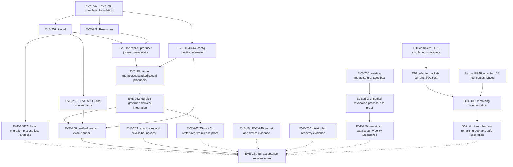
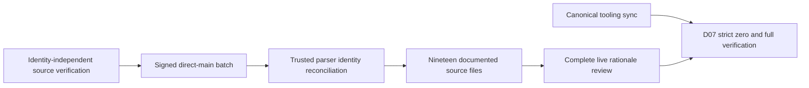
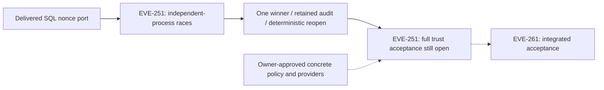
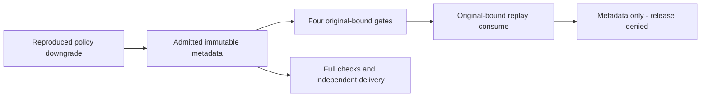

# Foundation and integration timeline

Last reconciled with Linear: 2026-11-17. Dates describe recorded decisions or this snapshot, not invented delivery deadlines. Status is the issue's observed status; repository source presence and focused tests do not close broader acceptance. Detailed contracts remain in the [modular specification](../architecture/modular-platform.md) and the [decision index](decisions.md).

## Independent migration recovery checkpoint - 2026-11-17

Jonathan's later direction, relayed in the [slice 1 assignment](https://ampcode.com/threads/T-a0a1608d-284c-46c6-8bd0-372ce1a02efb), ends the coordinator delivery gate. Each lane respects actual source reservations, rebases onto current main, regenerates affected shared outputs, verifies and pushes its own signed work. Older coordinated-window statements below are historical, not current ownership constraints. This does not authorize production or change G01-G15 acceptance.

| Stage | State | Evidence / next boundary |
| --- | --- | --- |
| EVE-258/EVE-42 migration process loss | Implemented; both-dialect focused proof passed | Separate uncached `migration-proof` target now feeds storage `test`; exact v1 rollback, v2/v3 acknowledgement-loss recovery, empty repeats, changed-prefix and stale-writer rejection with a current-writer control. [EVE-258 checkpoint](https://linear.app/resnovas/issue/EVE-258/add-the-database-neutral-resources-api-and-privileged-tenant-migration#comment-79bf922f) and [EVE-42 checkpoint](https://linear.app/resnovas/issue/EVE-42/p13-build-the-storage-layer-drizzle-on-postgres-and-sqlite-state#comment-b23c70d9). |
| False-positive control | Executed; target rejected broken transaction | Temporarily bypassing the fixture's transaction delegation exposed provisional v2/v3 to the independent connection; `migration-proof` failed with `ERR_ASSERTION`. The control was removed before final verification. |
| Independent delivery | Current | Full aggregate checks, strict reviewed planning and exact signed delivery are recorded on the owning issues; no pending CI is counted as passed. The default transaction proof and held parent spec remain intact. |
| Remaining G04/platform work | Upcoming, not closed | Distributed migration/lease fencing, power-loss/native durability, production least privilege and broader EVE-258/EVE-42/EVE-261 acceptance remain separate. No dependency, secret or production change. |

## Completed foundation and decisions

| Step                                                                              | Observed state                                              | Meaning                                                                                                                                   |
| --------------------------------------------------------------------------------- | ----------------------------------------------------------- | ----------------------------------------------------------------------------------------------------------------------------------------- |
| [EVE-243](https://linear.app/resnovas/issue/EVE-243) house enrollment             | Done                                                        | Current governance/tooling baseline; external administration limitations remain in [enrollment](../smartcloud-enrollment.md).             |
| [EVE-244](https://linear.app/resnovas/issue/EVE-244) fresh workspace              | Done                                                        | Accepted foundation, not product capabilities.                                                                                            |
| [EVE-23](https://linear.app/resnovas/issue/EVE-23) contracts/schema/runtime split | Done                                                        | Existing package boundaries are the baseline, not work to repeat.                                                                         |
| [EVE-17](https://linear.app/resnovas/issue/EVE-17) offline engine selection       | Done                                                        | Selected record/document direction; native-iOS follow-up remains open.                                                                    |
| [EVE-45](https://linear.app/resnovas/issue/EVE-45) producer semantics             | Three defaults approved 2026-11-17; issue still In Progress | Fresh durable incarnation; ambiguous callback reconciliation; committed-transition provenance. Approval is not journal/kernel completion. |

## Current work and prerequisites

| Lane / issue                                                                                                                                                                              | Linear state at snapshot                                           | Current acceptance boundary                                                                                                                                                                                                                                                                                               |
| ----------------------------------------------------------------------------------------------------------------------------------------------------------------------------------------- | ------------------------------------------------------------------ | ------------------------------------------------------------------------------------------------------------------------------------------------------------------------------------------------------------------------------------------------------------------------------------------------------------------------- |
| [EVE-13](https://linear.app/resnovas/issue/EVE-13) platform direction                                                                                                                     | In Progress                                                        | Parent acceptance remains open; architecture decisions do not prove every implementation.                                                                                                                                                                                                                                 |
| [EVE-257](https://linear.app/resnovas/issue/EVE-257) kernel                                                                                                                               | In Progress                                                        | Controlled transitions, exact providers, scoped cleanup and serving generations; distributed recovery is a separate gate.                                                                                                                                                                                                 |
| [EVE-258](https://linear.app/resnovas/issue/EVE-258) Resources                                                                                                                            | In Progress                                                        | Privileged tenant-bound migrations, unchanged features/provider composition, immutable revision/history and SQL boundaries.                                                                                                                                                                                               |
| [EVE-41](https://linear.app/resnovas/issue/EVE-41), [EVE-43](https://linear.app/resnovas/issue/EVE-43), [EVE-44](https://linear.app/resnovas/issue/EVE-44) config, identity and telemetry | In Progress                                                        | Redaction, authorization/audit and correlated bootstrap/runtime evidence. EVE-43 adoption remains blocked. Exporter contract and documentation checkpoints do not prove production ingestion/security or complete adoption.                                                                                               |
| [EVE-45](https://linear.app/resnovas/issue/EVE-45) durable producers and feed | In Progress | Delivered journal and actual kernel mutation-owner/cascade/disposal wiring retain authoritative committed facts. Slice 2 adds restart/redrive release-policy evidence; full governed-consumer and distributed/production acceptance remain open. |
| [EVE-262](https://linear.app/resnovas/issue/EVE-262) governed dispatch | In Progress, independently read 2026-11-17 | Slice 2 proves current synthetic release policy after claim/revocation/restart and authorized redrive. EVE-45 owns durable producers/feed; broad governed-consumer acceptance remains open. |
| [EVE-259](https://linear.app/resnovas/issue/EVE-259), [EVE-50](https://linear.app/resnovas/issue/EVE-50) declarative UI/screen context                                                    | In Progress                                                        | Data-only schema plus action/projection parity; native/UI end-to-end acceptance is not proven here.                                                                                                                                                                                                                       |
| [EVE-263](https://linear.app/resnovas/issue/EVE-263) exact types/acyclic graphs                                                                                                           | Backlog, binding quality gate                                      | Review actual source/declarations/export graphs and runtime admission; do not treat old isolated audit counts as current clearance.                                                                                                                                                                                       |
| [EVE-261](https://linear.app/resnovas/issue/EVE-261) integration | In Progress | Each lane independently rebases, regenerates affected shared outputs, verifies and ships its work under Jonathan's later direction. Exact overlapping source reservations still apply; all G01-G15 evidence remains explicit. |
| Documentation governance (under EVE-13/261)                                                                                                                                               | Implementation/review in progress, not a new approved Linear issue | This checkpoint publishes only the human timeline and decisions. The complete source mirror is frozen pending a verified canonical commit-hook correction for exact generated paths. The approved documentation-debt ratchet remains a separate reviewed delivery; no checker activation or global compliance is claimed. |

## Upcoming sequence

1. Respect exact active source reservations while each lane develops and ships independently. Clear applicable EVE-263 type/boundary findings without widening contracts or weakening checks; there is no central delivery gate.
2. Retain the delivered EVE-45 producer journal and actual kernel mutation-owner/cascade/disposal integration documented below. Its presence is not complete governed-consumer or production acceptance.
3. Extend durable governed-consumer evidence with bounded process-loss/revocation/replay slices. Preserve callback idempotency and authoritative provenance; snapshots and successful method returns cannot establish committed transitions.
4. Combine kernel/resources/config/identity/telemetry with durable governed hooks; prove pinned workflows, cleanup, readiness and protected-release boundaries on the actual composed system.
5. Complete declarative UI/action/screen parity and [EVE-260](https://linear.app/resnovas/issue/EVE-260) (Backlog) exact archived word-art reference only after verified ready and telemetry. No invented banner or physical exactly-once claim.
6. Complete target-specific [EVE-16](https://linear.app/resnovas/issue/EVE-16) federation/OTA and [EVE-252](https://linear.app/resnovas/issue/EVE-252) multi-runner recovery evidence (both In Progress), and [EVE-240](https://linear.app/resnovas/issue/EVE-240) native-iOS follow-up (Backlog). Independent portable work need not wait for every broad issue; full platform acceptance does.
7. Reconcile each lane's evidence on Linear and Markdown, rebase onto latest origin/main, regenerate affected shared outputs, run full gates and push signed commits directly to main. Rebase/regenerate/reverify a raced push. Keep EVE-45/EVE-261 open until full acceptance; no deployment or production readiness is authorized.

## Producer and exporter checkpoint - 2026-11-17

The source includes the [producer journal](../../packages/integrations/sql/src/hook-producer.ts) and [governed diagnostic export](../telemetry-export.md). Producer implementation commit `489819054e61d27ecc018b676de6814e54947196` and exporter implementation commit `5c241cbe68dbe743b3474f4c24e46f783365f135` are rebased onto the delivered EVE-264 archive head `980cac6f682336e97da5d72dea72650570dab6c7`. The 480 archive renames preserve source bytes and the private-tests gitlink; this checkpoint does not rewrite the archive.

The journal commits unresolved intent before granting first callback execution. Duplicate admission never permits replay; a restarted incarnation cannot directly confirm its predecessor. Authoritative reconciliation and confirmation publish only the original immutable fact, atomically through the existing feed. Missing/foreign attempts fail with policy denial rather than exposing another tenant/runtime's existence. Additive migration 0008 is tested on both dialects, not run against production.

The exporter rechecks a default-off flag and live tenant/purpose/module-generation grant for every delivery and flush. It drops input text/attributes and denies Restricted/Vault and nonordinary operations. Its replaceable SDK adapter uses immediate diagnostic events with no retry/backlog, handles swallowed HTTP errors and retains cancellation ownership through delayed preparation. Existing local logging and host composition are unchanged. No new dependency version, external ingestion or production activation is included.

Executed on the combined implementation before the archive-only base rebase:

- `bash .amp/in/orb-backup/run-storage.sh node --run verify`: exit 0; all 85 Nx lint/typecheck/test/build/parity tasks (16 cache hits), then smoke for three projects plus 12 dependency tasks. The disposable approved PostgreSQL fixture was removed. Android export is not device execution.
- `bash .amp/in/orb-backup/run-storage.sh pnpm exec vitest run --config tests/storage/vitest.config.mts tests/storage/src/hook-producer.spec.ts tests/storage/src/hook-process.spec.ts --coverage.enabled=false`: two files, 20 tests passed. Separate SIGKILL/reopen processes prove both-dialect journal recovery without source callback replay, alongside rollback, authority/tenant isolation and stale-resolution races.
- `pnpm exec vitest run --config tests/telemetry/vitest.config.mts`: 37 tests passed; 98.28% lines and 95.1% branches. `pnpm exec vitest run --config tests/integrations/posthog-server/vitest.config.mts`: 11 passed; 96.72% lines and 92.85% branches. Transport is fixture-intercepted; these are not production delivery receipts.
- `pnpm nx sync:check`: all files up to date. Source graph: 166 files/578 edges/28 packages, zero violations or cycles. Emitted graph: 67 files/256 edges, zero violations or cycles. Final post-rebase checks and exact-head CI are recorded on EVE-45/EVE-261; pending CI is not counted as passed.

Independent documentation review confirmed all 62 new production callable attachments; the test/example pass documented 139 callable nodes with unchanged comment-free AST/tokens. Semantic rationale remains reviewed, not inferred from a heuristic count. The exact debt ratchet and full Linear mirror are held separately; no broad suppression or source-prose rewriting is used to pass a gate.

Next, connect actual lifecycle mutation owners, dependent cascades and disposal to stable callback keys and authoritative provenance. Public-method success or snapshot differences cannot establish these transitions. EVE-45/EVE-261 remain In Progress, EVE-260 remains gated by verified readiness, and EVE-43 component adoption remains blocked. No new product decision is required for this bounded prerequisite; full native/UI/security/distributed/production acceptance is unproved.

## Kernel mutation-owner and OTLP checkpoint - 2026-11-17

The next dependency-ordered increment connects the existing journal to the actual
kernel mutation owners, not method-return wrappers or snapshot differences.
EVE-243/244 remain Done; live EVE-45/261 remain In Progress. EVE-260 is Backlog
with six open implementation prerequisites and is not the next unblocked slice.

| Stage | State in this increment | Evidence and remaining boundary |
| --- | --- | --- |
| Actual kernel producer, cascades and disposal | Implemented and aggregate-verified | 38 real SQLite/PostgreSQL producer tests passed; persisted intent precedes callbacks, confirmation follows actual publication, mandatory teardown survives denied intent and self-interrupting dependent cleanup without fabricated facts. |
| Kernel lifecycle/telemetry regression | Focused verification executed | 60 tests passed across kernel-runtime and kernel-telemetry; local-only host behavior remains supported. |
| Approved original EVE-21 OTLP scope | Implemented and aggregate-verified, default off | 43 telemetry tests passed; 96.66% lines/94.88% branches. Exact compatible dependencies, redacted endpoint/headers and bounded one-shot HTTP; no ingestion activation. |
| Rationale classifier calibration | Bounded improvement, global enforcement held | 52 fixtures passed, including execution hidden in destructuring and nested/outer security phases. Three reviewed adequate security/ownership bodies remain unresolved heuristic candidates; no broad exception or gate weakening. |
| EVE-22 house boundary reference | Human house merge verified; downstream aggregate-verified | [House PR 47](https://github.com/Resnovas/.github/pull/47) merged at 12:14:25Z. The downstream five-file patch is applied and all 16 workspace rows independently match ESLint; Eventiva delivery and asynchronous CI remain separate evidence. |
| Next implementation | Durable governed consumer integration | Combine actual kernel facts with persisted consumer dedup/drain and live release authority before the EVE-260 reference extension. Full G01-G15, native, protected security and distributed evidence remain open. |

Jonathan's two later owner choices are recorded separately in the
[decision index](decisions.md#later-owner-decisions---2026-11-17), with authenticated
selection times and agent-relay provenance. Mandatory finalization is not
permission to fabricate an event; OTLP dependency approval is not remote release
authorization. Final combined gates and exact delivered commits are recorded on
EVE-45/EVE-21/EVE-261; pending verification is never counted as passed.

Executed on the combined tree above immutable delivered base
`9af03961801dc6e6376da030332d92e11684f178`:
`NX_DAEMON=false NX_SKIP_NX_CACHE=true DOCUMENTATION_BASE=9af03961801dc6e6376da030332d92e11684f178 bash .amp/in/orb-backup/run-storage.sh node --run verify`
exited zero. Root checks passed, including 89 documentation fixtures; all 85 Nx
lint/typecheck/test/build/parity tasks passed without cache, followed by all three
smoke targets and 12 dependencies without cache. Source boundaries cover 169 files,
596 edges and 28 packages; emitted boundaries cover 68 files and 259 edges. Both
report zero violations/cycles. The approved disposable PostgreSQL fixture/network
were removed. Web/Android export is not native-device execution or production release.

The existing Effect compiler patch was restored after an installation omitted it;
the original diagnostic regression and the complete runtime suite then passed.
Temporary source backups were renamed as text after the licence guard correctly
rejected their copied file headers. No gate, test or threshold was weakened.
`NX_DAEMON=false pnpm nx sync:check`, scoped formatting and whitespace checks pass.
Planning remains 258 captured issues/692 edges with three explicit unresolved
decision sources and zero stale outputs, not exhaustive live semantic clearance.
Signed delivery revisions, clean-source Graphify and pending exact-head CI are
recorded on the owning issues; none of these local results approves ingestion,
production migrations, security-component adoption or full EVE-261 acceptance.

### House boundary reference delivery

Human TGTGamer merged [house PR47](https://github.com/Resnovas/.github/pull/47)
at 2026-11-17T12:14:25Z as
[983ce559](https://github.com/Resnovas/.github/commit/983ce5595b75f1d485446b320fdc85b322c80dd4).
GitHub merge state and the owning EVE-22 discussion were independently read.
The held downstream patch is now integrated: both architecture reference copies
and their changelogs, plus the house-standards summary, describe the same 16
intersecting boundary rows as Eventiva's ESLint. No boundary rule changed.
EVE-22 remains In Progress pending Eventiva delivery evidence; a house merge
does not claim that asynchronous aggregate CI finished or approve production.

### Parallel EVE-34 checkpoint allocation

The [2026-11-17 EVE-34 packet](https://linear.app/resnovas/issue/EVE-34#comment-01bffbbf-3f7b-433e-9397-e964b555037c)
was read in full after publication. It is explicitly agent-authored analysis,
not owner acceptance. Coordination reserved a bounded source-only implementation
of the server-local run/step checkpoint as part of EVE-54, reusing the existing
Cluster Workflow engine and authorized action path. Both live issues remain
Backlog; reservation does not rewrite that captured or live state.

Require raw executor counts across acknowledged steps 2/3 and automatic takeover,
not only business dedup after an interrupted Activity. Stable tenant/run/step keys
and live access checks are part of the checkpoint. EVE-35/36 consume the same run
model later; EVE-54 keeps full lifecycle/control and persisted module/provider/schema
pinning/fencing, and EVE-47 still needs the real EVE-52 agent loop. No production
module-bound run or complete agent acceptance is authorized by this allocation.
Root/planning/LLMS/Graphify delivery remains coordinated after the current increment.

## Unsettled marketplace revocation checkpoint - 2026-11-17

[EVE-250](https://linear.app/resnovas/issue/EVE-250) remains In Progress.
The [slice 3 contract](https://ampcode.com/artifacts/eventiva-next-parallel-slices-current-main-readiness-f4c31b8c-2405-4743-ad32-bedc11c633a5)
and [execution thread](https://ampcode.com/threads/T-01a1e9e1-b366-759e-b622-c4881886c1ee)
scope this increment to the existing SQL metadata APIs and reserved process fixture.
It does not select concrete marketplace policy, crypto, providers or custody.

| Step | State | Evidence / remaining boundary |
| --- | --- | --- |
| Existing six-worker crash/replay proof | Preserved | Original assertions and stdout contract remain; post-settlement revocation alone was not unsettled-work recovery proof. |
| Pending and running revocation | Focused execution passed | SQLite and approved disposable PostgreSQL default invocations pass pending claim denial, expired-running reclaim denial and live-lease settlement denial. Distinct workers revoke and reopen; exact rows retain one blocked audit per transition and no revoked settlement. |
| Negative and positive controls | Focused execution passed | A scratch loader that ignores revocation only for the added namespaces fails at the pending denied-claim assertion; the unmodified adapter passes. An unrelated authorized namespace records settlement without changing prior evidence. |
| Combined verification and delivery | Verification passed | Rebased onto origin/main 970e4485; full `node --run verify` passes the root gate, all 85 aggregate targets, source/declaration boundaries and all three smoke targets. Strict reviewed planning passes with zero unresolved sources/stale outputs. Planning/LLMS/Graphify are regenerated for independent direct-main signed delivery; exact revisions and results are posted on EVE-250. No coordinator or shared-output window is required. |
| Remaining marketplace acceptance | Upcoming / separately gated | Real saga destinations, identity/crypto/custody composition, policy parameters, payments, protected release and production remain unproved or unauthorized. This metadata process-loss proof closes none of those broad gates. |

The earlier coordinator/window-only wording in historical checkpoints is not the
current delivery gate. The later explicit independent-delivery instruction governs
this slice; actual other-lane source reservations remain in force. No other slice's
fixture or storage project wiring is changed. The complete issue mirror remains a
dated historical capture, not a fresh all-issue acquisition.

## Dependency roadmap

Solid arrows indicate implementation prerequisites from the modular specification/current EVE-45 plan, not new Linear blocking relations. Dotted arrows indicate broader target evidence required for complete integration. The text above is the accessible equivalent of this graph. Every issue node links to Linear.

## Acceptance ledger

The authoritative detailed matrix remains [specification G01-G15](../architecture/modular-platform.md#14-hard-readiness-gates-and-acceptance-evidence-ledger) and the live [EVE-261](https://linear.app/resnovas/issue/EVE-261) packet. This lane has not executed platform acceptance and marks none of those rows passed. Each completed checkpoint must name commit, command/output, runtime/provider, negative control and remaining limits. In particular, native/UI, production security/ingestion and full platform integration are **not proven** by this governance change.

## House tooling JSDoc sync - 2026-11-17

| Step | State | Evidence and limits |
| --- | --- | --- |
| Canonical house JSDoc | Human accepted | Jonathan merged [house PR48](https://github.com/Resnovas/.github/pull/48) at 14:35:04Z as [30c7ff08](https://github.com/Resnovas/.github/commit/30c7ff08dd05dc492feb26fc42da9f2e8903bbda). House CI and smartcloud passed on the tested PR head. |
| Thirteen Eventiva tooling copies | Source verified | Rendered from accepted templates against immutable pre-packet main `416ef0aa7a4035b35f77bdf3eb4e1430b22b00f2`; copies match canonical bytes, ASTs preserve behavior, no parse errors or scoped blocking JSDoc findings. |
| Exact ledger prune and semantic review | Completed | Only 87 identities removed: 72 attachments and 15 rationale candidates. Five adequate scoped candidates and all unrelated debt remain. After two intervening batches, regenerate from `970e44851983a15ef8f2130c930ffafc15b0c129` and its published trusted-fingerprint reconciliation: 338 to 251. Zero missing contracts and 330 live rationale review candidates, not strict zero. No authored checker, suppression or acceptance-policy change. |
| Eventiva local verification | Completed | Full `node --run verify` passed against the original base, `b5837844e68a28e5031f76d60006b1d4728f20ba`, `970e44851983a15ef8f2130c930ffafc15b0c129`, and final combined base `ded8c72a5958e7ccc26d8f08d3002cebb413c561`, using the approved disposable PostgreSQL fixture. Final run: 98 documentation fixtures, 95 resource/type-boundary fixtures, all 85 aggregate Nx tasks (63 cached), and three-project smoke plus 12 dependencies (12 cached) passed. Source/emitted boundaries have zero violations/cycles. Root `check` and the trusted-base ratchet also passed; each fixture/network was removed. |
| Eventiva direct-main delivery | This verified increment | Authorized after the human house merge. Exact pushed head and asynchronous CI status are recorded on [EVE-22](https://linear.app/resnovas/issue/EVE-22), [EVE-13](https://linear.app/resnovas/issue/EVE-13) and [EVE-261](https://linear.app/resnovas/issue/EVE-261); local verification is not remote CI success. |
| Remaining D03-D07 and product acceptance | Upcoming / held | This is partial D06 remediation. It does not complete EVE-22, strict global documentation, runtime integration, production release or any native/device gate. |

Semantic scope and the retained-candidate rationale are in the
[documentation standard](../documentation-standard.md#canonical-house-tooling-checkpoint---2026-11-17).
Canonical Markdown remains the source; no AsciiDoc pointers or historical
example edits are introduced. The directing owner ended the coordinator gate
for this packet and authorized this lane to verify and ship only the accepted
copies after the human house merge.

## Anchor-confirmation planning resolution - 2026-11-17

After the delivered D02 head
`8a1440bbbbc04e8f5bed2e7d253683600a713d00` returned the shared window, the
coordinator mirrored Jonathan's EVE-84 decision from the
[12:31:56.867Z Amp relay](https://linear.app/resnovas/issue/EVE-84#comment-f9c96ce3-873a-46ba-9702-bf00bcebc44d).
The source covers general Event planning, so option B applies: any Event/Phase
anchor-date change requires confirmation, including dependency-delay cascades;
non-anchor dates may cascade automatically. The exact owner-selection time is
unknown. This completes the scope decision, not the Backlog implementation or its
dependency gates. The [decision index](decisions.md#tasks-anchor-confirmation)
records the narrowed supersession of earlier automatic-delay direction.

At that checkpoint two unavailable owner-infrastructure references still blocked
strict source review. The bounded reconciliation below supersedes that source
blocker only. Next implement EVE-84 only after its recorded prerequisites and
applicable authorization/confirmation tests are met.

## Marketplace source reconciliation - 2026-11-17

Jonathan's [Puck instruction](https://ampcode.com/threads/T-01a1e940-37a3-7691-a5c0-e935b711c99a)
designates the existing [architecture index](../architecture/eventiva-platform-and-marketplace.md)
as the current repository replacement/index for the unavailable historical
`Eventiva-marketplace-infrastructure-v1.md`. The exact instruction time is unknown.
Current EVE-250/251 descriptions and their authorized mirrors now point directly
there and explicitly supersede historical missing-source/archive statements for
current source status. All 30 existing issue comments are unchanged; the original
file is still unavailable and unread, not recovered. Only these two issues were
refreshed, at 13:22:30.954Z and 13:22:32.697Z respectively; the original complete
enumeration timestamp and all other captured issues remain unchanged.

This resolves the two missing-file source-review blockers, not implementation or
acceptance. EVE-250/251 remain In Progress. The 2026-11-16 binding architecture and
provider-neutral authorization govern; concrete crypto/provider/verifier/custody,
canonicalization/timing, regional/legal/retention, freshness/recovery/reconciliation
and moderation gates remain where not independently approved. EVE-261, production
security/ingestion, native/device proof and unrelated blockers are not cleared.

## Documentation adapter and CI diagnostics checkpoint - 2026-11-17

This bounded increment compares against the coordinator's delivered
`1674f6fec4c3cf061794975dde61d6959a4afe75`, not its unrelated local EVE-34
packet. Tracking remains [EVE-13](https://linear.app/resnovas/issue/EVE-13) and
[EVE-261](https://linear.app/resnovas/issue/EVE-261); see the exact semantic and
execution evidence in [the documentation backlog](documentation-backlog.md#d03-first-adapters-and-bounded-ci-diagnostics---2026-11-17).

| Step | Status | Evidence / remaining boundary |
| --- | --- | --- |
| D01 source and D02 runtime attachments | Completed delivery, not strict global zero | D02 delivered at `8a1440bbbbc04e8f5bed2e7d253683600a713d00`; its verify/smoke/application CI passed. Nine adequate retained runtime rationale candidates remain. |
| First four D03 adapters | Source and focused verification complete | 33 attachment fixes and one rationale improvement, exact parsed executable tokens, zero scoped scanner findings, 26 uncached Nx tasks passed. |
| Bounded subprocess diagnostics | Reviewed source; combined delivery current | Coordinator approved the exact patch after independent reading; seven assertions and the 10-second bound remain. Real timeout negative control produced bounded redacted context, not a root-cause finding. |
| Exact prune and full verification | Completed local gate; delivery current | Uncached verify passed all 85 Nx tasks, 89 documentation fixtures, 95 boundary/type fixtures and all three smoke targets plus 12 dependencies. Retained debt is 3,117 (2,420 attachments and 697 rationale); five removed test rationale identities are replacements, not semantic fixes. |
| Remaining D03-D06, then D07 | Upcoming | Reserve remaining sources, review semantically and deliver verified packets. Strict zero cannot be activated while adequate candidates lack a safe general classifier refinement. |

The first D02 head failed both the original CI attempt and its one authorized
same-head rerun in different children. The coordinator also observed recurrence
on the pre-diagnostics planning head. Child signal/output were absent in those
logs; passing local probes and final-D02 CI do not establish why they timed out.
The diagnostics add evidence for future failures without retries, timeout
inflation, assertion weakening or runtime changes. Existing platform dependency
edges and production/native/UI acceptance gates remain unchanged.

## Second D03 adapter checkpoint - 2026-11-17

The coordinator returned the shared window at confirmed remote main
`17631eaf5712d422376e5d3d2f0bbfd939773959`. Its EVE-250/251 source
reconciliation is inherited, not reimplemented here; the unrelated EVE-34 packet
is not imported. Tracking remains EVE-13/EVE-261. The
[per-file backlog evidence](documentation-backlog.md#second-d03-flag-and-local-logger-checkpoint---2026-11-17)
records the review and exact immutable-base accounting.

| Step | Status | Evidence / remaining boundary |
| --- | --- | --- |
| First D03 packet and approved diagnostics | Delivered | Signed source `cad66393` and clean graph `285fc569`; passing local verification did not prevent a later CI timeout. |
| PostHog flag adapters and local logger | Source and focused verification complete | Exact executable tokens, zero scoped findings, 52 attachments and three rationale improvements; all 22 affected uncached Nx tasks passed. |
| Exact prune and combined verification | Completed local gate; signed delivery current | 3,062 retained identities: 2,368 attachments and 694 rationale. Uncached immutable-base verify passed all 85 Nx tasks, 89 documentation fixtures, 95 boundary/type fixtures and three smoke targets plus 12 dependencies; exact-head CI is separate. |
| Remaining SQL adapters and D04-D06 | Upcoming | Five SQL sources reserved for documentation only; no production migrations, provider changes or dependencies are authorized. |
| D07 strict zero | Held | Adequate retained rationale candidates still need a safe general classifier refinement; neither token equality nor the ratchet proves repository-wide compliance. |

The first-D03 exact-head CI failed the contracts-suite opt-out invalid-profile
child with `ETIMEDOUT`/`SIGTERM` after recording `bootstrap.failure`; its stdout
summary had 142 characters and stderr was empty. Root cause and shutdown timing
remain unproven. No timeout increase, retry, assertion change or runtime fix is
part of this documentation packet. Puck assigned further root-cause work to a
separate reserved lane; this lane stopped that investigation and supplied its
evidence. Existing platform and production acceptance gates remain unchanged.

## D03-D07 independent documentation delivery - 2026-11-17

Jonathan/Puck ended central shared-output windows. Documentation batches now deliver directly after immutable-base verification; canonical house-template ownership and production-authorization limits remain unchanged. Read the exact [source checkpoint and inventory](documentation-backlog.md#d03-d06-identity-independent-source-checkpoint---2026-11-17), tracked on [EVE-13](https://linear.app/resnovas/issue/EVE-13) and [EVE-261](https://linear.app/resnovas/issue/EVE-261).

| Step | State | Evidence / remaining boundary |
| --- | --- | --- |
| Identity-independent Eventiva sources | Delivered | Signed [source](https://github.com/Resnovas/Eventiva/commit/44078885a4136e5403415e506e9c207369d28d87) and [clean-source graph/head](https://github.com/Resnovas/Eventiva/commit/b5837844e68a28e5031f76d60006b1d4728f20ba). Documentation resolves 976 attachments and 207 live rationale candidates; exact debt shrinks by 1,155. Uncached full serial gates passed at both immutable bases; exact-head CI remains separate. |
| Nineteen retained-ID source files | Full serial verification passed; signed delivery current | Documentation resolves 1,308 attachments and 248 rationale candidates. Trusted-byte parser reconciliation normalizes 395 accepted IDs without changing count or admitting debt; separate pruning takes 1,894 to 338. All 98 documentation fixtures, 95 boundary/type fixtures, aggregate targets and smoke passed uncached against immutable b5837844. |
| Canonical synced tools | Delivered independently | Human-merged house PR 48 supplies the normal 13-file render at Eventiva head `c39cfb4f`. Its separate 72 attachment and 15 rationale removals take 338 to 251; all 20 scoped candidates reviewed, five adequate candidates retained. |
| Runtime and adapter rationale | Combined full serial verification passed; signed delivery current | Twenty sources receive 36 meaningful comments with all 41,353 parsed terminals unchanged. Exact prune removes 21 accepted identities, 246 to 225, without new debt; the independent trust input-isolation implementation pruned five other identities. Independent canonical sync and marketplace/resource/trust delivery through 6016e99d are preserved. All 98 documentation fixtures, 95 boundary/type fixtures, 85 aggregate Nx targets and smoke pass uncached against that immutable head; exact-head CI is separate. All five EVE-60 path holds are released. |
| Remaining live rationale / D07 | Upcoming | All 300 live candidates remain in scope, including 75 never ledgered. Do not activate strict mode before complete remediation/calibration and an empty strict scan. |

No passing aggregate, CI success, source-intent waiver or timeout diagnosis is inferred from token equality. Serial PostgreSQL-backed verification preserves every existing deadline, assertion and coverage threshold.

## AgentRun and synthetic correlation integration - 2026-11-17

This bounded increment starts at delivered main
`d771b3664ab260b418983b68ab40fc255fb77163`. EVE-243/244 are already
Done; EVE-260 remains dependency-gated. EVE-34's fixed-definition checkpoint and
EVE-60's local synthetic boundary reuse existing engines/services without new
dependencies, provisioning or production ingress. Both live issues remain
Backlog, not accepted by the existence of a source packet.

| Step | State | Evidence / remaining boundary |
| --- | --- | --- |
| EVE-34 scripted durable run source | Integrated; central process conformance passed | Existing Workflow engine and short per-run control handle, immutable tenant-routed acceptance, live control/step authority, completed Activity counts across SIGKILL/drain/restart. [Lane evidence](https://linear.app/resnovas/issue/EVE-34#comment-b52be1a7-b8d8-426f-877a-296deb20d658) is distinct from the central rerun. |
| EVE-60 synthetic request boundary | Integrated; six central acceptance groups passed | Default-off flag, complete finite allowlisted pairs, inherited/restored span/log context and existing minimized sink. Not raw-ID admission, SDK/device execution, captured-error events or production export. |
| Durable coverage and aggregate gate | Central verification passed | Both new modules remain in normal server coverage with unchanged 90% thresholds. Added public-contract tests close the initial 77.9% branch gap: AgentRun covers 42/44 branches (95.45%), synthetic correlation 18/18 (100%), aggregate 84/86 (97.67%). Uncached immutable-base verify passed all 85 aggregate Nx tasks, 89 documentation fixtures, 95 boundary/type fixtures and three smoke targets plus 12 dependencies. Signed delivery and exact-head CI remain separate evidence. |
| Downstream work | Upcoming / held where stated | EVE-35/36 build on this run model; EVE-52 turns, EVE-54 module/provider/schema pins and distributed fencing, full lifecycle and real external-effect acceptance remain separate. EVE-60 real correlation implementation awaits its rotation-lifetime decision and separate governed providers; production remains denied. |

Jonathan selected pseudonymous session/user correlation at
13:16:16.737Z and dedicated tenant/destination/purpose-separated rotating key
custody at 13:18:55.545Z. The later Amp relays are [55507185](https://linear.app/resnovas/issue/EVE-60#comment-55507185-3858-42e4-b1f9-e868357b54f7)
and [9cb2d84b](https://linear.app/resnovas/issue/EVE-60#comment-9cb2d84b-90b0-41b8-aeb9-1253346d5f39).
Per-request opt-in, current user consent and protected-profile exclusion remain
mandatory. One-hour UTC epochs, local HMAC-SHA-256 and 256-bit keys are proposals,
not selected lifetime/algorithm or provisioning authority. The source mirror
refresh is bounded to EVE-34/60; all other issue captures remain historical.

### Bootstrap timeout investigation checkpoint

The [timeout lane's EVE-261 checkpoint](https://linear.app/resnovas/issue/EVE-261#comment-2d5107ee-cf1e-4404-8e88-cb1928902019)
reports unchanged `285fc569` stress controls, not a fix: 58/60 six-way single-CPU
launches timed out; 13 emitted the same 142-character failure signature only at
9,827-10,003ms after spawn and returned within 281ms. Their status 1/null signal
differs from CI's null status/SIGTERM. Sixteen instrumented exit controls reached
`process.exit(1)` with no keepalive Timeout; they did not capture the actual CI
failure. Its separate contracts run was 401 passed/10 PostgreSQL connection
failures without a fixture, not a green aggregate. Exact CI cause remains
unknown: the old summary cannot distinguish late startup from a post-log stall.
No force-exit, cleanup, deadline or retry fix is justified by those observations.
The [diagnostic-capture checkpoint](https://linear.app/resnovas/issue/EVE-261#comment-c0e0d66f-9f2c-4009-9164-3695a7413038)
adds bounded launch-relative module, root and scoped-release phases, retaining
the original 10-second timeout and all assertions. Observed/unobserved executable
controls, invalid-journal/redaction controls and an actual synthetic timeout
exercise capture, not the historical cause. The private channel is inert without
subscribers; the test-only fd3 journal cannot become a business prerequisite.
On 2026-11-17 Jonathan ended central delivery windows; this lane now integrates
and delivers its own verified increment. Next: inspect phase evidence from any
actual CI recurrence before selecting a runtime fix. Investigation does not
clear failed CI or EVE-261 acceptance.

Executed on immutable `c3a541b9172c7ce22ecde7cd118df5a1cc10e2df` plus this
increment: `NX_SKIP_NX_CACHE=true NX_DAEMON=false timeout 20m node --run verify`
passed root checks, all 85 aggregate tasks, source/declaration boundaries and
smoke with the approved disposable PostgreSQL fixture. The fixture and its
network were removed. This is local combined evidence, not exact-head CI or a
verified runtime repair.

## Hook release reauthorization slice 2 - 2026-11-17

This independently delivered EVE-262/EVE-45 slice starts at main
`c3a541b9172c7ce22ecde7cd118df5a1cc10e2df`. The
[reservation and execution thread](https://ampcode.com/threads/T-01a1e9e1-a727-7765-932d-bd55c3f03d51)
owns only the hook process fixture and corresponding Markdown sources, plus its
affected shared generated outputs. Jonathan's later independent-delivery direction
supersedes coordinator-window language in historical checkpoints above; no new
product/security/production decision is introduced.

| Step | State | Evidence / remaining boundary |
| --- | --- | --- |
| Default hook-process extension | Completed focused verification | Four existing wrapper tests passed on SQLite and approved disposable loopback PostgreSQL. Revocation after durable claim and before SIGKILL yields a denied terminal delivery after actual lease expiry; a pre-crash claim cannot settle it. |
| Authorized redrive and allowed control | Completed focused verification | A further fresh worker rechecks revoked permission after operator replay: two denied policy checks, zero sink calls. Exact origin/receipt/fact/projection and retained replay history stay unchanged; the independent allowed control has two sink attempts but one durable application. |
| Negative control | Executed and rejected | Temporarily bypassing fixture policy denial made the unchanged SQLite proof fail with actual `delivered`, expected `dead-letter`. The bypass was removed before verification/delivery. |
| Shared outputs and aggregate gates | Passed locally; outputs regenerated | Root check, storage Nx tests, full verify and strict reviewed-source planning check passed. Planning/LLMS and clean-source Graphify are regenerated. Signed delivery revisions and exact-head CI are recorded separately on both owning issues; local results do not establish CI success. |
| Governed consumers and release | Upcoming / unaccepted | EVE-262 and EVE-45 remain In Progress. Production grants/sink, protected payloads, cancellation of an already-running sink, native targets, distributed drain and full platform acceptance remain separate. |

The [people guide](../hooks.md#verify-current-release-permission-after-restart)
and [agent guide](../../ai-docs/src/18_hooks/03_release-recovery.md) specify the
default self-asserting command and retained evidence. Existing JSON/parser,
consumer-cursor cases and 60-second subprocess bound are unchanged; no storage
project wiring or other slice's fixture changed. The complete source mirror
remains historical. A separately dated roadmap annotation records the live
EVE-262 In Progress status read through the connected MCP, not a silent rewrite
of captured Backlog or a full live freshness claim.

Final aggregate execution rebased onto immutable main
`970e44851983a15ef8f2130c930ffafc15b0c129`:
`NX_DAEMON=false bash .amp/in/orb-backup/run-hook-storage.sh node --run verify`
exited zero. Root checks passed, including 98 documentation fixtures; all 85
aggregate Nx tasks passed (49 cache hits), including the storage suite. The
separate uncached storage target passed all 201 tests with 96.32% lines/92.66%
branches before this final documentation-only base increment. All three smoke
targets and 12 dependencies passed (12 cache hits). Source boundaries cover 175
files/627 edges/28 packages; emitted boundaries cover 68 files/259 edges, both
with zero violations/cycles. Strict planning reports 258 issues/692 edges, zero
unresolved decision sources and zero stale outputs. The disposable PostgreSQL
fixture/network were removed; Android export is not native-device execution.

## Independent-process trust replay checkpoint - 2026-11-17

This [EVE-251 slice 4 checkpoint](https://linear.app/resnovas/issue/EVE-251#comment-eaf4d8a6-1612-4ae7-9bde-97244b878250)
advances metadata replay acceptance only. Jonathan ended central delivery gates;
actual source reservations remain. Earlier coordinator-window passages above are
historical checkpoints, not current delivery constraints. The trust lane owns its
fixture and people/agent guides, not the other process fixtures or storage project
wiring. See [the trust guide](../trust.md#prove-independent-process-nonce-consumption)
for commands, exact assertions and limits.

| Step | State | Evidence / remaining boundary |
| --- | --- | --- |
| Existing SQL consume-once and sequential crash proof | Already delivered | Reused unchanged public adapter/port and both migration dialects; not a new trust-policy choice. |
| Two four-process races per dialect | Implemented; standalone proofs passed | Identical and case-equivalent UUIDs retain one exact winner; sanitized losers, four deterministic fresh-process replay refusals and a distinct receipt control. An isolated lowercasing-removal mutation is rejected. |
| Independent aggregate verification and delivery | Current | Final commands/results and signed commits are recorded on EVE-251; no whole-issue completion or remote CI success is inferred from source presence. |
| Concrete trust composition and full acceptance | Upcoming / gated | Four independent real verifiers, crypto/custody/timing/retention decisions and release composition remain separately governed. No production change or key/plaintext release. |

## Trust-preflight input isolation, next-batch slice 2 - 2026-11-17

This bounded [EVE-251](https://linear.app/resnovas/issue/EVE-251) increment
implements revision 4 of the next-parallel-slices packet. The
[source and red/green checkpoint](https://linear.app/resnovas/issue/EVE-251#comment-b5a4e484-a21b-4b81-8292-566b8b76ba9d)
is agent implementation evidence, not a new owner policy decision. EVE-251
remains In Progress. Its parallel trust-process proof and broader acceptance
are separate; no coordinator delivery gate is introduced.

| Step | State | Evidence / remaining boundary |
| --- | --- | --- |
| A5-floor red control | Reproduced on unchanged cd35465d production source | Identity's attempted A5-to-A1 downgrade incorrectly admitted A4 evidence and produced a replay receipt; success still denied release. |
| Admitted-value isolation | Implemented; focused green | Copy/freeze request, scope, keys, policy and freshness records before adapters. All 171 trust tests pass, including separate barrier cases for caller writes during identity suspension and retained adapter references during resource suspension, original-bound gates/replay, freshness denial, sanitized failures and interruption. Observations are asserted outside adapter failure sanitization, permitting original-bound success or safe denial without coupling tests to freezing. |
| Shared outputs and full gates | Passed locally; signed delivery recorded separately | Planning/LLMS and clean-source Graphify regenerated. Root check, full uncached verify and strict reviewed-source planning passed on the rebased source. Exact signed delivery and asynchronous CI are recorded on EVE-251; local success is not remote CI success. |
| Concrete trust composition | Upcoming / separately gated | No crypto, provider, custody, canonicalization, timing, retention, key/plaintext release or production activation selected. A successful metadata preflight always says release denied. |

The [preflight-to-consume guide](../trust-replay.md#preserve-admitted-preflight-inputs)
owns the boundary details. The new agent note does not replace the trust
specification or claim SQL/process durability. No dependency, secret or
production change is part of this slice. The historical issue capture remains
unchanged; the generated annotation is a separately dated live-status/evidence
checkpoint, not an exhaustive live refresh.

Executed above immutable main `50668875c7ae129d68a3f0773dff67c4c94575bc`:
`node --run check` exited zero with 98 documentation fixtures and zero blocking
documentation findings/violations. `NX_DAEMON=false NX_SKIP_NX_CACHE=true DOCUMENTATION_BASE=50668875c7ae129d68a3f0773dff67c4c94575bc bash .amp/in/orb-backup/run-eve251-storage.sh node --run verify`
exited zero: all 86 aggregate Nx tasks passed uncached, followed by smoke for
three projects and 12 dependencies, also uncached. Source boundaries cover 175
files/627 edges/28 packages; emitted boundaries cover 68 files/259 edges, both
with zero violations/cycles. `node tools/documentation/planning.mjs --check --require-reviewed`
reports 258 issues/692 edges, zero unresolved decision sources/stale outputs.
`pnpm nx sync:check` reports all files up to date. The approved disposable
PostgreSQL fixture/network were removed; Android export is not device execution.
An earlier aggregate attempt failed two test tuple-inference checks, corrected
before this successful run. Formatting pruned five obsolete rationale-debt
identities without accepting new debt or claiming semantic remediation. The
[delivery evidence](https://linear.app/resnovas/issue/EVE-251#comment-e4158f5c-9e7e-4741-a8a5-37322651b305)
records signed revisions and remote CI separately. LLMS regeneration is
byte-unchanged: the generator includes index Markdown and TypeScript examples,
not sibling Markdown notes; the reserved trust index remains untouched.

<!-- planning:generated:start -->
## Generated all-issue planning coverage

Snapshot enumeration: 2026-11-17T07:42:41.684Z; 258 issues, 692 prerequisite edges. Planning counts after explicitly cited annotations: completed 20; current 18; upcoming 218; closed without implementation 2; additionally blocked 175. Captured Linear status is retained in every detail table and accessible SVG node; later evidence is never a silent source refresh.

Layers use longest prerequisite distance, not a newly approved delivery order, deadline or priority. P/F prefixes are preserved as recorded phase labels; unnumbered work is not assigned an invented phase. Only completed prerequisites satisfy recorded edges; canceled/duplicate closure alone does not. Completed status is not independent acceptance proof. No structured blocker does not establish readiness: prose/security/native/device gates still apply. See each complete issue's acceptance criteria and comments before choosing work.

Legend: COMPLETED solid green; CURRENT double blue; UPCOMING dashed slate; CLOSED dashed violet; BLOCKED hatched amber, always labeled in text. Blocked overrides base fill/border except the current double outline. Arrows point prerequisite -> dependent. A blocked current issue stays CURRENT / BLOCKED.

### Curated evidence separate from capture

- EVE-261, 2026-11-17, blocker: Bootstrap timeout cause remains unproven. Historical CI output does not distinguish late module/startup work from post-log shutdown delay. Bounded fd3 phase capture is implemented for the next actual occurrence with unchanged 10000 ms child limits, signals, results and existing assertions; executable equivalence, invalid-journal/redaction and synthetic timeout controls exercise diagnostics only. No force-exit, retry, deadline increase, telemetry repair or whole-issue acceptance is established. Source checkpoint predates delivery; exact-head CI is separate evidence, not a refreshed issue snapshot. [evidence](https://linear.app/resnovas/issue/EVE-261#comment-c0e0d66f-9f2c-4009-9164-3695a7413038), [evidence](https://github.com/Resnovas/Eventiva/actions/runs/44096066749/job/134083384961), [evidence](https://ampcode.com/threads/T-1cb8af52-2e52-4924-bb42-cc7c523a6ddc).
- EVE-262, 2026-11-17, later-status: Slice 2 independently read the live description and terminal comment page: EVE-262 is In Progress (state change recorded 08:14:06.002Z), not the historical Backlog capture. Current bounded work proves hook release reauthorization after claim/revocation/process loss and operator redrive using fixture-persisted policy, with an allowed durable-dedup control. Execution and delivered-head evidence are recorded separately on EVE-262/EVE-45 and in the maintained timeline; this annotation grants no production release or whole-issue acceptance. The complete historical source capture is unchanged. [evidence](https://linear.app/resnovas/issue/EVE-262), [evidence](https://linear.app/resnovas/issue/EVE-262#comment-4cad4584-11e3-45e2-80cc-afc7df728cec), [evidence](https://ampcode.com/threads/T-01a1e9e1-a727-7765-932d-bd55c3f03d51).
- EVE-258, 2026-11-17, later-status: Slice 1 adds a separate self-asserting declaration migration process-loss target to storage test, preserving the held parent spec and its migrationCrashProof:false default report. SQLite and disposable PostgreSQL pass precommit SIGKILL rollback, postcommit acknowledgement loss, empty repeat history, valid changed-prefix refusal and stale-writer rejection with a current-writer control. This is bounded local G04 evidence, not power loss, distributed fencing, native execution, production least privilege or whole-issue acceptance. Source capture remains historical; later execution and delivery evidence is cited separately. [evidence](https://linear.app/resnovas/issue/EVE-258/add-the-database-neutral-resources-api-and-privileged-tenant-migration#comment-79bf922f), [evidence](https://ampcode.com/threads/T-a0a1608d-284c-46c6-8bd0-372ce1a02efb).
- EVE-42, 2026-11-17, later-status: The EVE-258 migration process-loss slice executes on both SQL dialects through the existing public migrator with fixture-only barriers and three distinct SIGKILL workers. Two asymmetric records, exact declaration bytes/checksums and five original revisions survive rollback/retry and acknowledgement loss; repeat history applies nothing and stale writers fail closed. No adapter policy, dependency, secret or production change. Deferred Drizzle/device/provider least-privilege and complete storage acceptance remain open. This dated checkpoint does not silently refresh the captured issue discussion or infer completion. [evidence](https://linear.app/resnovas/issue/EVE-42/p13-build-the-storage-layer-drizzle-on-postgres-and-sqlite-state#comment-b23c70d9), [evidence](https://ampcode.com/threads/T-a0a1608d-284c-46c6-8bd0-372ce1a02efb).
- EVE-251, 2026-11-17T15:44:16.936Z, later-status: The 14:28:01.568Z slice 4 checkpoint adds independent-process consume-once evidence to the existing default trust fixture: identical and case-equivalent UUID races, one retained matching winner, sanitized fail-closed losers, deterministic replay after all racing clients close, and a distinct-nonce positive control. Both standalone dialect proofs passed; an isolated lowercasing-removal mutation was rejected. The 15:44:16.936Z next-batch slice 2 checkpoint independently read the live description and terminal 16-comment page; EVE-251 remains In Progress. Its A5-policy/A4-evidence adapter-mutation regression reproduced metadata success and nonce consumption before the fix; detached immutable admitted request/policy snapshots passed the initial 170-case checkpoint. The maintained timeline records the final separate suspension barriers, checks and delivery. Aggregate verification and signed delivery are separately recorded on the issue, not inferred from either checkpoint. The captured issue prose remains historical; this is not a full live mirror refresh. No concrete crypto/provider/custody/timing/retention choice, key/plaintext release, production activation or whole-issue completion is established. [evidence](https://linear.app/resnovas/issue/EVE-251#comment-eaf4d8a6-1612-4ae7-9bde-97244b878250), [evidence](https://ampcode.com/threads/T-01a1e9e1-bcd6-7217-97ea-fd5de5a09a96), [evidence](https://linear.app/resnovas/issue/EVE-251#comment-b5a4e484-a21b-4b81-8292-566b8b76ba9d), [evidence](https://ampcode.com/threads/T-01a1ea29-5659-70f4-acdb-3856f1dc28ae).
- EVE-84, 2026-11-17T12:31:56.867Z, later-status: Live description and complete comment list independently reviewed: EVE-84 covers general Event planning, not MDT only. Jonathan's conditional 2026-11-17 decision therefore selects option B: confirm every Event/Phase anchor-date change, including dependency-delay cascades; non-anchor dates may cascade automatically. Exact owner-selection time is unknown; this date is the Amp Linear relay, not the owner-selection or capture time. Baseline/history, absolute/completed-date exclusions, manual locks, authorization and readiness remain. The prior source ambiguity is resolved, but implementation prerequisites and whole-issue acceptance remain open. Frozen capture is unchanged; this is not a complete live roadmap refresh. [evidence](https://linear.app/resnovas/issue/EVE-84#comment-f9c96ce3-873a-46ba-9702-bf00bcebc44d), [evidence](https://ampcode.com/threads/T-01a1e940-37a3-7691-a5c0-e935b711c99a).
- EVE-22, 2026-11-17T12:15:01.148Z, later-status: Live MCP recheck retains In Progress. Human TGTGamer merged house PR 47 at 12:14:25Z as squash commit 983ce5595b75f1d485446b320fdc85b322c80dd4; GitHub state was independently checked. The tested downstream architecture references and house summary now align with Eventiva's 16 intersecting ESLint rows, without changing lint/runtime behavior. Eventiva combined verification/delivery and exact-head CI remain separate evidence; the historical mirror is not silently refreshed and whole-issue acceptance is not inferred from the house merge. [evidence](https://github.com/Resnovas/.github/pull/47), [evidence](https://github.com/Resnovas/.github/commit/983ce5595b75f1d485446b320fdc85b322c80dd4), [evidence](https://linear.app/resnovas/issue/EVE-22#comment-9b58885c-134f-49a6-aed2-59bfb9a1ef60).
- EVE-34, 2026-11-17T12:03:57.576Z, later-status: Bounded EVE-34 refresh retains Backlog and includes the checkpoint plus source-lane evidence. Central immutable-d771b366 verification on 2026-11-17 passed completed-Activity SIGKILL/drain/restart controls, all 85 aggregate Nx tasks and smoke with disposable PostgreSQL. Both new modules remain in normal coverage: AgentRun branches 42/44 and combined server branches 84/86, above the unchanged 90% gate after public-contract tests closed the initial gap. Exact-head CI remains separate. EVE-35/36 consume the run model; EVE-52 and EVE-54 module pin/fence/full lifecycle acceptance remain separate. No production activation or whole-issue completion. [evidence](https://linear.app/resnovas/issue/EVE-34#comment-01bffbbf-3f7b-433e-9397-e964b555037c), [evidence](https://ampcode.com/threads/T-5a85c8b5-cf76-429d-b85e-30bc35c680a4), [evidence](https://ampcode.com/threads/T-66e90dd6-0f21-4bf7-809b-fb3bb8b9eb9c).
- EVE-45, 2026-11-17T11:41:17.706Z, later-status: Live MCP recheck retains In Progress. Jonathan's authenticated option-A selection at 2026-11-17T11:38:55.329Z in the cited Puck thread requires mandatory finalizers despite failed durable admission, visible recovery-required and no fabricated fact. The Amp relay was recorded separately at 11:41:17.721Z on EVE-45. Ordinary mutations fail closed before callbacks with no replay. Kernel implementation and focused SQL acceptance are a bounded checkpoint, not full EVE-45/EVE-261 acceptance or production authorization. Historical capture is unchanged. [evidence](https://ampcode.com/threads/T-01a1e940-37a3-7691-a5c0-e935b711c99a), [evidence](https://linear.app/resnovas/issue/EVE-45/p16-build-the-change-flow-domain-events-and-a-durable-resource-change#comment-2ef327d5).
- EVE-21, 2026-11-17T11:53:50.319Z, later-status: Live MCP recheck retains Backlog, not accepted. Jonathan's authenticated selection at 2026-11-17T11:40:29.023Z approved adding @effect/opentelemetry and configurable OTLP endpoint/headers. Redaction, compatible 0.64.2/API1.9.0 pins, default-off/local behavior and one-shot no-backlog transport are scoped implementation constraints, not verbatim human wording or production-ingestion approval. Lane reports43 fixture tests; combined delivery remains separately verified. Later evidence is cited without changing the captured description/comments. [evidence](https://ampcode.com/threads/T-01a1e940-37a3-7691-a5c0-e935b711c99a), [evidence](https://linear.app/resnovas/issue/EVE-21/remove-sentry-from-core-and-make-telemetry-export-vendor-neutral#comment-bbcf9d9f).
- EVE-43, 2026-11-17T07:22:23.589Z, blocker: Exact-component adoption remains technically blocked: unresolved security, producer-provenance and inventory/licence evidence must close. Candidate readiness is denied; no risk acceptance or architecture change is established. [evidence](https://linear.app/resnovas/issue/EVE-43#comment-f95261be-6166-4781-8e5d-f8cbe2a9ec96).
- EVE-264, 2026-11-17, later-status: Central independently rechecked the live issue via MCP: Done/completed, source updatedAt 2026-11-17T08:24:52.805Z. Acceptance comment and delivered rename commit are cited. Captured Linear remains In Progress; this verified newer state is not full live reacquisition or an acceptance-test rerun. [evidence](https://linear.app/resnovas/issue/EVE-264), [evidence](https://linear.app/resnovas/issue/EVE-264/rename-the-top-level-examples-directory-to-lowercase-examples#comment-9e3bcf9c), [evidence](https://github.com/Resnovas/Eventiva/commit/980cac6f682336e97da5d72dea72650570dab6c7).

[Every issue, blockers and unlocks](roadmap/README.md) | [Layered SVG export](roadmap.svg) | [Mermaid source](roadmap/graph.mmd) | [Decision evidence coverage](roadmap/decision-sources.md)

This generated view augments, and does not replace or rewrite, the dated delivered human checkpoint above. Every mirrored issue is included exactly once in the linked layer tables. Live freshness requires separate credentialed acquisition; an offline pass proves consistency with the recorded snapshot only.
<!-- planning:generated:end -->
